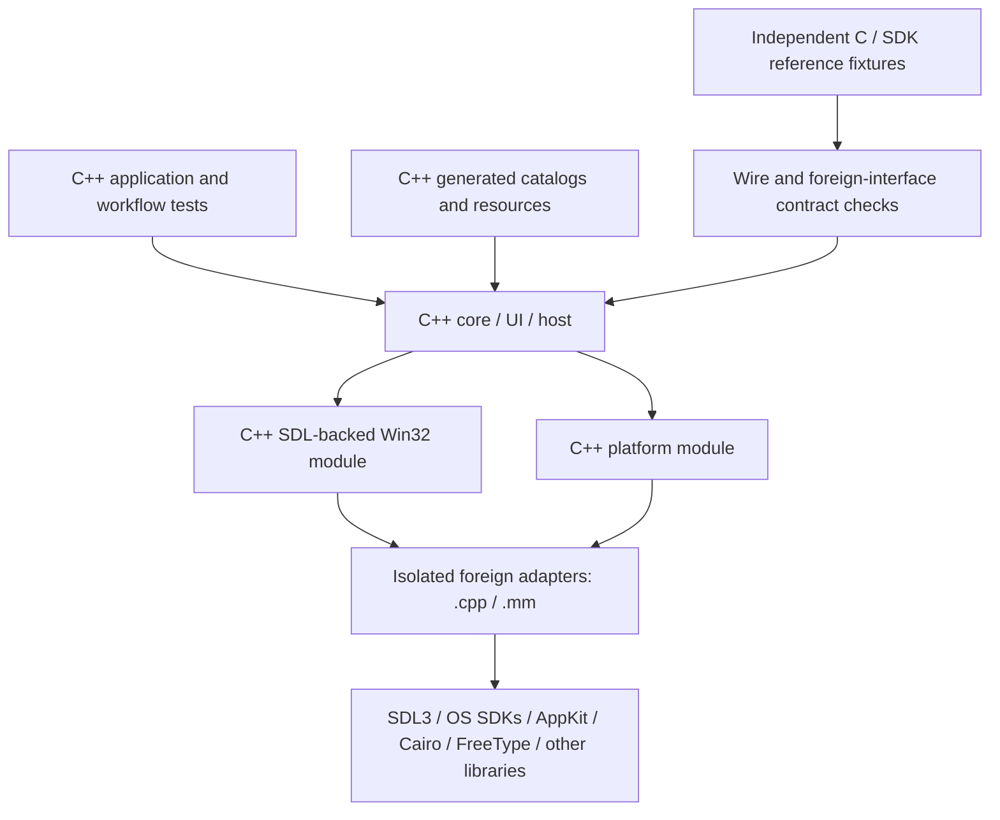

# Native C++ application migration

Status: milestone A implemented in [PR #64](https://github.com/madebyjeffrey/sdl-stars/pull/64). Verification evidence is recorded below and in the PR. Milestone B implementation is active in [#65](https://github.com/madebyjeffrey/sdl-stars/issues/65).
Recorded: 2026-10-28.
Inspected: `develop` at `472c70ac7e2b4d2ceace3f06d838feea8a60aa9c`.
Prerequisites: merged PRs [#57](https://github.com/madebyjeffrey/sdl-stars/pull/57),
[#58](https://github.com/madebyjeffrey/sdl-stars/pull/58),
[#59](https://github.com/madebyjeffrey/sdl-stars/pull/59),
[#60](https://github.com/madebyjeffrey/sdl-stars/pull/60), and review fixes
[#61](https://github.com/madebyjeffrey/sdl-stars/pull/61).

## Outcome and scope

The main application will use native C++ interfaces between its core, desktop,
host, platform and SDL-backed Win32 modules. Application-owned headers will no
longer require C linkage blocks or C/C++ compatibility branches. The Win32-style
function names and behavior can remain while their implementation and linkage
become C++.

The complete plan also covers the previously identified obstacles: generated C
data, C test consumers, compiler extensions, packed/variable-length records,
manual memory ownership, callback lifetimes, mutable string interfaces and global
state. These are delivered after or alongside the language conversion in bounded
PRs; they are not prerequisites for every internal interface to use C++.

Two independently useful milestones make completion observable:

- **A — native C++ interfaces:** owned production code builds as C++/Objective-C++,
  ordinary application tests use C++, and owned application headers have no
  `extern "C"` blocks or `__cplusplus` fallback declarations.
- **B — standard C++ storage and ownership:** runtime storage has explicit owners
  and lifetimes, serialized records use explicit codecs, and owned production
  code builds as ISO C++20 with extensions disabled. Legacy state is owned by one
  application/session context, with deterministic initialization and shutdown.

C++20 is the adopted baseline: it provides standard member designated initializers,
`std::span`, and object-lifetime facilities. C array designators still need a
new generator representation. A01 probes the actual toolchains and required library features at configure time.

External libraries can continue to be implemented in C. Their supplied headers
may contain C linkage declarations. Narrow foreign entry/callback thunks may need
C linkage **inside implementation files**; this does not require application
headers to expose a parallel C interface. Native Windows SDK translation units
remain separate from the wrapper's identically named types. The AppKit bridge
becomes Objective-C++ where it shares C++ declarations.

This is an engineering delivery plan, not a new gameplay specification or proof
of refinement. Existing behavior remains owned by [S01 persistence](../spec/S01-game-file-formats.md),
[S03 catalogs](../spec/S03-static-game-data-and-text.md),
[S04 platform](../spec/S04-platform-services.md),
[S05 desktop](../spec/S05-sdl-desktop-implementation.md), and
[S06 state](../spec/S06-shared-game-state.md). The
[managed-library](adr/0001-desktop-managed-libraries.md) and
[UTF-8](adr/0002-utf8-application-text.md) decisions remain in force.

## Observed dependencies

The inventory below records the starting point before milestone A at `5654a47`.
Completed migration evidence is recorded in the milestone A section.

| Starting evidence | Migration implication |
| --- | --- |
| [CMakeLists.txt](../CMakeLists.txt) compiles core/UI/host `.c` files as GNU C++17; encoding, generated tables and most harnesses remain C11. | File extensions do not determine the language. Inspect the actual target/source compilation graph; preserve original filenames initially. |
| [common.h](../src/core/common.h) and [win.h](../src/ui/win.h) place game/UI declarations under broad C linkage. | Move every real C consumer first, then remove the linkage blocks together with dependent declarations and adapters. |
| [enums.h](../src/core/enums.h) and text/data generators retain C integer typedef branches. | The 145 captured storage contracts survive removal of their C declaration branches. |
| [datagen.py](../data/datagen.py) emits member and array designators; the wrapper has four resource generators. | Generate C++-valid definitions with stable values, explicit linkage during transition, and no new dynamic initialization order. |
| [compat/win32/CMakeLists.txt](../compat/win32/CMakeLists.txt) builds the wrapper mostly as C11, with platform-specific C/Objective-C translation units. | Convert its implementation in groups while keeping mixed-language calls safe. Preserve symbol namespacing and SDK include isolation. |
| [memory.c](../compat/win32/src/memory.c), [profile.c](../compat/win32/src/profile.c), [file.c](../compat/win32/src/file.c), and the picker use C atomics/thread-local state. | Replace these with C++ atomics and `thread_local`; preserve lock coverage, error state and callback ordering. |
| [callback.cpp](../compat/win32/src/callback.cpp), [message.c](../compat/win32/src/message.c), and [exception_callbacks.cpp](../tests/compat/exception_callbacks.cpp) contain/deliver callback failures. | Retain cleanup-before-delivery, including the unowned timer/window modal-pump cases fixed in #61. |
| [structs.h](../src/core/structs.h) and [wincompat_structs.h](../compat/win32/include/wincompat_structs.h) use packing, anonymous aggregates and zero-length tails. | Separate wire/resource layouts from runtime storage before replacing their representation or disabling extensions. |
| [memory.c](../src/core/memory.c) supplies bulk-reset heaps, movable allocations and borrowed pointers; [globals.c](../src/core/globals.c) owns shared state. | Document pointer invalidation and initialization policies before adding typed owners or a state context. |
| [test-redirect.cmake](../cmake/test-redirect.cmake), SDK comparisons, the 27 source-witness programs, and the archived tutorial observer depend on current declarations/source shapes. | Migrate tests and tooling with their consumers, preserve independent evidence, and update observer/parser dependencies in the same PR as their inputs. |

## Delivery and merge rules

This planning PR targets `develop`; the prerequisite stack has already merged.
Implementation PRs use the `codex/` prefix. The first targets `develop`; an
unmerged dependent PR targets its predecessor. Merge in the listed order,
retargeting/rebasing each dependent PR onto `develop` after its predecessor lands.
A squash merge requires particular care to avoid replaying previous changes.

The A IDs below are checkpoints in the single implementation PR requested by the user.
The B IDs describe proposed future PR slots.
Each PR contains a working implementation, evidence, risks and rollback notes;
there are no empty placeholder PRs. A row listing several record families is a
repeatable slot: create a separate PR for each family when it cannot be reviewed
and reverted independently. Do not enlarge a PR merely to keep the total count.

Track implementation work in GitHub Issues using the repository
[issue-tracker instructions](agents/issue-tracker.md); link each implementation
PR to its ticket and predecessor. Create the tickets as work is scheduled; this
planning PR supplies a concrete document change rather than placeholder requests.

Keep language/linkage changes separate from ownership changes and gameplay fixes.
Preserve debug-symbol names and source filenames. A rename, if useful later,
gets its own tooling-aware change. Update agent/build instructions only when a
PR actually changes the policy they describe. Mark completed slots and link their
PRs here as implementation proceeds.

## Milestone A: remove application-owned C interfaces

A01–A13 are implemented as checkpoints in one PR, as requested on 2026-10-28.
Focused commits separate compiler policy, generators, consumers, wrapper groups
and final declaration cleanup. Milestone B remains outside this PR.

| Checkpoint | Bounded scope | Additional completion evidence |
| --- | --- | --- |
| **A01 — compiler policy and consumer inventory** | Adopt a tested C++20 baseline for owned C++ targets, retaining extensions temporarily. Add a manifest of every owned C/Objective-C consumer, linkage declaration and foreign exception; add C++ compiler feature/float checks. | Linux, macOS and Windows compiler probes pass. Host still builds without SDL. Configure ordinary tests, SDK reference tests, both, and neither on supported platforms; preserve #61's registration fix. |
| **A02 — C++ game catalogs and text** | Make `text/textgen.py` and `data/datagen.py` emit C++ translation units. Replace C array designators and produce correctly typed enum/flag initializers. | Compare every ID and canonical table field, compressed text bytes and required reserved zeros against the pre-change generator. Require static initialization (`constinit` or an equivalent checked guarantee); no cross-unit initialization-order dependency. |
| **A03 — C++ unit/workflow harnesses** | Convert ordinary game, compatibility and application workflow harnesses plus their private adapters to C++. Keep test isolation and real-function delegation. | Same cases pass on all platforms, including Windows process isolation. Use target-specific source wrappers where a file also serves an independent C SDK reference test; do not globally change that reference test's language. |
| **A04 — C++ simulation witnesses** | Port source-witness callers for production, research, construction, colony/mining and related rules to compiled C++ at the real implementation's test seams. | Preserve original vector domains, exclusions, assertions and independent expected results. Keep existing Dafny definitions/proofs; do not replace them with implementation-derived expectations. |
| **A05 — C++ workflow witnesses and frozen references** | Port remaining preferences, library, wizard/editor and transport witness callers. Detach intentional C reference fixtures from application headers. | Account for all 27 witness programs. Keep frozen integer/wire expectations independent of the new implementation; avoid expanding regex-based C++-to-C rewriting. |
| **A06 — C++ platform implementation** | Compile encoding and remaining platform implementation as C++. Keep filesystem, clock, formatting and error behavior unchanged. | UTF-8, path, formatting, sort, memory/error and file-publication contracts pass. Remaining C wrapper callers use explicitly tracked temporary C declarations until A13. |
| **A07 — C++ wrapper foundation** | Convert rectangle/time/system/string helpers, memory handles, files, profiles and document/audio helpers. Replace C atomics/thread-local syntax. | Preserve handle/token validation, sharing, private temporary modes, replacement, last-error behavior and lock coverage. No exception escapes into an unconverted C caller. |
| **A08 — C++ drawing implementation** | Convert drawing, bitmap/image, font and print modules without changing ownership yet. | Drawing/selection/DIB/font tests, scale/retina checks, PDF publication and print-abort/error tests pass. Preserve borrowed versus owned GDI objects. |
| **A09 — C++ controls** | Convert edit/list/combo/toolbar/scroll/menu/accelerator modules. | Reentrant notification, mutation, focus, capture, popup and destruction tests pass; preserve message order and synchronous notifications. |
| **A10 — C++ window/dispatch/dialog implementation** | Convert window, message, dialog/template, input, timer, inspector, session and help modules. | Nested modal cleanup, owner re-enabling, timer/window failures without a modal owner, deferred destruction and runtime restart remain correct. Keep the existing pending-failure protocol during this compilation step. |
| **A11 — C++ wrapper assets and native adapters** | Convert resource-generator outputs and the application entry adapter. Convert paired Windows/portal bridge callers and implementations to C++; compile AppKit glue as Objective-C++. | Preserve resource IDs/bytes, command-line handling, cancellation, native chooser pumping and SDK/wrapper type isolation. Foreign callback/entry thunks contain all exceptions. SDK reference fixtures remain independent. |
| **A12 — C++ header hygiene** | Make public headers self-contained; remove owned `min`/`max` macros and C spelling shims, using explicit typed operations and native C++ spellings. | Compile standard C++ headers both before and after each application-facing header. Preserve operand conversions and evaluation counts, including side-effecting calls; do not blindly replace a reevaluating macro with a once-evaluated function. |
| **A13 — native C++ declarations** | Remove broad C linkage and C fallback branches from core/UI/platform/wrapper headers, generated enum declarations and ordinary test declarations. Remove temporary mixed-language declarations and the application entry's C-linkage dependency. | The A exit gate below passes. All owned production translation units are C++/Objective-C++; every remaining C source/linkage entry has a real foreign or independent-reference purpose. |

### Implementation evidence

Ticket #63 tracks [PR #64](https://github.com/madebyjeffrey/sdl-stars/pull/64),
which is ready for review. All A01–A13 code changes are implemented.
Local qualification includes C++20 SDL Debug/Release and SDL-free host builds,
85 independently compiled public headers in both standard-library include orders,
56 generated catalog arrays (112,780 bytes) matched to pre-conversion hashes,
unchanged wrapper resource bytes/descriptors, all 27 C++ source witnesses,
145 enum storage contracts and 259 frozen C/current C++ layout/prefix checks.
Full regression and supported-platform CI results are recorded in the PR.
The available tutorial checkpoints remain partial coverage of the 80-page tutorial.

### Witness migration ledger

A04 owns these 17 programs under `tests/spec/` (all names end in `_source.py`):
`check_colony_capabilities`, `check_construction_buildability`,
`check_construction_effects`, `check_design_buildability`, `check_host_production`,
`check_host_research`, `check_mass_driver`, `check_mining`, `check_native_colony`,
`check_part_availability`, `check_production_builder`, `check_production_cost`,
`check_production_forecast`, `check_production_lifecycle`, `check_research`,
`check_restoration`, and `check_terraform`.

A05 owns the remaining 10: `check_library_publication`, `check_planet_editor`,
`check_production_editor`, `check_production_presets`, `check_s02_io`,
`check_s02_presets`, `check_s02_save`, `check_s02`, `check_s02_state`, and
`check_transport_presets`. Their shared extraction helpers and any generated
expectation inputs move with their callers. A04 and A05 may each use several
family PRs; every program keeps its own positive/negative vectors and coverage
limits.

### Mixed-language transition rules

During A06–A11, private helpers called from both languages need consistent linkage
on both declarations and definitions. Track the temporary mixed-language seam in
one inventory and remove it in A13. Do not build permanent duplicate C/C++
interfaces for hypothetical future consumers.

Compilation conversion preserves existing allocation/error behavior first.
Native C++ linkage does not itself replace existing `FALSE`/`NULL`/last-error
contracts with exceptions; any such interface change needs its own behavior
and failure evidence.
Introducing allocating containers while callers are still C requires explicit
exception containment at that call seam. Replacing `malloc` with throwing `new`
without containment is not a compilation-only change. The existing file module
already contains exceptions for its C consumers; preserve that guarantee until
its last real C consumer has moved.

Generated C++ definitions must retain external linkage where declarations require
it: namespace-scope `const` has different default linkage from C. Shared enum
initializers, union members and array entries need deliberate typed generation.
Test the resulting values and storage, not merely whether the source compiles.

The C/C++ enum ABI and layout programs remain until their consumers have migrated.
Before removing application C declarations, move their historical C inputs into
independent reference fixtures. Retain the 145 underlying-type/bit-pattern
contracts and the frozen wire layouts. Retire temporary cross-C function probes
only when their production purpose is gone, replacing them with the appropriate
C++ storage checks. Genuine foreign interfaces keep actual ABI tests.

### A exit gate

1. A production compilation manifest reports no owned C/Objective-C translation
   units; Objective-C++ and external dependency sources are classified explicitly.
2. Owned application-facing headers contain neither C linkage blocks nor C/C++
   fallback branches. Compile each public header as C++ without relying on an
   accidental include order; exercise C++ library types/templates at the interfaces.
3. A linkage audit allows C linkage only for named, genuine foreign entry/callback
   adapters in implementation files and independent reference tests. Moving an
   `extern "C"` block into a differently named macro does not meet this gate.
4. `common.h`, `win.h`, enum/catalog headers, platform headers and wrapper headers
   are native C++ interfaces. Their functions can retain the original names and
   Win32-style shapes.
5. Third-party C headers, the real OS SDKs and isolated C reference fixtures are
   permitted. They cannot require the main headers to become C-compatible again.
6. All verification below passes; this milestone does not claim that manual
   heaps, packed layouts, globals or GNU extensions have already been removed.

## Milestone B: ownership, records and standard C++

B01–B14 are being implemented as focused checkpoints in one PR, as requested on
2026-10-29, following merged milestone A (#64). Their changes preserve the same
external behavior and file contract. The [implementation ledger](CPP-B-IMPLEMENTATION.md)
records active/completed checkpoints and measured evidence; pending rows remain
in scope until the final strict C++20 gate passes.

| Checkpoint | Bounded scope | Additional completion evidence |
| --- | --- | --- |
| **B01 — private desktop resource owners** | Add RAII for owned SDL/Cairo/FreeType resources, menu/image/font storage and cleanup scopes. | Borrowed selected objects and cached/shared resources are not double-freed. Destruction, print abort, allocation failure and shutdown/restart tests pass. |
| **B02 — dispatch and callback lifetime guards** | Use C++ guards for locks, dispatch depth, modal owner state and deferred window/control destruction. Simplify internal exception delivery only where all frames are C++. | Fault tests prove cleanup order, nested/reentrant destruction, unowned callback delivery, no post-failure commands and no hung modal pumps. Foreign C callbacks still catch exceptions before returning. |
| **B03 — const-correct strings and buffer views** | Remove casts from string literals and separate borrowed text, mutable text buffers and binary buffers. Introduce call-scoped `string_view`/`span` where their lifetime is known. | UTF-8 byte limits, complete-code-point truncation and NUL requirements remain intact. Do not retain views across heap resets, reallocations, callbacks or reused compressed-text buffers. |
| **B04 — explicit record codecs and ownership inventory** | Inventory every `ReadRt`/`WriteRt`/raw resource access, fixed prefix, bitfield encoding, tail length and alias. Introduce checked byte readers/writers and one representative family. | Golden wire vectors cover exact defined bytes, endian/bit ordering, lengths, sentinels and existing malformed-input behavior. No implicit struct dump or native pointer serialization enters a new codec. |
| **B05 — production payloads** | Replace production-list zero-length tails with explicit storage/views and preserve their heap lifetime. | Queue order, capacities, partial production, allocation failure and forecast/host results match. |
| **B06 — waypoint/order payloads** | Replace order-list tails and casts with explicit storage/views. | Replay, transport presets, waypoint edits, growth/reallocation and failure receipts match. |
| **B07 — hull/ship-design payloads** | Separate variable hull slots/design storage from wire prefixes. | Hull/part IDs, slot strides, design import/export and fixed serialized widths match. |
| **B08 — fleet and identifier payloads** | Replace zero-prefix fleet-ID views and related variable record overlays. | Split/merge ordering, ID iteration, record prefixes and file bytes match; do not substitute C++ minimum object size for a wire length. |
| **B09 — battle/AI payloads** | Replace battle/token tails and related heap views in independently reviewable record-family PRs. | Battle/replay, AI traversal, RNG consumption, rounded values and original tie ordering match; preserve battle-specific alignment requirements. |
| **B10 — message/log payloads** | Replace variable message/log overlays and their borrowed-buffer lifetimes in family PRs. | Compression/encryption/framing, argument widths, message order, replay and incomplete-record behavior match. |
| **B11 — remaining packed layouts** | Finish fixed entity-record and wrapper resource/DIB/icon codecs; replace anonymous aggregate overlays. Use one PR per independently encoded family. | Account for every packing directive, zero-length tail and alias in the inventory. Keep SDK-defined foreign layouts inside their SDK adapter. Production record correctness no longer depends on compiler packing or native bitfield layout. |
| **B12 — typed game arenas and cleanup** | Add typed allocation/lifetime operations and owners for the remaining game heaps; scope cleanup without jumps across constructed objects. | Preserve address stability, pointer/stride-derived identity, alias invalidation, bulk-reset semantics, initialization policy, free-list/capacity limits and failure behavior. Do not replace stable pooled addresses with reallocating containers without changing their users in the same PR. |
| **B13 — application/session state owner** | Introduce one explicit owner for game, RNG, heaps, stream/session state and the corresponding UI lifetime. Move legacy globals incrementally, preserving original field/debug names and temporary accessors. | One source of truth; deterministic creation/reset/shutdown; callbacks/timers stop before referenced state is destroyed. Update the archived tutorial observer/parser with any affected globals/signatures/layouts. Multiple simultaneous games or new concurrency are separate features. |
| **B14 — strict C++20 gate** | Disable extensions for owned production targets, enable strict diagnostics and remove migration-only compiler suppressions/shims. | Clean Linux/macOS/Windows production builds with `CXX_EXTENSIONS OFF` and strict diagnostics; standalone headers and the full functional/contract matrix pass, using `-Wpedantic -Werror` or compiler-equivalent enforcement. Any genuine platform ABI exception is named and isolated, not enabled project-wide. |

Cleanup destructors must be non-throwing and preserve the primary failure.
Callbacks reached during destruction still need containment; moving dispatch to
C++ does not make a second exception during unwinding safe.

On-wire views expose bytes and decode/copy typed values. Do not reinterpret an
unaligned packet or an object whose lifetime has not started as `span<T>`.
Construct aligned runtime objects deliberately, and use integer temporaries at
legacy output-pointer seams instead of aliasing enum objects through integers.

Do not put `std::string`, `std::vector`, ownership pointers or virtual functions
inside a type still serialized by layout. A runtime type can change representation
only after its codec and all direct accesses have moved. Preserve scalar domains
and checked wire widths even when a container's native count is `size_t`.

A codec change must not silently tighten a reader's accepted domain or add
transactional rollback to a workflow whose specified partial effects differ.
Such improvements are separate behavior-change PRs, with the required changelog,
specification evidence and baseline decision.

## Verification and review gate for every implementation PR

Use the root [AGENTS.md](../AGENTS.md) checks, including:

- Platform SDL Debug build and relevant Release build, with no new warnings.
- Full desktop/native regression (`make regression`), unit programs
  (`make test-unit`), and available tutorial checkpoints (`make tutorial`).
- Full host regression and host unit programs (`make regression-host`,
  `make test-host`) for game/shared-interface changes. The host remains SDL-free.
- The full CTest contract/workflow suite, beyond the unit-only Make target.
  Include enum/storage/layout/file contracts, callback faults, UI workflows,
  generator/resource checks, SDK references where supported, and the configure
  combinations introduced by #61.
- All affected source-witness/model comparisons; for the header/witness migration
  and final gates, account for all 27 programs and their existing input domains.
  Keep canonical Dafny proofs and exclusions intact; an extracted or linked test
  is not a proof of whole-program refinement.
- Linux and Windows CI plus local macOS checks; relevant sanitizers and targeted
  allocation/error/reentrancy tests for ownership changes. These focused tests
  supplement the full regression rather than replace it.

At each PR, compare with its parent and the native baseline. Baseline checkpoints
currently comprise 519 files through turn 150 for nine scenarios. The initial
migration recorded 25 accepted unused-storage warnings on macOS; report actual
counts for the new parent/platform, the first unexpected difference and any
skipped inputs. Do not normalize differences away or regenerate either baseline
to make a refactor pass. Frozen original-game fixtures remain untouched.

Keep the 145 enum width/signedness and boundary-bit contracts, the 4,575 constant
values measured for #60, fixed wire offsets/record sizes and table/compressed
payload checks. Evolve the 259-measurement C/C++ layout test deliberately when
runtime types become separate from wire types: retain independent frozen wire
expectations and codec vectors, and demonstrate that a removed runtime layout
comparison no longer represented serialized storage. A shorter test is not
itself evidence of preserved coverage.

Each PR description records its scope, actual verification, remaining limits,
first-difference evidence if needed, affected source-reading tools and rollback.
Review constants, scalar widths, pointer ownership, ordering, exception delivery,
foreign linkage and stale migration documentation before marking it ready.

## Scope limits and rollback

This plan preserves format 2.85, UTF-8 rules, native baseline behavior, catalog
numbering, RNG order, `qsort16` tie order and binary64 operation boundaries. It
adds no new sorting algorithm, formatting grammar, validation policy, public
Rust/DLL interface, UI redesign or multi-game/concurrency feature. Standard C++
free functions and Win32-style names are compatible with the goal; an object
hierarchy is not required for every operation.

Every implementation PR is revertible on its own parent, with dependent PRs
rebased or reverted in reverse order. No irreversible file conversion is planned.
Keep a working host and desktop between steps. If a test or platform cannot
qualify a step, retain its old implementation and record the concrete gap before
proceeding with dependent changes.

## Planning evidence

The inspected revision includes the four completed migration PRs and #61's
callback/configuration fixes. Their recorded checks establish the starting
contracts, not completion of this plan. Implementation slots above remain
proposed until linked code and measured evidence are recorded here. This plan
changes documentation only; it does not claim new gameplay rules or new formal
proofs. Planning-PR validation results belong in its PR description.
