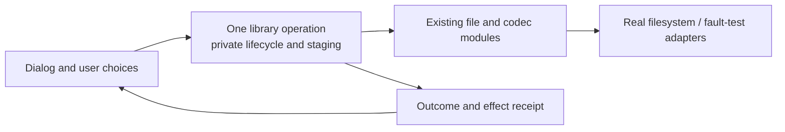

# Prospective Milestone D: modular design and selective object orientation

Status: analysis and recommendations, not an approved implementation plan.
Recorded: 2026-10-29. No GitHub milestone/issue is created by this assessment.

The later [Milestone D plan](CPP-MILESTONE-D.md) selects a narrower SDL Win32
file-selection interface as its first C++ module pilot. The broader domain and
object-orientation candidates below remain prospective analysis, not D scope.

## Recommendation

An application-wide object-oriented rewrite is premature. A bounded effort to
improve module interfaces and selectively encapsulate state would be worthwhile
after B and C. The recommended D theme is **modular design and domain
encapsulation**, with one small composition-based object-oriented pilot and an
explicit decision about whether to continue.

There is a credible path toward more object-oriented code: identify an invariant
or lifecycle, put its representation behind a small interface, migrate real
callers and test observable outcomes. Apply it to workflow owners before
redesigning fleets, planets and ships. Some calculations should remain free
functions over explicit values; some orchestration should remain procedural.

The purpose is to make changes easier to understand and verify. A higher class
count, fewer free functions, or matching every domain noun to a class would not
establish that improvement.

## Evidence and limits

The chat checkout remains `codex/traceability-views` at `e3222eb`, with substantial
local specification work. C is planned in [CPP-MILESTONE-C.md](CPP-MILESTONE-C.md)
and tracked by [#67](https://github.com/madebyjeffrey/sdl-stars/issues/67).
B is still active in its separate worktree. Code inspection used its committed
snapshot `aa8bc13119b73d57c7ef1279a2c3cc2059e1404d`; a supplementary inspection
used `3d361cc584e629e6eaad91d65f518b333acb8cdb`. The relevant game/library
examples were unchanged in those inspections. B continued advancing during the
assessment; its live ledger is not a frozen result.

Implementation links below point to the active B worktree for convenient
navigation. For exact historical evidence use `git show <snapshot>:<path>`.
The root specifications and known-bug notes include local uncommitted evidence;
their logical types are not automatically implemented or approved interfaces.
All D candidates must be revalidated against the final merged B/C result.

This is static inspection, not a new correctness, performance, security or
whole-program refinement claim. No runtime benchmarks, regression runs or
prototype implementation were performed for this assessment.

## What B and C should settle first

B already owns storage/serialization separation, typed lifetime management,
callback cleanup and application/session ownership. C owns honest source
extensions, explicit callback/test/state seams, linked witnesses, namespaces
and deletion of migration scaffolding. D must not rename those obligations as
new architecture work or introduce replacement global-access machinery.

After C, inspect whether one explicit owner still contains essentially all
legacy state. Ownership answers who creates and destroys state; it does not by
itself establish who may mutate it or which operations preserve its invariants.
That is the useful next design question. Splitting the owner requires evidence
about actual reads, writes, borrowing and teardown, rather than a universal
manager class or an assumed domain taxonomy.

Sources: [B migration plan](/Users/jdrake/.codex/worktrees/cpp-file-handling/sdl-stars/docs/CPP-MIGRATION.md),
[B implementation evidence](/Users/jdrake/.codex/worktrees/cpp-file-handling/sdl-stars/docs/CPP-B-IMPLEMENTATION.md),
[C checkpoints](CPP-MILESTONE-C.md#checkpoints-and-dependency-order).

## Choosing the right design tool

A module has an interface and an implementation. Its interface includes
invariants, ordering, failures and lifetimes as well as parameters. A deep module
hides substantial complexity behind a small interface; its value is better
locality for maintainers and less knowledge required of callers.

| Need | Suitable starting form | Evidence required before adding more machinery |
| --- | --- | --- |
| Related independent values | Plain value struct, optionally typed IDs/units | Meaning and conversions are explicit; no invented invariant. |
| Deterministic calculation | Free function with explicit input/result values | Arithmetic, rounding and RNG/effect dependencies accounted for. |
| State with a persistent invariant | Concrete class with private representation | Public operations preserve a named invariant that callers previously maintained. |
| Owned resource or multi-step operation | Small move-only owner/operation object | Clear transfer, failure, cancellation and destruction policy. |
| Ordered game resolution | Explicit functions and an operation context | Phase/effect order preserved; no unsupported parallelism or rollback. |
| Actual interchangeable behavior | Typed adapter at a seam; dynamic dispatch only if needed | Real alternatives, their lifetimes and calling contracts, not hypothetical extensibility. |

Object orientation does not require inheritance. A class that owns an import
operation can compose filesystem operations and decoded values. Conversely,
moving a free function into a class while leaving all dependencies global does
not deepen its module. Replacing public fields with trivial getters/setters
usually leaves callers responsible for the same ordering and invariants.

These recommendations agree with the C++ Core Guidelines' distinction between
independent data and invariant-bearing classes (C.2), representation-dependent
member functions (C.4), and genuinely hierarchical concepts (C.120). They are
design guidance, not an instruction to turn every existing struct into a class.
Source: [C++ Core Guidelines](https://isocpp.github.io/CppCoreGuidelines/CppCoreGuidelines#S-class).

## Ranked candidates

| Candidate | Assessment after C | Main improvement | Risk / prerequisite |
| --- | --- | --- | --- |
| Managed-library staged save/import operation | Best initial product-facing OO pilot | Encapsulate staging ownership, publication progress, cleanup and outcome receipts; keep UI choices outside. | Medium: preserve operation-specific partial effects and file identity rules. |
| Race edit session and version/save decision | Good next candidate | Own draft/binding lifetime; separate version/equality rules from dialogs and effects. | Medium: preserve credentials, cancellation and existing-path behavior. |
| Print job lifecycle | Smaller technical pilot if library work remains too coupled | Hide active/aborted/published state behind existing resource ownership. | Lower relative scope, but reentrant printing and publication still need faults. B may already leave little additional value. |
| Production/waypoint draft and queue operations | Promising after storage work settles | Enforce runtime bounds and mutation ordering in one place. | Medium/high: do not invent queue limits or silently repair wrapping behavior. |
| Production, research and colony calculations | Improve interfaces first; OO optional | Explicit inputs, results, effect receipts and shared calculation definitions. | Existing effects and numerical contracts must remain visible. |
| Application/session decomposition | Reassess B13/C08 before choosing a slice | Group state by real responsibility and lifetime. | High if it becomes a single class owning every game method. |
| Planet/Fleet/Ship hierarchy or polymorphic turn phases | Defer | No demonstrated gain yet over values, explicit queries and sequential resolution. | Broad identity, knowledge, order, storage and tooling implications. |

The ranking is a design judgment from inspected dependencies, not a measured
performance ranking or fixed implementation order for all future work.

## Best pilot: one library operation, not a library framework

`libraryui.c` combines dialogs, current selection, paths, metadata, copying,
staging, publication and race binding. Its file-static fields include pending
library paths, current race identity, list allocation and Continue state.
`FSaveLibraryRace` creates staging storage, writes records/checksum, closes the
stream, replaces the destination, cleans up and binds the saved race.
`FImportLibraryGame` additionally combines family inspection, ZIP staging and
name selection. These are real lifecycle obligations callers must coordinate.

A first slice could isolate staged race-save/publication behind an operation
object. It would own only its temporary resources and progress, use existing
file/codec operations, and return a precise outcome. The UI would retain
questions and presentation; race/game-library identity policies would remain
distinct. Preserve original function names at established callers where useful.
After one successful slice, evaluate game import or another operation rather
than immediately extracting all of `libraryui.c`.

The proposed object must hide lifecycle knowledge. If callers still manipulate
its stage paths and flags or must invoke a long undocumented sequence of methods,
it has only moved the old globals. A single end-to-end operation may be a better
interface than exposing every internal step. Do not add a universal repository
base class or filesystem abstraction when C's existing typed seams suffice.

Crucially, do not promise automatic rollback, atomicity or stronger durability.
For example the inspected `FSaveLibraryRace` decides success from replacement
after `StreamClose`; a new destructor/commit policy that treats every close or
cleanup warning as failure changes behavior. Cleanup is not the same as
publication. Asynchronous folder chooser callbacks also have a different lifetime
from the operation that ultimately publishes files; borrowed UI state must not
escape its lifetime through a newly created object.

Sources: [library state](/Users/jdrake/.codex/worktrees/cpp-file-handling/sdl-stars/src/ui/libraryui.c:9),
[staged race save](/Users/jdrake/.codex/worktrees/cpp-file-handling/sdl-stars/src/ui/libraryui.c:614),
[game import](/Users/jdrake/.codex/worktrees/cpp-file-handling/sdl-stars/src/ui/libraryui.c:2058),
[M01 operation contracts](../spec/M01-game-library.md),
[M02 race save](../spec/M02-native-state-and-save.md),
[accepted library decision](adr/0001-desktop-managed-libraries.md).

## Other useful object shapes

**Race edit session.** `SaveRaceState`/`RestoreRaceState` copy and restore the
draft player, password, filename, path and new-design flag. Save-choice code
mixes version discovery, equality, credentials, dialog choices and publication.
Compose a draft value, a version/save-choice calculation and an effectful save
operation. An edit-session owner can enforce the binding/cancellation lifecycle;
the calculation need not become a method. Preserve the distinction between a
race's stored name, library filename, saved revision and game-player identity.

**Print job.** `COMPATPRINT` already has a destructor and typed file/Cairo owners.
This shows that B introduces useful class behavior without a game-wide OO design.
A further step could encapsulate its state transitions if callers still manage
active/keep/temp-file flags. Keep the existing Win32-facing functions as adapters.
If B/C already make those obligations local, leave this module alone.

**Draft queues and identities.** After B's codecs and arenas, a concrete draft
owner could centralize queue length/capacity and editor invalidation. Stronger
runtime ID types could prevent confusing a player, planet, design slot or library
copy, but exact scoped identity and sentinel conversions must be established
first. Do not force broader validated domains onto legacy-loaded values. These
improvements can be valuable without an entity hierarchy.

Sources: [race snapshot/restore](/Users/jdrake/.codex/worktrees/cpp-file-handling/sdl-stars/src/ui/libraryui.c:65),
[wizard control](/Users/jdrake/.codex/worktrees/cpp-file-handling/sdl-stars/src/ui/raceui.c:4),
[print owner](/Users/jdrake/.codex/worktrees/cpp-file-handling/sdl-stars/compat/win32/src/print.c:13),
[shared identity/knowledge specification](../spec/S06-shared-game-state.md).

## Where other improvements should precede OO

### Expose calculation effects before creating engine classes

`EstimateItemProdSched` copies a planet/queue, but calls
`EstMineralsMined(..., TRUE)`, `CBuildProdItem` and `ChgPopFromPlanet(..., TRUE)`.
Its callees can inherit generation/RNG context, touch live fleet flags and emit
messages. An object named forecast engine would still have those dependencies.

First characterize and expose the inputs/effects of the actual algorithm. Keep
operation order and observable effects unchanged. A later proposal to make
forecasting genuinely isolated must be a separate intentional behavior change,
with its own specification/changelog/baseline decision. The known-bug notes
describe source mechanisms and coverage limits, not complete player-facing
reproduction or authorization to repair them.

Likewise `FCanMerge(FLEET *pfl)` checks candidates against `sel.fl.pt`, while
`FCanSplit` reads `idPlayer`. Putting these functions on a Fleet class would
hide session/selection dependencies behind a misleading receiver. An explicit
query input is the more immediate improvement; do not silently substitute
`pfl->pt` for the current selection and call it a refactor.

Sources: [forecast](/Users/jdrake/.codex/worktrees/cpp-file-handling/sdl-stars/src/core/produce.c:449),
[fleet queries](/Users/jdrake/.codex/worktrees/cpp-file-handling/sdl-stars/src/core/ship.c:3),
[forecast effect contracts](../spec/M09-production-forecast.md),
[known source mechanisms](KNOWN-BUGS.md#forecast-helper-side-effects--located-on-main).

### Resolve local correctness and qualification gaps

The current notes identify habitat hit-test out-of-bounds access, production
sanitization overlap/cursor behavior, queue-capacity wrapping and Genesis stock
write-back questions. Revalidate each against final B/C before work on its
module. Undefined behavior cannot be a behavior-preservation oracle. Affected
domains need bounded characterization and a separately justified repair or an
explicit exclusion before a neutral pilot can claim equivalence there. This
does not require repairing every unrelated bug before any design improvement.

Full SDL tutorial coverage and some real-desktop/hardware evidence remain
incomplete in the inspected documentation. Prioritize coverage for the chosen
operation's actual UI/cancel/failure paths. Avoid replacing a broad missing
workflow test with numerous tests of new private methods.

Sources: [known bugs and evidence limits](KNOWN-BUGS.md),
[gameplay qualification](GAMEPLAY-QUALIFICATION.md),
[roadmap](ROADMAP.md), [specification coverage](../spec/README.md).

### Improve compile-time seams and measurements

`common.h` aggregates most game declarations, including globals; `win.h`
aggregates UI declarations. A namespace or class conversion alone does not
reduce that visibility. Once C's linked tests exist, define a focused header and
build dependency for the pilot so tests and callers need only its interface.
Use the established core/UI/platform split; avoid adding a new layer of
pass-through classes over unchanged global functions.

Measure build/test setup, direct mutable-state dependencies and caller ordering
obligations for the selected slice before and after. For performance work, first
profile real host turns and library/UI workflows on declared corpora. Do not
assume virtual dispatch, new containers, per-entity heap allocation or a different
layout will improve speed; none was benchmarked here. Keep storage and hot-loop
changes independent from the pilot unless essential to its invariant.

Source: [aggregate game declarations](/Users/jdrake/.codex/worktrees/cpp-file-handling/sdl-stars/src/core/common.h:38).

## Why entity inheritance should wait

The shared-state specification distinguishes authoritative host state from
partial, stale and estimated player knowledge. Missing information is not zero,
and full-host invariants cannot simply be applied to partial views. A colony is
owned planetary state rather than necessarily a separately identified entity.
Fleet identity, owner-scoped design slots and library-copy identity also have
different scopes and reuse rules.

These distinctions make a universal Planet/Fleet/Ship object graph an uncertain
starting point. Inheritance would not by itself resolve knowledge, identity,
ownership, persistence or cross-entity rules. Retain explicit runtime values and
codecs; choose richer objects only where actual operations justify them. Any new
private representation must stay out of fixed wire layouts and must preserve
arena/handle stability. Virtual functions must not become part of persisted
record types.

Turn generation is similarly order-sensitive. `FGenerateTurn` and `Produce`
sequence shared state, RNG, mining, research, construction and messages. An
operation object can own phase-local state, progress and cleanup while phase
functions remain explicit. A polymorphic phase pipeline, observer bus or
parallel scheduler would enlarge the interface and ordering obligations without
a demonstrated requirement. Keep those as separate future design questions.

Sources: [S06 knowledge and identity](../spec/S06-shared-game-state.md),
[turn schedule](../spec/M18-turn-generation.md),
[turn implementation](/Users/jdrake/.codex/worktrees/cpp-file-handling/sdl-stars/src/core/turn.c:25),
[production resolution](/Users/jdrake/.codex/worktrees/cpp-file-handling/sdl-stars/src/core/turn2.c:23).

## Possible D structure and decision points

This is a suggested sequence for a future plan, not scheduled implementation:

1. **Reassess after C.** Pin its final revision, inventory remaining mutable
   dependencies and qualification gaps, and choose a concrete maintenance or
   feature change the new interface should make easier.
2. **Choose one slice.** Prefer staged library save/publication; use the smaller
   print lifecycle only if a real residual invariant remains after B/C. Describe
   ownership, inputs/results, effects, callbacks and failure receipts.
3. **Compare two concrete interfaces.** Evaluate a plain explicit context plus
   free functions against a concrete owner class with composition. Compare caller
   knowledge, invariant enforcement, test setup and migration cost. No need to
   build both entire implementations or assume the class must win.
4. **Implement and qualify one pilot, if justified.** Migrate real callers and
   tests through the same interface, retire the replaced implementation and keep
   frozen independent evidence. Do not combine fixes or gameplay changes.
5. **Decide whether to expand.** Continue only if complexity has become local,
   meaningful operations are tested through a smaller interface, and callers
   have fewer ordering/ownership obligations. Otherwise retain the simpler
   function-based design and spend the next effort on the identified prerequisites.

Before a pilot, require a stable post-C implementation, known lifetime/codec
contracts, linked actual-module tests and characterized success/cancel/failure
behavior. Require real variant implementations before adding interchangeable
adapter abstractions; a single concrete operation object does not need an
abstract base class. Preserve debug-symbol names and update source-reading
tools/observers with any interface changes.

Qualify a neutral pilot under repository policy: SDL Debug/relevant Release,
full native regression, unit/tutorial/CTest workflows and affected witnesses;
game/shared changes also require full host regression and units. Include
Linux/macOS/Windows and relevant fault/sanitizer/reentrancy cases. Report actual
results and first unexpected differences. The baseline remains unchanged.

A D assessment can succeed by demonstrating that a proposed OO transformation
is unnecessary and selecting a better module interface. A whole-codebase
conversion target should wait for successful pilots and a clearer product need.
No new external issue, architecture decision or implementation is authorized by
this analysis alone.
