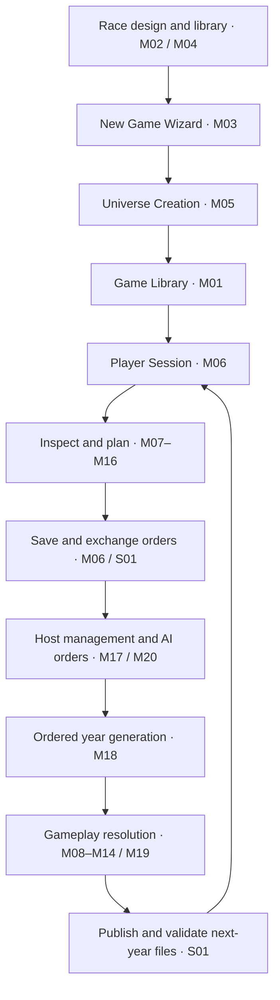
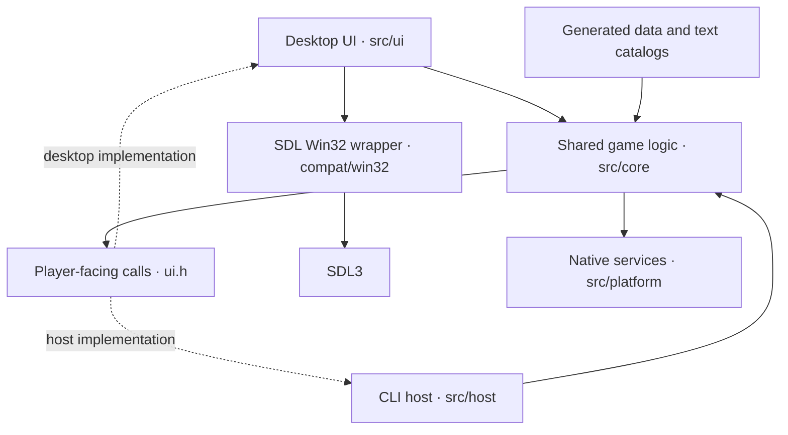
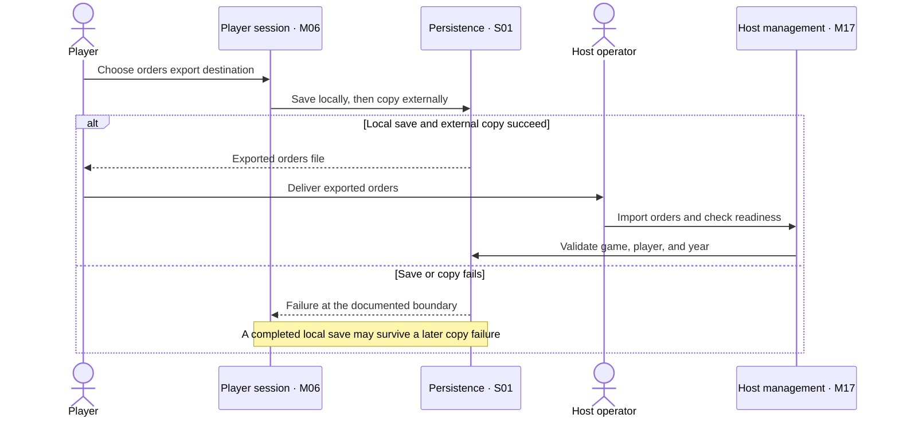
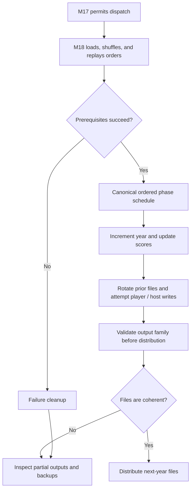

# How the game fits together

These diagrams summarize the existing specification collection. The logical
module ownership is proposed; the implementation layers describe the existing
organization. Follow the linked specifications for conditions and exceptions.

## From race design to the next year

This is a successful-path orientation, not the exact phase schedule or a claim
of atomic saving. Start with [setup](../spec/M03-new-game-wizard.md),
[player sessions](../spec/M06-player-session-and-turn-orders.md), and
[host management](../spec/M17-host-game-management.md).
[M18](../spec/M18-turn-generation.md#ordered-successful-year) owns sequencing;
gameplay modules own their effects and [S01](../spec/S01-game-file-formats.md)
owns persistence. Tutorial/help supports player activity rather than owning
gameplay rules.

## Existing implementation layers

Arrows show calls or supplied data; dotted arrows identify implementations of
the UI contract. The command-line host is independent of SDL. The source map is
the [existing technical organization](../spec/README.md#existing-technical-organization),
with [CMakeLists.txt](../CMakeLists.txt) defining build groups and
[ui.h](../src/core/ui.h) defining the game-to-UI contract.

## Orders exchange crosses several boundaries

Delivery is an external action. Export does not imply submission or host receipt.
The diagram summarizes [M06 export](../spec/M06-player-session-and-turn-orders.md#41-export-orders)
and [M17 readiness](../spec/M17-host-game-management.md). Their entry-specific
failure behavior remains authoritative.

## Generation success needs output validation

Validation before distribution is an operator obligation highlighted by
[M18's publication boundary](../spec/M18-turn-generation.md#publication-failure-and-cancellation),
not an assertion of a new automatic engine check. The top-level success flag
does not establish that every output write succeeded. Cleanup does not provide
general whole-year rollback. The canonical schedule and exact failure boundaries
remain in M18, M17, and S01.
