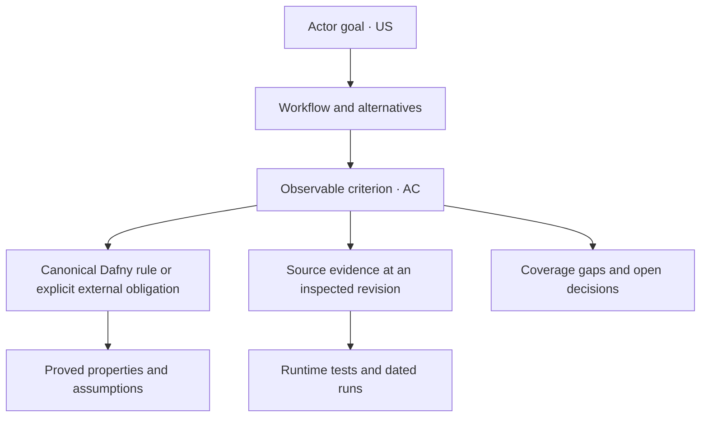

# Reading a specification

Begin with a module's purpose and actors, follow its workflows, then use its
acceptance criteria to reach the canonical rules and evidence. Technical
companions specialize the owning module's contracts.

## Behavior status and evidence answer different questions

| Behavior status | Meaning |
| --- | --- |
| **Observed** | Source behavior at the cited revision, including its limitations. |
| **Proposed** | A desired interface, behavior, or acceptance target. Implementation and approval are separate. |
| **Open** | An unresolved policy, target, or behavior. |

Evidence can include source review, a named model definition, a proved property
with assumptions, a test with a bounded scope, or a dated run. Missing coverage
is recorded explicitly. These conventions come from the
[canonical status definitions](../spec/README.md#requirement-ids-and-status).

An observed workflow may still lack an end-to-end acceptance test. A successful
historical run remains evidence for its recorded revision and environment.

## Follow the trace

This diagram is a reading guide to the collection's traceability conventions.
It does not assert that every criterion already has every kind of evidence.

## Stable references

`M07-US01` identifies a story; `M07-AC01` an acceptance criterion;
`M07-IR01` an interaction requirement; `M07-QR01` a quality requirement.
Technical companions can add a scope, such as `S01-REC-AC01`.

The [generated index](requirements.md) links directly to their existing anchors.
Preserve those IDs when editing, including retired IDs with successor links.

## Logical ownership and implementation

Every module entry has [workflow and state diagrams](diagrams.md) beside its
canonical specification. Their nodes summarize the documented contract rather
than add fields or implementation states. A terminal node ends the illustrated
operation; it does not mean the application or game has ended.

Read cancellation labels literally. Research and battle-plan close handlers
commit edits, while production Next/Back commits before changing colony. A
later Cancel cannot undo earlier accepted operations. Undefined-access nodes
and external recovery boundaries identify limits, not implemented safe failures.
Where no cancellation hook exists, the diagram says so instead of inventing one.

Module boundaries describe coherent goals and responsibilities. They are not
proof that the implementation already has isolated interfaces. The
[system overview](overview.md) separates those logical responsibilities from
the existing core, UI, host, and platform layers.

Use the [glossary](../GLOSSARY.md) for shared vocabulary and the accepted decisions
on [managed libraries](../docs/adr/0001-desktop-managed-libraries.md) and
[UTF-8](../docs/adr/0002-utf8-application-text.md) for their rationale. Follow
explicitly recorded conflicts and open decisions when historical evidence and
current policy differ.
