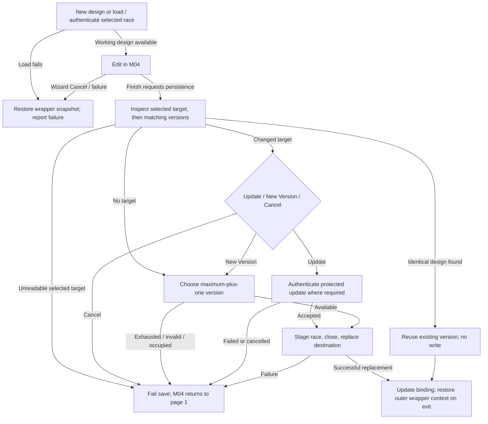
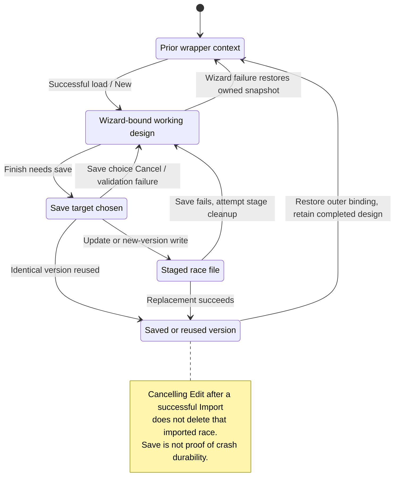
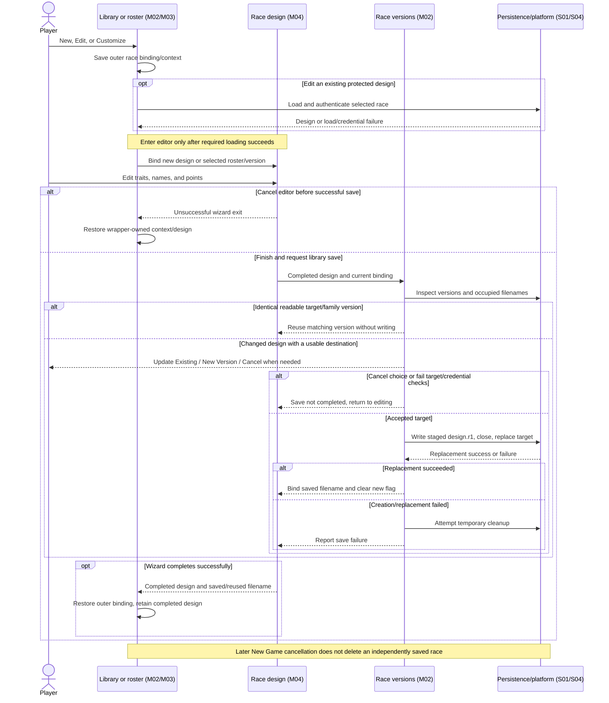

# M02 — Race Library

Status: source-derived specification with explicit policy, adapter and UI gaps.
Inspected: 2026-10-24, `e2eae18cff0f990db20415c1c2262aed2022f95b`, with the
existing local specification collection. Runtime sources are unchanged.
Canonical definitions: [entry point](M02-library-specification.dfy),
[M02Library](dafny/M02-library.dfy), [shared library names](dafny/S01-library-names.dfy).
Verification: [collection run](README.md#m01-and-m02-verification),
[native state/version/save continuation](README.md#m02-native-state-version-and-save-continuation).
The [native companion](M02-native-state-and-save.md) records its newer source
inspection, comparison/snapshot distinction and exact save outcomes.
The [import companion](M02-race-import.md) specifies source/name choice, current/legacy publication and customization wrappers.
The [action companion](M02-race-file-actions.md) specifies Duplicate/Export/Delete outcomes and exact restoration/cleanup frames.
The [allocation companion](M02-race-file-allocation.md) records temporary-name
loops, copy receipts, numbered suggestions and the duplicate-name budget gap.

[Workflow and state diagrams](#workflow-and-state-diagrams) and
[cross-module sequences](#cross-module-sequences) provide visual reading paths.

## 1. Purpose, scope and ownership

Manage reusable race designs independently of player turns: discover designs,
create/edit them, retain versions, import/export, duplicate and delete selected
entries. Follow the [glossary](../GLOSSARY.md) and
[accepted library decision](../docs/adr/0001-desktop-managed-libraries.md).
A numbered `.rN` identifies a race version, not a game player slot. Stored race
name, current library filename and sanitized filename stem are distinct values.

The implementation lives chiefly in [libraryui.c](../src/ui/libraryui.c), with
race loading/conversion in [race.c](../src/core/race.c), wizard/password UI in
[raceui.c](../src/ui/raceui.c), roster handoffs in
[createui.c](../src/ui/createui.c) and title dispatch in
[mdi.c](../src/ui/mdi.c). This specification does not require a source refactor.

| Owner | Handoff |
| --- | --- |
| M02 | Library location/list, current destination binding, version matching/choice, staged save and exchange/removal. |
| [M04](M04-race-design.md) | Race fields, controls, normalization, credentials and advantage pricing. M02 does not redefine design validity or affordability. |
| [M03](M03-new-game-wizard.md) | Selected race filename and roster customization context; successful customization returns the saved filename/design. |
| [M01](M01-game-library.md) | External-open dispatch and the separate game library. |
| [S01](S01-game-file-formats.md) | Race BOF/records/checksum, UTF-8/legacy conversion, bounded parsing and file publication. |
| [S06](S06-shared-game-state.md), S02/S04/S05 | Player-state distinction, settings, native paths/files and controls/pickers. |

No live player progress is versioned here. Rust/SQL race storage in
[M04's data companion](M04-race-data-model.md) remains a proposal; current
versions are ordinary files. Protected legacy race import has an unresolved
root-instruction/ADR conflict, recorded in §3.5 and §7.

## User stories and requirements

Actors are a player building a reusable collection and a player choosing a race
for New Game. Entry requires accessible per-user storage; operations on an
existing design require a selected filename and, where applicable, credentials.
Goals are source/ADR-derived. [Behavior status and evidence](README.md#requirement-ids-and-status)
are separate; Observed does not imply complete UI coverage.

**M02-US01 — Find a reusable design (Observed).** As a player, I want to browse
saved race files so that I can choose a design to edit or use in New Game.
Refresh Race Designs, select an entry and load it. Listing establishes filename/
nonempty-file eligibility; loading can still reject malformed content or fail
authentication. Roster selection remains M03.

**M02-US02 — Create or customize a race (Observed).** As a player, I want New
or roster customization to open the race wizard directly so that I can design
before choosing storage details. Edit through M04 and Finish; derive the library
filename from the completed singular name. Cancel restores the wrapper's saved
race/destination context. Saved designs remain separate from setup cancellation.

**M02-US03 — Reuse, update or retain a version (Observed).** As a player, I want
unchanged designs reused and changed designs offered Update Existing, Save New
Version or Cancel so that I control earlier revisions. Scan versions by stored
race name, identify the actual target, then save through staging. A selected edit
can update its original filename after a name change; a new version uses the
completed name. Authentication, version exhaustion and publication failure have
distinct outcomes.

**M02-US04 — Import a design without changing its source (Observed, with Open legacy policy).**
As a player, I want an external race copied or converted into the library so
that I can reuse it independently. Load/validate, choose a unique filename and
stage/import; external Open then offers editing. Cancelling that edit leaves the
successful import intact. Legacy conversion can require name confirmation and
replacement credentials; the policy conflict is not resolved by this story.

**M02-US05 — Make an independent duplicate (Observed).** As a player, I want
Duplicate to create another saved file so that I can work from a copy. Authenticate
and validate the source, choose the first available numbered suggestion, copy
and revalidate. This operation intentionally bypasses identical-design reuse.
Failure can leave different artifacts depending on its stage.

**M02-US06 — Export a race (Observed).** As a player, I want an ordinary race
file outside the library so that I can share or archive it. Select destination,
authenticate, stage a copy, validate and replace the target. Cancel or failure
preserves the managed source; export retains its stored credential behavior.
It is not a ZIP or an unlocked race conversion.

**M02-US07 — Delete the selected saved version (Observed).** As a player, I want
to remove one named race file after confirmation so that other revisions remain
available. Select Delete, confirm or cancel, then refresh. A failed removal
reports failure; successful removal clears the matching current-path binding.
It does not cascade through other versions or existing games.

## 2. Inputs, outputs and state

| State | Meaning / ownership |
| --- | --- |
| Root | `STARS_LIBRARY_DIR`, else `STARS_SETTINGS_DIR`, else SDL per-user preference root, with `Race Designs` appended. Separate from `Games`. |
| `vplr` / race password / race filename | Working design and credential context consumed by M04 and `FWasRaceFile`. Running-player fields are not a new reusable-race schema. |
| Current library path / new flag | Selected edit destination versus a new race lacking a destination. `FHasCurrentLibraryRace` accepts either state. |
| `RACESTATE` | Complete 192-byte player, password[16], filename cache[16], current path[512] and signed new flag used by wrappers. The separate 256-byte UI filename suggestion is not captured. Restoration choices differ after success and cancellation. |
| Version scan | Maximum occupied/relevant version, latest same-name entry, highest-version identical entry. Enumeration is native and can fail. |
| Staging path | Unique temporary directory plus `design.r1` for save/import; export uses an exclusive sibling temporary file at its destination. |
| Roster filename | M03 owns the filename for each selected library race. Customization must bind that slot, not a previously imported global destination. |

M04 owns the [logical race fields](M04-race-data-model.md). `M02Library.Design`
is a comparison projection: the native `PLAYER` prefix before `szName`, with
`fLearned` cleared, plus singular/plural strings through their terminators.
The adapter must retain every compared prefix field, including credentials.
It is not an alternate serialization layout or a checksum-only identity. Prefix
fields need not all survive a partial-player serialization; S01/M04 own valid
race admission. The [native companion](M02-native-state-and-save.md) maps all
compared ranges and separates them from full snapshot bytes.

## 3. Workflows and rules

### 3.1 Enumerate, load and bind an editor

Sources: `FInitRaceLibrary`, `FEnumerateLibraryRaces`, `EnumLibraryRace`,
`FLoadLibraryRace`, `FReadManagedRace`, `SaveRaceState`, `RestoreRaceState`.
Models: `FListed`, `FVersionReadable`, `RaceState`, `Restore`, `WizardExit`.

List entries need a portable race filename and a positive native file size.
Enumeration does not fully parse each design. Version matching uses the stricter
`FReadManagedRace`: reject directories/links, require a current 2.85 race BOF,
then decode silently without password prompts. It restores saved race context,
file-error mode and file-version state after inspection. For stable current files this avoids browsing-time legacy conversion and
replacement-password dialogs. The preliminary BOF check and parser reopen the
path separately; concurrent replacement is outside that guarantee. The native
companion specifies output, suggestion, stream-handle and ignored-close effects.

Explicit load uses `FWasRaceFile(..., TRUE)`. Failure restores the wrapper snapshot
and reports inability to open; success binds the current path, filename and
non-new state. Existing protected designs authenticate before editing. The full
race parser and checksum/credential rules remain S01/M04 obligations.

`FBeginLibraryRace` starts from the first predefined race with default singular/
plural labels, clears password/filename and calls M04 without an earlier filename
prompt. `FEditLibraryRace` first loads the selected entry. Both restore prior
binding after wizard exit; on failure they also restore the saved design,
password and filename. On success, the completed design remains in working state
while the outer binding is restored. This is restoration of the captured fields; the full UI filename suggestion
remains at its current value. It is not a promise to undo previously saved files.

`FCustomizeLibraryRace` binds the roster slot's filename, or new-race state for
a predefined choice, then calls the wizard. On success it returns the saved
filename to that slot and retains the completed design; on failure it restores
the snapshot. In both cases it restores the prior outer path/new flag. Thus an
unrelated prior import cannot silently become that slot's save target.

### 3.2 Portable filenames and suggestions

Sources: `FPortableRaceFilename`, `GetRaceLibraryStem`, `SuggestRaceFilename`,
`FChooseLibraryRaceName`, `LibraryNameDlg`.
Models: shared `FRaceName`, `FComponent`, `FReserved`, `FAvailable`, `CleanStem`,
`DropSuffix`, `FUtf8Cut`; M02 `DuplicateStem`, `SuggestedVersion`.

A filename is a nonempty stem followed by case-insensitive `.r` and 1–3 decimal
digits, first digit nonzero: `.r1`…`.r999`. Whole length is below 240 bytes,
`rootBytes + filenameBytes + 2 < sizeof(szBase)`, and portable component checks
reject edge space/period, controls/DEL, `<>:"/\|?*` and reserved Windows stems.
The shared model writes lowercase `r`; native parsing also accepts uppercase `R`.

For wizard saving, derive the stem from the completed singular name: replace
forbidden bytes with `_`, trim edge spaces/periods, substitute the default when
empty and prefix `_` when the prospective filename fails portability. The stored
race name is unchanged. Final validation can still reject path-capacity failures;
prefixing is not a guarantee that an overlong path becomes valid. Unlike game
title suggestions, internal periods in race stems are retained.

Import naming keeps a unique-name dialog. The model uses `SuggestedVersion ==
1000` for exhaustion; the source returns an empty suggestion instead. `SuggestRaceFilename` strips the last
extension from its input and tries the first available `.r1`…`.r999`; availability
includes occupied filenames even if their contents are invalid. Suggestions and
native path conversions must retain complete UTF-8 code points. Native
case-insensitive comparison defines collision/name grouping; no normalization
policy is added. The formal key adapter constrains ASCII folding and leaves
non-ASCII native comparison explicit; the tests include `Élan`/`éLAN` cases.

An observed duplicate edge case is retained: `FDuplicateLibraryRace` strips
`.rN` before calling the helper, which strips one more dotted suffix. Duplicating
`A.B.r1` therefore suggests an `A.rN` stem, not `A.B.rN`. The model records this
behavior; changing it is separate work.

### 3.3 Find versions and choose a save target

Sources: `FindRaceVersion`, `FSameLibraryRace`, `FSaveCurrentLibraryRace`,
`LibraryRaceSaveDlg`. Models: `Candidate`, `Versions`, `Scan`, `Target`, `Plan`,
`FSame`, `OccupiedStemIsNotRace`, `VersionAboveOccupied`.

For each portable filename, count its numeric suffix toward the maximum if its
stem matches the newly derived stem, even if the file cannot be decoded. Then
attempt a silent current-format read. Only a matching stored singular race name
(case-insensitive) joins the version family; this includes unrelated filenames
such as `Imported.r8` holding a race named `Legacy`.

Within matching races, count the suffix toward the maximum. Latest is the
highest numeric version, breaking equal-version ties with native case-insensitive
filename ordering. Identical reuse takes the highest numeric identical version;
equal identical-version ties retain the first encountered entry. Complete design
comparison clears `fLearned`, compares the prefix and both terminated names;
unused bytes after the terminators and the checksum alone do not define equality.
Names and credentials therefore matter even if pricing is unchanged.

Save choice proceeds in this exact order:

1. An existing edit uses its selected current filename, even if the completed
   race name changed. New uses the latest matching stored-name entry.
2. If that target exists but cannot be read, fail before trying another reuse.
   If it is identical, reuse it immediately, without a save-choice dialog.
3. Otherwise reuse an identical matching-family entry if found, also without
   writing. This precedes asking Update/New Version/Cancel.
4. If no existing target remains, choose New Version directly. Otherwise show
   the target filename with Update Existing, Save New Version and Cancel.
5. New Version uses maximum-plus-one, considering both same-name versions and
   occupied derived-stem filenames. Maximum 999, invalid final filename or
   unavailable destination fails. This is not a first-hole search.
6. Update uses the selected/latest filename. A New workflow updating a protected
   existing entry loads/authenticates that target while preserving the completed
   design. An existing edit authenticated when opened.
7. Save through `FSaveLibraryRace`; reuse or successful save updates current
   path/filename and clears new state. Failure/cancel returns to the M04 workflow.

Distinct race names that sanitize to one stem affect filename occupancy but do
not become each other's update target. Explicit Duplicate uses a separate path
and can deliberately create identical copies.

### 3.4 Staged save, cancellation and failure

Source: `FCreateRaceStagePath`, `FSaveLibraryRace`; models `StageAttempts`,
`PublishedBytes` and
S01's publication/native-file boundary. The stage allocator tries at most 1000
unique tick/counter directory names, writes a race BOF/player/checksum EOF to
`design.r1`, closes and replaces the selected destination. Failed creation or
replacement attempts removal of temporary artifacts; only successful replacement
updates the current path/filename/new flag.

The source does not re-read the saved candidate before replacement and does not
expose separate checks for every `WriteRtPlr`/`WriteRt`/`StreamClose` result here.
Consequently `PublishedBytes` is conditional on supplied candidate bytes and the
native replacement result; it does not prove completed-write durability, correct
flush error handling or a transaction across all files. Existing injected save
failures test a narrower boundary. Cleanup itself can fail. [Native save/state contracts](M02-native-state-and-save.md)
separate ordinary FALSE from escaping writes, unchanged destination bytes from
mutated candidate memory, and `hf=-1` from successful underlying close. The
writer sets `detAll` for a dead candidate before serialization; checksum/EOF use
that resulting record. A successful replacement can still leave a stage directory.

Cancel before publication leaves existing saved versions untouched. Wizard
wrappers restore their owned context as §3.1 specifies; M04 retains its own
working-record/normalization behavior. Cancelling New Game later does not remove
a race already independently saved by customization.

### 3.5 Import and legacy conversion

Sources: `FImportLibraryRace`, `FImportLibraryRaceAs`,
`FImportLibraryRaceAndEdit`, `FWasRaceFile`, `FConvertLegacyRaceNames`,
`FPromptLegacyRacePassword`. Models: S01 race validation/conversion predicates,
M02 `ImportAndEdit`; `LegacyProtected` makes the two policies explicit.

Choose a source, load/validate with credentials as applicable, derive an initial
filename suggestion from its source stem and obtain a unique portable library
name. A caller-supplied import name must pass the same validity/availability
checks. Cancel restores saved race context.

For current 2.85 input, copy into a race stage and replace the chosen unique
library destination, then validate the published destination again. Failed
post-publication validation attempts to remove it and restores the snapshot;
that path is not a pre-publication validation guarantee. Successful import binds
the imported filename/path. For legacy input, conversion occurs in memory and
`FSaveLibraryRace` writes current 2.85 content; it does not preserve legacy bytes
or the old protected hash. Original source files are retained.

External Open routes a race to Import and then Edit. Successful import returns
success even if the subsequent edit is cancelled. The imported file remains;
`ImportAndEdit` formalizes that distinction.

**Policy conflict remains Open:** root [AGENTS.md](../AGENTS.md) permits only
unprotected legacy races, while accepted
[ADR 0002](../docs/adr/0002-utf8-application-text.md) and inspected source support
protected legacy races after original checksum/record validation and confirmation
of a replacement UTF-8 password. The old password is not authenticated or
recovered. Source also requests confirmation when converted names need shortening.
`LegacyProtected` has separate policy inputs; its conversion branch is an observed
source/ADR description, not authorization to override the root instruction.
This documentation changes neither policy nor runtime.

### 3.6 Duplicate, export and delete

Sources: `FDuplicateLibraryRace`, `FCopyRaceExport`, `FExportLibraryRace`,
`FDeleteLibraryRace`. Models: `DuplicateStem`, shared availability, `Restore`,
`PublishedBytes`, [allocation/copy contracts](M02-race-file-allocation.md);
actual file operations are checked external outcomes.

Duplicate authenticates/validates, computes a first-free numbered suggestion,
copies bytes directly to the chosen destination and revalidates. It restores
outer race state on success and failure. Failed revalidation removes the copied
file; direct copy failure returns without an explicit destination cleanup in
this wrapper, so a partial file can remain. It is not the staged Save New Version
workflow. Successful duplication preserves source bytes, including protection.

Export offers a race-file picker with overwrite confirmation, then authenticates
and rejects a case-insensitive identical source/target path. It exclusively copies
to a temporary sibling, validates that copy and replaces the destination. Failure
after temporary allocation succeeds attempts temporary cleanup; helper failure
can leave a failed-copy artifact without another cleanup attempt. Wrapper state
is restored. A second
validation can exercise credential behavior too. Native path-alias/concurrent
writer behavior is not established by the lexical same-path check.

Delete checks a portable name and nonempty file, asks a named Yes/No confirmation,
removes that one file and clears an exactly matching current-path binding. It
does not authenticate the race or delete all matching-name versions. Failure to
remove produces an error; cancellation leaves the selected file. Existing game
players contain their own data and are not erased with the reusable definition.

## 4. Acceptance and traceability

Observed rows describe current code; policy conflict is explicitly Open.

| ID / story / status | Given / when / then | Rule and evidence | Test or gap |
| --- | --- | --- | --- |
| M02-AC01 / US01 / Observed | Given a nonempty portable `.rN`, list it; listing alone does not certify the race. Version scanning rejects links and an initially non-current BOF before parsing; stable current files avoid conversion prompts. The second open remains a concurrency boundary. | `FListed`, `FVersionReadable`; §3.1. | Race-library fixtures; malformed-listed-file combinations need broader coverage. |
| M02-AC02 / US02 / Observed | Given New, open M04 directly without a filename prompt; derive a portable filename at Finish while preserving the in-game singular name. | Shared `CleanStem`, `FRaceName`; New/save source. | `FCheckRaceVersionWorkflow` explicitly rejects an early naming dialog. |
| M02-AC03 / US02 / Observed | Given failed/cancelled wizard completion, restore the wrapper snapshot; on success retain completed design but restore the outer destination binding. | `WizardExit`, `CancelRestores`; §3.1. | Race-cancellation and roster workflows. |
| M02-AC04 / US03 / Observed | Given identical selected design, reuse it before prompting/writing; credentials and names participate in equality while `fLearned` and trailing name storage do not. | `FSame`, `Plan`; `FSameLibraryRace`. | [Native comparison fixture](../tests/spec/check_race_workflows_source.py) covers every prefix bit and bounded-name/tail cases; full parser/caller admission remains S01/S06 evidence. |
| M02-AC05 / US03 / Observed | Given `Imported.r8` contains stored name `Legacy`, a changed New `Legacy` can target that entry or create `Legacy.r9`. | `Scan`, `Target`, `Plan`; §3.3. | Imported-version fixture and actual target prompt assertion. |
| M02-AC06 / US03 / Observed | Given a different race with the same sanitized stem, count its occupied version but never choose it as the update target. | `OccupiedStemIsNotRace`; `FindRaceVersion`. | General model property; dedicated collision matrix remains partial. |
| M02-AC07 / US03 / Observed | Given max version 7, New Version selects 8; given 999, fail; an available earlier hole is not used. Identical reuse can still succeed. | `VersionAboveOccupied`, `Plan`; naming source. | Model witnesses and actual scan/current-save fixtures cover 999, reuse and occupied/unreadable stem cases under scripted native services; full GUI/OS exhaustion remains unqualified. |
| M02-AC08 / US03 / Observed | Given an edit whose race name changes, Update retains the selected filename; New Version uses the completed name. Cancel/failing replacement preserves earlier versions at the tested boundary. | `Target`, `Plan`, `PublishedBytes`; §3.3–3.4. | Version/failure tests; write-flush/crash durability not proved. |
| M02-AC09 / US03 / Observed | Given New updating a protected existing target, require its existing credentials; restoring the authentication snapshot retains the completed candidate. | `Plan`, `Restore`; `FSaveCurrentLibraryRace`. | Source/formal branch; broad protected-update GUI coverage remains a gap. |
| M02-AC10 / US04 / Observed | Given successful import followed by cancelled Edit, retain the imported copy and report import success; external source stays unchanged. | `ImportAndEdit`, `ImportSurvivesEditCancel`; import source. | Race-library external-open and source snapshot tests. |
| M02-AC11 / US04 / Open policy | Given a protected legacy race, root policy rejects support; source/ADR conversion requires validated input and accepted replacement credentials. Do not merge these into one approved requirement. | `LegacyProtected`; S01 legacy contracts and ADR 0002. | Existing legacy conversion harness is observed implementation evidence, not policy resolution. |
| M02-AC12 / US05 / Observed | Given explicit Duplicate, produce an independent byte copy despite identical-version reuse; restore outer working state. A dotted stem follows the documented double-strip behavior. | `DuplicateStem`, `Restore`; §3.6. | Race duplication/source snapshots and AC28's native suggestion cases; the [action fixture](../tests/spec/check_race_actions_source.py) now supplies ordinary Duplicate controller cases, with parser/OS/UI qualification still open. |
| M02-AC13 / US06 / Observed | Given failed export replacement, preserve the previous destination at the native replacement boundary; keep the managed source and stored protection. | `PublishedBytes`; staged copy/validation source. | Export fault injection and byte snapshots; aliases/durability external. |
| M02-AC14 / US07 / Observed | Given cancelled deletion, retain selected file; successful deletion removes only that version and leaves siblings/source exports. | §3.6; native single-file removal outcome. | Race-library deletion and siblings checks; no version cascade exists. |
| M02-AC15 / US03 / Observed | Given bounded native names, compare all 128 prefix bytes after clearing only `fLearned`, plus exact terminated names. Credential/case changes matter; name-tail bytes and `fLearned` do not. XOR checksum equality alone does not imply comparison equality. | [Native comparison](M02-native-state-and-save.md#comparison-versus-captured-memory); `ComparedPrefix`, `Project`, `Equal`; `FSameLibraryRace`. | Native headers, layout assertions and all-prefix-bit/name-tail fixtures; 272 unterminated-name cases stop before C comparison. |
| M02-AC16 / US02, US03 / Observed | Given snapshot restoration, restore the selected full captured-byte groups and raw new flag; retain the current UI suggestion. A matching restored short cache can cause the next cache-pointer save request to use that newer full suggestion. | `Capture`, `RestoreOwned`, `Suggested`, `UsesFullSuggestion`; extracted snapshot/filename-selection bodies. | Native truth-value/frame and shared-prefix examples; complete UI flow/reentrancy remains open. |
| M02-AC17 / US02, US03 / Observed | Given a long or malformed filename passed to SetSzRaceFile, copy at most 15 complete UTF-8 bytes to cache and 255 to suggestion; stop at invalid sequence/NUL, write terminators and retain later buffer bytes. Equal text in a separate buffer does not establish cache-pointer identity. | `SetFile`, `CopyString`, existing S04 `Count`/`Prefix`; `SetSzRaceFile`, FSaveRace entry. | 77858 native outputs match an independent maximal-valid-prefix oracle, including boundaries and stale tails. |
| M02-AC18 / US01, US03 / Observed | Given a version read, failed admission/parser leaves output unwritten. A returning parser restores captured fields and silent/version words, while its suggestion and hf remain current. Header-close failure does not stop parsing; path stability across the two opens is a separate obligation. | `M02VersionReader.Read`, `WrapperRestoresOwned`, `HeaderCloseIsNotGate`; `FReadManagedRace`. | Actual wrapper with real temporary BOFs and scripted parser; disjoint output/global pointer domain; full parser/OS/concurrency qualification remains open. |
| M02-AC19 / US03 / Observed | Given an escaping player/EOF write, stop this save controller before close/publication/cleanup; partial stage and open hf can remain. Allocation/creation failure and ordinary replacement failure have their own reached cleanup calls. | `Save`, `Writes`, `EscapeSkipsPublication`, checked transfer receipts; `FSaveLibraryRace`. | Source controller with actual player writer/checksum/close and live jump buffer; Escaped is not native FALSE. |
| M02-AC20 / US03 / Observed | Given returning writes and successful replacement, an underlying close error or failed stage-directory cleanup can accompany TRUE. Bind the full path, filename cache/suggestion and new flag only after replacement. hf=-1 does not certify descriptor closure/durability. | `CloseFailureIgnored`, `SuccessMilestones`, `CloseWarningVector`, `Bind`; CloseFile/StreamClose source. | Scripted close/remove outcomes in native save fixture; actual OS error delivery and durability remain open. |
| M02-AC21 / US03 / Observed | Given a dead candidate, set detail to detAll before writing/checksum, preserving other candidate bytes. If the pointer is global vplr this mutation is visible there, including on later write escape or replacement failure. EOF uses the resulting candidate's canonical checksum. | `BeforeWrite`, `WrittenDetail`, `Eof`; `WriteRtPlr`, `IRaceChecksum`, `WriteRt`. | Native detail/dead/learned/relation and alias cases with independent record/EOF oracle; complete admitted-input round-trip qualification remains S01/M04/S06. |
| M02-AC22 / US03 / Observed | Given ordered candidates, count unreadable derived-stem occupancy, use readable same-stored-name versions across unrelated filenames, choose latest ties lexically, and retain first identical-version ties. Case-insensitive family matching does not make different-cased design names identical. | Existing `Scan`, new `Fold`/`FoldMaximum`; `FindRaceVersion`. | Actual reader/scan/comparator pair matrix, ASCII comparison keys; full Unicode/native enumeration qualification remains open. |
| M02-AC23 / US03 / Observed | Given an unreadable selected target and another identical candidate, fail before reuse. Otherwise reuse precedes prompting/exhaustion. A changed New updating a protected target restores the completed candidate after authentication; its full suggestion can remain changed. | Existing `Target`/`Plan`, `ExistingUnreadableFirst`, native snapshot/reader models; `FSaveCurrentLibraryRace`. | Actual current-save cases cover version 999, both candidate pointer modes, read/reuse/choice/availability/authentication and early failure; dialog rendering and full authentication remain separate. |
| M02-AC24 / US03, US04, US06 / Observed | Given temporary allocation, sample one tick, use the old unsigned counter in each name, then advance it modulo 2³² before checking formatting. At most 1000 attempts consume counters, including a formatting failure. | `Next`, `Advance`, `StageLoop`, `ExportLoop`, `Bounded`, `FormatConsumesCounter`; [allocation model](dafny/M02-race-allocation.dfy) and [companion](M02-race-file-allocation.md). | [Source fixture](../tests/spec/check_race_allocation_source.py): actual helper call traces cover wrap, formatting errors and first/last/exhausted attempts; OS clock/refinement and concurrent globals remain S04/S06. |
| M02-AC25 / US03, US04 / Observed | Given failed mkdir, retry only when the subsequent directory query is true. A file-path formatting failure after successful mkdir attempts directory removal and returns FALSE even when cleanup fails. Successful allocation supplies a fresh absent file inside a new directory. | `Stage`, `EmptyBelow`, `StageAdmitsSave`, `SaveAllocation`; `FCreateRaceStagePath`. | [Source fixture](../tests/spec/check_race_allocation_source.py): native formatter/mkdir/query/remove receipt fixture and checked save-input projection; real OS mutation/cleanup remains S04. |
| M02-AC26 / US06 / Observed | Given export-copy failure, retry only on errno EEXIST after the whole helper. Keep prior attempt effects on retry; formatting, non-EEXIST or 1000-attempt exhaustion adds no cleanup. Temporary names use only the last native separator; an INT_MAX directory-prefix guard precedes the tick. | `LastSeparator`, `ExportName`, `Export`, `ExportLoop`, checked `Copy` receipts; `FCopyRaceExport`. | [Source fixture](../tests/spec/check_race_allocation_source.py): exact native call/name/counter traces, both separator forms and 1000 bounds; huge-prefix guard is source/model evidence, not an allocated multi-gigabyte test. Complete outer export still open. |
| M02-AC27 / US04, US05, US06 / Observed | Given content/read/write/close failure, copy returns FALSE and attempts destination removal; failed cleanup may retain a prefix or full bytes. Nonexclusive literal self-copy truncates before reading; exclusive copy retains its literal source. | `ValidCopy`, `Wanted`, `Copied`, `FileCopyFrame`, `ExclusiveSourceFrame`; actual copy helpers. | [Source fixture](../tests/spec/check_race_allocation_source.py): 48 exclusive fault/boundary cases and 16 nonexclusive real-file cases; nonliteral aliases/native OS errors/concurrency remain external. Save's ignored close error is a distinct AC20 rule. |
| M02-AC28 / US04, US05 / Observed | Given a requested name, drop its last suffix, take at most 239 valid UTF-8 stem bytes, and query `.r1`…`.r999` in order. Return the first available name or an empty name after all 999 failures. Duplicate's preceding suffix drop remains observable for dotted stems. | `SuggestStem`, `SuggestLoop`, exact first-free/query-count postconditions; `SuggestRaceFilename`, `DuplicateStem`. | [Source fixture](../tests/spec/check_race_allocation_source.py): native cases cover UTF-8/invalid bytes, availability boundaries, reserved/dotted names and exhaustion. Availability enumeration and complete duplicate-controller effects remain open. |
| M02-AC29 / US05 / Observed gap | Given 236 ASCII stem bytes plus `.r1` and a 14-byte root, the original passes portable validation; suggesting first-free `.r999` produces 241 bytes and fails the final name/path budgets. Duplicate has no second guard before copy/revalidation. If written, that name is rejected by library enumeration. | `NameSearchHasNoFinalBudget`, shared `FRaceName`, existing `FListed`; [GAP-22](README.md#gap-22), actual Suggest/Portable/Enum and Duplicate source. | [Source fixture](../tests/spec/check_race_allocation_source.py): native suggestion/portable/enumeration checks pass the boundary witness; ordinary Duplicate controller cases now reach successful copy/revalidation under scripted replies; callee/normal UI qualification and intended correction remain M02/S04/S05 work. |
| M02-AC30 / US05 / Observed | Given Duplicate source validation failure, restore captured state and return FALSE without the wrapper alert. Every ordinary Duplicate return restores full captured groups; the last parser suggestion/version remains current. | `M02RaceActions.Duplicate`, `DuplicateRestores`, `DoneRestoresOwned`; [action companion](M02-race-file-actions.md). | [Source fixture](../tests/spec/check_race_actions_source.py) checks captured arrays, version and conditional notification on every reached branch; full parser/UI refinement remains open. |
| M02-AC31 / US05 / Observed | Given direct-copy FALSE, keep the helper's residual store without another wrapper removal. Given successful copy followed by failed validation, attempt removal once, ignore its result, restore context and conditionally alert. | `Duplicate`, shared `ValidCopy`/`Copied`, `Removed`; actual Duplicate body. | [Source fixture](../tests/spec/check_race_actions_source.py) covers unchanged/absent/prefix/full residuals, both cleanup results and source/suggestion alias replies; filesystem/availability correlation remains external. |
| M02-AC32 / US06 / Observed | Given a cancelled export picker, return before capture/source parse. Otherwise parse source before comparing paths; a nonpositive parser result skips comparison. Case-insensitive lexical equality rejects export after parsing. | `M02RaceActions.Export`, shared `FComparisonKey`; actual picker/source short circuit. | [Source fixture](../tests/spec/check_race_actions_source.py) checks picker settings/cancellation, call order and retained parser suggestion/version; native non-ASCII comparison and picker ABI remain S04/S05. |
| M02-AC33 / US06 / Observed | Given allocation helper FALSE, preserve its residual store/advanced counter without outer cleanup. Given successful helper, validate temporary copy before replacement; failed validation/replacement attempts temporary removal. Every ordinary return restores captured groups, retaining parser suggestion/version and counter. | `Export`, `ExportStaged`, `ExportFailed`, `ExportRestores`, existing allocator; [action model](dafny/M02-race-actions.dfy). | [Source fixture](../tests/spec/check_race_actions_source.py) composes actual outer/export-allocation bodies through copies, cleanup, replacement, retry exhaustion and wrap; real OS/crash guarantees remain open. |
| M02-AC34 / US06 / Observed gap | Given an absent target equal to the generated temporary name, exclusive copy creates that final path before second validation. Failed validation and failed removal can return FALSE with the copied final file present. | `Export`, `ReplacementSelf`, `FailedAliasValidationRetainsFile`; [GAP-23](README.md#gap-23). | [Source fixture](../tests/spec/check_race_actions_source.py) checks literal target/temp identity from the outer entry, including existing target retry and failed cleanup; normal picker reachability/intended policy remains M02/S04/S05. |
| M02-AC35 / US07 / Observed | Given a positive regular-file size read and IDYES, attempt one removal. Other answers or missing/empty/unreadable files return FALSE without deletion. Removal failure alerts without an IsWindow gate; there is no parser/authentication or family cascade. | `M02RaceActions.Delete`, `DeclinePreserves`, `RemoveFrame`; actual size/prompt/remove flow. | [Source fixture](../tests/spec/check_race_actions_source.py) checks exact named confirmation and byte/file frames; full native size/remove error mapping remains S04. |
| M02-AC36 / US07 / Observed | Given successful deletion, clear only byte zero of an exactly matching binding. Different case is not an exact match. Preserve remaining path bytes, working design/password/cache/suggestion, raw new flag, version/counter and other files. | `Delete`, `DeleteFrames`; exact native strcmp and byte assignment. | [Source fixture](../tests/spec/check_race_actions_source.py) compares all native arrays/tails, exact/case-different/unrelated/empty bindings and surviving sibling files. |
| M02-AC37 / US04 / Observed | Given cancelled source picking or an explicit source at least 512 bytes long, return FALSE before capture/parsing. A nonpositive source parser result restores captured groups before naming. | `M02RaceImport.Import`, `ImportFalseRestores`; [import companion](M02-race-import.md). | [Source fixture](../tests/spec/check_race_import_source.py) checks picker flags, length boundary, early call order and complete captured arrays; native picker ABI/parser admission remain S01/S05. |
| M02-AC38 / US04 / Observed | Given source naming hints, choose the basename using either slash form, truncate stem to 255 raw bytes, remove its last suffix, append `.r1` and truncate again. Suggestion then uses canonical UTF-8 prefix/first-free rules rather than version maximum-plus-one. | `Hint`, `Take`, `Choose`, existing `Suggest`; [import model](dafny/M02-race-import.dfy). | [Source fixture](../tests/spec/check_race_import_source.py) covers mixed separators, trailing slash, dotted parents, long names and a split UTF-8 hint; final dialog/OS text mapping remains qualified separately. |
| M02-AC39 / US04 / Observed | Given override selection, validate/init/query before copying the global name; non-NULL empty input fails. Without override, copy/suggest before dialog; exhaustion leaves its last buffer tails. Ordinary dialog returns clear the flag to FALSE, and accepted naming rechecks path/availability. Failed Import does not restore this global name buffer or flag. | `Choose`, `NameWrites`, `Format`, `Failed`; actual FChooseLibraryRaceName and import branches. | [Source fixture](../tests/spec/check_race_import_source.py) compares every name-buffer byte/tail, cancelled/error-path flag state, exhaustion and post-dialog format/query failures; full shared dialog event loop remains M01/M02/S05. |
| M02-AC40 / US04 / Observed | Given accepted source parsing, latch version minor bits 5–11 before naming; minor below 85 uses converted-memory save, otherwise current-copy publication. A legacy save writes a 2.85 BOF without assigning the parsed-version global. GAP-08 policy stays Open. | `Minor`, `NamedImport`, `LegacySave`, existing save model; source WriteBOF. | [Source fixture](../tests/spec/check_race_import_source.py) checks 49/84/85 branches and retained version word under scripted parser/BOF providers; actual conversion/password/BOF refinement remains S01/M04. |
| M02-AC41 / US04 / Observed | Given current-copy success, replace target and attempt directory removal before final parsing. Copy/replace failure attempts stage then directory cleanup; final parse failure attempts target removal. FALSE restores captured groups but may retain files, directory, counter and uncaptured buffers. | `CopyCurrent`, `CurrentFailure`, `ValidatePublished`, `PublishedRejectionRetainsFile`, `ImportFalseRestores`. | [Source fixture](../tests/spec/check_race_import_source.py) checks prefixes/full bytes, failed removals and post-publication FALSE without another wrapper alert. Native aliases/OS/crash guarantees remain external. |
| M02-AC42 / US04 / Observed | Given legacy input, compose actual global-candidate save with stage allocation. Ordinary save FALSE restores the import snapshot; escaping player/EOF writes bypass restoration and retain partial/open stage effects. Close/directory failures may accompany TRUE under existing save rules. | `LegacySave`, existing `F.Save` and alias/transfer/EOF rules; no unconstrained helper-success boolean. | [Source fixture](../tests/spec/check_race_import_source.py) runs actual save/writer/checksum/close with live jumps and checks candidate alias/file/open effects; serialized BOF/crypto and platform faults remain qualified separately. |
| M02-AC43 / US04 / Observed gap | Given a raw new-race flag before current import, successful current binding leaves it unchanged; successful legacy save clears it. Determine normal caller reachability and intended later-save behavior before changing this distinction. | `NewFlagOnCurrentSuccess`, `ValidatePublished`, existing save `Bind`; [GAP-24](README.md#gap-24). | [Source fixture](../tests/spec/check_race_import_source.py) checks -7/0/1 flags through current/legacy and Edit wrappers; M02/M04/S05 own caller/UI qualification and any policy correction. |
| M02-AC44 / US04 / Observed | Given ImportAs, replace the previous override before import and clear it to NULL on every ordinary return, including FALSE. NULL selects interactive naming, distinct from an empty string. An escaping write bypasses the clear. | `As`, `AsClearsOrdinary`; actual wrapper. | [Source fixture](../tests/spec/check_race_import_source.py) starts with a different prior override and checks ordinary/escaped outcomes plus NULL/empty/invalid arguments; pointer lifetime remains S06. |
| M02-AC45 / US02, US04 / Observed | Given Import TRUE, derive the imported name from current binding and invoke Edit. Load failure or cancelled Edit still returns ImportAndEdit TRUE without file rollback. Ordinary Edit restores outer path/new flag; failed wizard also restores design/password/cache, while successful wizard retains completed groups. | `Load`, `Edit`, `AndEdit`, `EditKeepsBinding`, `EditReturnDoesNotUndoImport`; explicit wizard-state receipt. | [Source fixture](../tests/spec/check_race_import_source.py) composes real wrappers/load with scripted wizard mutations, persistence and escapes; full wizard pages/modal state remain M04/S05. |
| M02-AC46 / US04 / Observed | Given race naming collision, apply canonical first-free suggestions only to edit text, report Name Taken and keep the dialog/output open/unchanged. Exhaustion makes edit text empty; another OK reports Invalid Name. | Shared `Command`, existing `Suggest`, `InvalidOrCollisionKeepsOutput`; [naming dialog](M01-library-name-dialog.md). | [Source fixture](../tests/spec/check_library_name_dialog_source.py) exercises collision/exhaustion and second OK; native availability/text extraction remains S04/S05. |
| M02-AC47 / US04 / Observed | Given a nonzero raw race-dialog flag, select race filename validation; zero selects game rules. Callback commands use LOWORD without filtering notification high word. Cancel's handled TRUE differs from its FALSE dialog result. The callback does not reset the mode flag. | Shared `Command`, `CancelLeavesBuffers`; caller `Choose` owns later flag clearing. | [Source fixture](../tests/spec/check_library_name_dialog_source.py) checks 0/1/-7 modes and nonzero notifications with exact output/tail and callback/result states. |
| M02-AC48 / US02, US04 / Observed | Given wizard entry from M02, follow the actual top-level page-return/Finish controller; read-only Finish returns failure and direct credential/save retries follow M04 rules. M02 wrappers retain their own restoration and file outcomes. | [Wizard controller](M04-wizard-controller.md), `Route`, `Run`, import/edit wrappers; M04-AC08–14; [page commands](M04-page-commands.md), M04-AC15–25; [initialization](M04-page-initialization.md), M04-AC26–34; [pointer/messages](M04-pointer-and-message-interactions.md), M04-AC35–47. | [Wizard source fixture](../tests/spec/check_race_wizard_source.py) plus existing import/wrapper cases; six-page widget/native extraction remains M04/S05. |

## 5. Interaction and quality requirements

| ID / status | Requirement and check / target | Owner and remaining evidence |
| --- | --- | --- |
| M02-IR01 / Observed | Expose New, Edit, Duplicate, Import, Export and Delete on Race Designs; save choices name the actual Update target and distinguish Update/New Version/Cancel. | M02/S05; title controls and version prompt tests. |
| M02-IR02 / Observed | Keep import filename choice separate from wizard-derived New naming, and credential prompts separate from point affordability. Verify cancelled import/edit/save produces the documented state. | M02/M04; §3 and race workflows. |
| M02-IR03 / Proposed | All library and save-version choices support keyboard operation, visible focus and readable labels independent of color; error return leaves a useful correction target. | M02/S05/M04; full accessibility, picker and focus audit is incomplete. |
| M02-IR04 / Proposed | Explain stored race name versus filename/version, identical reuse and source-preserving import/export in consistent feedback; identify partial-copy/recovery artifacts when cleanup fails. | M02/S05; a uniform diagnostic/result interface is not implemented. |
| M02-QR01 / Observed | Preserve complete compared design fields, credentials, fixed record widths and UTF-8 byte limits. Test byte snapshots plus decoded names/credentials, not checksum alone. | S01/M04/M02; existing equality/version tests and formal projection. |
| M02-QR02 / Observed | Keep explicit `.r1`…`.r999` bounds, occupied-stem accounting, reached path guards and stage attempt limits. Suggestions do not recheck final name/path budgets (AC29). Test invalid digits, reserved stems, UTF-8 and exhaustion. | M02/S01/S04; model/source and native allocation/suggestion cases; full outer controller and GUI exhaustion qualification remains open. |
| M02-QR03 / Observed | Retain earlier versions on Cancel and at checked save-replacement failures; report duplicate direct-copy and post-publication import limitations separately. | M02/S01/S04; fault injection supports selected stages, not all write/close failures or crash recovery. |
| M02-QR04 / Open | Measure enumerate/scan/save/import/export latency, file opens and memory for 0/1/999 versions plus unrelated names on defined storage/platform; report median/p95 and failed reads. | M02/S04/S05; agree budgets and total collection limits. No benchmark result is claimed. |
| M02-QR05 / Open | Define supported viewport/DPI/localization profiles and test long filenames, Unicode labels, password and save dialogs for readable/reachable controls. | S05/M02/M04; minimum display and assistive-technology acceptance remain unagreed. |

## 6. Formal coverage and boundaries

| Rule area | Canonical definitions / external obligation |
| --- | --- |
| Race contents, affordability, credentials | Existing M04 `Race`, `Finish`, pricing and credential definitions; S01 packed race records/checksum/legacy contracts. No second calculator or binary layout. |
| Name/number/path validation | Shared `FRaceName`, `FComponent`, `FReserved`, `FAvailable`, `CleanStem`, `FUtf8Cut`; exact temporary and suggestion algorithms are in [M02RaceAllocation](dafny/M02-race-allocation.dfy). Final suggestion budget validation is absent in the observed helper (GAP-22). Localized fallback and native Unicode comparison are adapter obligations. |
| Listing/read levels | `FListed`, `FVersionReadable`; actual path kind, BOF and decode results come from native/S01 inspection. Listing is deliberately weaker. |
| Version scan | `Candidate`, `Versions`, `Scan`, `FSame`, native `Existing`/`Fold`; a candidate version is 1–999. Apply `Scan` in enumeration order with the native filename comparison result; complete read/error effects are external. |
| Save decision/authentication | `Target`, `Plan`, selected equality/version lemmas. Native authentication outcome is input, not a cryptographic security proof. |
| Context and roster isolation | Logical `RaceState`/`WizardExit` plus [full native captured-byte state](M02-native-state-and-save.md), exact comparison, filename-prefix/selection and reader frames. Full callback/alias/lifetime and M03 call order remain qualification obligations. |
| Save/import/export | [Import/wrapper contracts](M02-race-import.md) compose stage/current/legacy save and restoration; `M02RaceSave.Save` supplies staged-save normal/escaping outcomes; `PublishedBytes`, `ImportAndEdit`, S01 publication conditions remain shared effects; actual bytes, close/flush, replacement, cleanup, cancellation callbacks and concurrent filesystem changes are external. |
| Duplicate/export/delete | [Action contracts](M02-race-file-actions.md) compose actual controller order with canonical allocation/copy/suggestion rules, full captured-byte restoration and exact single-file deletion frames. Parser/credential, OS/path/concurrency and GUI qualification remain external; GAP-22/23 preserve observed budget/publication boundaries. |
| Legacy policy | `LegacyProtected` records separate root and accepted-ADR outcomes; it does not resolve precedence or authorize a behavior change. |

The formal `Design` projection must be extracted exactly as `FSameLibraryRace`
describes. Equality of two projected values proves that comparison's result,
not equality of arbitrary `PLAYER` memory or native files. Race-version metadata
is not race pricing input. These checks establish selected model properties;
C refinement, end-to-end filesystem guarantees and accessibility remain unproved.

## 7. Evidence, verification and open decisions

Relevant test sources are the [race-library runner](../tests/compat/run_racelibrary.py),
[version workflow](../tests/compat/win32_raceversion_workflow.h),
[roster workflow](../tests/compat/win32_raceroster_workflow.h),
[startup harness](../tests/compat/win32_client_startup.c) and
[race unit tests](../tests/unit/test_race.c).
See the [shared verification record](README.md#m01-and-m02-verification) for this
original batch's actual commands/results. The [native continuation](README.md#m02-native-state-version-and-save-continuation) records new adapter/controller evidence; named harness coverage is not an assertion that
every acceptance row is exercised.

| Decision / gap | Owner / consequence |
| --- | --- |
| Reconcile protected legacy race support in root rules, accepted ADR 0002, S01/M04 and current source. | Repository owner/S01/M02; policy remains Open and no rule is silently overridden. |
| Decide whether dotted-stem duplication should retain the full stem; add a native case before changing behavior. | M02; current double-strip behavior is recorded, not fixed. |
| Decide how Duplicate should enforce name/path budgets after suffix growth; qualify normal GUI reachability. | M02/S04/S05; [GAP-22](README.md#gap-22) and AC29 preserve the observed unchecked suggestion. |
| Verify write/close failure handling and cleanup artifacts across Save, Duplicate, Import and Export. | M02/S01/S04; currently different publication/cleanup guarantees. |
| Define native non-ASCII comparison, alias and concurrent-update expectations across platforms. | S04/M02; ASCII model and selected UTF-8 tests are not full equivalence coverage. |
| Decide whether the list should validate/show corrupt/legacy entries rather than merely failing at load. | M02/S05/S01; changing enumeration is a separate UX/behavior decision. |
| Agree performance/display/accessibility targets and complete protected-update, version-exhaustion and focused failure tests. | M02/S05/M04; §4–5 explicitly retain their gaps. |

## Workflow and state diagrams

These reading projections summarize [Save target selection](#33-find-versions-and-choose-a-save-target), [Staged save and cancellation](#34-staged-save-cancellation-and-failure), [Import and edit](#35-import-and-legacy-conversion) and the
[canonical contracts](M02-library-specification.dfy) at the inspection revision recorded above.
States are explanatory milestones, not new persisted fields or a claim of
complete C/model refinement. Terminal nodes end the illustrated operation.

### Workflow

### State and recovery

This is the wizard save/reuse path. Duplicate and Export have their own copy/revalidation cleanup rules. The protected-legacy-import policy conflict remains Open in §3.5; these diagrams do not resolve it or strengthen write/close guarantees.

## Cross-module sequences

These source-derived reading projections use logical module lifelines, not new
services or asynchronous APIs. Rechecked at `c3259e255f37af9c1fad0b7c749d36db157ee60e`
on 2026-10-25. Existing canonical rules, statuses and coverage limits still apply.

### Design a race and save a library version

Trace: [M02 save target](#33-find-versions-and-choose-a-save-target),
[staging and cancellation](#34-staged-save-cancellation-and-failure),
[M04 editor](M04-race-design.md), [M03 customization](M03-new-game-wizard.md#32-roster-editing),
[canonical library contracts](M02-library-specification.dfy) and
[S01 race bytes](S01-game-file-validation.md). Evidence: [libraryui.c](../src/ui/libraryui.c)
`FBeginLibraryRace`, `FEditLibraryRace`, `FCustomizeLibraryRace`,
`FSaveCurrentLibraryRace`, `FSaveLibraryRace`; [raceui.c](../src/ui/raceui.c)
`RaceCreationWizard`. Covers existing M02 stories; no new persistence policy.

The existing-target read failure precedes identical-family reuse. New Version
uses maximum-plus-one; the detailed algorithm stays in M02. Replacement success
does not prove flush durability or every record writer succeeded. Protected legacy
conversion is outside this current-format editing sequence; its conflicting
policy remains [Open](#7-evidence-verification-and-open-decisions).
