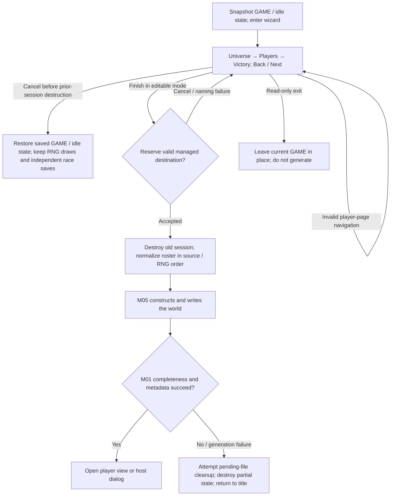
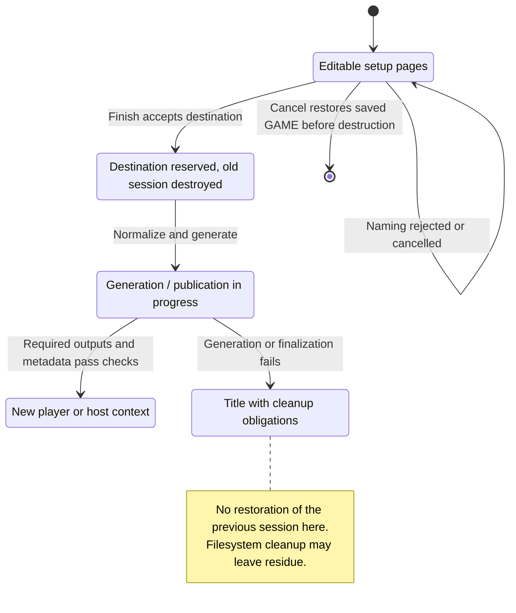

# M03 — New Game Wizard

Status: observed implementation, with a proposed logical model for a Rust/SQL port. Inspected:
`e2eae18cff0f990db20415c1c2262aed2022f95b`, 2026-10-23. Entry point: [module map](README.md).

The canonical formal definitions for setup, normalization, wizard transitions, scoring and victory consumers are in
[M03-new-game-specification.dfy](M03-new-game-specification.dfy). The prose and worked examples below
explain those definitions and retain their source evidence. See the
[coverage inventory](README.md#dafny-coverage-and-verification) for exact scope,
proof strength, dependency boundaries and verification commands.

[Workflow and state diagrams](#workflow-and-state-diagrams) provide a visual reading path.

## User stories and requirements

Actors are the player arranging a game and, for batch input, the host operator.
The entry context is a new-game draft with catalog/race-library access. These
source-inferred goals use the [collection status conventions](README.md#requirement-ids-and-status);
acceptance describes existing rules unless explicitly Proposed or Open.

### Stories and workflows

<a id="m03-us01"></a>
**M03-US01 — Configure the universe (Observed).** As a player, I want to choose
universe size, density, spacing and options so that the game starts with my
intended settings. From page 1, edit settings, continue to the roster, and return
with Back to revise them. The accepted values feed M05; editing is not generation.

<a id="m03-us02"></a>
**M03-US02 — Arrange the participants (Observed).** As a player, I want to assign
race designs and human/AI controllers so that the intended participants occupy
the intended player slots. On the roster page, choose or customize races and
controller selectors, then continue. An empty first slot blocks leaving that
page; Finish resolves random selectors and normalizes the occupied roster.
Race customization and saved versions hand off to M04/M02.

<a id="m03-us03"></a>
**M03-US03 — Define victory (Observed).** As a player, I want to choose victory
conditions and thresholds so that the game has the intended winning objectives.
On the victory page, enable conditions, adjust thresholds and the required count,
then review/finish. Threshold display, stored steps and later evaluation are
linked below; batch values have their own quantization and defaults.

<a id="m03-us04"></a>
**M03-US04 — Finish or abandon setup (Observed).** As a player, I want to either
create the configured game or leave setup with a clear outcome. Before committed
creation, Cancel restores the saved game state as documented; consumed random
draws and separately saved races remain. Finish validates/normalizes, reserves
storage and delegates generation/publication to M05/M01. Failure after destroying
the prior session can return to the title; rollback is stage-specific.

### Acceptance and traceability

| ID / story / status | Observable criterion | Canonical rules and implementation evidence | Verification or gap |
| --- | --- | --- | --- |
| <a id="m03-ac01"></a>M03-AC01 / US01 / Observed | Given an editable draft, when settings are changed and pages revisited, then subsequent setup uses the edited values and accepted selector domains. | [Inputs](#2-inputs-outputs-and-owned-state), [pages](#31-three-pages); `M03Setup.Setup`, `Wizard`, `LeavePage` in [setup model](dafny/M03-setup.dfy); `NewGameWizard`/page dialogs. | Model projection and source; full control-by-control revisit coverage remains open. |
| <a id="m03-ac02"></a>M03-AC02 / US02 / Observed | Given an editable wizard with an empty first roster slot on page 2, when leaving that page is attempted, then the page gate refuses it; a populated first slot passes that gate, with remaining Finish validation still required. | [Roster](#32-roster-editing); `FCanLeave`, `EditSlot`, `FPrefix`; [normalization](dafny/M03-normalization.dfy). | Named model conditions; existing startup wizard tests cover selected roster paths, not every selector combination. |
| <a id="m03-ac03"></a>M03-AC03 / US03 / Observed | Given batch planet-ownership victory of 64%, when normalized to stored steps, then the threshold is 60%; desktop defaults must not be substituted for omitted batch values. | [Victory controls](#43-victory-controls-exact-transforms-ranges-and-defaults), [batch](#48-batch-input-is-a-separate-entry-point); `BatchRaw`, `FBatchValue`, `VCValue`. | Formal vectors and source; batch/UI equivalence is only claimed for explicitly equivalent settings. |
| <a id="m03-ac04"></a>M03-AC04 / US03 / Observed | Given a configured required count and minimum year, when victory is evaluated, then only the documented enabled/count/year and elimination rules determine the result. | [Victory evaluation](#44-victory-evaluation); `Conditions`, `Victory` in [scoring model](dafny/M03-scoring.dfy). | Defined predicates and existing acceptance vectors; complete gameplay integration is M18 evidence. |
| <a id="m03-ac05"></a>M03-AC05 / US04 / Observed | Given Cancel before prior-session destruction, when setup exits, then saved GAME state is restored while RNG consumption and already saved race designs are retained. | [Recovery](#5-cancellation-errors-and-recovery); `CancelWizard` in setup model. | Formal/source projection; no blanket memory/filesystem rollback claim. |
| <a id="m03-ac06"></a>M03-AC06 / US04 / Observed | Given Finish reaches generation but publication fails, when the desktop handles the failure, then it follows the documented cleanup/title path rather than advertising a complete managed game. | [Normalization](#33-finish-and-normalization-order), [M05 recovery](M05-universe-creation.md#5-cancellation-errors-and-recovery); `BeginFinish`, `Complete`. | Startup failure scenarios exist; injected filesystem outcomes do not prove crash durability. |

### Interaction and quality requirements

| ID / status | Requirement, check and target | Owner / evidence / remaining decision |
| --- | --- | --- |
| <a id="m03-ir01"></a>M03-IR01 / Observed | Preserve the three-page Back/Next/Finish/Cancel workflow and validation feedback described in §3. Check page and draft state after each route and error. | M03; source/page projections. M01 owns library publication feedback, M04 owns race dialogs. |
| <a id="m03-ir02"></a>M03-IR02 / Proposed | Complete setup and correct a rejected field using keyboard-only navigation; focus identifies the active control and returns to a useful correction point. Verify labels, enabled states and validation cues without relying on color. | M03/S05; full focus/accessibility and viewport audit missing. S05 owns platform/display acceptance profiles; no conformance level is claimed. |
| <a id="m03-qr01"></a>M03-QR01 / Observed | Use the existing UTF-8 title/name byte budgets and complete-code-point boundaries. Exercise valid, maximum-size and oversized multibyte inputs through the named adapters. | S01/M04/native text owners; links and limitations in §2/§4, not a new character-count rule. |
| <a id="m03-qr02"></a>M03-QR02 / Observed | Preserve setup normalization order and RNG consumption. Compare accepted state and stream state under identical complete context, including rejected/cancelled paths. | M03/M05; [arithmetic](#41-arithmetic-conventions-and-rng), normalization model; a seed alone is insufficient. |
| <a id="m03-qr03"></a>M03-QR03 / Open | Measure page-change/edit feedback latency and Finish latency separately for 1 and 16 participants, recording platform, catalogs and display size; report median/p95 and failures. Target budgets and supported viewport matrix are unagreed. | M03/S05 own interactive budgets; M05 owns generation time. No measured responsiveness claim or timeout is introduced. |

Detailed scope, dependency owners and unresolved recovery/port questions remain
in §§1, 6 and 8. Adding stories does not complete the existing UI audit or approve
a stronger cancellation guarantee.

Checks for this story expansion are recorded in the
[collection verification](README.md#story-expansion-verification).

## 1. Purpose and scope

Create a managed game from universe settings, an ordered player roster, reusable race designs,
and victory conditions. This specification covers the three wizard pages, initialization,
navigation, validation, random choices, numerical settings, and the calculations that interpret
those settings and victory conditions. Initial-state generation is linked to M05. It describes
logical data and behavior; it is not a binary file-layout reference.

M03 owns setup. M05 owns universe generation. M19 currently groups scoring and victory
resolution; M12 owns research. Their directly relevant calculations are included here to make
setup reproducible, with ownership identified. General combat, growth, mining, movement, and AI
decision algorithms are separate modules, not additional wizard formulas. Race design inputs and
advantage pricing remain canonical in [M04-race-data-model.md](M04-race-data-model.md) and
[M04-race-advantage-points.md](M04-race-advantage-points.md).

**Evidence:** [createui.c](../src/ui/createui.c), `NewGameWizard`, `NewGameDlg`, `NewGameDlg2`,
`NewGameDlg3`; [create.c](../src/core/create.c), `InitNewGamePlr`, `GenerateWorld`, victory
accessors; [turn2.c](../src/core/turn2.c), `UpdatePlayerScores`. Current code shares globals;
the module boundaries here do not imply an existing standalone request API.

Generated entities, identities, units and execution lifetimes are specified in
[S06](S06-shared-game-state.md), including its [creation-facing conditions](S06-shared-game-state.md#7-creation-facing-state-and-defaults).
M03 remains canonical for setup, roster and victory settings.

## 2. Inputs, outputs, and owned state

### 2.1 Universe settings

| Logical field | Current field | Allowed values / unit | New editable wizard |
| --- | --- | --- | --- |
| Game title | `game.szName` | UTF-8; at most 31 bytes of text | Localized preset title |
| Universe size | `mdSize` | 0 Tiny, 1 Small, 2 Medium, 3 Large, 4 Huge | Small |
| Planet density | `mdDensity` | 0 Sparse, 1 Normal, 2 Dense, 3 Packed | Normal |
| Starting distance | `mdStartDist` | 0 Close, 1 Moderate, 2 Farther, 3 Distant | Moderate |
| Beginner: Maximum Minerals | `fExtraFuel` | Boolean; historical field name is misleading | False |
| Slower Tech Advances | `fSlowTech` | Boolean | False |
| Accelerated BBS Play | `fBBSPlay` | Boolean | False |
| No Random Events | `fNoRandom` | Boolean | False |
| Computer Players Form Alliances | `fAisBand` | Boolean | False |
| Public Player Scores | `fVisScores` | Boolean | False |
| Galaxy Clumping | `fClumping` | Boolean | False |

The library name, game title, and exchange basename are distinct concepts; see
[GLOSSARY.md](../GLOSSARY.md) and [ADR 0001](../docs/adr/0001-desktop-managed-libraries.md). The
title is not the authoritative managed-game identifier. The editable wizard starts a zeroed
`GAME`, retaining the former `cPlanMax` and `cPlayer` temporarily; generation replaces those
values. It starts at turn zero (display year 2400). The desktop wizard has no seed input: it
consumes the current shared RNG state.

### 2.2 Roster and race choices

There are 16 ordered slots. The final player count is the length of the occupied prefix, ending
at the first empty slot. A slot selects one of:

| Choice | Required logical data | Resolution at Finish |
| --- | --- | --- |
| Preset race | Preset ID 0–6 | Copy `vrgplrDef[id]` |
| Library/custom race | A race-design snapshot; optional saved version reference | Copy the working race snapshot |
| Computer player | AI type 0–6; difficulty 0–4 | Resolve random selectors, then copy `vrgplrComp[type][level]` |
| Expansion player | Special selector | Random preset, housekeeping AI, Easy difficulty |
| Empty | No data | Terminates roster |

Preset ID 6 is the preset called Random; copying it is distinct from selecting a random AI type.
AI IDs are 0 Robotoid, 1 Turindrone, 2 Automitron, 3 Rototill, 4 Cybertron, 5 Macinti, 6 Random.
Difficulty is 0 Easy, 1 Standard, 2 Tough, 3 Expert, 4 Random. Housekeeping AI is ID 7, an
outcome of Expansion rather than a normal selectable AI type. Names are localized catalog
values, not stable IDs.

The current transient selector is `0` for empty, `1 + 4*preset` for a preset (Expansion uses
preset index 7), `2 + 4*cache_index` for a cached race, and `3 + 4*ai_type + 32*difficulty` for
an AI. These equations explain behavior; a Rust enum or SQL discriminator should expose the
logical variants instead. The working cache holds up to 16 race snapshots. Several slots can
refer to the same cache entry, so editing that entry can affect multiple slots before Finish.

### 2.3 Victory settings and outcomes

Store seven enabled flags and ten values: planet percentage, technology level, technology field
count, score, percentage lead, resource production in thousands, capital ships, highest-score
year offset, required-condition count, and minimum victory year offset. Technology level and
field count form **one** condition. Keep configured required count and effective required count
distinct.

Derived output includes resolved player races/AI parameters, normalized names, unique portraits,
generated universe state, and a managed game containing host state and player turns. Scoring
derives per-player metrics, satisfied-condition bits, rank, and winner state. These are
outcomes, not editable setup inputs.

### 2.4 Suggested Rust/SQL representation

The logical constraints now live in `Setup`, `Slot`, `FPrefix`, `FSetup` and
`FVC` in [M03-setup.dfy](dafny/M03-setup.dfy). These mapping suggestions are
proposals, not existing repository schema:

- `GameSetup`: title, typed size/density/distance enums, seven booleans,
  `Vec<PlayerSlot>` of length 1–16, `VictoryRules`, and a replay context if needed.
- `PlayerSlot`: tagged preset, race snapshot, AI selection, or Expansion; retain
  slot order and use explicit `Random` variants for AI selections.
- `VictoryRules`: typed threshold values in the units above, enabled flags,
  configured required count, and minimum elapsed years.
- SQL `game_setup` plus ordered `game_setup_player` rows, unique
  `(setup_id, slot_index)` with indices 0–15. Enforce contiguous slots in the
  application or a deferred constraint, since a simple row `CHECK` cannot do it.
- Store a race snapshot/version identity, not merely a mutable race filename.
  Save resolved AI choices separately from requested Random selectors if replay
  and provenance matter. Store full RNG state and algorithm version for exact
  replay; a seed alone does not capture earlier desktop RNG consumption.

Use SQL integer arithmetic deliberately: division, rounding, unsigned conversion, and
intermediate widths must follow this specification. Do not replace the current binary64
calculations with decimal arithmetic or algebraically reorder them for a compatibility port.
Proposed stricter validation must not be confused with the current wizard's silent normalization
rules.

## 3. User actions and workflow

### 3.1 Three pages

1. **Universe:** edit title, size, density, starting distance, and seven flags.
2. **Players:** select presets, library races, new/customized races, computer
   players, Expansion, or No Player for each slot.
3. **Victory:** toggle seven conditions and adjust ten numeric settings.

Next advances; Back returns; Cancel closes; Finish is supported before the final page and uses
defaults for settings not visited. Help is page-specific. The wizard temporarily disables idle
checks and restores their previous state on exit. Read-only mode presents the current game,
disables editing, shows Unknown for unavailable player races, and never generates a replacement
game.

The internal `max_step` begins at 0. Leaving page 1 calls `InitNewGamePlr`. Leaving page 2
raises it to at least 1 and calls initialization again. Leaving page 3 raises it to at least 2.
While `max_step < 2`, initialization resets the minimum victory years from universe size. While
`max_step < 1`, it also creates the default AI roster. Once page 3 has been left, Back/Next
preserves the edited minimum. Once page 2 has been left, changing size on page 1 does not
regenerate the roster. `InitNewGame3` itself is a no-op.

### 3.2 Roster editing

Choosing No Player clears the selected slot **and every later slot**. Choosing an occupied
option after a gap fills the preceding consecutive empty slots with the same selector, stopping
at an occupied slot. This maintains a prefix, and can cause multiple rows to share a cached
race.

New/Load appends a cache entry until 16 have been allocated. Once full, it searches indices 15
down to 0 for an entry not referenced by any other slot, ignoring the selected slot for reuse.
If none is available it does not apply that new choice. Editing a cached race under its existing
filename updates that entry; saving a new version allocates another entry. Protected edits use
the race-library password/customization flow. Race versions can be saved while the wizard is
open; wizard Cancel is not a rollback of those library operations.

Page 2 rejects non-Cancel navigation if the first player slot is empty in editable mode,
including Back. Read-only mode bypasses this check. Source: [createui.c](../src/ui/createui.c),
`NewGameDlg2`.

### 3.3 Finish and normalization order

Finish first obtains/reserves a valid managed-game destination. Failure or cancellation of that
naming flow leaves the wizard open. After acceptance:

1. Preserve the selected setup, set turn to 0, destroy the former active game,
   and install the new setup.
2. Resolve the occupied roster in order. For Random AI difficulty call `R(4)`
   first; for Random AI type call `R(6)` second. Expansion calls `R(7)`, takes
   that preset, sets `fAi`, Easy level, housekeeping AI ID, and salt `-1`.
3. For each non-AI race, calculate advantage points. If negative, silently
   replace it with preset 0 and mark `fHacker`. AI races bypass this check.
   Use the [canonical advantage algorithm](M04-race-advantage-points.md).
4. Fill missing singular names from a catalog of 24 names using `R(24)`; fill
   missing plurals by appending `s`. For each later duplicate singular name
   (case-sensitive byte comparison), start at `R(24)` and advance modulo 24
   until a catalog name is unused among all players. Replace its plural too.
5. Mark portraits outside 0–31, and all AI portraits, unassigned. For each
   duplicate among remaining portraits, use `R(2)` to invalidate either the
   earlier or current entry. In slot order, assign each unassigned portrait
   from `R(32)`, advancing modulo 32 until unused. This is not rejection sampling.
6. Generate the world, validate generated artifacts, commit library metadata,
   and open the player view or host dialog selected by generation.

These operations consume RNG in order. Names and portrait changes can therefore change the
generated universe even when size, density, and roster races match.

## 4. Rules, calculations, and validation

### 4.1 Arithmetic conventions and RNG

`R(n)` means the existing `Random(n)`: for positive `n`, an integer in `[0,n)`. It uses modulo
reduction, not a promise of perfectly uniform sampling. Calls with `n <= 0` still advance the
RNG and then return 0. Integer division truncates toward zero; for nonnegative inputs this is
floor. Preserve explicit narrowing and unsigned operations where reproducing the C
implementation. Values shown as percentages are whole percentage points unless stated otherwise.

[utilgen.c](../src/core/utilgen.c), `Random`, uses two state integers:

```text
k  = trunc(s1 / 53668)
s1 = 40014 * (s1 - k*53668) - k*12211
if s1 < 0: s1 += 2147483563
k  = trunc(s2 / 52774)
s2 = 40692 * (s2 - k*52774) - k*3791
if s2 < 0: s2 += 2147483399
z = s1 - s2
if z < 1: z += 2147483562
return 0 if n <= 0 else unsigned32(z) % n
```

C uses 32-bit unsigned intermediate operations before signed storage; preserve those semantics
for exact compatibility. `Randomize(seed)` takes `a=seed & 63`, `b=(seed >> 6) & 63`, advances
`b=(b+1)&63` when equal, then loads `rgPrimes[a]` and `rgPrimes[b]`. This is the literal source
table, including its entry `279`; do not regenerate it from a mathematical prime sequence. The
wizard does not call `Randomize`. Recording only a user-visible seed cannot reproduce arbitrary
desktop entry state or subsequent branch-dependent draws.

`LMulDiv(a,b,c)` computes the product in signed 64 bits, divides with rounding half away from
zero, and returns `-1` for zero denominator or result outside `[-2147483647,2147483647]`. For
the positive calculations here it is `floor((a*b + floor(c/2))/c)`. See
[native.c](../src/platform/native.c), `LMulDiv`.

### 4.2 Default roster and minimum years

The desktop initializes its overall roster difficulty to Standard; there is no page-1 control
changing that variable. Individual AI difficulties remain editable. For Standard (and Easy),
size chooses default player counts:

| Size | Default players, including slot 0 | Initial minimum victory years | First eligible display year |
| --- | ---: | ---: | ---: |
| Tiny | 2 | 30 | 2430 |
| Small | 3 | 50 | 2450 |
| Medium | 7 | 70 | 2470 |
| Large | 12 | 90 | 2490 |
| Huge | 16 | 110 | 2510 |

Minimum years uses raw `2*size`, hence `30 + 20*size`. Before the first initialization the
zeroed raw field displays 30; the normal Small setup becomes 50 on leaving page 1. The localized
default title selects catalog offset `5*difficulty + size` at wizard entry (Standard/Small gives
offset 6).

`InitNewGamePlr` also supports other callers' difficulties. The following lists are evaluated in
order; **every stated random test is a fresh draw**, and the first successful branch wins. `L`
is difficulty 0–3:

| Size | Nondefault count branches, in order | Otherwise |
| --- | --- | ---: |
| Tiny | Expert and `R(3)==0`: 3 | 2 |
| Small | Expert and `R(4)==0`: 5; `L>=2` and `R(6-L)==0`: 4 | 3 |
| Medium | Expert and `R(10)==0`: 9; Expert and `R(10)==0`: 5; `L>=2` and `R(7-L)==0`: 8; `L>=2` and `R(7-L)==0`: 6 | 7 |
| Large | Expert and `R(10)==0`: `14+R(2)`; Expert and `R(10)==0`: `10-R(2)`; `L>=2` and `R(7-L)==0`: 13; `L>=2` and `R(7-L)==0`: 11 | 12 |
| Huge | Expert and `R(10)==0`: `13-R(3)`; `L>=2` and `R(9-L)==0`: 14; `L>=2` and `R(7-L)==0`: 15 | 16 |

Slot 0 remains the selected human preset (initially Humanoid). For every other slot `i=1..N-1`,
take the first threshold `i < t` below. Division is integer. Values are the transient selector
codes defined in §2.2; these codes preserve the exact distribution without depending on
localized names.

| Difficulty | Ordered `(threshold, selector)` pairs; then fallback |
| --- | --- |
| Easy | `((N+1)/3+1,11)`, `(2*(N+1)/3+1,15)`, `(5*(N+1)/6+1,7)`; else `27` |
| Standard | `(2*(N+5)/7+1,39)`, `((3*(N-1)+6)/7+1,35)`, `((4*(N-1)+6)/7+1,43)`, `((5*(N-1)+6)/7+1,47)`, `((6*(N-1)+6)/7+1,51)`; else `155` |
| Tough | Same thresholds as Standard; selectors `83,71,67,87,91`; else `155` |
| Expert | `((N+1)/3+1,99)`, `((6*(N-1)+11)/12+1,119)`, `((5*(N-1)+5)/6+1,115)`; else `123` |

Then shuffle for `i=1..N-2`: select `j=i+1+R(N-i-1)` and swap slots `i,j`. This always selects a
**later** slot. Replacing it with an inclusive Fisher–Yates shuffle would change behavior and
RNG consumption. The default Small roster is Humanoid plus two Standard Turindrones before/after
this shuffle.

### 4.3 Victory controls: exact transforms, ranges, and defaults

The current representation uses a low-seven-bit raw value `r` and an enabled bit `0x80`. This is
described solely to reproduce the control semantics. Toggle a flag without changing `r`. Setting
a raw value clamps it to `[0,max]` while preserving the flag. Rust/SQL can store the logical
flag and integer separately.

| Index | Setting | Raw maximum | Logical value | Editable range / normal step | Initial value; enabled |
| --- | --- | ---: | --- | --- | --- |
| 0 | Owns planets | 16 | `20+5*r` percent | 20–100 / 5 | 60%; yes |
| 1 | Attains technology level | 18 | `8+r` | 8–26 / 1 | 22; yes |
| 2 | Number of technology fields | 4 | `2+r` | 2–6 / 1 | 4; part of index 1 |
| 3 | Score threshold | 19 | `1000+1000*r` | 1000–20000 / 1000 | 11000; no |
| 4 | Lead over second place | 28 | `20+10*r` percent | 20–300 / 10 | 100%; yes |
| 5 | Production capacity | 49 | `10+10*r` thousand resources | 10–500 / 10 | 100 thousand; no |
| 6 | Capital ships | 29 | `10+10*r` | 10–300 / 10 | 100; no |
| 7 | Highest score after years | 87 | `30+10*r` elapsed years | 30–900 / 10 | 100; no |
| 8 | Conditions required | 7 | `min(r, enabled_count)` | 0–7 / 1, capped | 1 |
| 9 | Minimum years before victory | 47 | `30+10*r` elapsed years | 30–500 / 10 | `30+20*size` after initialization |

The literal initial values for indices 0–9 are `[136,142,130,10,136,9,9,7,1,0]`; the
initialization rule then updates index 9. The seven independent enabled indices are
`{0,1,3,4,5,6,7}`. Index 2's initial high bit is not another condition. `enabled_count` counts
those seven flags.

For an arrow hit rectangle `h`, setting index is `floor(h/2)` and direction is `+1` for even
`h`, `-1` for odd `h`. Shift **or** Control multiplies this raw step by 5; pressing both still
multiplies by 5 once. Thus a normal planet click changes 5 percentage points, a modified click
25; score changes 1000 or 5000; years 10 or 50. Apply clamping after the step. Holding uses the
same repeated button-tracking operation. Read-only hit testing returns no editable rectangle.

Setting required count explicitly stores the capped value. Merely disabling a condition does
**not** rewrite the stored required count: its effective display and evaluation fall to the
enabled count, and re-enabling can restore the old requirement. Current
`GetVCVal(pgame,8,FALSE)` counts flags from global `game`, not its `pgame` argument. Existing
callers use `&game`; a standalone port should make this dependency explicit rather than
accidentally reading another setup.

### 4.4 Victory evaluation

These are M19 rules from `UpdatePlayerScores`, not validation performed by the wizard. Let
`t=game.turn` (elapsed years), `P` be total planets, `p_i` owned planets, `S_i` score, `R_i`
annual resources, and `C_i` decoded capital-ship count. The seven predicates are:

| Condition | Satisfied when | Result bit |
| --- | --- | ---: |
| Planet share | `p_i >= LMulDiv(P, planet_percent, 100)` | `0x01` |
| Technology | At least `field_count` of six levels are `>= tech_level` | `0x02` |
| Score | `S_i >= score_threshold` | `0x04` |
| Lead | Selected top scorer has `S_top >= trunc(S_second*(100+lead_percent)/100)` | `0x08` |
| Production | `floor(R_i/1000) >= production_thousands` | `0x10` |
| Capital ships | `C_i >= capital_threshold` | `0x20` |
| Highest after years | Exactly one top scorer, and `signed16(t) >= highest_after_years` | `0x40` |

“Exceeds” in the UI uses `>=`, not strict `>`. Planet share uses nearest-integer rounding, not
ceiling: for 241 planets at 60%, the threshold is 145; for 243 it is 146; for 242 it is 145.
Production counts resources, not the value of items actually produced or research allocations. A
100% lead means twice the second score, not merely matching it. Lead multiplication is signed
32-bit in the source; arbitrary out-of-domain values need an explicit overflow policy in a port,
not SQL's implicit widening advertised as identical behavior.

Evaluation order and exceptions:

1. Calculate scores and the planet/capital/score/technology/production predicates
   for everyone. Mark a player dead when it has no planets and all three ship
   counts are zero. Predicate bits can be set even if their condition is disabled;
   only enabled predicates increment the condition counter.
2. If there is exactly one player, assign rank 1 and skip the multiplayer victory
   path. One human plus AI opponents is still a multi-player roster for this rule.
3. Rank is `1 + count(other scores strictly greater)`. Ties share rank and skip
   subsequent ranks. The highest-index tied leader is retained as `iScoreMax`.
   For a top tie, second-place score becomes the top score; otherwise take rank 2.
4. Evaluate the highest-after-years condition only for a unique leader.
5. If `dead_count + 1 >= player_count`, declare game over regardless of selected
   conditions or minimum years. The source sends the survivor message to the top
   scorer if alive; it does not enter the ordinary numeric-winner marking loop.
6. Otherwise evaluate the lead predicate for `iScoreMax`. There is no explicit
   unique-leader guard for lead. In particular, a zero-score top tie satisfies
   `0 >= 0` for the selected leader. Do not add an unstated tie rejection.
7. If `t >= minimum_years` and effective required count is at least 1, mark every
   player meeting at least that count a winner. Multiple winners are possible.
   A zero effective count disables this numeric-victory route; it is not a
   vacuously satisfied requirement. This loop has no explicit dead-player filter.

The game-over flag allows a declared outcome; game messages explicitly allow continuing play.
Highest-after-years and the general minimum-year gate both apply when using that condition to
achieve an ordinary numeric victory.

### 4.5 Score and resource mathematics used by victory

Source: [util.c](../src/core/util.c), `CalcPlayerScore`, `WPackLong`, `LComputePower`;
[planet.c](../src/core/planet.c), `CResourcesAtPlanet`; [battle.c](../src/core/battle.c),
`SpdOfShip`.

Population `q` in these formulas is the internal quantity in **hundreds of colonists**, not
people. For planets retained through production, scoring uses the recorded population at
production, before waypoint-1 cargo movements, when `vrgiplrPopScore[id]` matches the owner;
otherwise it uses current population. Owned planets still determine the count. Copy that
population into the planet used for both the population score and resource calculation.

```text
planet_points = sum over owned planets of min(6, floor((q+999)/1000))
resource_points = floor(total_resources/30)
base_points = 3 * qualifying_starbase_count
tech_points(level) = level                 if level < 4
                    2*level - 3           if 4 <= level < 7
                    3*level - 9           if 7 <= level < 10
                    4*level - 18          if level >= 10
ship_points = floor(min(unarmed, planets)/2)
            + 2*min(escort, planets)
            + floor(8*capital*planets/(planets+capital))  if capital > 0
```

The last capital term is zero when capital is zero; the two earlier terms always apply. Total
score is the sum of these components and six technology contributions; dead players receive no
technology contributions. A starbase qualifies only when its hull definition's maximum cargo is
nonzero. Ship counts include surviving owned fleets and non-free designs. Classify design power
`W` as unarmed for `W<=0`, escort for `0<W<2000`, capital for `W>=2000`.

Score storage compresses each ship count: starting with `m=count,e=0`, repeatedly set
`m=floor(m/4), e=e+1` while `m>8191`. The decoded count is `m*4^e`. The capital victory
condition uses this decoded count, while score uses original counts. The wizard's maximum
capital threshold is 300, well below the first compression loss, but the distinction matters to
the reusable score model.

For resource production, let `K=CalcPlanetMaxPop`, `E=rsResGen` (internal hundreds of colonists
per resource), `F=rsFactProd`, and `O=rsFactOperate`:

```text
q_eff = q                                             if q <= K
        min(2*K, K + trunc((q-K)/2))                  otherwise
ordinary resources = trunc(q_eff/E)
                   + floor((operating_factories*F+9)/10)
AR resources = trunc(sqrt(binary64(q_eff)*max(1,energy_level)/E)
                     *max(25,habitability_percent)/10 + 0.999)
```

Zero population produces zero resources. A nonzero population whose result is zero receives one
resource. The AR `+0.999` then truncation is the actual formula; do not casually substitute
`ceil`. Operable factories are the lesser of built factories and
`max(1,min(max_factories,trunc(q*O/100)))`; AR operates zero factories. For non-AR races,
`max_factories=max(10,trunc(K*O/100))`. For AR it is zero. For non-AR capacity, begin `K=500` if
habitability is below 5, otherwise `K=100*habitability`. HE subtracts `trunc(K/2)`; JOAT instead
adds `trunc(K/5)`. For AR, `K=0` unless the planet is owned and has a starbase; otherwise select
`[2500,5000,10000,20000,30000]` by base-hull index relative to Orbital Fort. Finally OBRM adds
`trunc(K/10)` for either route. Habitability is defined in the second-world selection section
below. `CalcPlanetMaxPop` looks up the authoritative planet by ID, while resource calculation
can use a population snapshot. Race inputs are in [M04-race-data-model.md](M04-race-data-model.md).
Resource results pass through the source's 16-bit storage; normal game-domain values are assumed
here.

For a design's score classification, sum these contributions per occupied slot:

```text
beam = trunc(damage*count*(max_range+3)/4)
       then trunc(beam/3) for a shield-sapper beam
 torpedo = trunc(damage*count*(max_range-2)/2)
 bomb = (colonist_damage + building_damage)*count*2
```

Begin capacitor factor `A=1000`. For each Energy/Flux Capacitor item in slot order set
`A=trunc(A*(100+ability)/100)`. If the resulting factor differs from 1000, set
`a=min(255,trunc(A/10))` and replace summed beams `B` by `trunc(B*a/100)`. Then set
`B=B+trunc(B*(speed-4)/10)`. Total design power is `B + torpedo_sum + bomb_sum`. Preserve
truncation toward zero for negative speed adjustments. Parts statistics are the existing static
catalog, not wizard inputs.

The speed used here is the design-only `SpdOfShip(NULL,...)`, so it excludes fleet cargo, the
fleet-owner War Monger bonus, and battle RNG. Count Maneuvering Jets and Multi-Function Pods as
one thruster each, Overthrusters as two, plus `floor((Enigma_Pulsars + Alien_Miners + 1)/2)`. No
engine returns speed zero. Interspace-10, Enigma Pulsar, Trans-Star-10, Trans-Galactic Mizer
Scoop, and Galaxy Scoop use warp 10; other engines choose the highest warp 1–9 with fuel use at
most 120 (or zero if none). Then:

```text
speed = clamp(warp - 4 + thrusters
              - floor(floor(empty_mass/70)/slot0_item_count), 0, 8)
```

This assumes a valid engine-equipped design as the source does. Full design validation and
catalog reproduction belong to M11; the scoring path is recorded here so “capital ship” is not
mistaken for a hull-name or hull-size classification.

### 4.6 Slower research and score visibility

From [research.c](../src/core/research.c), `GetTechLevelCost`, let `T` be the sum of the
player's current six tech levels. The base for target level `L` is `B = 10*T + costs[L]`, with
the literal table for levels 0–26:

```text
0,50,80,130,210,340,550,890,1440,2330,3770,6100,9870,13850,
18040,22440,27050,31870,36900,42140,47590,53250,59120,65200,
71490,77990,84700
```

Expensive race research gives `2*B-floor(B/4)`; standard gives `B`; cheap gives `floor(B/2)`. If
Slower Tech Advances is enabled, double the result **after** that race adjustment.
`CostOfDevelopingItem` also doubles accumulated expenditure when subtracting progress in this
mode and updates temporary tech levels while projecting successive levels. This is distinct from
advantage-point pricing.

Public Player Scores exposes opponents' score records when `turn >= 20` (year 2420). Own scores,
dead-player scores, and scores after game over are written regardless of this switch. See
[save.c](../src/core/save.c), score-record writing. The alliances flag is consumed by AI
targeting/relations; it is not a numerical multiplier or a shared victory condition. No Random
Events suppresses selected events and generation features; it does not disable the RNG or random
planets.

### 4.7 Universe generation contract (M05)

The generation contract now lives in [M05 Universe Creation](M05-universe-creation.md).
Its [rules and calculations](M05-universe-creation.md#4-rules-calculations-and-validation)
own planet placement, homeworlds, technology, starting assets, second worlds,
wormholes and completion ordering. M03 supplies accepted settings and normalized
race/controller snapshots; M05 consumes them with the shared RNG and catalog
context. The former §4.7.1–§4.7.9 rules moved to M05 §4.1–§4.9.

### 4.8 Batch input is a separate entry point

`GenNewGameFromFile` in [create.c](../src/core/create.c) accepts the same semantic universe
settings and invokes the generator, but is not the desktop wizard. It starts from zeroed state
and does not inherit the desktop victory defaults. The input has a 31-byte nonempty UTF-8 title,
numeric size/density/distance in the ranges above, seven boolean flags, and 1–16 players. An
optional seed calls `Randomize(seed)`. Player 0 is loaded from a race; later entries may select
AI. External AI type 0 means Random, types 1–6 subtract one; level 0 means Random, levels 1–4
subtract one. This numbering differs from the desktop enum values.

Enabled victory thresholds are range-checked in displayed units and converted to raw values
using integer division:

| Setting | Accepted values | Raw conversion |
| --- | --- | --- |
| Planets | 20–100 | `(value-20)/5` |
| Technology level / fields | 8–26 / 2–6 | `level-8` / `fields-2` |
| Score | 1000–20000 | `(value-1000)/1000` |
| Lead | 20–300 | `(value-20)/10` |
| Production in thousands | 10–500 | `(value-10)/10` |
| Capital ships | 10–300 | `(value-10)/10` |
| Highest-score elapsed years | 30–900 | `(value-30)/10` |
| Required count | 0–7 | Identity, then enabled-count cap |
| Minimum elapsed years | 30–500, read when required count is positive | `(value-30)/10` |

The parser does not require exact step multiples: 64% becomes raw 8 and therefore 60%; score
1999 becomes 1000. For required count zero it skips setting both that count and minimum years,
leaving zero raw values. Do not silently apply desktop defaults to a batch import. This section
describes semantic conversion, not a line-by-line file-layout specification.

### 4.9 Presentation arithmetic

These formulas belong to the current UI, not the Rust/SQL domain model. They are included to
distinguish UI geometry from game mathematics. In `DrawNewGame2` and `NewGameDlg2`, with font
height `h`, row top is `6+i*(h+4)`, row index is `floor((y-6)/(h+4))`, and a selectable diamond
requires `y>=6`, index below 16, remainder below `h+1`, and x in the diamond's half-open
interval of width `h+1`. The diamond x offset is measured Player-16 text width plus 12; desired
roster height is `16*(h+4)+8`.

`DrawNewGame3` uses field digit-width counts `[3,2,1,5,3,3,3,3,1,3]` for the ten values. The
planet and lead percentages add `floor(3*digit_width/2)` for `%`. A spinner's up rectangle
starts at `(value_right+4, text_top-3)`, is 15 pixels wide and `floor(h/2)+3` high; the down
rectangle is shifted by up-height minus 1. Twenty rectangles map to ten raw settings as in §4.3.
Seven checkbox rows map to numeric indices `row + (row>=2)`, skipping the technology-field
subvalue.

## 5. Cancellation, errors, and recovery

Before Finish destroys the prior active game, Cancel/dialog failure restores the saved `GAME` in
editable mode and restores idle-check state. It does not restore the RNG sequence or undo
race-library saves performed during customization. Read-only exit does not replace `GAME`.

[FChooseLibraryGameName](../src/ui/libraryui.c) validates a portable available library name and
reserves a new directory before closing the wizard. Existing managed games are not overwritten.
A collision can offer a revision name; backing out leaves setup available. Empty page-1 title
falls back to the existing basename in the current UI; the title text control enforces its byte
budget.

After Finish has destroyed the prior game, generation failure does not restore that earlier
playing session. `FFinishLibraryGame` validates the universe, host, and every player output with
`FCompleteGeneratedFile`, then writes metadata. On failure it attempts to remove pending
files/directory, clears the pending path, reports storage failure, and the wizard destroys
partial state and returns to the title screen. Cleanup is attempted, not a guarantee that an
underlying filesystem failure cannot leave residue. A generation-success return alone is not
proof that a managed game was successfully finalized.

The negative-points race substitution is a normalization, not a wizard rejection; generation
later sends tampered-race messages. Allocation failure, invalid race imports, protected-race
password behavior, and library version persistence use the respective library/race interfaces.
Their complete recovery contracts remain with M01/M02/M04; this document does not invent
stronger transaction guarantees.

## 6. Interactions with other modules

| Module | Responsibility and handoff |
| --- | --- |
| M01 Game Library | Reserve unique destination, validate outputs, metadata and opening |
| M02 Race Library | Select versions, customize/save races, credentials |
| M04 Race Design | Race normalization, random race generation, advantage calculation |
| M05 Universe Creation | Consume resolved setup; [placement and starting assets](M05-universe-creation.md#4-rules-calculations-and-validation) |
| M08/M09 Colony and Production | Habitability, resources, capacity and scoring snapshots |
| M11 Ship Design / S03 Static Data | Valid starting templates, parts availability and design statistics |
| M12 Research | Cost multiplier and initial technology consumers |
| M17/M18 Hosting and Generation | Initial host state and later score/victory evaluation timing |
| M19 Resolution | Score, rank, elimination and configured victory predicates |
| S01/S04/S05 | Persistence, UTF-8/platform arithmetic, dialog/input implementation |

The bounded generation contract is canonical in [M05](M05-universe-creation.md); §4.7
retains the handoff link. Race pricing is shared by reference with M04.
The protected legacy-race policy conflict recorded in [the overview](README.md) is not resolved
by this document.

## 7. Observable acceptance criteria and verification

The following are implementation/port acceptance vectors, not claims that all have automated
coverage:

| Input/action | Expected observable result |
| --- | --- |
| Fresh wizard, Finish from page 1 | Small/Normal/Moderate, seven flags off; 3 players; minimum 50 years; enabled conditions planets/technology/lead; one required |
| Change size to Tiny before first Next | Default 2-player roster; minimum 30 years; normal target 32 planets |
| Change size after leaving roster | Preserve edited roster; minimum resets only while `max_step<2` |
| Delete roster slot 4 (zero based) | Slots 4–15 become empty; final prefix length 4 |
| Required raw count 5, only 3 conditions enabled | Effective count 3; toggling flags alone preserves stored 5 |
| Shift-click planet-percentage up at 90% | Clamp to 100%, not 115% |
| 242 planets, ownership threshold 60% | Owning 145 satisfies the rounded threshold |
| 99999 resources, production threshold 100 thousand | Fails; 100000 passes |
| Scores 1000 and 500, lead threshold 100% | First player satisfies the lead condition at equality |
| Two tied leaders at 1000 | Both rank 1; highest-after condition fails; 20% lead fails |
| Two tied leaders at zero, no elimination | Highest-index leader can satisfy the lead predicate |
| Required count zero, rivals still alive | No numeric-condition victory |
| Exactly one player | Score/rank computed; multiplayer victory path skipped |
| All but one player dead before minimum years | Elimination game-over route applies |
| Research arithmetic with synthetic base 51, cheap field, Slower Tech | `floor(51/2)*2 = 50`, not 51 |
| BBS, normal home population 250, true growth 15 | `floor(250*(2*15+10)/10)=1000` = 100000 colonists |
| IT/PP second world, home population 250 | Home 200 and second 100, total 300 internal units |
| Leftover 50 points, minerals choice, equal starting stocks | Add 125 to each plus 125 to index 2; total 500 |
| No Random Events enabled | Skip artifact and wormhole draws; other random generation still runs |
| Cancel before Finish | Restore pre-wizard GAME; no new managed game from this attempt |
| Generated output/metadata fails verification | No successful playable library entry; title screen and reported failure |

Existing [wizard workflow test](../tests/compat/win32_newgame_workflow.h) drives real
cancellation, Tiny creation, page navigation, naming/revision choices, and write failures. It
checks restored GAME on cancel, turn zero, nonzero game ID, single-player state, planets,
scanner visibility, and generated artifacts. [run_newgame.py](../tests/compat/run_newgame.py)
supplies managed-game workflow scenarios. The [tiny host
fixture](../tests/scaffold/fixtures/newgame/tiny/game.def) and [qualification
notes](../docs/GAMEPLAY-QUALIFICATION.md) provide additional context. Existing workflow coverage
is not an exhaustive oracle for the formulas.

For this documentation change: source and existing tests were inspected; victory transforms were
tested in 354 cases against extracted current C helpers; stored versus effective condition count
and all five Standard roster defaults were checked; 20 size/density targets and worked integer
examples were independently checked; relative links were validated. No GUI, host regression, or
gameplay suite was rerun. Additional compatibility tests should cover exact RNG state
progression, all size/density pairs, equal-x sorting, clumping boundaries, planet 0 becoming an
early homeworld, nonpositive mineral RNG bounds, second-world retries 99/100, all trait/leftover
interactions, score ties, and victory minimum-year boundaries.

## 8. Evidence, compatibility limits, and open questions

Primary sources are the current implementation, not historical manuals:

| Evidence | Relevant functions / data |
| --- | --- |
| [createui.c](../src/ui/createui.c) | Wizard, three pages, drawing, controls, normalization |
| [create.c](../src/core/create.c), [create.h](../src/core/create.h) | Defaults, VC transforms, generation, batch entry |
| [enums.h](../src/core/enums.h), [structs.h](../src/core/structs.h) | Logical domains and existing state |
| [utilgen.c](../src/core/utilgen.c), [native.c](../src/platform/native.c) | RNG, sort compatibility, rounded multiply/divide |
| [globals.c](../src/core/globals.c) | Capacity/constants tables |
| [turn2.c](../src/core/turn2.c), [util.c](../src/core/util.c) | Victory, scores, power and count compression |
| [planet.c](../src/core/planet.c), [battle.c](../src/core/battle.c) | Resource production, habitat, design speed |
| [research.c](../src/core/research.c), [save.c](../src/core/save.c) | Research multiplier and public score gate |
| [thing.c](../src/core/thing.c), [ship.c](../src/core/ship.c) | Wormhole placement checks and starting fuel |
| [libraryui.c](../src/ui/libraryui.c) | Reservation, completion validation and cleanup |
| [library ADR](../docs/adr/0001-desktop-managed-libraries.md), [UTF-8 ADR](../docs/adr/0002-utf8-application-text.md) | Managed-game/race vocabulary and text policy |

Known implementation details requiring a deliberate decision in a new port:

- Preserve configured-versus-effective condition count; remove the global-game
  dependency only as an explicit interface improvement.
- Decide whether to preserve or change silent invalid-race substitution,
  zero-score lead ties, single-player victory bypass, and source narrowing or
  overflow behavior. This document records them; it authorizes no gameplay fixes.
- Exact replay also requires static data, random race generation, part eligibility,
  initial RNG state, sorting behavior, and clock handling. This setup specification
  is not sufficient to replace all of M04/M11/S03 with empty placeholders.
- The source has no bounded total homeworld-placement retry count. A modern API
  may need cancellation/time limits, but adding one changes failure behavior.
- Proposed Rust/SQL types should enforce representable enums, valid race ranges,
  and thresholds on the wizard's step lattice. Batch parsing intentionally has
  coarser rounding behavior; retain that as a separate import adapter.

No binary layout, byte offsets, or serializer implementation is specified here.

## Workflow and state diagrams

These reading projections summarize [Page navigation and Finish](#3-user-actions-and-workflow), [Cancellation and recovery](#5-cancellation-errors-and-recovery) and the
[canonical contracts](M03-new-game-specification.dfy) at the inspection revision recorded above.
States are explanatory milestones, not new persisted fields or a claim of
complete C/model refinement. Terminal nodes end the illustrated operation.

### Workflow



### State and recovery



The state projection follows editable setup; read-only viewing is a separate non-generation entry. Cancel before Finish does not rewind RNG or race-library saves. There is no inner generator cancellation protocol.
