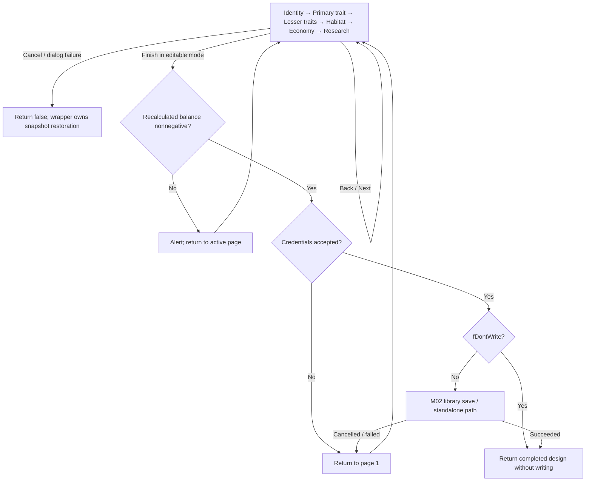
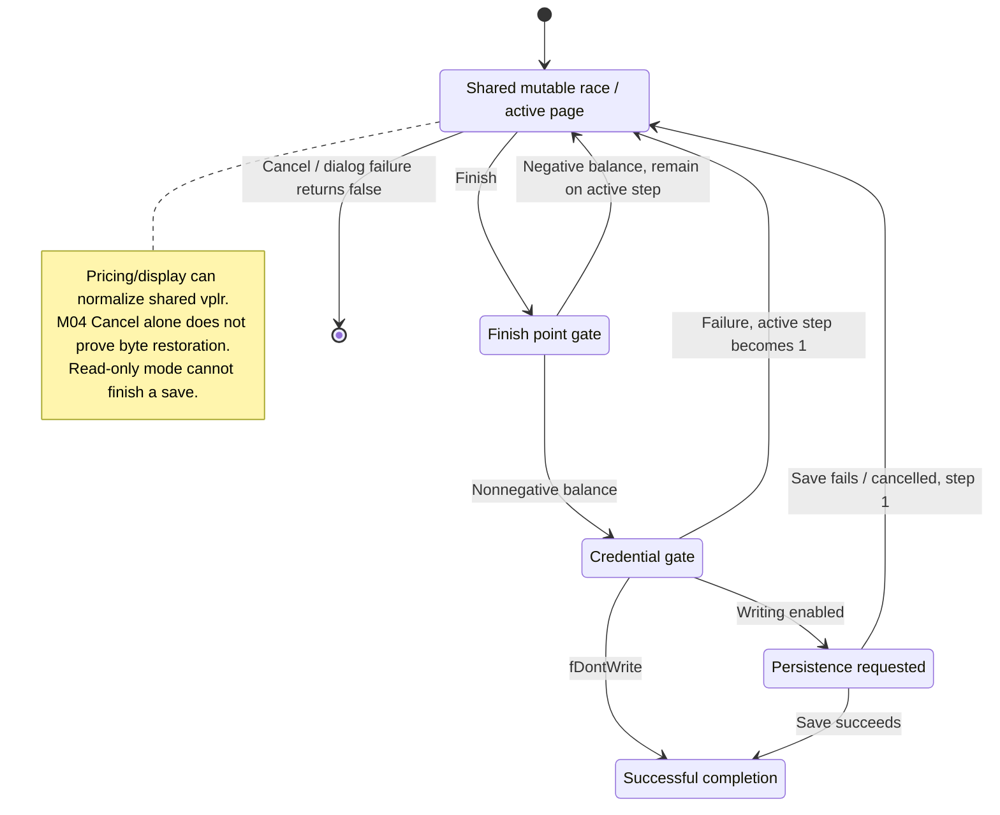

# M04 - Race Design Wizard

Status: source-derived specification; suggested Rust/SQL models are proposals.
Base data/pricing review: 2026-10-23, source `e2eae18cff0f990db20415c1c2262aed2022f95b`.
UI continuations reviewed: 2026-10-27, source `e3222eb1fbdb01d68067231b5d5ef14a71759b30`.

Status of coverage: data model, advantage calculation and top-level wizard
dispatch/Finish/recovery, all six command/initialization arms, mouse/cursor/
tracking and color/erase arms, player-name/plural and title producers specified.
Complete paint/pricing and native
modal extraction remain incomplete. This module entry incorporates
the logical race reports first prepared on October 20, revalidated against the
current revision. It does not approve a refactor or establish a new code API.

The canonical formal definitions for race design, normalization, pricing and completion are in
[M04-race-specification.dfy](M04-race-specification.dfy). The prose and worked examples below
explain those definitions and retain their source evidence. See the
[coverage inventory](README.md#dafny-coverage-and-verification) for exact scope,
proof strength, dependency boundaries and verification commands.

[Workflow and state diagrams](#workflow-and-state-diagrams) provide a visual reading path.

## User stories and requirements

The primary actor is a player designing a reusable race, entered from the race
library or New Game roster. A developer implementing race storage/pricing is a
supporting actor. The [status conventions](README.md#requirement-ids-and-status)
apply; the existing incomplete wizard/recovery audit remains incomplete.

### Stories and workflows

**M04-US01 — Shape a race (Observed).** As a player, I want to choose identity,
traits, habitat, economy and research so that the race reflects my intended
play style. Start with a preset or Custom, navigate the six visible pages,
adjust choices and revisit earlier pages. Committing Custom on page 1 through
a non-Cancel navigation button clears Random;
normalization may change the working record while calculating/displaying price.

**M04-US02 — Understand affordability (Observed).** As a player, I want an
updated advantage-point balance so that I can trade off race choices and know
whether Finish can pass the point gate. Editing feeds the canonical calculator;
Finish recalculates and keeps the active page on a negative returned balance.
The balance does not by itself validate credentials or successful saving.

**M04-US03 — Complete or cancel a design (Observed).** As a player, I want to
save the accepted design or return it to New Game so that I can use it in a game.
Finish checks balance and credentials, then follows the save or `fDontWrite`
path. Credential/save failure returns to page 1; Cancel returns failure without
a promise that every working byte or prior library write is restored. Read-only
viewing cannot finish a save; M02 owns version/collision/protection decisions.

**M04-US04 — Retain a reusable definition (Proposed representation over observed values).**
As a developer, I want race identity, gameplay settings and library version
metadata represented distinctly so that storage and pricing use the right
inputs. Map the [race data](M04-race-data-model.md) into a validated representation,
then reuse the [pricing contract](M04-race-advantage-points.md). Rust/SQL designs
are proposals; running-player progress and binary layout remain S06/S01 concerns.

### Acceptance and traceability

| ID / story / status | Observable criterion | Canonical rules and implementation evidence | Verification or gap |
| --- | --- | --- | --- |
| M04-AC01 / US01 / Observed | Given the working race has the Random bit and Custom is checked, when a non-Cancel page-1 navigation command starts committing the form, then the Random bit is cleared before password text is read. Clicking Custom alone or cancelling does not perform that clearing step. | [Workflow](#workflow-and-completion); `Custom` in [race model](dafny/M04-race-model.dfy); `RaceWizardDlg1`. | Existing `test_race.c` Custom-then-Next regression; source orders clearing before the password-read failure branch. Full page controls remain unaudited. |
| M04-AC02 / US02 / Observed | Given the complete golden input, when current binary64 pricing runs, then innate habitability is 1470287 and displayed balance is 541. | [Pricing acceptance](M04-race-advantage-points.md#acceptance-and-evidence); `FInnate`, `FPrice`, `Balance` in [pricing model](dafny/M04-race-pricing.dfy). | Native rounding witness; formal integer subtotal is conditional on the supplied innate result, not an end-to-end C proof. |
| M04-AC03 / US02 / Observed | Given internal total -2, when divided/narrowed for display, then returned balance is zero and the point gate permits continuation; total -3 returns -1 and blocks it. | [Final balance](M04-race-advantage-points.md#research-starting-technology-and-final-balance); `Balance`, race model `Finish`. | Defined arithmetic/transition; end-to-end boundary UI tests remain a gap. |
| M04-AC04 / US03 / Observed | Given editable mode and accepted balance/credentials, when Finish uses `fDontWrite`, then it can return success without saving; read-only mode cannot complete a save. | [Workflow](#workflow-and-completion); `Finish`; `RaceCreationWizard`. | Source/model; library publication is a separate M02 obligation. |
| M04-AC05 / US03 / Observed | Given failed credentials or cancelled/failed saving, when the wizard handles the result, then it returns to page 1; Cancel itself returns failure. | [Recovery](#cancellation-errors-and-recovery); `Finish`, `Cancel`. | Source-backed transitions; full cancellation/restore audit explicitly missing. |
| M04-AC06 / US04 / Proposed | Given identical pricing fields and changed identity/version metadata, when a proposed store/calculator compares price inputs, then no pricing change is inferred from metadata alone. | [Data](M04-race-data-model.md#scope-and-inputs); `FSamePriceInputs`, `MetadataIndependent`. | Formal property under its inputs; no delivered Rust/SQL implementation. |
| M04-AC07 / US01, US02 / Observed correction; Proposed safe boundary | Given an ordinary axis (10,99,10), when normalizing, then obtain (10,10,10); correction permits it but safe pricing rejects it. An even-width (10,99,12) normalizes to (10,11,12) and passes the width check. | `NormalizeAxis`, `FAxis`, `NormalizationWidthVectors`; `BoundsCheckPlayer` in race.c. | Formal witnesses; does not claim a runtime zero-width rejection or safe result from undefined division. |
| M04-AC08 / US03 / Observed correction | Given a read-only Finish request, cancel and return FALSE before the direct price/hash/check/save calls. The previous Stay projection is corrected; runtime behavior is unchanged. | `M04Race.Finish`, `ReadOnlyFinish`; [GAP-25](README.md#gap-25), [controller](M04-wizard-controller.md). | [Source fixture](../tests/spec/check_race_wizard_source.py) tests all pages, raw nonzero read-only values and no-write/sequence combinations. |
| M04-AC09 / US01, US03 / Observed | Given dialog returns, narrow to unsigned 16 bits, free the procedure after ordinary return, then route Cancel/65535, Back, Finish and fallthrough exactly. Page-1 Back advances; page-6 Next/unknown advances to Finish. Visible dialog order is 1,4,5,2,3,6. | `Code`, `Route`, `DialogNumber`, `RouteVectors`; [model](dafny/M04-wizard-controller.dfy). | [Source fixture](../tests/spec/check_race_wizard_source.py) covers raw negative/large/unknown returns; normal disabled-control reachability is not claimed. |
| M04-AC10 / US02, US03 / Observed | Given negative signed-16 balance, alert its promoted debt and retry the post-price active panel, defaulting unknown panels to page 1. -32768 produces debt 32768. Do not hash/check/save in this branch. | `Run`, `Retry`, canonical pricing receipt; integer promotion before negation. | [Source fixture](../tests/spec/check_race_wizard_source.py) covers all pages, debt extreme and fallback panels; native pricing/refinement remains the existing pricing owner. |
| M04-AC11 / US03 / Observed | Given nonnegative editable Finish, hash current password, set current salt and last salt -5, then check credentials even with no-write mode. Credential failure returns to page 1 with current state. | `Salt`, `SaltRange`, `Run`, `NoWriteSkipsSave`; canonical password codec. | [Source fixture](../tests/spec/check_race_wizard_source.py) uses actual hash and signed-byte/empty/15-byte cases, asserts pre-check salts and keeps check effects. |
| M04-AC12 / US03 / Observed | Given write mode after accepted credentials, select current-library save using raw new flag or binding first byte. Otherwise request stars.r1 for empty cache, or pass cache pointer and apply existing full-suggestion selection. Save FALSE returns to page 1. | `Run`, existing native `Suggested`; actual FHasCurrent/FSaveRace dispatch. | [Source fixture](../tests/spec/check_race_wizard_source.py) checks routes, pointer identity, requested/effective names, failed-save mutation retention and no-write skip. |
| M04-AC13 / US01, US03 / Observed boundary | Given ordinary exit, end the sequence only if this call acquired ownership; retain callee state without wizard snapshot rollback. Its local uninitialized 17-RECT frame expires, while source does not restore/clear the global rectangle pointer. | `Begin`, `Close`, `Complete`, `ReturnExpiresFrame`; [GAP-26](README.md#gap-26). | [Source fixture](../tests/spec/check_race_wizard_source.py) checks live-frame slots and cleanup/state order; post-return reads, paint initialization and nested callback lifetime remain M04/S05/S06. |
| M04-AC14 / US03 / Observed | Given a nonlocal escape during a controller service, do not reinterpret it as FALSE or perform later free/sequence cleanup. A finite missing reply is Pending, not successful native completion. | `Run`, `Escape`, `Close`; checked service-kind/state receipts. | [Source fixture](../tests/spec/check_race_wizard_source.py) uses a live jump target at dialog/price/password/save/end; full native exception and modal lifetime mapping remain S01/S05/S06. |
| M04-AC15 / US01, US03 / Observed | Given any page and a help/navigation command, Help returns handled TRUE; navigation maps Cancel/Back/Next/Finish to 0/1/2/3 without notification filtering. Cancel preserves the focused race/form state, including prior live edits. | `Nav`, `Command`, `CancelKeepsState`; [page commands](M04-page-commands.md#common-commands-and-cancellation). | [Source fixture](../tests/spec/check_race_page_commands_source.py) tests all pages, unknown IDs and high notifications; outer snapshot and native modal lifetime retain their owners. |
| M04-AC16 / US01 / Observed | Given page-1 preset/Custom click with notification zero, zero/read both name fields and replace default-derived labels only when the current singular matches a localized default. Request leftover combo/Next state and update the portrait without copying the full design. | `DefaultClick`, `MatchName`, `Names`; [click contract](M04-page-commands.md#identity-page-preset-selection-versus-form-commit). | Source fixture covers every preset, Custom, default/user/31-byte/multibyte names and zeroed versus retained tails. Plural/catalog/native control extraction remains explicit. |
| M04-AC17 / US01, US03 / Observed | Given non-Cancel page-1 navigation, choose the first checked preset and copy all 192 bytes; Custom or no checked radio clears Random instead. Then read both names with capacity 32, preserving post-NUL tails. | `First`, `Commit`, `Names`; actual RaceWizardDlg1 command arm. | Source fixture covers all seven presets, Custom, no radio and multiple checked radios. This is the commit point; clicking Custom alone does not clear Random. |
| M04-AC18 / US01, US03 / Observed | Given rejected password text during page-1 commit, clear only password byte zero, alert and keep the page open. Retain earlier preset/name changes and skip combo/hash/portrait restoration/EndDialog. | `RejectedPasswordDoesNotClose`, `RejectedPresetKeepsPrefix`; actual CchGetUtf8WindowText. | Source fixture checks full player/password bytes, provider order and the preset portrait/salt retained on rejection. Failure does not imply rollback. |
| M04-AC19 / US01, US03 / Observed | Given accepted page-1 password text, narrow combo LOWORD to signed 16 bits and clamp leftover to 0…6, hash bytes, restore the old portrait and end with navigation index. CB_ERR maps to zero. | `Narrow`, `SetStat`, `Commit`, `SuccessfulCommitRestoresPortrait`; canonical hash. | Source fixture covers -1/wrapped combo values, 15-byte/multibyte passwords, portrait boundaries and full buffer tails. Later point/credential/save gates remain at the controller. |
| M04-AC20 / US01, US02 / Observed | Given primary-trait radio notification zero, set the primary stat; choosing AR resets factory/mine values to 10/10/10 and 10/5/10 and clears cheap factories immediately. Other choices retain those fields; Cancel does not restore them. | `Command`, `AR`, existing attribute bounds; RaceWizardDlg4. | Source fixture checks all ten choices and unrelated-byte frames; real radio/control and pricing callbacks remain separately qualified. |
| M04-AC21 / US01, US02 / Observed | Given any notification for lesser-trait IDs, use nonzero signed-16 check truth, set the matching bit and description index, invalidate points/description, then return callback FALSE. | `Command`, `SetTrait`; RaceWizardDlg5. | Source fixture covers all fourteen controls, high notifications and wrapped check values; callback FALSE does not mean unchanged state. |
| M04-AC22 / US01, US02 / Observed | Given any immunity notification, only narrowed check exactly 1 sets the three axis values to -1; every other value restores preferred/minimum/maximum 50/20/80. Retain the drawing/pricing post-state. | `Command`, `Drawing`, `DrawFrame`, `DrawingMaskVectors`; RaceWizardDlg2. | Source fixture checks exact/non-TRUE checks, all axes, signed-16 masks and actual BoundsCheckPlayer in scripted drawing. Complete drawing and GAP-27 growth hits remain open. |
| M04-AC23 / US01, US02 / Observed | Given any factory-discount notification, set bit 31 for any nonzero narrowed check, then call DrawRace3(99) and retain its post-state. | `Command`, `SetTrait`, `Drawing`; RaceWizardDlg3. | Source fixture checks raw/negative/wrapped checks and normalization of unrelated fields. It does not execute full native painting/pricing. |
| M04-AC24 / US01, US02 / Observed | Given research radio notification zero, map IDs into six groups of three and set stat 8…13 to 0…2. Higher-tech ID uses nonzero narrowed check truth on every notification. | `Command`, `SetStat`, `SetTrait`; RaceWizardDlg6. | Source fixture checks group/value IDs, high notifications and bit 29; catalog/widget mapping remains S03/S05. |
| M04-AC25 / US01, US03 / Observed boundary | Given a delivered setting command in raw read-only mode, execute the same handler branches; these commands do not independently check read-only. Primary/research radios filter notification zero; checkboxes do not. | `Command`, `NonClickRadioIgnored`; [native-command boundary](M04-page-commands.md#primary-lesser-habitat-economy-and-research-commands). | Source fixture delivers commands under read-only -7. Normal disabled-control event reachability and actual initialization remain explicit S05/M04 work. |
| M04-AC26 / US01, US03 / Observed | Given page-1 initialization, set the two name controls from native fields; only an empty singular reads the Humanoid label with capacity 16. Copy its prefix/NUL while preserving later native name bytes and the plural. | `Identity`; [initialization](M04-page-initialization.md#identity-page-and-preset-recognition). | [Source fixture](../tests/spec/check_race_initialization_source.py) covers empty/nonempty/multibyte names and tails. Control extraction stays S05. |
| M04-AC27 / US01 / Observed | Given ordinary preset recognition, temporarily substitute each preset portrait before comparing exactly bytes 0…127, choose first match or Custom, then restore the original portrait. Names do not affect matching; other prefix differences do. Tutorial/player-zero/read-only requests Humanoid without comparison or replacement. | `Preset`, `PresetIgnoresNames`, `IdentityKeepsPortrait`; actual initialization arm. | Source fixture covers all seven matches, Custom, different names/portraits and tutorial/player/mode combinations. This is distinct from M02's library equality. |
| M04-AC28 / US01, US03 / Observed | Given identity setup, request three edit limits 15 and five leftover additions, then request raw signed-byte stat selection. With five successful items, requests 5/6 are out of range; later commit consumes CB_GETCURSEL independently. | `Identity`; canonical command `Commit`; [combo/list evidence](M04-page-initialization.md#identity-page-and-preset-recognition). | Source fixture checks -1/0/4/5/6/127 requests and ordinary five-item selection. Add/selection success is a native control obligation, not guaranteed by the request. |
| M04-AC29 / US01, US03 / Observed | Given page-1 entry, set password text only for nonzero salt. Read-only disables the source's identity/preset/combo controls, while Next's prior state remains even when Random is recognized. Opening a page does not apply Custom commit or Random click effects. | `Identity`, `IdentityKeepsPortrait`; [initialization](M04-page-initialization.md). | Source fixture checks zero-salt unused unterminated password, nonzero-salt text, exact disable requests and Next preservation. Native focus/widget success remains S05. |
| M04-AC30 / US01, US02 / Observed | Given primary/lesser initialization, request the raw primary radio or fourteen lesser labels/checks; lesser description becomes zero. Read-only requests disables in source order. Do not apply AR reset or mutate the race here. | `Initialize`, `OtherPagesKeepRace`; actual callbacks 4/5. | Source fixture checks raw modes, labels/checks and native byte frame. Later command/paint rules remain separate. |
| M04-AC31 / US01, US02 / Observed | Given ordinary habitat setup with written metrics/client fields and defined subtraction intermediates, write all 17 rectangles, place/check three immunity controls, then assign count 17 and restore font/DC before sticky placement. Preserve native narrowing/division/shift and either permitted growth-measure order. | `Layout`, `GeometrySafe`, `LayoutFits`, `Initialize`; [geometry](M04-page-initialization.md#habitat-geometry-and-native-widths). | Source fixture checks all coordinates across positive/zero/negative/boundary metrics. Native positioning/display and GAP-26/27 hit/event behavior remain open. |
| M04-AC32 / US01, US02 / Observed | Given economy initialization, request cheap-factory check and disable it for read-only or AR without resetting values. Given research initialization, request six raw radio groups, higher-tech label 4 for Jack of All Trades otherwise 3, and bit-29 check with source read-only disables. | `Initialize`, `Trait`, `OtherPagesKeepRace`; actual callbacks 3/6. | Source fixture checks AR/JOAT and raw stat requests with unchanged full native record. Painting and native control acceptance remain separate. |
| M04-AC33 / US01, US03 / Observed boundary | Given any page title request, use the raw signed-16 mode in the title ID addition/narrowing and format with active panel. Do not substitute boolean mode or callback number. | `TitleId`, `Title`; actual SetRCWTitle. | Source fixture executes actual title body with bounded scripted integer-format templates. [M04-AC49](#m04-ac49) adds current catalog/template/formatter and buffer evidence; general lookup/native text extraction remains S03/S04/S05. |
| M04-AC34 / US01, US03 / Observed boundary | Given ordinary page initialization, only habitat supplies fresh hit rectangles/count; every other initializer preserves those fields. Economy hit geometry still comes from painting. Preserve these producer/lifetime boundaries instead of assuming initialized geometry on every entry. | `NonHabitatKeepsRectangles`, `OtherPagesKeepRace`; [state scope](M04-page-initialization.md#other-page-controls). | Source fixture starts with explicit stale rectangle/count values and checks preservation. Native event-before-paint, nested wizard and post-return qualification remains GAP-26. |
| M04-AC35 / US01 / Observed | Given hit testing, nonzero read-only returns no hit without rectangle reads. Otherwise choose first half-open containing rectangle, then apply the habitat immunity filter; do not fall through to later overlapping rectangles. | `Scan`, `HitTest`, `ReadOnlyHitReadsNothing`; [hit contract](M04-pointer-and-message-interactions.md#hit-testing-and-parent-dispatch). | [Source fixture](../tests/spec/check_race_tracking_source.py) covers raw counts, overlaps, immunity and first-hit order. Missing native storage/field evidence remains unqualified. |
| M04-AC36 / US01 / Observed source limit | Given habitat growth hit 15/16, retain GAP-27's undefined axis read without inventing FALSE or an index. Given economy hit 14…16, an immediate false repeat need not read the seven-entry stat map; a true repeat does. | `HitTest`, `Run`, native undefined/table domains. | Source fixture executes only defined hit/map paths, including no-tick high economy hits; known growth evidence stays [GAP-27](README.md#gap-27). Native event/lifetime qualification stays GAP-26. |
| M04-AC37 / US01, US03 / Observed | Given parent down/double-click, decode signed-16 coordinates and route identity/habitat/economy to their tracker; other pages return zero. Cursor arms exist only on habitat/economy, get/convert position before hit testing and request Hand only on a defined hit. | `Decode`, `Mouse`, `Cursor`; actual callback arms. | Source fixture covers dispatch, raw keyboard narrowing and cursor outcomes. These callbacks do not EndDialog or save a design. |
| M04-AC38 / US01 / Observed | Given portrait repeat, left has priority, each true reply wraps a local image by one and blits with signed-16 parameters; defer the global portrait write until the repeat loop ends, then release the original DC. | `PortraitMouse`, `Run`, `End`, `PortraitSetBeforeCleanup`; [portrait contract](M04-pointer-and-message-interactions.md#portrait-repeat-tracking). | Source fixture checks wraps, repeated query order, live geometry, callback portrait changes and pre-cleanup assignment. Native handle/lifetime remains S05/S06. |
| M04-AC39 / US01, US02 / Observed | Given habitat shift/width repeat, apply one or ten and preserve signed-byte stores before each correction. Odd width 19 can remain 19. On loop end, recompute midpoint even with no true ticks. | `Adjust`, `Resize`, `ButtonStep`, `NoTickRecomputesCenter`, `TrackingVectors`. | Source fixture checks native endpoints/midpoints, no-draw/no-tick cases and casts; no universal minimum-width or raw-input validity guarantee is inferred. |
| M04-AC40 / US01, US02 / Observed numeric branch | Given a defined delivered growth index, add shift into int8 before clamping to 1…20; raw 127 plus ten produces one. Redraw only on value change. | `ButtonStep`, `GrowthStepBounds`, `TrackingVectors`. | Source fixture exercises the actual tracker through a defined other-panel hit; ordinary habitat growth still has GAP-27. This is not a claim that the normal growth click is qualified. |
| M04-AC41 / US01, US02 / Observed | Given habitat drag, capture half-width after capture/cursor setup, use current written mouse/rectangle values each move, sequentially narrow clamped point edges, apply MulDiv and target clamp, compare maximum before int8 stores, then release capture on ordinary end. No final midpoint step is added. | `DragStep`, `Start`, `Run`, `End`; canonical S04 arithmetic. | Source fixture checks actual MulDiv, odd widths, live zero/reversed boxes and callbacks. Point/rectangle/subtraction domains and full redraw remain explicit. |
| M04-AC42 / US01, US02 / Observed | Given a true economy repeat with a valid map row, step the current stat by +/-1 or +/-3 for bit 4, clamp with canonical SetRaceStat and redraw only when its returned value changes. | `EconomyDelta`, `EconomyStep`, `Run`; actual rgRW3IStat. | Source fixture covers all seven rows, both directions, raw modifiers and stat boundaries. No repeat means no map read. |
| M04-AC43 / US01, US02 / Observed handoff | Given a changed tracker value, call the exact redraw mask with literal NULL for drag or BTNT.hdc expression for repeat. Retain supplied pricing/geometry post-state for subsequent ticks. | `Mutation`, `DrawResume`, `DrawFrame`; [redraw handoff](M04-pointer-and-message-interactions.md#economy-repeat-tracking-and-redraw-handoff). | Source fixture executes actual BoundsCheckPlayer in scripted redraws and changes live geometry; complete DrawRace2/3/CAdvantagePoints/native extraction remains open. |
| M04-AC44 / US01, US03 / Observed boundary | Given finite service replies, preserve their mutations and consume only reached calls. Missing replies are Pending, nonlocal exits bypass later calls, and an escape within setup/cursor uses its actual reached prefix. Do not reinterpret these as native FALSE. | `Start`, `Run`, `DrawResume`, `Cursor`; typed service/prefix checks. | Source fixture uses live jump targets for start/tick/draw/end/cursor and checks call order/state. Native timer/event/reentrancy qualification remains S05/S06. |
| M04-AC45 / US01, US03 / Observed | Given ordinary end, perform the source's final portrait/midpoint assignment and only its direct cleanup. Retain false-reply and cleanup effects. Tracking returns handled TRUE independently of modal completion. | `End`, `NoTickRecomputesCenter`, `PortraitSetBeforeCleanup`; [state/receipt scope](M04-pointer-and-message-interactions.md#state-input-replies-and-source-domains). | Source fixture checks zero ticks, cleanup order, retained callback state and escape without later cleanup. Outer wizard restoration remains M02. |
| M04-AC46 / US01 / Observed | Given a color message, query the source's child handles in order, respecting first match/null/duplicates; static fallback still performs those queries. A match/static branch requests face background and returns the brush handle; otherwise return zero. | `ColorIds`, `FirstHandle`, `Color`, `StaticColorStillQueries`. | [Appearance fixture](../tests/spec/check_race_appearance_source.py) checks all seven types and six pages, including research's extra lookup only when needed. Native rendering remains S05. |
| M04-AC47 / US01 / Observed | Given any erase arm, request client rectangle and face fill, then return one even if fill returns zero. Do not infer successful painting or Boolean TRUE from a brush-valued color result. | `Erase`, `AppearanceCode`; [appearance contract](M04-pointer-and-message-interactions.md#color-and-background-callbacks). | Appearance fixture checks failed-fill and numeric/brush distinctions. Native DC/display/accessibility and complete WM_PAINT effects remain open. |
| M04-AC48 / US01 / Observed | Given a default replacement, generate its plural from the newly written singular and zeroed plural using the exact PszPlayerName arguments, then copy it to the 32-byte native field. Current seven default plurals fit. | `DefaultPlural`, `CurrentDefaultReceipt`, `PluralReceipt`; [producer contracts](S03-player-labels-and-race-titles.md#m04-preset-plural-and-title-handoffs). | [Actual-helper fixture](../tests/spec/check_player_labels_source.py) binds generated names, ordinary plural rules and full PLAYER/scratch frames. Native form/callback lifetime remains S05/S06. |
| M04-AC49 / US01, US03 / Observed | Given a title request, resolve the narrowed raw-mode ID, copy its template, format the signed-16 step and request text assignment. Preserve ignored API failure; unknown catalog/format domains do not imply successful display or a new C failure return. | `Title`, canonical `TitleId`, `S04IntegerFormat`; [producer contracts](S03-player-labels-and-race-titles.md). | Fixture executes actual title, decoder, generated catalog and SDL formatter, including negative/extreme steps and other pinned raw-mode rows. Full catalog/native rendering remains S03/S05. |

### Interaction and quality requirements

| ID / status | Requirement, check and target | Owner / evidence / remaining decision |
| --- | --- | --- |
| M04-IR01 / Observed | Present the visible page order, current balance and the distinct point/credential/save outcomes in the linked workflow. Check page return and read-only/`fDontWrite` modes independently. | M04 dialogs and M02 save path; no new error/rollback protocol. |
| M04-IR02 / Proposed | Allow all race controls, including habitat ranges and immunity, to be operated by keyboard with visible focus and readable value/unit labels. A negative balance or invalid field has a non-color cue. | M04/S05; control-level accessibility and minimum-display audit missing. Preserve existing mouse behavior until separately changed. |
| M04-QR01 / Observed | Preserve UTF-8 identity byte limits, trait/storage widths and exact pricing operation order. Use multibyte boundary cases and the binary64 witness as conformance checks. | [Data companion](M04-race-data-model.md#story-linked-requirements), [pricing companion](M04-race-advantage-points.md#story-linked-requirements); S01 owns bytes. |
| M04-QR02 / Proposed | A new calculator validates positive ordinary habitat widths before pricing and reports normalization explicitly. Check zero-width rejection separately from observed C correction. | `FPricing`/`FAxis` in race model; integration missing. Current undefined division is not an accepted numerical outcome. |
| M04-QR03 / Open | Measure edit-to-balance latency across immunity masks, habitat extremes and trait combinations on a named platform; report median/p95 and failures. Target latency and accessible display profiles remain unagreed. | M04/S05; existing unit timing is not an interactive latency guarantee. |

The data, pricing, [controller](M04-wizard-controller.md),
[command](M04-page-commands.md), [initialization](M04-page-initialization.md) and
[pointer/message](M04-pointer-and-message-interactions.md) companions trace these
stories and criteria. Remaining policy, UI coverage and persistence decisions are
owned in [Evidence and open
questions](#evidence-and-open-questions), including the protected-legacy-race conflict.

Checks for this story expansion are recorded in the
[collection verification](README.md#story-expansion-verification).

## Purpose and scope

Build a reusable race design through identity, primary and lesser traits,
habitability, economy and research choices, with advantage-point accounting.
The detailed rules are owned by these companions:

- [Race data model](M04-race-data-model.md): all fields, bounds, meanings, trait
  mappings and proposed Rust/PostgreSQL representations.
- [Race advantage points](M04-race-advantage-points.md): normalization, ordered
  binary64 habitat integration, every price and interaction, and acceptance.
- [Wizard controller](M04-wizard-controller.md): raw page dispatch, Finish/retry,
  credential/save routing, modal sequence and explicit rectangle lifetime.

Keep pricing rules in the companion document rather than copying them here.
Binary record layout and trait effects during play are outside this scope.

## Inputs, outputs and owned state

Observed working state is global `vplr` (`PLAYER`) plus password input and wizard
presentation state. `RaceCreationWizard(hwndParent,fReadOnly,fDontWrite)` returns
success/failure; it does not currently expose a standalone immutable design
request. A completed design may be persisted or returned for its caller without
writing when fDontWrite is true. Race library version identity and save/reuse
decisions belong to
[M02 Race Library](M02-race-library.md#33-find-versions-and-choose-a-save-target).
Normalization can mutate the design during point calculation and display.
Sources: `RaceCreationWizard`, `DrawRaceAdvantagePoints` in
[raceui.c](../src/ui/raceui.c), `CAdvantagePoints` in [race.c](../src/core/race.c).

## Workflow and completion

Observed visible order differs from dialog function numbering:

| Step | Options | Source dialog |
| --- | --- | --- |
| 1 | Identity, preset/custom, portrait, credentials, leftover allocation | RaceWizardDlg1 |
| 2 | Primary trait | RaceWizardDlg4 |
| 3 | Lesser traits | RaceWizardDlg5 |
| 4 | Habitat, immunity and growth | RaceWizardDlg2 |
| 5 | Population, factories and mines | RaceWizardDlg3 |
| 6 | Research costs and higher starting technology | RaceWizardDlg6 |

Back/Next navigate these steps. Finish recalculates the signed balance; a
negative returned value alerts and returns to the current page. It verifies
credentials, then either saves through the current library race / standalone
save path or, with fDontWrite, returns success without saving. Read-only mode
returns failure on a Finish request before direct pricing/credentials/save.
Cancel/dialog failure returns failure. A non-Cancel page-1 navigation command
with Custom checked clears the Random template bit before reading password text;
the click handler itself does not clear it. Source: `RaceCreationWizard`, `RaceWizardDlg1`
in [raceui.c](../src/ui/raceui.c).

The historical calculation notes say fDontWrite is unused; **current source
consults it**. Preserve the current behavior when implementing a new workflow.
The historical document is not the current API contract.

## Rules and validation

The [data model](M04-race-data-model.md) defines legal logical inputs. The
[point algorithm](M04-race-advantage-points.md) defines observed correction behavior,
integer truncation, floating boundaries and finish acceptance. A proposed new
port should explicitly report normalization and invalid zero-width habitats,
rather than treating C undefined behavior as a reproducible numeric contract.
Metadata never directly changes the calculated point balance.

## Cancellation, errors and recovery

Observed outcomes in `RaceCreationWizard`: cancellation and dialog failure
return false, credential failure returns to step 1, failed/cancelled saving
returns to step 1, and insufficient points returns to the active step.
The working race is shared mutable state; this specification does not claim
that cancellation restores its original bytes. Library transaction guarantees
and overwrite protection are documented in [M02](M02-race-library.md); M04 now has [top-level controller/sequence contracts](M04-wizard-controller.md);
complete page-control/native snapshot and modal extraction remains open.
Source: [raceui.c](../src/ui/raceui.c), [library ADR](../docs/adr/0001-desktop-managed-libraries.md).

## Interactions and proposed ownership

| Neighbor | Responsibility / handoff |
| --- | --- |
| M02 Race Library | Version selection, protected design lifecycle and persistence destination |
| M03 New Game Wizard | Select/customize a race for the roster |
| M05 Universe Creation | Consume final design, generate Random templates and apply leftover bonus |
| S01 Persistence | Read/write validation, encoding and credential import boundaries |
| S03 Static Data | Predefined race templates and labels |
| Gameplay modules | Apply racial abilities during play |

These are logical ownership proposals following the [module map](README.md),
not evidence of isolated code modules. Sources: [library ADR](../docs/adr/0001-desktop-managed-libraries.md),
`GenerateWorld` in [create.c](../src/core/create.c),
[predefined races](../data/races/predefined.yaml).

## Observable acceptance criteria

1. Reproducing the golden race in the pricing spec returns innate 1470287 and
   balance 541 using current binary64 arithmetic.
2. Zero or positive returned balance permits finish past the point gate;
   negative balance alerts and returns to the active wizard page.
3. Committing page 1 with Custom checked clears bit 30 before password text
   validation. Selecting Custom alone or cancelling does not run that step.
4. Ordinary habitat normalization bounds endpoints and recomputes the midpoint;
   it can retain zero, odd or even width. The proposed safe pricing boundary
   rejects zero width. See M04-AC07 for the observed/safe-boundary distinction.
5. Changing identity, portrait, credentials or allocation alone leaves price
   unchanged. Every pricing input in the data model can be retained in Rust/SQL.

Existing evidence includes the binary64 witness and high-bit/Custom regressions
in [test_race.c](../tests/unit/test_race.c). Criteria 2, 4 and 5 require broader
workflow/port coverage; listing them does not claim a new test has passed.

## Evidence and open questions

Owning sources: [race.c](../src/core/race.c), [raceui.c](../src/ui/raceui.c),
[planet.c](../src/core/planet.c), [enums.h](../src/core/enums.h),
[structs.h](../src/core/structs.h), [test_race.c](../tests/unit/test_race.c).
Historical context: [calculation notes](../docs/RACE-WIZARD-CALCULATIONS.md),
[current binary64 contract](../docs/DOUBLE-PRECISION.md).

Remaining work:

- Complete all paint arms, DrawRace2/3, points/invalidation and their pricing/
  geometry/cache effects; command, initialization, tracking and
  [name/title producers](S03-player-labels-and-race-titles.md) now have contracts.
  Native keyboard/focus, event and display qualification remains S05 work.
- Specify exact cancellation/restore guarantees with M02/M03; shared state
  means rollback cannot be assumed.
- Reconcile protected legacy import policy in the separate M02/S01 work.
  [ADR 0002](../docs/adr/0002-utf8-application-text.md) and `FWasRaceFile` describe
  replacement credentials; the module overview records the policy conflict.
- Validate the proposed SQL DDL against PostgreSQL and implement/differentially
  test a Rust calculator before describing either as a delivered interface.

The original integration used source review, documentation links, formula/constant
checks, Rust example compilation and whitespace checks. Later source-fixture,
formal and repository runs are recorded in the [dated collection continuations](README.md#shared-naming-and-wizard-control-continuation). Earlier report runs remain
historical evidence, not checks rerun for every continuation. No runtime,
baseline, file-format or gameplay changes are made.

## Workflow and state diagrams

These reading projections summarize [Wizard order and Finish](#workflow-and-completion), [Failure and cancellation](#cancellation-errors-and-recovery) and the
[canonical contracts](M04-race-specification.dfy) at the inspection revision recorded above.
States are explanatory milestones, not new persisted fields or a claim of
complete C/model refinement. Terminal nodes end the illustrated operation.

### Workflow

### State and recovery

The six visible steps are not dialog-function-number order. M02/M03 wrappers own their documented snapshots; no general race-state rollback is added here. The pricing companion remains canonical for numeric and undefined-domain boundaries.

### Library snapshot and filename-suggestion handoff

The [M02 native companion](M02-native-state-and-save.md) gives the exact
RACESTATE boundary used around wizard, version-read and authentication calls.
Restoring captured design/password/cache/path/new-flag fields leaves the separate
full UI filename suggestion current. FSaveRace can select that suggestion when
called with the legacy cache pointer and a matching prefix; equal text in a
separate buffer does not select it. M04/M02 retain full dialog/focus/default-name
and reentrancy qualification, including whether cancellation should restore that
additional UI state. No wizard control, normalization or save behavior is changed.
