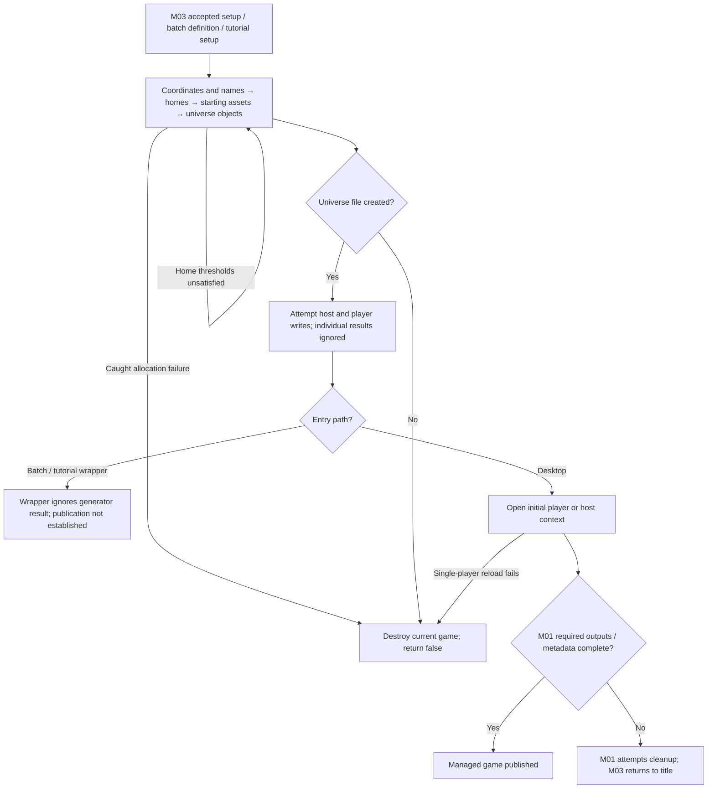
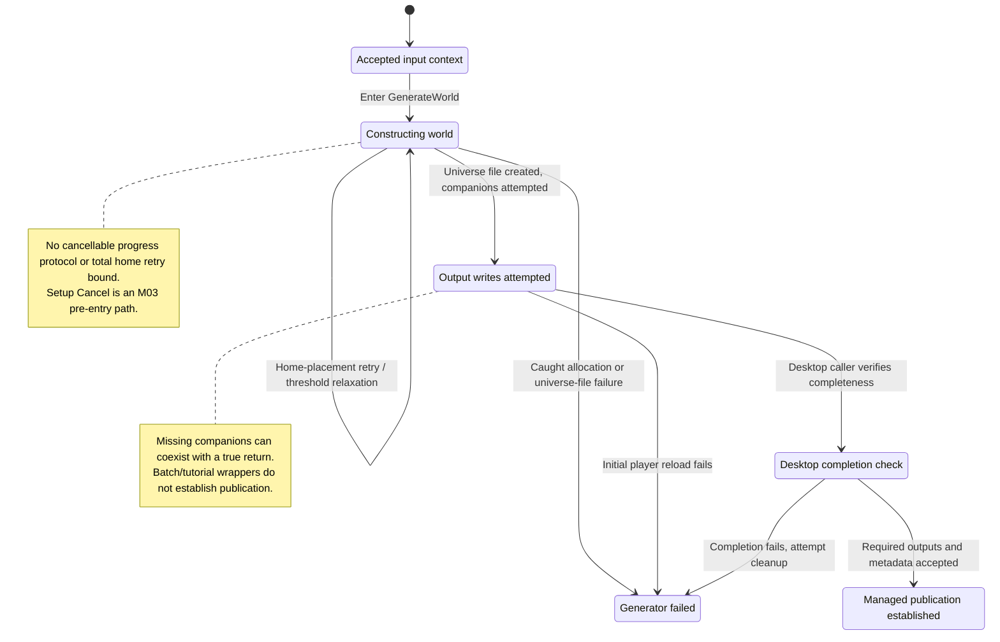

# M05 - Universe Creation

Status: source-derived specification; proposed interface boundaries are identified
explicitly. Inspected: `e2eae18cff0f990db20415c1c2262aed2022f95b`,
2026-10-24, with the local M03/M04/S01/S06 drafts. Entry point:
[module map](README.md).

The canonical formal definitions for generation formulas, small-step searches, starting assets and failure outcomes are in
[M05-universe-specification.dfy](M05-universe-specification.dfy). The prose and worked examples below
explain those definitions and retain their source evidence. See the
[coverage inventory](README.md#dafny-coverage-and-verification) for exact scope,
proof strength, dependency boundaries and verification commands.

[Workflow and state diagrams](#workflow-and-state-diagrams) provide a visual reading path.

## User stories and requirements

Actors are the player finishing setup, a host operator using batch creation,
and a developer reproducing creation results. Entry requires accepted M03/M04
inputs, catalogs and a fresh creation context. Behavior/evidence status follows
[the collection conventions](README.md#requirement-ids-and-status).

### Stories and workflows

<a id="m05-us01"></a>
**M05-US01 — Start with the configured universe (Observed).** As a player, I
want accepted setup to produce planets, homeworlds and starting assets so that
participants can begin the game. Finish enters the ordered generation stages,
constructs state, writes player/host outputs and hands off to the selected
session or host view. Race-specific assets and random-template substitution use
the existing rule/catalog owners; subsequent turn generation is M18.

<a id="m05-us02"></a>
**M05-US02 — Reproduce a creation result (Observed dependency contract).** As a
host operator or developer, I want to replay creation with controlled inputs so
that I can investigate differences. Capture entry mode, accepted setup, catalogs,
RNG context, clock inputs and file-write order, then compare the appropriate
logical/normalized outputs. A seed alone or a retry in an already advanced
process is not sufficient; tutorial and batch paths have distinct defaults.

<a id="m05-us03"></a>
**M05-US03 — Distinguish creation from publication (Observed).** As a player or
host operator, I want to know whether a complete playable file family exists
so that I do not mistake partial creation for success. The desktop checks
completeness before managed publication. On failure it attempts documented
cleanup; bare generator, batch and tutorial returns provide weaker guarantees.
Allocation, write and reload failures can leave partial files or lost prior state.

### Acceptance and traceability

| ID / story / status | Observable criterion | Canonical rules and implementation evidence | Verification or gap |
| --- | --- | --- | --- |
| <a id="m05-ac01"></a>M05-AC01 / US01 / Observed | Given accepted setup and fresh context, when creation runs, then its stages and random-race/home/fleet calls occur in the documented order. | [Entry workflow](#3-entry-points-and-workflow), [creation model](dafny/M05-creation.dfy) `StagePlan`, `FStageOrder`, `AssignmentEvents`, `FleetEvents`; `GenerateWorld`. | Model ordering and source; no full C refinement theorem. |
| <a id="m05-ac02"></a>M05-AC02 / US01 / Observed | Given an HE starting colony-ship choice, when initial fleets are created, then separate one-ship fleets can share one design; initial fuel is filled before later upgrades. | [Starting fleets](#46-starting-fleets-templates-and-the-recursive-dependency-boundary); `StartupFleet`, `ShipTemplates`, `Fuel`; `CreateStartupShip`. | Source/model; catalog/design helper conformance remains M11/S03. |
| <a id="m05-ac03"></a>M05-AC03 / US02 / Observed | Given the same simulation seed but different game-ID/BOF clock input, when raw output bytes are compared, then byte identity is not required; comparison must use the declared context and normalization policy. | [Context](#21-accepted-input-and-execution-context), [completion](#49-completion-state); `Context`, `GameIdentity`, `Salt`; S01 normalization. | Existing native regression compares normalized checkpoints; no seed-only byte reproducibility claim. |
| <a id="m05-ac04"></a>M05-AC04 / US02 / Observed | Given No Random Events, when construction runs, then artifact/pair-count draws are skipped as specified; deleting events after another seeded run is not an equivalent construction. | [Wormholes](#48-wormholes-and-event-flag); `PairCount`, `Artifact`, RNG contracts. | Defined branches/source; exhaustive draw-trace integration remains a gap. |
| <a id="m05-ac05"></a>M05-AC05 / US03 / Observed | Given a failed companion write, when bare generation returns true, then that return does not establish complete publication; desktop completion must independently check all required files. | [Recovery](#5-cancellation-errors-and-recovery); `GeneratorReturn`, `FPublished`, `PublicationNeedsEveryPlayer`. | Formal completeness condition and source; filesystem outcomes are external. |
| <a id="m05-ac06"></a>M05-AC06 / US03 / Proposed | Given a future stage-oriented creation interface, when a stage fails, then its result distinguishes construction, file creation and publication instead of reporting a single ambiguous success. | [Proposed interface](#5-cancellation-errors-and-recovery), existing `StagePlan`/`FPublished` conditions. | Logical milestones exist; typed error/API and UI implementation remain open. |

### Interaction and quality requirements

| ID / status | Requirement, check and target | Owner / evidence / remaining decision |
| --- | --- | --- |
| <a id="m05-ir01"></a>M05-IR01 / Observed | Desktop, batch and tutorial callers retain their separate entry/return behavior. Test each failure stage with its caller; no direct core keyboard or focus surface exists. | M03/M01/M16 own screens/focus/help; host wrapper owns command results. §3/§5 record current feedback limits. |
| <a id="m05-ir02"></a>M05-IR02 / Proposed | Future stage feedback names completion/failure in text and remains accessible through the caller's UI or CLI. Cancel availability must reflect actual cancellable stages. | M03/S05/host; no cancellable inner generation loop is currently promised. |
| <a id="m05-qr01"></a>M05-QR01 / Observed | Preserve operation order, integer/binary64 boundaries, RNG streams and catalog identity. Compare constructed state before projection and normalized output afterward. | M05/S04/S06/S01; §2 and formal models. Reproduction requires complete context. |
| <a id="m05-qr02"></a>M05-QR02 / Observed | Check complete identity/turn-matched file families before claiming managed publication; preserve documented partial-write and cleanup limits. | M01/S01; `FPublished`, existing creation failure cases. Crash/power-loss safety is not established. |
| <a id="m05-qr03"></a>M05-QR03 / Open | Benchmark generation and peak memory for smallest/largest setup and 1/16 participants with pinned catalogs/seeds/platform. Report stage duration, retries and failure rate; thresholds are unagreed. | M05/platform owners. Home-placement restart has no total retry bound; adding one would be a behavior decision. |

The dependency table in §1 and handoffs in §6 remain authoritative. Tutorial
interaction/display requirements are M16/S05; creation itself has no viewport.
Performance limits and a stronger failure interface are open decisions, not
properties inferred from a passing regression.

Checks for this story expansion are recorded in the
[collection verification](README.md#story-expansion-verification).

## 1. Purpose and scope

Turn accepted game settings and an ordered roster into a turn-zero universe,
players, homeworlds, designs, fleets, initial messages and paired wormholes;
write the initial game-file family and hand control to a player or host session.
This document owns the generation rules formerly in M03 §4.7. It describes
current behavior, including ordering and failure limitations, without authorizing
runtime changes.

The available specifications are sufficient to establish this boundary:

| Dependency | Available contract | Readiness for M05 |
| --- | --- | --- |
| [M03 setup](M03-new-game-wizard.md) | Settings, roster normalization, victory configuration and batch semantics | Ready; generation formulas were already audited here. |
| [M04 races](M04-race-data-model.md), [advantage points](M04-race-advantage-points.md) | Race snapshots, trait IDs, growth and leftover-point calculation | Ready for accepted races; random-race generation remains a source-backed dependency. |
| [S06 state](S06-shared-game-state.md) | Scoped IDs, units, entity relationships, initial-state conditions and execution state | Ready; structural Dafny conditions do not prove the generator. |
| [S01 persistence](S01-game-file-formats.md) | Initial file family, records, projections and completeness/recovery limits | Ready; successful publication must be distinguished from a generation return. |
| [S03 catalogs](S03-static-game-data-and-text.md), [M11 design rules](M11-ship-and-starbase-design.md) | Exact versioned data and helper implementations | Sufficient by the bounded references in §2.3; M11 now specifies design workflows and scalar rules; [S03](S03-static-game-data-and-text.md) now supplies the full versioned catalog inventory; complete helper refinement remains open. |

Thus M05 can be specified now. A from-scratch implementation still needs the
referenced catalogs and helper behavior; the other documents alone are not a
complete executable replacement for every dependency.

M03 owns setup editing and normalization; M04 owns race pricing; M01 owns
managed-game reservation/publication; S01 owns encoding; M11 owns part
availability/design statistics; M16 owns tutorial navigation; M18 owns subsequent
years. Victory evaluation and general colony, fleet, combat and AI rules do not
move into M05.

## 2. Inputs, outputs, and owned state

### 2.1 Accepted input and execution context

The logical input is the accepted [M03 setup and roster](M03-new-game-wizard.md#2-inputs-outputs-and-owned-state),
with 1–16 active players in an occupied prefix, resolved controllers, normalized
names/portraits, race snapshots, seven option flags and stored victory settings.
Race limits, text byte budgets and trait encoding remain in M03/M04. A random
race template still has bit `ibitRaceAIPlayer` set; M05 resolves that template
during the home-assignment loop, not during a separate preliminary pass.

The current API is `GenerateWorld(int16_t fBatchMode)`, reading and mutating
globals. It does not validate an arbitrary request or zero every `PLAYER`,
`GAME` or auxiliary collection. Callers establish a fresh creation context,
including empty old fleets/designs/things, message state and initial counters.
`NewGameWizard` destroys the previous game before committing creation;
`GenNewGameFromFile` and `CreateTutorWorld` zero `game` and populate their own
rosters. Do not call `GenerateWorld` against an arbitrary active game and expect
it to be a reset operation.

Reproduction also requires:

- Both simulation seeds, saved RNG stack/depth, and all earlier setup draws.
  The desktop continues the shared stream; batch optionally calls `Randomize`;
  tutorial always calls `Randomize(1234567890)`.
- Entry path and execution flags, including both `game.fTutorial` and
  `gd.fTutorial`, generation/session flags, and incoming `game.fSinglePlr`.
  Some branches use different flags; do not collapse them implicitly.
- The clock values used for `game.lid` and every BOF salt, the source/catalog/text revision,
  `qsort16` tie ordering and binary64/integer operation boundaries.
- Destination basename `szBase`, current output/storage conditions, and the
  library reservation when called through the desktop.

[S06 execution state](S06-shared-game-state.md#81-rng-and-determinism) defines the
shared stream and lifetime contract; [M03 arithmetic](M03-new-game-wizard.md#41-arithmetic-conventions-and-rng)
defines the recurrence and rounding. `Random(n)` advances its stream even when
`n<=0`; a seed alone is not a byte-reproducibility contract.

### 2.2 Results and state boundaries

The construction result comprises `game`, indexed planet coordinates/names and
planet records, player runtime state and assigned homes, per-player ship/base
designs, fleets/waypoints, five battle plans per player, messages and wormholes.
Use [S06 creation conditions](S06-shared-game-state.md#7-creation-facing-state-and-defaults)
for identities/references and its entity definitions for widths, units and
sentinels. Planet IDs follow the compacted/sorted coordinate order; player IDs
follow roster order; design and fleet identities are scoped to their owner.

Distinguish three observable milestones:

1. **Logical construction:** each player has its distinct owned home, referenced
   designs and starting assets. Temporary planet-0 stocks are resolved.
2. **File-family creation:** `.xy`, `.hst`, and `.m1` through `.mP` exist and are
   complete for the same identity and turn. The bare generator return does not
   guarantee this milestone.
3. **Managed-game publication:** M01 checks those outputs and writes `.library`.
   Opening a player session can additionally create session files; `.xN` and
   `.hN` are not prerequisites for the initial family.

`FWriteDataFile` calls `SetVisiblePlanFleet` before writing each snapshot. This
mutates inclusion/detail flags and counters; it is not a const serialization of
an untouched host object. Compare logical construction before projection and
compare decoded host/player outputs after writing. Do not infer a final global
counter is still the construction count after every player projection.

### 2.3 Minimum catalog and helper contract

All source/data references in this table are pinned to the inspected revision
above. Paths identify the complete authoritative entries, not examples. Future
catalog edits require a new evidence revision. S03 remains owner of the general
catalog specification.

| Required input | Authoritative data / helper | Generation-facing meaning |
| --- | --- | --- |
| Race presets and AI snapshots | [predefined races](../data/races/predefined.yaml), [AI races](../data/races/ai.yaml); `CreateRandomRace` in [race.c](../src/core/race.c) | Preserve complete `PLAYER` defaults and 6×4 AI table order. M05 only overwrites the fields described here. |
| Starting ships | [starting-ships.yaml](../data/parts/starting-ships.yaml), `LpshdefT` in [parts.c](../src/core/parts.c) | Copy full `SHDEF` templates; generation selects indices 0–18 as listed in §4.6. Other entries are not selected by this path. |
| Starting bases | [starting-starbases.yaml](../data/parts/starting-starbases.yaml), `LpshdefSBT` | Four templates in order: Starbase, Accelerator Platform, Porthole to Beyond, Starter Colony. Owner slots and stored design numbers differ; see §4.5. |
| Hulls and components | [parts catalog](../data/parts), [datagen.py](../data/datagen.py), [structs.h](../src/core/structs.h), [enums.h](../src/core/enums.h) | Full field schemas are the C types; slot category/index/count, six technology requirements, fuel/cargo units and trait restrictions must be preserved. IDs are positional and append-only. |
| Part eligibility | `FLookupPart` in [parts.c](../src/core/parts.c), `FShouldPartBeHidden` in [research.c](../src/core/research.c) | In the current player's context, test candidate category/index, trait restrictions, hidden trader parts and required technology. Pick the first available candidate; retain the old slot if none qualifies. |
| Fleet allocation and fuel | `LpflNew` in [util.c](../src/core/util.c), `LGetFleetStat` / `WtMaxShdefStat` in [ship.c](../src/core/ship.c) | Assign next free owner fleet index; create one stationary planet waypoint; fuel derives from hull and installed parts before upgrades. |
| Battle plans | [battle-plans.yaml](../data/battle-plans.yaml), `InitBattlePlan` | Five complete templates, positions 0–4: Default, Kill Starbase, Max-Defense, Sniper, Chicken. |
| Planet names and messages | [planets.txt](../text/planets.txt), [messages.txt](../text/messages.txt), [strings.txt](../text/strings.txt), [textgen.py](../text/textgen.py) | Preserve ordered name table, generated `cPlanetName`, message IDs/parameter contracts and UTF-8 bytes. Random fallback race names are M03 normalization inputs. |
| Embedded constants | [create.c](../src/core/create.c), [globals.c](../src/core/globals.c), [utilgen.c](../src/core/utilgen.c), [native.c](../src/platform/native.c) | Distance 12, size/density and wormhole tables, literal `rgPrimes` (including 279), RNG and compatible sorting. |

`datagen.py` emits designated initializers: omitted fields are zero, `rg` maps
select array elements, flag lists are ORed, hull slot count comes from `rghs`,
component `id` is position+1, and battle-plan `iplan` is position. A template copy
must retain fields such as `turn=1` even when the new game itself has `turn=0`.
These values are distinct domains, not a reason to rewrite the template.

## 3. Entry points and workflow

### 3.1 Desktop Finish

M03 validates/normalizes setup and reserves a portable unique library name
through M01. Its accepted state then enters `GenerateWorld(FALSE)` in this order:

1. Draw/prune/clump coordinates, choose all names, then initialize all planets.
2. Draw temporary planet-0 stocks; place homes; interleave each assignment swap
   with that player's random-race resolution, starting technology and tip messages.
3. Initialize every homeworld, bonuses, player runtime values and base designs.
4. In player order, create starting fleets and any second world, then upgrade
   that player's ship designs. A second-world draw precedes the next player's
   fleet work.
5. Clear planet-0 stocks if still unowned; initialize battle plans; create
   wormhole pairs; emit tampering messages; determine single-player mode/relations.
6. Set normal game identity from the clock; write universe, host and all players.
7. In single-player mode, destroy construction memory and load that participant's
   `.mN`, create child windows and call `PostOpenGame`. Otherwise select no player,
   clear the current log index and create the host windows.
8. M01 finalizes and checks the family; M03 handles failure by returning to title.

There is no cancellable generator progress protocol. Setup cancellation before
Finish remains [M03 recovery](M03-new-game-wizard.md#5-cancellation-errors-and-recovery).

### 3.2 Batch creation

`GenNewGameFromFile` parses a definition and normalizes the roster, then calls
`GenerateWorld(TRUE)`. [S01 batch grammar](S01-game-file-external.md#1-batch-universe-definitions)
is canonical for bytes/lines; [M03 batch semantics](M03-new-game-wizard.md#48-batch-input-is-a-separate-entry-point)
is canonical for threshold rounding, AI selectors and zero-based defaults.

Batch mode returns before opening any player/host UI and does not invoke
`FFinishLibraryGame`. Its wrapper currently ignores `GenerateWorld`'s result and
sets `fSuccess=TRUE` after the call. This is an observed failure-propagation gap,
not an assurance that either logical construction or output completed.

### 3.3 Tutorial creation

`CreateTutorWorld` establishes a separate fixed setup:

| Field | Value |
| --- | --- |
| Players | 2; predefined race 0 named Humanoid, easy Turin Drone AI named Berserker |
| Geometry | Tiny, Sparse, Moderate; target 24 planets before pruning |
| Options | BBS, public scores and no random events enabled; other zeroed flags off |
| Identity/time | `lid=9236297`, turn 0, tutorial flag true, localized tutorial title |
| Victory raw state | `rgvc[7]=128`, `rgvc[8]=129`; all other bytes initially zero |
| RNG | `Randomize(1234567890)` immediately before removing old companions/generation |

It attempts to remove `.h1`, `.x1`, `.h2`, `.x2` under `szBase`, then calls
`GenerateWorld(FALSE)` and ignores its return. Removal failures are not checked
here. It is not M01's fresh managed-game reservation/finalization workflow.
Tutorial generation adjusts planet environments, name probing, IFE technology
and IT bases as specified in §4. `gd.fTutorial` separately controls the
homeworld concentration minimum; recording only `game.fTutorial` misses that
input. M16 owns subsequent tutorial pages and turn-generation overrides.

## 4. Rules, calculations, and validation

The following is the directly invoked normal-game generation path in
[create.c](../src/core/create.c), `GenerateWorld` and `CreateStartupShip`. `Random(n)` below is
`R(n)` from [M03 arithmetic and RNG](M03-new-game-wizard.md#41-arithmetic-conventions-and-rng). Counts, coordinates, and stock quantities are integers; population is in
hundreds of colonists. The tutorial has a separate fixed-seed entry point and explicitly noted
overrides; it is not a fourth wizard page. The [starting
ships](../data/parts/starting-ships.yaml), [starting
starbases](../data/parts/starting-starbases.yaml), [planet rules](../src/core/planet.c), [ship
statistics](../src/core/ship.c), and [wormhole validation](../src/core/thing.c) are dependency
evidence.

For valid coordinates, `ICompLong` compares x only through a narrowed packed-point subtraction;
y is not a tie-breaker. Preserve `qsort16`'s Win16 equal-key ordering from
[native.c](../src/platform/native.c); `ICompLong` is in [utilgen.c](../src/core/utilgen.c). A
stable standard-library sort can change planet IDs and everything that consumes the following
random sequence.

### 4.1 Universe count and coordinates

Source [src/core/create.c](../src/core/create.c) and enum domains
[src/core/enums.h](../src/core/enums.h).

Size index `s` is Tiny 0, Small 1, Medium 2, Large 3, Huge 4. Density `d` is Sparse 0, Normal 1,
Dense 2, Packed 3. Starting distance is Close 0, Moderate 1, Farther 2, Distant 3.

```text
D = 400*(s+1)
dGalInv = D+2000
N0 = floor(D*D/5000)
N1 = N0 + floor(N0/4)*(d-1)
N2 = N1 + floor(N1/4) if d>=3 else N1
N = min(999,N2)
M = min(999,N+floor(N/7))
```

| Size | D | Sparse N | Normal N | Dense N | Packed N |
|---|---:|---:|---:|---:|---:|
| Tiny |400|24|32|40|60|
| Small |800|96|128|160|240|
| Medium |1200|216|288|360|540|
| Large |1600|384|512|640|960|
| Huge |2000|600|800|999|999|

These are target counts, not guaranteed final counts. Generate M candidates in array order,
drawing x then y as `1010+Random(D-19)`, inclusive 1010..D+990. Sort with `qsort16/ICompLong`.
`dGalMinDist=12`, squared 144. For each surviving point, inspect later sorted points while their
x<=current.x+12. If absolute y difference<=12 and squared distance<=144, remove the later point
by marking y=-100. If geometric removals are fewer than M-N, repeatedly draw `Random(M)`, reject
already removed entries, and remove only survivors until that target. Do not draw from a
compacted survivor list. If geometry removes more than M-N, there is no refill. Compact
survivors; actual count is `M-removals<=N`.

Clumping, if enabled in `GenerateWorld`, performs exactly actual-count iterations. Each draws a
planet `j`, finds its nearest different planet by a strict `<` scan (ties retain earlier index),
then mutates j in place using nearest n and old p independently per coordinate:

| Squared distance q | New coordinate |
|---|---|
| q<=144 | unchanged |
| 144<q<=324 | floor((4p+n)/5) |
| 324<q<=625 | floor((2p+n)/3) |
| 625<q<=1600 | floor((p+n)/2) |
| q>1600 | floor((p+2n)/3) |

Selections can repeat. Re-sort after the loop. There is no second separation-pruning pass.

### 4.2 Unowned planet initialization

Source [src/core/create.c](../src/core/create.c).

In a separate first loop over all planet IDs, choose each name by `Random(cPlanetName)` then
linear probing/wrap until an unused name; mark its name bit. Normal wizard wrap count is
cPlanetName (tutorial adds one). **Finish all name draws before starting any planet
environment/mineral draws.** Allocate and zero-initialize planet records, then loop over IDs
setting owner=-1, full detail, scanner 31. If random events are enabled, artifact flag is
`Random(3)==0`; disabling random events skips this draw entirely.

Gravity and temperature each are `1+Random(90)+Random(10)`, range 1..99, and radiation is
`1+Random(99)`, range 1..99. Current and original environmental values initially match.
Gravity/temperature probability is pair-count/900: pair count=x for 1..9,10 for 10..90,100-x for
91..99. Radiation is uniform under the modulo RNG approximation. Tutorial has planet5 subtract 5
on all axes and planet11 gravity +20; these are separate tutorial branches, not ordinary wizard
choices.

For each mineral, in mineral index order:

1. Beginner maximum minerals (`fExtraFuel`) sets concentration 100. Otherwise `C=31+Random(45)+Random(45)`, range 31..119. If radiation>=90, add `floor(Random(99-C)/2)`. There is **no clamp to 99**; negative/zero bound consumes a draw and adds zero.
2. Depletion level and surface stock become 0.
3. Accelerated BBS adds 5 if C<40.
4. After all three minerals, unless maximum minerals, draw t=Random(27). t>=18: no overrides. 9<=t<18: one override. For t<9, set k=t+1; while k<16 perform override then double k. Each override draws value first (`1+Random(30)`) then mineral index (`Random(3)`) and replaces concentration. Overrides can hit the same mineral repeatedly. Counts for t0..8 are4,3,3,2,2,2,2,1,1. Thus BBS can still end with1..30 concentrations because overrides happen afterward.

Prepare starting stocks on live planet 0 only. Per mineral: `S=10+Random(C0*10)`; if S<200 add
`155+Random(150)`; if BBS then `S+=floor(S/4)`. Each homeworld later copies planet 0's
**current** stocks and concentrations. This is a live object, not a frozen template; if planet 0
has already become a homeworld, its modifications can affect later homeworlds. At end, planet 0
stock is zeroed only if it remains unowned.

### 4.3 Homeworld placement

Source [src/core/create.c](../src/core/create.c).

P=number of players (>0), h=start-distance index. Define:

```text
L = 6*D
A = floor(D*D/P)-L
A = 0 if A<0 else floor(9*A/10)
I = floor(A*h/3)+L
Min = floor(9*I/10)
Max = floor(7*I/6)
```

I/Min/Max are squared-distance thresholds, despite the additive L being linear in D. Do not
reinterpret the expression dimensionally.

Pick first homeworld with at most 50 random draws, accepting the first in square
`[1000+D/4,1000+3D/4]` inclusive. If none inside, use the sampled point with strictly smallest
squared distance to that square (ties keep first). Subsequent eligible coordinate squares depend
on P:

- P>4: `[1000+floor(D/20),1000+LMulDiv(D,19,20)]`.
- 3<=P<=4: `[1000+floor(D/10),1000+LMulDiv(D,9,10)]`.
- P<=2: `[1000+LMulDiv(D,3,20),1000+LMulDiv(D,17,20)]`.

Each subsequent point must have strictly positive squared distance and distance>=Min from every
earlier home, and distance<=Max from at least one earlier home. Try 50 random draws; then
circularly scan the remaining candidate IDs, starting immediately after last failed draw. If no
candidate works, `Min-=floor(I/35)`, `Max+=floor(I/35)`, restart all placement with a new first
home. I remains unchanged. No explicit retry cap.

For each player index i, shuffle selected home IDs using `j=i+Random(P-i)` and swap i,j. This
loop also performs that player's random-race generation and tech initialization, so RNG draws
from `CreateRandomRace` are interleaved between shuffle draws. Do not shuffle all players first
and generate random races afterward.

### 4.4 Starting technology

Source [src/core/create.c](../src/core/create.c).

When race bit `ibitRaceAIPlayer` is set, call M04 `CreateRandomRace`. Clear dead/learned/trader
state, six technology levels and six spent-resource counters. The technology vector order is
Energy, Weapons, Propulsion, Construction, Electronics, Biotechnology:

| PRT | Initial technology |
|---|---|
| HE | [0,0,0,0,0,0] |
| SS | [0,0,0,0,5,0] |
| WM | [1,6,1,0,0,0] |
| CA | [1,1,1,2,0,6] |
| IS | [0,0,0,0,0,0] |
| SD | [0,0,2,0,0,2] |
| PP | [4,0,0,0,0,0] |
| IT | [0,0,5,5,0,0] |
| AR | [1,0,0,0,0,0] |
| JOAT | [3,3,3,3,3,3] |

Higher-starting-tech bit 29 raises only expensive-research fields (choice 0) to at least 3, or 4
for JOAT. Cheap Engines bit 8 then adds 1 Propulsion. IFE bit 0 adds 1 Propulsion unless
tutorial. Preserve this ordering.

### 4.5 Homeworld resources and leftover points

Source [src/core/create.c](../src/core/create.c); true growth
[src/core/race.c](../src/core/race.c).

Home starts owned, starbase index 0, homeworld=true, artifact=false; factories/mines/defenses
each 10; population 175 hundred with LSP, otherwise 250. Initial population guess is
`floor(pop/4)` masked to 12 bits. Copy planet 0 stocks and `max(30,planet 0 concentration)`
(tutorial minimum 25), scanner 0.

Points B=`min(CAdvantagePoints(race),50)`; AI overrides B=50. Do not duplicate M04's
advantage-point calculator here. There is no lower clamp at this stage; earlier race validation
is required. Expert AI (`lvlAi>=3`) adds `floor(pop/10)` population. Then accelerated BBS
computes `G=idealGrowth*(2 if HE else 1)` and `pop=floor(pop*(2*G+10)/10)`; at this line the
stored population guess is shifted left 2, not recomputed from pop.

Leftover setting effects:

| Choice | Effect |
|---|---|
| Surface minerals/default | K=10B; select lowest stock (tie rules below), add floor(K/4) to every mineral plus floor(K/4)+(K mod4) extra to selected; total addition K |
| Concentrations | q=1 for B=1 or 2, otherwise floor(B/2); choose first lowest concentration by strict `<`; selected+=q; every concentration+=floor((q+1)/2) |
| Mines | +=B>>1 |
| Factories | +=floor(B/5) |
| Defenses | +=floor((B+5)/10) |

Surface-mineral ties: index 0 wins only if strictly lower than both; otherwise index 1 wins if
stock1<=stock0 and stock1<stock2; otherwise index 2 wins. Tough/expert AI (`lvlAi>=2`) taking
surface/default also receives the concentration effect. No concentration cap is applied here. AR
subsequently sets factories/mines/defenses to 0, discarding those infrastructure bonuses.

Home environment axis = `min+floor((max-min)/2)` if nonimmune, else `1+Random(99)`.
Current/original values match. Human research allocation 15%; current research field 0, next
field 6, last-year resources 0, score 0; relation entries 0. Starbase templates and PP/IT/AR
adjustments come from `GenerateWorld` and static starting-starbase data. PP replaces first base
component with Mass Driver 5; IT with Stargate 100/250 outside tutorial. Size>tiny adds second
base design for PP/IT. AR remaps templates and its home uses design 1; surface scanner becomes
31 later. Base arrays allocate ten slots, copy four templates and mark slots
1–9 free. The active home template has built/existing counts 1. PP activates
slot 1 from the Accelerator Platform template for its second world; IT copies
Porthole to Beyond into slot 1 and sets stored design number 17. AR copies the
ordinary home base to slot 1 (number 17), places Starter Colony in slot 0
(number 16, built/existing counts 0), and keeps both designs available. Base
design numbers 16–25 are encoded separately from owner base-slot indices 0–9;
see S06/S01 rather than changing those domains.

### 4.6 Starting fleets, templates, and the recursive dependency boundary

Sources [src/core/create.c](../src/core/create.c),
[data/parts/starting-ships.yaml](../data/parts/starting-ships.yaml),
[data/parts/starting-starbases.yaml](../data/parts/starting-starbases.yaml),
[src/core/ship.c](../src/core/ship.c).

`CreateStartupShip(player,planet,templateOrDesign,copyTemplate)` optionally copies a template
into next design slot, increments its built/existing counters, creates a one-ship fleet at the
planet, fills its fuel to `LGetFleetStat(fleet,1)`, and sets battle plan 0. The return value is
actual player's design index, so repeated ships use it with copyTemplate=false.
`LpflNew` assigns the next available owner-local fleet index, zeroes the fleet,
sets full detail and planet coordinates, and creates one current waypoint at
that planet with warp 0, no task, valid-task=true and repeat-orders=false.
Starting minerals/population cargo remain zero.

Template IDs 0..18: Lilliputian Freighter, Shadow Transport, Smaugarian Peeping Tom, Armed
Probe, Long Range Scout, Shadow Sleuth, Teamster, Stalwart Defender, Swashbuckler, Santa Maria,
Pinta, Mayflower, Spore Cloud, Gadfly, Cotton Picker, Potato Bug, Little Hen, Change of Heart,
Speed Turtle.

Selections occur in this order:

1. PP:4 (home packet warp 1); WM:3 plus 7 and 13 if Construction>=3; JOAT:3 and 4; SS:2 when Energy<2 else 5, plus 1 if human; all others:2.
2. HE: three separate one-ship fleets using template 12, sharing one design; IT:11; AR:10; all others:9.
3. SD:16 and 18; CA:17; IT:7 and 8 and second world when size>tiny; PP:second world when size>tiny; JOAT:6 if Construction<4 else 8, plus 7 and 14.
4. ARM without OBRM: two one-ship fleets using template 15, sharing one design.

After fleet creation, upgrade eligible slots in each design to the first available component in
these candidate-index lists, using `FLookupPart` in current-player context:

| Existing slot | Candidates |
|---|---|
| Quick Jump 5 engine | [10,5,4,2,3]; omit 10 for colony hull with nonimmune preferred radiation<85 |
| Mole Skin/Cow Hide shield | [2,1] |
| Tritanium/Crobmnium armor | [2,1] |
| Laser/X-Ray beam | [3,1] |
| Alpha torpedo | [1] |
| Lady Finger bomb | [1] |
| Robo Midget/Robo Mini mining | [2,0] |
| Bat/Rhino scanner | [4,2,1] |

M05 consumes component availability; they do not redefine its full trait/technology rules. A
from-scratch implementation needs the static starting templates, hull/component catalogs and
`FLookupPart` contract in addition to this document. Fleet starting fuel uses sum over designs
of `shipCount*designFuelCapacity`. Design capacity is base hull fuel plus 250 per Fuel Tank, 500
per Super Fuel Tank, 200 per Anti-Matter Generator. Initial fleets have exactly one ship and
full-detail data. `LGetFleetStat` returns 32000 for non-full-detail fleets, a general helper
fallback not normally exercised here. **Fuel is filled before slot upgrades**, so preserve
ordering instead of refilling after upgrades. Full future ship statistics, costs, propulsion and
combat are outside M05.

### 4.7 Second starting world for IT/PP

Source [src/core/create.c](../src/core/create.c).

Only size>tiny. Eligible unowned planets have squared distance in inclusive interval
`[floor(15D/100)^2,floor(23D/100)^2]` from home. Scan planet order, increment fitting count `k`,
replace selected candidate if `Random(k)==0` (reservoir sampling). If none fits, take nearest
unowned planet, strict `<` tie handling. Source computes `floor(20D/100)^2` but never uses it.

If current desirability<10, reroll each environment axis to `2+Random(97)`, range 2..98, up to
100 iterations. The loop condition is `desirability<10 && count++<100`; afterward `count>=100`
copies home environment. Thus even success on the hundredth reroll triggers home-environment
fallback. An already suitable planet consumes no reroll draws.

Shared desirability rule ([src/core/planet.c](../src/core/planet.c)) required by this check:

```text
positive=0; negative=0; modifier=10000
for axis in gravity,temp,radiation:
  if max<0: positive+=10000
  else if min<=planet<=max:
    distance=abs(planet-preferred)
    halfwidth=preferred-min if planet<preferred else max-preferred
    quality=100-floor(100*distance/halfwidth)
    positive+=quality*quality
    penalty=2*distance-halfwidth
    if penalty>0:
      modifier=floor(modifier*(2*halfwidth-penalty)/(2*halfwidth))
  else:
    negative+=min(15, distance outside nearest interval endpoint)
if negative!=0: return -negative
rounded_root=trunc(sqrt(positive/3.0)+0.9)
return floor(rounded_root*modifier/10000)
```

The square root uses floating-point double and +0.9 before truncation; it is neither floor-sqrt
nor ordinary nearest rounding. Valid race ranges are prerequisites (zero halfwidth would divide
by zero). The modifier is truncated separately after each qualifying axis, in axis order. This
is actual planet desirability; the habitat integration used for race advantage pricing is a
different calculation.

Second planet becomes owned, starbase design 1, artifact=false, factories 4, mines 10, defenses 0, scanner
0, packet warp 1; retains generated mineral concentrations. From original home population H,
second population=`floor(2H/5)` and home=`floor(4H/5)`: combined approximately 120% of H,
**not** a conserving split. Both population guesses become floor(pop/4). Each second-world
mineral stock=`100+Random(200)`, range 100..299. Add one fleet using actual player's design 0
without copying a new template.

### 4.8 Wormholes and event flag

Sources [src/core/create.c](../src/core/create.c), [src/core/thing.c](../src/core/thing.c).

No Random Events gives zero pairs and skips pair-count draw. Otherwise
pairs=`min[s]+Random(var[s])`, with min=[0,1,1,3,4],var=[3,3,5,4,5]. Ranges by size: 0..2, 1..3,
1..5, 3..6, 4..8 pairs. Generate two endpoints per pair, each stability=`Random(3)`. When
creating second endpoint, link both partner IDs.

For each endpoint draw up to 100 positions, x then y=`1000+Random(D)` (1000..1000+D-1). Accept
first validation score 0. Otherwise keep position with strictly smallest numeric score (initial
best 16). Scores are **bitwise OR masks**, not additive penalties or Euclidean minimization.

Validation: outside nominal inclusive `[1000,1000+D]` square => 15. Exact overlap with any other
THING, any planet, or any enumerated fleet => 15. Within 10 units of an edge (strict x<1010 or
x>1000+D-10 etc.) OR 4. For squared distance q to each obstacle:

| Obstacle | OR 8 | OR 4 | OR 2 | OR 1 |
|---|---|---|---|---|
| Partner wormhole | q<25 |25<=q<100|100<=q<900|900<=q<4900|
| Other wormhole | q<16 |16<=q<64|64<=q<225|225<=q<900|
| Planet | q<25 |25<=q<100|100<=q<400|400<=q<784|

Own endpoint is excluded. Distances outside table add zero. All masks combine by OR. Partner
validation only applies when source has assigned partner ID. Disabling random events also
suppresses initial artifact draws; the resulting galaxy is not obtained by merely deleting
wormholes and artifacts from an otherwise identical seeded run.

### 4.9 Completion state

Creation initializes five battle plans per player. A roster is marked `fSinglePlr` only if
exactly one participant is non-AI or housekeeping AI. In that mode all relations between
distinct players become 2. The scan assigns ordinary AI a constant salt `156085230`, but stops
at the second human/housekeeping participant; AI after that break do not receive this assignment
from this scan. Outside tutorial, the game ID is `DwTickCount()`, so identical RNG state does
not by itself guarantee byte-identical output. `FCreateFile` in
[save.c](../src/core/save.c) also builds each BOF salt from `DwTickCount()` plus
`Random(2000)`; reproduce the entire clock-call sequence and file-writing draw
order for byte comparisons, including the fixed-identity tutorial.

`InitBattlePlan` copies `rgbtlplanT[0..4]`, assigns the owner, and changes
plan 0 to attack everyone only if `game.fSinglePlr` is already set at that call.
**Plans are initialized before the single-player scan above**; fresh zeroed
setup does not get that override retroactively. For fresh zeroed setup, the five plans therefore retain the catalog's attack
selectors. Each player already received four consecutive tip
messages during technology setup and a homeworld message during home creation.
For a tampered race, send its owner the altered-statistics message; notify every
other player only if the tampered player is non-AI (the source tests the sender's
`fAi`, not each recipient's).

Generation writes universe, host, and player data. In single-player mode it then loads the
human/housekeeping participant's initial turn; otherwise it opens host state with no selected
player. The library finisher separately verifies complete outputs for all participants before
recording success. See §5 for failures.

## 5. Cancellation, errors, and recovery

These are current outcomes, not proposed transaction guarantees:

| Failure/exit | Observed result and ownership |
| --- | --- |
| Cancel setup before Finish | M03 restores the saved `GAME`; RNG draws and separately saved race designs are not rolled back. |
| Home placement cannot satisfy thresholds | Relax minimum/maximum and restart; there is no total retry bound or cancellation hook. |
| Allocation failure caught by `GenerateWorld` | Its `setjmp` recovery calls `DestroyCurGame` and returns false. The previous active session is not restored. |
| `.xy` creation fails | Alert, destroy current game, return false. No generator-wide file rollback is established. |
| `.hst` or any `.mN` write returns false | The companion loop ignores the result and continues. A true return can coexist with missing/truncated outputs. |
| Initial single-player `FLoadGame` fails | Alert and return false after construction memory has already been destroyed. |
| Batch wrapper reaches its generation call | It sets success after the call without using the returned result; batch success alone proves neither construction nor completeness. |
| Desktop completeness or metadata fails | M01 attempts pending-file/directory cleanup, reports storage failure and clears its pending path. M03 destroys partial state and returns to title. Cleanup itself can leave residue on filesystem failure. |
| Tutorial companion removal or generation fails | `CreateTutorWorld` checks neither return and has no return status of its own. Its caller must not infer verified publication from the function returning. |

Normal identity, file BOF salts and generation consume clock/RNG input even if a
later step fails. Retrying with the same setup in the same process is not a
replay of the first attempt. There is no all-or-nothing memory/file transaction.
See [S01 recovery](S01-game-file-formats.md#6-cancellation-failure-and-recovery) and
[M03 recovery](M03-new-game-wizard.md#5-cancellation-errors-and-recovery).

A **proposed port interface** would separate accepted input/context, constructed
host state, per-player projections, and verified file-family publication, with
an error identifying the failed stage. That is a specification boundary, not an
existing API or an approved change to retry/cleanup behavior. Preserve the
observed behavior for compatibility until a separate decision changes it.

## 6. Interactions with other modules

| Owner | M05 handoff |
| --- | --- |
| M03 | Accepted settings, roster and normalization; Finish/cancel and failure UI. Victory settings are carried through, not evaluated during construction. |
| M04 / M02 | Race schema, pricing/random-race helper, selected snapshots and credentials. Creation must not modify a saved race-library version. |
| S06 | State domains, scoped identity, entity relationships and creation-only invariants. M05 owns how initial values are produced. |
| S03 / M11 | Versioned catalogs, availability checks and design/fleet helper contracts. Generation selects templates; it does not own general design rules. |
| M08 / M12 | Planet desirability, true growth and technology checks used by construction. General colony/research progression remains with those modules. |
| S01 | Universe/snapshot encoding, visibility projection, BOF/EOF and family matching. [Initial-family contract](S01-game-file-formats.md#41-create-a-game) is canonical. |
| M01 | Unique library reservation, output completeness validation, metadata and cleanup. The basename is not the game title or internal identity. |
| M06 / M17 | Initial player or host session after output creation. Later orders/hosting are separate workflows. |
| M15 / M16 | Initial tips/homeworld/tampering messages and tutorial-specific setup; display/navigation remains outside M05. |
| S04 | Clock, RNG support, filesystem and arithmetic compatibility. |

M05 does not resolve the documented protected-legacy-race conflict between
[root instructions](../AGENTS.md) and [ADR 0002](../docs/adr/0002-utf8-application-text.md).
It consumes accepted race snapshots; any reconciliation belongs at the import
boundary. All newly emitted games use the existing 2.85 UTF-8 file contract,
with unchanged record widths and byte limits.

## 7. Observable acceptance criteria and verification

These are acceptance requirements derived from source. Unless explicitly listed
as run below, they are not claims of automated coverage. Deterministic fixtures
must record setup, normalized roster, both seeds/stack, entry/context flags,
clock results for all calls, source/data/text revision and output comparison
stage. Decode the complete family, not only the displayed homeworld.

| Case | Required observation |
| --- | --- |
| All 20 size/density combinations | Target counts match §4.1; actual count is at most target and all compacted planet IDs/names/coordinates align. |
| Equal-x points; clumping q=144,324,625,1600 | Compatible sort tie order and exact inclusive branch boundaries; clumping has no subsequent pruning pass. |
| No Random Events | No artifact draws, no pair-count draw and no wormholes; do not compare against a galaxy produced by deleting events afterward. |
| Radiation>=90 and concentration>=99 | `Random(99-C)` still advances the RNG, adds zero and does not clamp concentration. |
| Planet 0 assigned to an early player | Later homes copy its then-current stocks/concentrations. If it stays unowned, clear its temporary stocks at completion. |
| Home placement repeatedly fails | Relax using fixed ideal-distance/35 and restart all homes; no invented retry cap. |
| Random-race roster slot | Race-generation draws occur between that player's shuffle draw and the next player's shuffle draw. |
| Each PRT and expensive-tech/CE/IFE combinations | Exact starting technology vector, then high-tech floor, CE increment, and non-tutorial IFE increment. |
| BBS, initial population 250, true growth 15 | Population 1000 internal units (100000 colonists); population-guess behavior follows §4.5 rather than a recomputed estimate. |
| Equal stocks, 50 leftover points, minerals | Add 125 to each mineral and another 125 to index 2; total 500. Tough/expert AI then receives concentration bonuses too. |
| AR with infrastructure leftovers | Factories/mines/defenses end at zero; home base slot 1, surface scanner 31. |
| HE or ARM repeated startup ships | Distinct one-ship fleets share one copied design; `cBuilt`/`cExist` increment per ship. ARM extras require OBRM absent. |
| IT/PP on Tiny versus Small | No second world on Tiny; on Small, owned second world/base and design-0 fleet. For H=250, home=200 and second=100, not a conserving split. |
| Second-world suitability reached on reroll 99 versus 100 | Reroll 99 can be retained; count 100 still copies home environment. |
| Wormhole placement exhausts 100 attempts | Use first strictly best numeric OR-mask score; zero-score placement is not guaranteed. Partners reference each other. |
| Initial battle plans from a zeroed GAME | Five copied templates; plan-0 single-player override is evaluated before single-player mode is derived, so it is not retroactively applied. |
| One human/housekeeping versus two | Single-player relations between distinct players become 2 only in the first case; the second qualifying participant stops the AI-salt scan. |
| Initial messages | Four tip messages and one home message per player; tampering notifications follow §4.9. |
| Successful family | Decode `.xy`, `.hst`, every `.mN`; match game/turn/player, settings, positions/names, owned homes, designs, fleets, plans, messages and reciprocal wormholes at the appropriate visibility level. |
| Missing/truncated player file or metadata failure | Desktop publication fails and attempts cleanup; a batch success status is insufficient. |
| Repeated tutorial creation | Fixed identity/setup and RNG initialization; old player histories/orders removal is attempted, tutorial exceptions apply, generation return remains unchecked. |

Existing evidence: [new-game workflow harness](../tests/compat/win32_newgame_workflow.h)
checks cancellation, Tiny creation, initial state, scanner visibility and file
artifacts; [workflow runner](../tests/compat/run_newgame.py) exercises managed-game
naming/publication/failure cases. The [Tiny batch fixture](../tests/scaffold/fixtures/newgame/tiny/game.def)
is a batch-input example. [Native regression](../tests/scaffold/REGRESSION.md)
and [unit-test guidance](../tests/unit/README.md) define broader checks. Tutorial
checkpoints provide partial coverage, not the complete 80-page workflow.

The [S06 Dafny model](dafny/S06-shared-state.dfy) checks structural creation-home,
reference and wormhole-pair conditions. It does not prove placement termination,
RNG draw equivalence, exact starting inventories, visibility or publication.
No new formal proof of `GenerateWorld` is claimed here.

### Verification for this specification

The generation path and its immediate helpers, catalogs, tutorial entry, batch
return handling and library finalization were re-read at the revision above.
All nine M03 generation subsections were transferred, with one canonical copy.
The following checks were performed on 2026-10-24:

| Check | Result |
| --- | --- |
| Relative links in M05, M03, S06 and the module index | 342 paths/anchors checked; no failures. |
| Independent arithmetic checks | All 20 size/density targets, nine concentration-override counts, and the BBS/second-world/mineral-bonus worked examples passed. |
| SDL Debug build | Passed using `macos-sdl-debug` in `dist/m05-macos-sdl-debug`; no compiler warnings in the build log. |
| SDL unit tests | All 17 `sdl_test_*` tests passed. |
| Full native regression | All nine scenarios through turn 150: 519 matches (21 with unused-storage warnings), 0 differences/errors, 0 reference inputs skipped; baseline unchanged. |
| SDL tutorial checkpoints | Available `win32_native_tutorial_smoke_dummy` passed; partial tutorial coverage only. |
| Additional New Game workflow test | Failed: `run_newgame.py` timed out after 45 seconds in `check_failed_switch_save`, before reaching its creation cases. This is not a pass for the creation matrix. |

The initial `make` commands could not use the default build cache because it
still referred to the repository's former directory; Go's default cache was
also unwritable in the sandbox. Verification used an isolated directory with
the same SDL preset and CTest filters, copied already-installed Python build
dependencies after network package installation failed, and used the writable
`dist/go-cache`. Full regression used `make regression` with
`REGRESSION_BUILD=dist/m05-regression-build`,
`REGRESSION_WORK=dist/scaffold/regression/m05-native` and
`REGRESSION_REPORT=dist/scaffold/regression/m05-comparison.json`. Host-specific
checks were not required because no game code changed. These environment
workarounds do not change the specifications
or runtime source. The acceptance matrix above is broader than the tests run.

## 8. Evidence and remaining work

Primary behavior evidence is [create.c](../src/core/create.c): `GenerateWorld`,
`CreateStartupShip`, `InitBattlePlan`, `GenNewGameFromFile`, `CreateTutorWorld`;
[createui.c](../src/ui/createui.c): `NewGameWizard`; and
[libraryui.c](../src/ui/libraryui.c): `FCompleteGeneratedFile`, `FFinishLibraryGame`.
The minimum dependency table names the other source functions. The original
module map's earlier revision is historical; this document and the retained
M03 generation evidence were checked at the revision in this document's header.

| Remaining item | Consequence / owner |
| --- | --- |
| Remaining S03/M11 contracts | [M11](M11-ship-and-starbase-design.md) now owns design workflows and scalar rules. Catalog bytes/helper implementations remain precisely referenced here; full random-race, part-eligibility and visibility extraction remains follow-up work. |
| Stronger publication/failure policy | S01-D04 remains open. Define batch/tutorial failure propagation and rollback separately before changing runtime behavior. |
| Placement termination and degenerate inputs | No total retry cap exists; valid accepted setup is assumed. A bounded/cancellable port needs an explicit decision and regression evidence. |
| Ordering-sensitive behavior | Live planet-0 copying, bonus ordering, pre-upgrade fuel, battle-plan timing and partial AI-salt initialization must not be silently normalized away. |
| Deterministic acceptance coverage | Add controlled clock/RNG and failure-injection cases for the matrix above; ordinary gameplay regressions do not prove every edge. |
| Exact tutorial execution context | Both tutorial flags and the caller's reset state matter; preserve those distinctions when defining a standalone entry API. |

No runtime code, save layout, regression baseline or gameplay rule is changed
by this specification.

## Workflow and state diagrams

These reading projections summarize [Desktop, batch and tutorial entries](#3-entry-points-and-workflow), [Failure and cancellation](#5-cancellation-errors-and-recovery) and the
[canonical contracts](M05-universe-specification.dfy) at the inspection revision recorded above.
States are explanatory milestones, not new persisted fields or a claim of
complete C/model refinement. Terminal nodes end the illustrated operation.

### Workflow



### State and recovery



The state projection names milestones, not a new generator API. Failure can consume RNG/clock input and lose the old session. Neither retries nor cleanup establish an all-or-nothing memory/file transaction.
