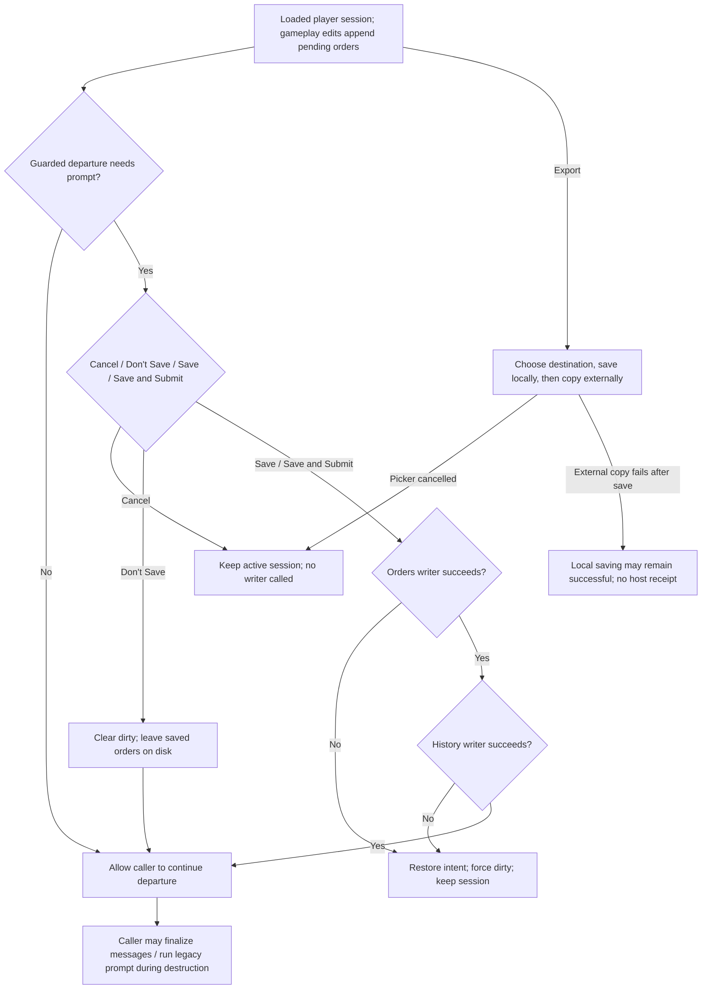
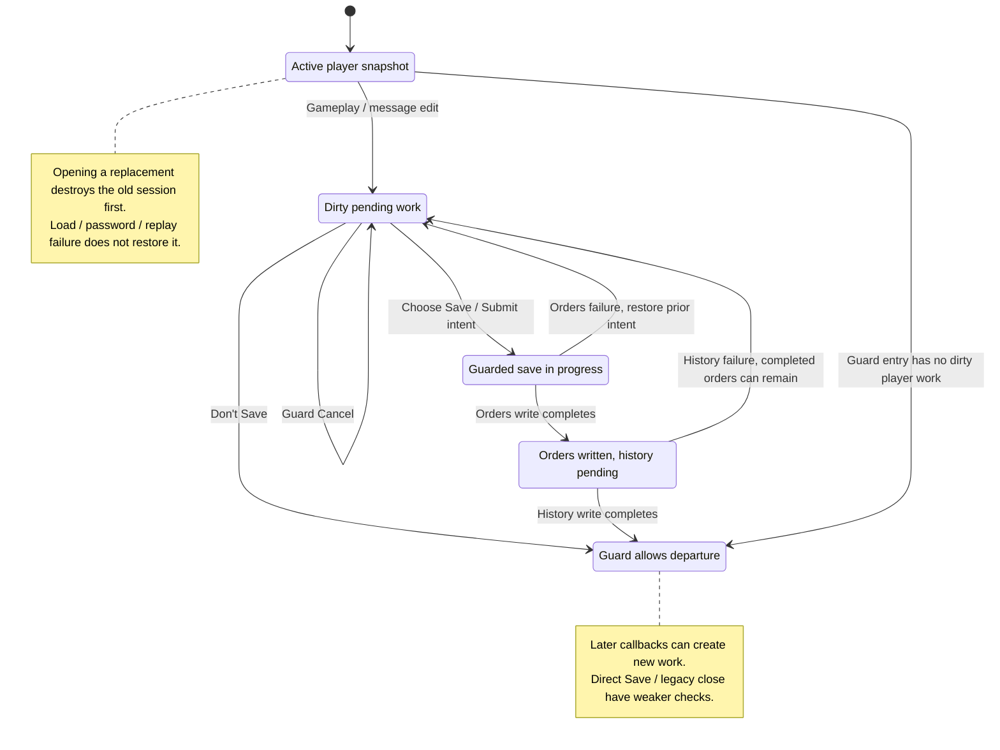

# M06 Player Session and Turn Orders

Status: source-derived specification; logical ownership remains proposed.
Inspected revision: `e2eae18cff0f990db20415c1c2262aed2022f95b`, with the existing
local S01/S06 specification drafts. Checked: 2026-10-24.

[Dafny entry point](M06-session-specification.dfy) includes the canonical
[session workflow definitions](dafny/M06-session.dfy). The coverage inventory
below identifies shared definitions and explicit external boundaries. Proofs
apply to those models, not to the C implementation.

[Workflow and state diagrams](#workflow-and-state-diagrams) provide a visual reading path.

## User stories and requirements

Actors are the player opening/editing a player turn and exchanging orders, with
the host as an external recipient of those files. Context includes a managed
game, chosen player/year and pending session state. Use the [status/evidence
conventions](README.md#requirement-ids-and-status); host receipt is not implied
by local submission intent or a completed write.

### Stories and workflows

**M06-US01 — Open the intended player turn (Observed).** As a player, I want to
open the selected participant's turn so that I see and edit the correct game
and year. Choose a player or Continue, authenticate when required, load the
snapshot/history, and replay applicable orders. Missing remembered-player data
requires a choice rather than silent substitution; failed loading can destroy
the attempted session without recovering its predecessor.

**M06-US02 — Decide what to do with pending orders (Observed).** As a player,
I want to save, submit, discard or cancel departure so that I control my pending
work. Through guarded library departure, choose an outcome; Save/Submit must
complete both orders and history before departure succeeds. Direct menu saves,
legacy close and later editor flushes have different documented failure behavior.

**M06-US03 — Export orders to the host (Observed).** As a player, I want an
orders export for my selected player so that I can deliver it to an external
host. Choose a destination, confirm replacement if needed, save through staging,
then copy externally. Cancel before saving leaves files alone; a later external
copy failure can follow a successful local save. Export itself does not submit
or demonstrate host receipt.

**M06-US04 — Continue with an incoming turn (Observed).** As a player, I want
to import or detect a newer player turn so that I can continue the game without
confusing another player's files. Import selects a matching managed game and
classifies identical/first/later/conflicting inputs. Waiting instead polls the
active turn, with separate save, discard and reload steps. Same-year changes
require conflict handling rather than the strictly-newer polling path.

### Acceptance and traceability

| ID / story / status | Observable criterion | Canonical rules and implementation evidence | Verification or gap |
| --- | --- | --- | --- |
| M06-AC01 / US01 / Observed | Given Continue's remembered player is unavailable, when Continue is invoked, then select a player explicitly instead of opening another by fallback. | [Selection](#31-select-and-open-a-player-turn); `Continue`, `FSelectPlayer` in [session model](dafny/M06-session.dfy); library caller. | Startup workflow cases; availability/metadata enumeration remains M01. |
| M06-AC02 / US01 / Observed | Given mismatched game/turn/generation orders, when direct log loading runs, then it follows the documented ignore path; malformed accepted content can instead fail the load. | [Pending orders](#33-edit-pending-orders); `LoadedLog`, S01 reader contracts. | Model vectors/source; wrong-player checking is stronger at other entry points and must not be inferred here. |
| M06-AC03 / US02 / Observed | Given dirty work at the guarded departure entry, when Cancel is chosen, then keep the session and call neither writer; when orders fail, do not attempt history and keep dirty state. | [Save/leave](#34-save-submit-and-leave); `GuardedLeave`, `CancelPreservesSession`, `GuardedFailureStays`. | Formal properties and injected startup workflow failures; excludes later editor callbacks. |
| M06-AC04 / US02 / Observed | Given orders succeed but history fails during guarded Submit, then remain in the session with restored intent and dirty work, while the completed orders file may already be marked submitted. | Same save section; `SaveNeedsBoth`, `SessionVectors`. | Model/source and failure harness; no two-file transaction claim. |
| M06-AC05 / US03 / Observed | Given accepted export destination and successful local saving, when the external copy fails, then local saving can remain successful; export preserves submission intent. | [Export](#41-export-orders); `ExportFlags`, `ExportPreservesIntent`, S01 publication relation. | Formal flags plus library failure cases; actual restoration/copy outcomes external. |
| M06-AC06 / US04 / Observed | Given a strictly later turn for Player 2, when successful import publishes it, then retire only Player 2's old orders and retain other players/history; changed same-year input is a conflict. | [Import](#42-import-an-incoming-player-turn); `ClassifyImport`, S01 `PublishLaterTurn`. | Source/model and startup import/conflict cases; disk import does not reload the active session itself. |
| M06-AC07 / US04 / Observed | Given a newer turn and dirty active state, when Wait offers discard and the player cancels, then remain active even though history saving has already been attempted. | [Waiting](#43-detect-and-load-a-new-turn); `WaitAction`, `FHistoryBeforeReloadPrompt`. | Source/model; broader timer/host race coverage missing. |
| M06-AC08 / US01 / Observed | Given an original nonzero saved kind that restoration clears, return successful open without another fallback. An original zero kind can cause fallback again when planets exist; host mode returns 0 after its dialog. | `FinishOpenPresentation`, `OpenPresentationVectors`; FOpenGame tail and M07 post-open contract. | Extracted tail cases include absent scanner and duplicate fallback; successful open is not proof of main-object promotion. |

### Interaction and quality requirements

| ID / status | Requirement, check and target | Owner / evidence / remaining decision |
| --- | --- | --- |
| M06-IR01 / Observed | Keep player/year selection, password prompts, guarded save choices, export replacement and incoming conflict choices distinct. Check each entry point's resulting state and feedback. | M06/M01; §3–4 and startup workflow harness. Direct/legacy paths are not upgraded to the guarded contract. |
| M06-IR02 / Proposed | Make player identity, pending work and completed/failed saving understandable without color alone; all choices have keyboard access and useful focus after failure. Distinguish local submission from host receipt in feedback. | M06/S05; accessibility/wording audit and supported-display cases missing. A universal reliable-save interface remains an open decision. |
| M06-QR01 / Observed | Validate scoped identity at the documented entry points and retain the specific partial-write/reload effects. Fault-inject orders, history, publication, restoration and copy separately. | S01/M06; acceptance/model traces. Power-loss durability and concurrent-host locking are unproved. |
| M06-QR02 / Observed | Preserve existing UTF-8 credential/name limits and order serialization without changing fixed widths. | M04/S01/S04, §3.2; credential hashing is not a new authentication protocol. |
| M06-QR03 / Open | Measure open/save/export latency and polling-to-ready delay with specified file sizes, storage and platform; distinguish timer interval from an end-to-end deadline. Budgets and display profiles are unagreed. | M06/M17/S05; current 10000/1000 ms timer constants do not guarantee file arrival or responsiveness. |

Scope and state remain in §§1–2; the coverage inventory and open decisions remain
in §§6/8. Gameplay legality belongs to the editors, host readiness to M17, and
byte-level replay/publication to S01.

Checks for this story expansion are recorded in the
[collection verification](README.md#story-expansion-verification).

## 1. Purpose and scope

M06 lets a player open a player turn, edit pending orders, save or submit them,
export orders for delivery, leave the session, and adopt a new turn. It owns the
meaning of these actions and their sequencing. Editing an order, persisting it,
marking it submitted, exporting it, and the host executing it are separate events.
Submission sets a file flag; it does not send a network message or advance time.

[M01 Game Library](M01-game-library.md) owns the library, destination selection,
file publication, names and metadata. S01 owns file envelopes, codecs, records,
replay and persistence; S06 owns shared logical state. M08–M14 own legal gameplay edits, M15 message editing,
M17 host readiness, M18 generation and M16 tutorial progression. This document
does not redefine their algorithms or authorize a refactor.

The [library ADR](../docs/adr/0001-desktop-managed-libraries.md) specifies separate
Games/Host Games views and explicit player selection. Its save-before-switch
intent is implemented by the guarded return-to-library route; it must not be
read as a guarantee for every older direct-open or destruction path.

## 2. Inputs, outputs and state

| State/input | Meaning and owner |
| --- | --- |
| Managed game, library name, exchange basename | M01's folder selection and external naming. Neither name replaces `game.lid`; separate copies may share that identity. |
| `game.lid`, `game.turn`, `game.wGen`, `idPlayer` | Active identity, u16 turn, 3-bit generation and zero-based player. `.mN/.xN/.hN` use player+1; host state uses `iplrNone`. Calendar display is turn+2400, defined by S06 `CalendarYear`. |
| Universe + player snapshot | Required `.xy` and `.mN`, current format 2.85. The snapshot is a player projection, not authoritative host state. |
| History + saved orders | Optional `.hN` knowledge and `.xN` edits/messages. History is not a substitute for a player snapshot. S01 defines companion checks and merge rules. |
| `lpLog`, `imemLogCur`, `imemLogPrev`, `hdrPrev` | Ordered plaintext command buffer, byte count and coalescing cursor. Payload widths and replay effects belong to S01. |
| `game.fDirty` | Pending unsaved work indicator. It is not a disk comparison and does not prove both orders and history were saved. |
| `gd.fSubmit` / on-disk BOF `fDone` | In-memory write intent versus saved submission status. `WriteBOF` copies the former into the latter. Neither `FLoadLogFile` nor `DestroyCurGame` synchronizes/resets `gd.fSubmit`; do not infer it from reopened orders. |
| Messages/editor copies | Outgoing messages are written after the counted command stream. An active message editor can create dirty work when finalized during destruction. M15 owns editor details. |
| `gd.fReadOnly`, `gd.fPartialTurn` | File-status/host-generation flags, not a general player-editor authorization policy. `GetFileStatus` reads the opened snapshot's filesystem status; generation may set partial-turn when orders are unsubmitted. |
| Password state | `lSaltCur`, cached `lSaltLast`, default password, AI/validation/hot-seat flags and prompt result. Hashing uses UTF-8 bytes and the existing S01 codec. |
| Presentation and timers | Selection/window state, waiting/ready timer, remembered player and last-played metadata. These outlive or are invalidated with different lifetimes. |

The model reuses S06 `SessionState`. In M06 its `fSubmitted` field specifically
projects `gd.fSubmit`; `SaveTrace.completedDone` separately records the flag of
a successfully completed orders write. `None` means completion is not established,
not that the old file is intact or absent. The model's typed player state cannot
represent host/title state; `fPlayer` guards those cases explicitly.

Outputs are an active loaded player turn, changed pending commands/messages,
completed or failed writes, an external orders copy, a published imported turn,
or a cleared session. Filesystem failure is an input to the workflow model,
not an axiom that a write succeeds.

## 3. User actions and workflow

### 3.1 Select and open a player turn

Sources: [libraryui.c](../src/ui/libraryui.c) `FSelectLibraryGame`,
`FContinueLibraryGame`, `RememberLibraryGame`; [mdi.c](../src/ui/mdi.c)
`FOpenGame`; [file.c](../src/core/file.c) `FLoadGame`.

Games lists available players with their individual years. Selection must name
an available player in 0..15 (`FSelectPlayer`); `PlayerSuffix` maps to 1..16.
Continue opens the remembered player if its turn remains inspectable. Otherwise
it selects that game, clears the player selection and requires an explicit
choice (`Continue`). Host Games selects `.hst` instead. External desktop files
go through Import; a managed startup selection enters `FOpenGame` directly.

`FOpenGame` destroys the old session before loading the selected file. It then
resets selection and creates child windows, restoring eligible presentation
state. Remembering an opened managed game updates its player/time metadata and
preserves the exchange basename. Metadata does not establish that a turn saved.

The presentation tail has a separate observed contract, `FinishOpenPresentation`.
For a player, remember the original `ini.grobjSel`, then send the post-open
command. If that original kind was nonzero and the returned kind is zero, return
1 immediately. Otherwise clear the kind and, when `cPlanet != 0`, call
`FFindSomethingAndSelectIt`, then return 1 regardless of that helper's result.
Thus an original zero marker can cause a second fallback after restoration,
whereas a marker cleared by a returning selection call is considered handled
without checking that the main editor changed. Without a scanner the command
does nothing, but this later fallback may still run. The host path opens its
host dialog and returns 0. [M07 owns the command and restoration controller](M07-galaxy-map-and-navigation.md#61-restoring-selection-after-opening-a-turn),
including the exact selection/message/tutorial call order; S02 owns saved-field
decoding. Native source cases cover this tail, not every preceding load/dialog
or callback side effect.

`FLoadGame` loads in this order:

1. Open and validate `.xy`, its GAME and star positions; initialize identity.
2. Attempt `.hN`, including remembered planets, designs, scores and filters.
   Missing history is optional; detected corruption warns and falls back to
   loading without that history. S01 owns the exact merge/validation behavior.
3. Open `.mN`, load player records, obtain the player password hash and check
   credentials, then read the player snapshot/results. Host loading takes its
   separate password/snapshot path.
4. Process appended turn segments when present. Core support and the library's
   single-segment import restriction differ; see S01, not an invented M06 limit.
5. For player loading, unless `gd.fDontDoLogFiles`, load and replay `.xN` after
   the snapshot. Recompute entity counts and finish the session.

`FLoadCompletes` projects these stages using externally checked parse/password
outcomes. Missing history and ignored orders are not fatal. Parse, allocation,
password or replay failure can destroy the newly loaded state and show the title
screen; the prior session is not restored. See S01 for exact validation gaps.

### 3.2 Authenticate and change a password

Sources: [utilgen.c](../src/core/utilgen.c) `FCheckPassword`, `LSaltFromSz`;
[utilgenui.c](../src/ui/utilgenui.c) `PasswordDlg`, `NewPasswordDlg`;
[log.c](../src/core/log.c) `FRunLogRecord`.

`PasswordAllowed` preserves the check order: zero hash, matching cached hash,
AI mode, or a nonempty matching default password permits access. Otherwise
validation mode fails without prompting; interactive mode uses `PromptPassword`.
A successful dialog caches the credential only outside hot-seat mode. Failed
entries increment `vcPasswordFailures` and delay 1000 ms below 10 failures,
5000 ms below 100, otherwise 10000 ms (`PasswordDelay`). The dialog remains
open after a mismatch; Cancel fails the load. Hash equality, including password
confirmation, is the source's criterion, not string equality or cryptographic
authentication. UI retrieval failures request re-entry rather than substitution.

The player Change Password command requires a loaded player and checks current
credentials; a single-player session with nonpositive current hash is excluded
by the menu handler. `NewPasswordDlg` logs a four-byte `rtChgPassword` on OK.
Replay changes the player's hash only during generation, so reopening the
current turn still uses its snapshot credential. Cancel appends nothing. The
hash calculation is S01 `Password`; tag 36 and generation-only effect are S01
orders. Host password changes write the host file immediately and belong to M17.

### 3.3 Edit pending orders

Sources: [log.c](../src/core/log.c) `WriteMemRt`, `CancelMemRt`, `DirtyGame`,
`FRunLogFile`; [S01 orders](S01-game-file-orders.md).

Gameplay editors update working state and log commands; M06 does not create a
second legal-order validator. `Append` models the basic write: disabled logging
leaves the stream/dirty flag unchanged; otherwise append a framed record and
mark dirty. Dirty transitions update the message title outside AI mode. An
unchanged dirty bit does not trigger that update.

`LogBytes` counts two header bytes plus each payload. `FLogWarning` is strictly
`current + payload + 2 > 32000`. The source warns but continues: this is not a
hard limit. `FBoundedLog` is explicitly proposed validation, not observed runtime
rejection. It additionally respects the 10-bit record payload capacity.

Coalescing, cancellation of a preceding record, zero-net transfers and individual
command effects are canonical in S01; order is significant. Replay suppresses
logging, tries every command even after a false result, accumulates failure,
restores the logging flag and invalidates fleet links. `ReplaySucceeded` models
the aggregate result only; S01 owns partial state effects. Replay is neither
transactional nor generally idempotent.

`FLoadLogFile` can return success with no commands for a missing file, wrong
version/header, different game, older/newer turn or different generation.
Malformed accepted content/read failures can instead fail. `LoadedLog` projects
these branches; tutorial embedded log streams remain an S01/M16 external boundary.
The direct loader does not itself validate BOF player/kind/submitted state. The
stronger `FOrdersForSession` checks S06 `OrderEnvelope` game/player/turn and
explicit generation; it is a validated boundary, not a claim about that reader.

### 3.4 Save, submit and leave

Sources: [fileui.c](../src/ui/fileui.c) `AskSaveDialog`, `FCanLeaveCurrentGame`,
`PromptSaveGame`; [mdi.c](../src/ui/mdi.c) `CommandHandler`;
[log.c](../src/core/log.c) `FWriteLogFile`, `FWriteHistFile`;
[save.c](../src/core/save.c) `WriteBOF`.

Save writes `.xN` and then `.hN`; it normally does not rewrite `.mN`. Save sets
submission intent false; Save & Submit sets it true. The orders writer may first
log a changed default production template, emits commands and outgoing messages,
then clears dirty on success and requests a displayed turn-number update.
History saves knowledge/filters/score history, not a new authoritative turn.

| Entry | Observed outcome / canonical projection |
| --- | --- |
| Return to library/title, no active player or no dirty work | `FCanLeaveCurrentGame` succeeds without prompting or writes (`FNeedsPrompt`, `GuardedLeave`). |
| Guarded Cancel or dialog result 0 | Keep the active session; no writer called. `DialogChoice` maps -2 and 0 to Cancel. |
| Guarded Don't Save | Clear dirty, allow departure; no file deletion. Existing saved orders will replay if reopened. |
| Guarded Save / Save & Submit | Set chosen intent, write orders, write history only if orders succeeded. Allow departure only when both succeed. |
| Guarded save failure | Restore previous intent, force dirty true and keep the session. Completed orders may already contain the new submission flag if history failed. |
| Direct menu Save / Save & Submit | Check for a newer turn first; otherwise set intent and call both writers without checking their results (`DirectSave`). History failure after successful orders can leave dirty false. |
| Legacy `PromptSaveGame` | Save choices call both writers without checking results. Cancel has no veto result for its caller (`LegacyPrompt`). |
| Destruction / direct replacement | `DestroyCurGame` finalizes active message entry, may call the legacy prompt, then releases the game. `FOpenGame` uses this path directly. |

The guarded function is a preflight, not an atomic leave operation. Return to
title next writes preferences and calls `DestroyCurGame`. Message finalization
can create new dirty work after the guard; that work reaches the legacy prompt.
The guaranteed failure/cancel properties apply to the guard's entry state, not
to all subsequent GUI callbacks. Close/exit also lacks a universal guarded-save
contract; callers must not generalize the return-to-library behavior.

## 4. Export, incoming turns and waiting

### 4.1 Export Orders

Source: [libraryui.c](../src/ui/libraryui.c) `FExportLibraryOrders`.

Requires an initialized library, loaded planets, nonzero game identity, valid
active player and managed path. Suggest the exchange basename and `.x(player+1)`;
the final extension is corrected to that player's extension. Confirm replacement
of an existing target after correction. Reject a target equal to the managed
orders path under the function's case-insensitive comparison.

Cancel/declining replacement occurs before save. After destination acceptance,
write orders and history to sibling staging files, preserve prior history if it
exists, install history then orders, and restore the original base path and
submission intent. On save/install failure restore dirty/intent and attempt
history restoration; restoration itself may fail and is reported. On success,
copy the managed orders through a temporary external file to the destination.
A failed external copy can therefore leave successfully saved local orders and
history, with dirty cleared. Export never independently submits the turn.

`ExportFlags` specifies these control-state outcomes. `FPublication` delegates
staging/restoration states to S01External; it does not promise crash atomicity.
The orders writer's possible template append is an external preparation effect,
so restoring flags is not a claim that all memory is byte-for-byte unchanged.
Whole-game export and its older prompt path remain M01/S01 responsibilities.

### 4.2 Import an incoming player turn

Sources: [libraryui.c](../src/ui/libraryui.c) `FImportSubsequentTurn`,
`FReplaceConflictingLibraryTurn`, `FImportConflictingTurnAsCopy`;
[S01 external workflows](S01-game-file-external.md).

Validate the incoming player suffix/file and match managed destinations by
internal identity. No match falls back to importing a new game; multiple matching
copies require destination selection. `ClassifyImport` assumes those checks:

| Case | Result |
| --- | --- |
| Identical bytes to existing player turn | Success without replacement or orders retirement. |
| First turn for that player | Validate player membership using the stored universe, stage and install; keep existing history and even pre-existing host orders. |
| Strictly later existing turn | Stage and revalidate, preserve prior turn, install, then retire only that player's `.xN`. Skipped years are allowed. Keep histories, existing backups and other players' turns/orders. |
| Changed same-year or older turn | Offer Cancel, Replace or Separate Copy. Replacement creates a backup; a separate copy leaves the selected game unchanged. |

Retirement failure attempts to restore the prior turn. A restoration failure
leaves an explicit recovery obligation and preserves the reported prior copy.
This is not an all-or-nothing filesystem transaction. `FImport` reuses S01's
logical successful effects and `FPublication` its failure-stage relation. Import
publishes disk state; it does not itself reload an active in-memory player turn.

### 4.3 Detect and load a new turn

Sources: [file.c](../src/core/file.c) `FNewTurnAvail`; [mdi.c](../src/ui/mdi.c)
`CommandHandler`, `HostTimerProc`, frame `WM_SYSCOMMAND`; [save.c](../src/core/save.c)
`FMarkFile`.

`FNewTurnAvail` temporarily sets `game.turn=0`, silently opens the player turn
with multi-turn checking, tests strictly greater turn, then restores the old
turn and generation (`FNewTurn`). A changed same-year snapshot is not detected
as a new turn. The helper sets `fFileErrSilent` true; surrounding callers differ
in restoring it. This polling path is distinct from library conflict import.

Wait for New Turn requires loaded planets, an active player and multiplayer
mode (`WaitAction`). If a newer turn exists, write history **before** warning
about dirty work. Cancel keeps the active session but may already have written
history. Accept discards dirty work, destroys the old game and loads the new
snapshot; failure does not recover the old session. Direct Save uses this same
new-turn branch before writing orders.

Without a new turn, Wait sets submit true, calls both writers without checking
results, minimizes the frame and starts a 10000 ms wait timer, polling once
immediately. It may enter waiting despite save failure. On detection the timer
loads the turn and switches to a 1000 ms ready timer, flashes and beeps. Timer
scheduling/arrival is external; no eventual-arrival guarantee is specified.

Restoring/maximizing the frame also probes for a new turn. Without an active
timer it offers a load choice; with one it can load automatically. Returning
from submitted waiting without a new turn offers to resume editing; acceptance
attempts `FMarkFile(...mdMarkDone,FALSE)`. If marking fails, it warns and attempts
reload. That mark helper checks version/game identity but is not a host lock or
compare-and-swap on player/year. These OS-event and concurrent-host interactions
are explicit boundaries, not a race-free protocol.

Single-player Generate, AI completion and actual turn execution belong to M17/M18.
The desktop saves then generates and reloads; the older handler ignores several
save/generation return values. Tutorial generation can use bundled next-year
snapshots and remove `.x1`; its progression belongs to M16, not the multiplayer
submission model.

## 5. Cancellation, failure and lifetime

The distinctions in §§3–4 are observable requirements. In particular, a failed
history save does not undo a completed orders write, an export-copy failure does
not undo a local save, and a failed load does not recover the previous session.
`DestroyCurGame` releases planet/fleet/thing/order/design/message allocations,
invalidates report/link caches and selection pointers, clears current player,
game identity, counts, turn and log cursors, and closes game windows. Preferences
and library files persist. It does not clear every global flag or credential.
S06 `DestroySession` is a proposed logical invalidation model, not a literal
field-by-field transcription of this routine.

No M06 model assumes malformed record safety, successful memory allocation,
atomic direct writes, disk flush durability, idempotent replay, host receipt,
or rollback of arbitrary GUI side effects. Undefined out-of-range C buffer
access/overflow has no defined transition here. Preserve those boundaries when
using the spec for a port; stronger behavior requires a separate decision.

## 6. Coverage inventory and module interfaces

Every rule group above has a named definition or the specific boundary below.
Definitions are in [M06Session](dafny/M06-session.dfy) unless otherwise linked.

| Rule group | Canonical definitions / external obligation |
| --- | --- |
| Identity, units, envelopes and session flags | S06 `SessionState`, `OrderEnvelope`, `Matches`, `CalendarYear`; M06 `PlayerSuffix`, `FOrdersForSession`. Generation is supplied separately; existing S01 BOF constraints define its 3-bit domain. |
| Selection, remembered player | `FSelectPlayer`, `Continue`; M01 supplies inspected availability and metadata. Enumeration, paths, case rules and last-played tie order stay with M01/S01External, not reimplemented here. |
| Load sequence, optional history, parse/replay failure | `FLoadCompletes`, `LoadedLog`; [S01 files](dafny/S01-files.dfy) and [formats](S01-game-file-formats.md) own parsing, history merge, appended segments and incomplete raw-reader checks. Memory allocation, actual GUI destruction and title restoration are external outcomes. |
| Password access and retries | `PasswordAllowed`, `PasswordDelay`, `FCachePassword`, `FChangePassword`, `FPasswordConfirmed`; S01Codecs `Password` and M04Race `Credential` own the hash and signed adapter. UI control byte limits/retrieval and dialog event scheduling are native UI obligations; they must preserve the stated source calls. |
| Pending edits and dirty state | `Append`, `LogBytes`, `FLogWarning`, proposed `FBoundedLog`; [S01 orders](S01-game-file-orders.md) and [S01Orders](dafny/S01-orders.dfy) own coalescing and every command payload/effect. Gameplay legality remains M08–M14. |
| Replay and outgoing messages | `ReplaySucceeded`; S01Orders and S01Files `OrdersRecords` own ordering and message encoding. M15 editor flush (`FFinishPlrMsgEntry`) is an explicit prerequisite/effect outside the flag projection, including late dirty work at destruction. |
| Leave choices, save and submit | `DialogChoice`, `FNeedsPrompt`, `GuardedLeave`, `DirectSave`, `LegacyPrompt`; writer template preparation and byte-level partial files are S01 obligations. `completedDone` records only a completed write. |
| Export | `ExportFlags`, `FPublication`; S01External `FExportFailureAfterSave` and `FTransition` describe partial publication. Native path/rename/copy results, collision/race handling and restoration are external checked outcomes. |
| Incoming turn | `ClassifyImport`, `FImport`; S01 `FLaterTurn`, `PublishLaterTurn` and S01External `FImportEffect` preserve other players and history. Raw file equality, validation, destination choice and conflicts are M01/S01 inputs. |
| New-turn detection, discard/history order, waiting | `FNewTurn`, `WaitAction`, `FHistoryBeforeReloadPrompt`, timer constants. Restore/maximize callbacks, `FMarkFile`/host races and tutorial/single-player generation are explicit external boundaries described in §4.3. |
| Cleanup and stale references | [S06 lifetimes](dafny/S06-state-extensions.dfy); actual allocation/window/pointer invalidation is a C/UI obligation. No blanket reset of `gd` or credential state is assumed. |

These are interface projections, not a new implementation. M06 neither owns
binary layouts nor duplicates S01's full file-content model. It consumes accepted
command effects and completed/failed I/O results. The model deliberately exposes
where a reliable future interface would need richer errors or stronger policy.

## 7. Acceptance criteria and verification

| Case | Required observation / existing evidence |
| --- | --- |
| Guarded Cancel on dirty Player 2 | Same active player and pending work, no writer calls; `CancelPreservesSession`, startup workflow harness. |
| Guarded Save/Submit with orders failure | Stay dirty with original intent; do not attempt history; `GuardedFailureStays`, `SaveNeedsBoth`. |
| Submit orders succeed, history fails | Stay dirty, restore old intent, but completed on-disk orders may be submitted; `SessionVectors`. |
| Direct save has history failure | Successful orders may already clear dirty; distinguish from guarded save. |
| Don't Save then reopen same turn | Discard only pending memory; previously saved orders remain available for replay. |
| Missing remembered player's turn | Choose explicitly; no silent fallback to another player; `Continue`. |
| Old/new/different-generation orders | Ignore under direct load conditions; malformed accepted body can fail; `SessionVectors` and S01 reader tests. |
| Wrong-player validated envelope | Rejected by `WrongPlayerRejected`; not claimed for raw `FLoadLogFile`. |
| Log total exactly 32000 / 32001 | Warning only above 32000; disabled logging leaves state untouched (`LoggingDisabledPreserves`). |
| Replay contains false result followed by another command | Later command still attempted; overall failure, no rollback. |
| Export cancelled / staging failed / external copy failed | Respect the distinct outcomes in §4.1; `ExportPreservesIntent`. |
| Later Player 2 turn skips a year | Only Player 2 advances and loses old orders; history/backups/Player 1 preserved by S01 `PublishLaterTurn` contracts. |
| Identical / first / changed same-year import | No-op / install without retiring orders / conflict choice respectively (`ClassifyImport`). |
| New turn detected while dirty; Cancel | Keep active turn; history write has already been attempted. |
| Wait after failed save | May still minimize and poll; do not report it as confirmed submission or receipt. |
| Password command saved and current turn reopened | Old snapshot credential remains until host generation applies tag 36. |
| Failure after destroying old session | Return failure/title as applicable; do not promise restoration of old allocations or edits. |

Source test evidence: [startup workflow harness](../tests/compat/win32_client_startup.c)
and [workflow runner](../tests/compat/run_newgame.py) contain cancel/switch
Save/Don't Save/Submit, injected orders/history failures, Continue, later-turn,
and conflict/backup cases. [test_log.c](../tests/unit/test_log.c),
[test_save.c](../tests/unit/test_save.c) and [test_native_files.c](../tests/unit/test_native_files.c)
exercise persistence helpers. Existence of a case is not a claim that it ran.

### Checks performed on 2026-10-24

| Check | Result |
| --- | --- |
| `python3 tests/spec/verify.py --time-limit 120` | Dafny 4.11.0; all 25 Dafny files and include closure: **775 verified, 0 errors; auditor 0 findings**. No assumptions or disabled verification added. |
| Collection links/includes, anchors, exact casing, prefixes and whitespace | **624 checked, 0 errors**. An initial check caught a mistaken unit-test filename link; corrected before the passing run. |
| `cmake --preset macos-sdl-debug -B dist/m05-macos-sdl-debug` and build of that directory | Passed, no compiler warnings. Reused the existing valid preset build directory. |
| CTest, dummy SDL environment, `^sdl_test_\|win32_native_tutorial_.*dummy$` | **18/18 passed**: 17 SDL unit suites and the available tutorial smoke checkpoint; not the complete 80-page tutorial. |
| `make regression` | Nine scenarios through turn 150: **519 matches** (21 unused-storage warning matches), **0 differences/errors**, 0 reference inputs skipped. Baseline unchanged. |
| CTest `^win32_client_newgame_dummy$` | **Passed**, 101.99 seconds, including the runner's failed-switch-save cases. This is a new successful run; the earlier M05 timeout remains historical evidence. |
| `git diff --check` | Passed. No runtime source or baseline changed; host-specific checks were not required. |

Regression used `GOCACHE=$PWD/dist/go-cache`,
`REGRESSION_BUILD=dist/m05-regression-build`,
`REGRESSION_WORK=dist/scaffold/regression/m06-native` and
`REGRESSION_REPORT=dist/scaffold/regression/m06-comparison.json`. Build/CTest
used the same preset and filters as `make test-unit` / `make tutorial`, with
`SDL_VIDEODRIVER=dummy`, `SDL_AUDIODRIVER=dummy`, `STARS_SDL_RENDERER=software`
and `STARS_FILE_DIALOG_BACKEND=compat`. The separate existing build paths avoid
the default caches' former repository path; no build configuration was edited.

The acceptance matrix is broader than the tests and formal witnesses; no proof
of C refinement, general GUI scheduling or concurrent-host safety is claimed.

## 8. Evidence and open decisions

All runtime evidence above was read at the revision in the header. Existing
[S01](S01-game-file-formats.md), [S06](S06-shared-game-state.md) and the library
ADR remain the shared references. The older module overview's base revision
is historical, not the inspected revision of this module.

| Open decision | Consequence / proposed owner |
| --- | --- |
| One guarded transition for direct-open, close, reload and late message flush | Current cancellation/save failure handling differs by path; M06/UI follow-up. No behavior fix is included here. |
| Reliable save result and durable submission status | Separate memory intent, successful orders, successful history and host receipt; M06/S01/M17. S06's `fSubmitted` must not conceal those differences. |
| Concurrent-host handshake | Poll/mark/load are separate I/O operations; a file flag is not mutual exclusion. M17/S01 must define any stronger protocol. |
| Log capacity and malformed replay | Current warning is not enforcement and raw reader checks differ. S01 owns validation hardening; editor semantics stay with gameplay modules. |
| Import versus live-session reconciliation | Library publication does not reload state. Define routing and pending-edit policy before introducing automatic reload. |
| Fault-injection/UI acceptance coverage | Complete the matrix, especially late editor flush, direct-save failure, mark/reload races and restoration failure. |

This batch changes only specifications and their index. Runtime code, file
format, gameplay, changelog and regression baselines are unchanged.

## Workflow and state diagrams

These reading projections summarize [Guarded save and departure](#34-save-submit-and-leave), [Export and incoming turns](#4-export-incoming-turns-and-waiting) and the
[canonical contracts](M06-session-specification.dfy) at the inspection revision recorded above.
States are explanatory milestones, not new persisted fields or a claim of
complete C/model refinement. Terminal nodes end the illustrated operation.

### Workflow

### State and recovery

The diagrams scope the stronger return-to-library guard; they do not upgrade direct Save, legacy prompts, or every close path. Wait can write history before a later Cancel. Import publishes disk state without automatically replacing the live session.
