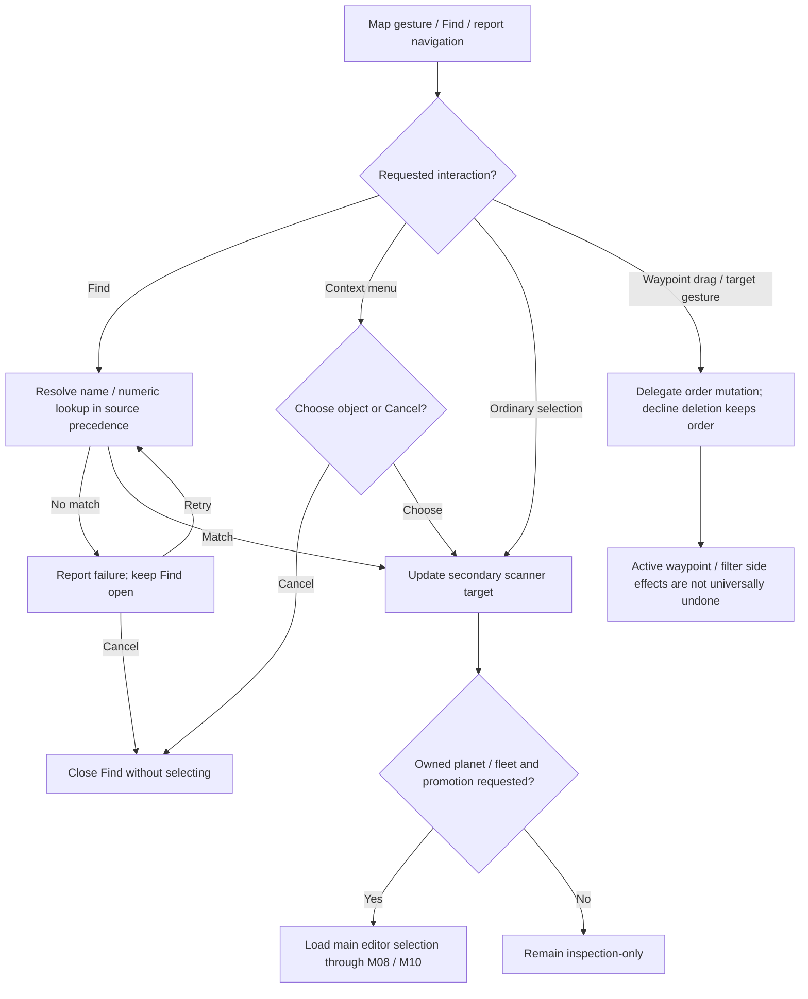
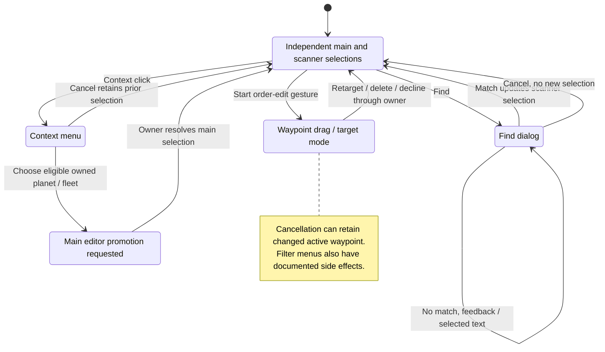

# M07 — Galaxy Map and Navigation

Status: source-derived specification with explicit UI and neighboring-module boundaries.
Inspected: 2026-10-24, `e2eae18cff0f990db20415c1c2262aed2022f95b`, plus the
existing local specification collection. Runtime sources were unchanged.
Canonical definitions: [M07 entry point](M07-navigation-specification.dfy),
[M07Navigation](dafny/M07-navigation.dfy),
[restoration controller](dafny/M07-restoration.dfy) and
[adjacent starbase selection](dafny/M07-adjacent.dfy). Verification is recorded in §8
the [restoration continuation](README.md#selection-restoration-and-message-navigation-continuation)
and [lifecycle/adjacent verification](README.md#production-lifecycle-and-starbase-navigation-continuation).

[Workflow and state diagrams](#workflow-and-state-diagrams) provide a visual reading path.

## User stories and requirements

The principal actor is a player exploring an open player turn. A developer or
tester using the semantic inspector is a secondary actor. Known objects and the
current viewport/selection are prerequisites; host-only information is outside
this surface. The [collection conventions](README.md#requirement-ids-and-status)
separate behavior status from evidence. Story goals are inferred from workflows.

### Stories and workflows

**M07-US01 — Locate and inspect an object (Observed).** As a player, I want to
find a planet or fleet and inspect objects sharing a location so that I can
understand the situation. Search or click the map, resolve the target, reveal
it, then inspect or choose a co-located object. No match keeps Find open;
context-menu cancellation retains selection. Inspection is distinct from
promoting an owned planet/fleet to the main editor.

**M07-US02 — Navigate the galaxy (Observed).** As a player, I want to zoom,
pan and reveal selected objects so that I can move between overview and detail.
Use menu/wheel zoom, drag or scroll, then inspect the new viewport. Zoom limits,
rounding, edge clipping and capture loss follow the existing transitions; a
left press may change selection before it becomes a pan.

**M07-US03 — Focus the displayed information (Observed).** As a player, I want
to choose views and filters so that I can focus on relevant fleets, planets and
overlays. Choose a base view, toggle overlays or edit masks, inspect the result,
and revise the choices. Selected-object overrides and minefield exceptions
remain visible; hidden objects can still be found. View 5 is not a privacy mode.

**M07-US04 — Act on a map location (Observed).** As a player, I want to measure
a distance or select a route/waypoint target so that I can plan from the map.
With the appropriate main object and gesture/mode, route the input to
measurement, colony targeting or fleet editing. A duplicate adjacent waypoint
asks about deletion; decline retains the order. M08/M10 own legality and writes;
measurement alone creates no movement order.

**M07-US05 — Inspect map state reliably (Observed).** As a developer or tester,
I want a copied object snapshot and explicit selection by identity so that I can
inspect/test the player view without ambiguous coordinate clicks. Capture,
inspect/export, select/reveal by kind and ID, then refresh. A stale key or absent
object fails; current IDs are re-resolved and filtered/offscreen objects remain
available in the snapshot. This is UI-thread inspection, not host access.

### Acceptance and traceability

| ID / story / status | Observable criterion | Canonical rules and implementation evidence | Verification or gap |
| --- | --- | --- | --- |
| M07-AC01 / US01 / Observed | Given matching planet/fleet candidates, when Find runs, then use exact planet, own fleet number, exact fleet, first planet prefix precedence; no match leaves Find open for correction. | [Find](#33-find); `Search`, `ParseFleetNumber`, `SearchVectors` in [navigation model](dafny/M07-navigation.dfy); `FindDlg`/`FSelectSz`. | Formal precedence/parser witnesses; full localized/keyboard dialog tests remain missing. |
| M07-AC02 / US01 / Observed | Given a planet and owned fleet at one point, when mode 2 explicitly selects the fleet, then preserve that secondary kind; mode 1 can prefer the planet without changing the main editor by itself. | [Selections](#32-scanner-selection-versus-main-selection); `SelectedKind`, `HitVectors`; `ChangeScanSel`. | Source/model and inspector workflow; all popup/cycling combinations are not covered. |
| M07-AC03 / US02 / Observed | Given two same-direction 60-unit wheel deltas, then produce one notch; reversing from +60 to -60 discards the old remainder. Zoom stays within -4…4. | [Navigation](#4-coordinates-zoom-and-panning); `WheelConservation`, `WheelZoom`, `ArithmeticVectors`. | Formal witnesses/general bounds; cursor-edge/capture interleavings remain S05 tests. |
| M07-AC04 / US02 / Observed | Given a reveal request outside the inset, when centering is attempted, then apply existing alignment/clipping; a false return means an attempt, not guaranteed visibility or failed loading. | Same navigation section; `FInsideReveal`, `RevealCenter`, `CenterTop`, `AlignedOrigins`. | Source/model; existing reveal/scrollbar tests cover selected sizes. |
| M07-AC05 / US03 / Observed | Given a selected fleet with zero filtered count, then ordinary views can still draw it; view 5 suppresses the ordinary fleet pass. A selected minefield still requires its overlay flag. | [Filters](#5-views-filters-and-overlays); `FFleetShown`, `FMineShown`, `FilterSelectionOverride`, `DisplayVectors`. | Formal predicates/source; all raster combinations need visual coverage. |
| M07-AC06 / US04 / Observed | Given a dragged waypoint reaches an adjacent waypoint, when deletion is declined, then retain the original order; active waypoint selection need not roll back. | [Gesture handoffs](#34-gesture-dispatch-and-editing-boundaries); `Click`, `DragOutcome`; `FHandleWayPointDrag`. | Source and selected GUI drag workflows; complete M10 mutation/undo semantics remain outside M07. |
| M07-AC07 / US05 / Observed | Given a snapshot from another game, turn or player, when selecting, then reject it; with a matching key still require a live requested identity. | [Inspector](#6-semantic-scanner-inspection-and-persistence); `FSnapshotSelect`, `StaleSnapshotRejected`; `FSelectScannerObject`. | Formal property plus stale-turn/invalid-ID startup cases; same-turn mutation coverage remains partial. |
| M07-AC08 / US05 / Observed | Given a valid inspection target, when selecting/revealing it, then preserve main editor, active waypoint and pending orders while updating secondary selection; copied names preserve valid UTF-8. | Same inspector section; `InspectPreservesOrders`; `FCaptureScanner`, snapshot writer. | Startup/encoding tests; UI callbacks and stream failure can have separately documented effects. |
| M07-AC09 / US01 / Observed | Given matching saved game/player and a found fleet, request that fleet and clear the saved marker after the call returns. A mismatch skips saved-message restoration and requests the home/fallback path. | [Restoration](#61-restoring-selection-after-opening-a-turn); `Step`, `ClearAfterCallback`, `MismatchSkipsMessages`; RestoreSelection. | Checked control transitions and linked native cases. A selection request is not proof the main editor changed. |
| M07-AC10 / US01 / Observed | Given an eligible saved message, navigate from saved index minus one, clear replay intent, update title/invalidation, then test the current tutorial flag. Later fallback uses post-callback state. | `MessageSeed`, `Step`, M15 `Next`; RestoreSelection and callback order. | Source cases inject callback changes; actual title/tutorial effects remain M15/M16/S05 obligations. |
| M07-AC11 / US01 / Observed | Given no eligible saved object, prefer owned home, first owned planet in array order, then first owned fleet before the first null slot. No candidate returns false from the helper but does not preserve the saved marker after restoration returns. | `Fallback`, `OwnedHomeWins`, `FleetTailAfterHoleIgnored`; FFindSomethingAndSelectIt. | Source/model cases include a null slot before an owned fleet; lifetime/selection callback failures remain separate. |
| M07-AC12 / US01 / Observed | Given an actual planet-array order and owned/base/capacity projections, Shift navigation selects first greater/last smaller eligible ID, wraps by array order and returns -1 if none. | `Target`, `Scan`, `NoEligible`; `IdFindAdjStarbase` | Formal order/wrap witnesses and 15,360 native selector cases across order/filter/direction/current-ID combinations; catalog pointers and full selection remain external. |

### Interaction and quality requirements

| ID / status | Requirement, check and target | Owner / evidence / remaining decision |
| --- | --- | --- |
| M07-IR01 / Observed | Preserve input precedence, status-strip exclusion, selection distinctions, Find feedback and context choices in §3–4. Exercise modifier combinations and capture release against the declared main-object state. | M07/S05; `Click`, `FPanArmed` and source adapters. Existing gestures are not an exhaustive keyboard-access claim. |
| M07-IR02 / Proposed | Provide discoverable keyboard paths for locating, inspecting, zooming/panning and invoking supported map actions, with visible focus and selection/relationship information available beyond color. Check labels/help and equivalent outcomes. | M07/S05/M16; keyboard coverage, non-color alternatives and assistive-technology behavior need design/audit. No accessibility standard conformance is claimed. |
| M07-QR01 / Observed | Preserve signed scaling/narrowing, hit ordering, UTF-8 names and scoped snapshot keys. Test negative offsets, co-located/tied identities, multibyte names and stale keys. | M07/S01/S06; formal vectors and current unit/startup evidence. Exact pixel fidelity is an external obligation. |
| M07-QR02 / Open | Measure input-to-visible-frame median/p95, frame count and capture/export memory for small/large object sets at all zooms on a named platform/display scale. Agree budgets before making responsiveness claims. | M07/S05; the existing scrollbar presentation-count assertion is narrow evidence, not a general frame-time target. |
| M07-QR03 / Open | Define supported viewport sizes/scales and acceptance for tiny windows, screen edges, overlapping sprites and cursor anchoring. Verify no unreachable controls and declared clipping/rounding. | S05/M07; no minimum size or universal reveal guarantee is established. |
| M07-QR04 / Observed boundary | Validate maximum menu/snapshot counts separately from mathematical predicates. The documented 12-entry design-menu arrays are a capacity concern; no full-capacity safety claim is made. | M07/S05; §7 capacity follow-up remains open and this story expansion does not fix it. |

Scope/state stay in §§1–2; §7 owns model/external boundaries and §9 the remaining
decisions. The proposed interaction outcomes and open performance/display targets
require separate implementation work before they can be marked delivered.

Checks for this story expansion are recorded in the
[collection verification](README.md#story-expansion-verification).

## 1. Purpose and scope

Help a player locate and inspect known objects, choose a planet or fleet to
edit, and navigate a player turn through the galaxy map. M07 owns navigation,
coordinate conversion, selection arbitration, search precedence, presentation
filters, and the scanner's semantic inspection interface.

This is a proposed logical boundary across [scan.cpp](../src/ui/scan.cpp),
[scaninspect.cpp](../src/ui/scaninspect.cpp), [tb.cpp](../src/ui/tb.cpp),
[util.cpp](../src/core/util.cpp), [planet.cpp](../src/core/planet.cpp) and
[mdi.cpp](../src/ui/mdi.cpp), not an already isolated service or an approved refactor.
The command-line host has no interactive map workflow.

M06 owns opening/replacing the player turn; S06 owns entities, identity, knowledge,
waypoints and lifetimes. [M08](M08-planet-and-colony-management.md) and
[M10](M10-fleet-operations.md) own colony/fleet edits initiated on the map.
M15 owns report and message contents, M16 tutorial progression, S02 preferences,
and S05 window/input/raster operations. Visibility calculation during generation
and serialization of the player's knowledge remain M18/M19 and S01. Showing
scanner coverage does not discover objects or recompute the player's knowledge.

## 2. Inputs, outputs and state

Use [S06](S06-shared-game-state.md) `Point`, `ObjectRef`, `FleetId`, `ThingId`,
`Knowledge`, `PopulationView`, `Task` and order types. Do not reinterpret array
indices as durable IDs or pixels as light years. Serialized widths remain
[S01](S01-game-file-formats.md) obligations; static hull categories, planet names,
text IDs and sprite resources are S03 inputs.

| State | Meaning and lifetime |
| --- | --- |
| `sel.grobj`, `sel.id`, `sel.pt`, `sel.pl`, `sel.fl` | Main object and editor copies: an owned planet or fleet selected for editing. `ChangeMainObjSel` loads these and resets mass-driver/route modes. |
| `sel.scan` (`SCAN`) | Secondary inspection target. `grobj` is the selected category; `grobjFull` records other categories found there. `idpl` is a planet ID, `ifl`/`ith` are current array indices, `iwp` is a waypoint index. |
| `sel.iwpAct` | Active main-fleet waypoint; a scan selection containing a waypoint can update it. |
| `iScanZoom`, `xScanTop`, `yScanTop`, `dGal`, `dGalInv` | Zoom and logical viewport origin. Display Y runs downward, universe Y upward. `dGalInv` supplies the inversion; the conversion does not infer it from window height. |
| `grbitScan`, `grbitScanShip`, `grbitScanEShip`, `grbitScanMines` | View mode, independent overlays and own-design/foreign-hull-category/mine-relation filters. These are presentation settings, not visibility permissions. |
| `vpctRadarView`, `cMinGrafMax` | Coverage percentage and surface-mineral graph scale. |
| `fOrdersVis`, fleet links/`fDone`, drawing flags | Mutable rendering caches. A repaint is not literally read-only memory access. |
| Wheel remainders, pan origin/capture, modal drag state | UI-local gesture state. OS dispatch/capture lifetime is external; no replayable event stream is assumed. |
| `SCANSNAPSHOT` | Copied UI-thread observation keyed by game, turn and player, with object kind/ID. Re-capture after changing the player turn or viewport. |

Public universe coordinates and names exist for all planets even when no explored
`PLANET` record exists. Unknown is distinct from unowned; a displayed estimate
is distinct from current authoritative population. Filters cannot confer access
to host-only data. Conversely, hiding a known fleet does not remove it from the
loaded state, search results, context menus or hit testing.

## 3. Selection, search and handoffs

### 3.1 Hit testing

Source: [util.cpp](../src/core/util.cpp) `FFindNearestObject`.
Canonical definitions: `Radius2`, `Candidate`, `Hit`, `HitStep`, `Hits`, `CompleteHit`.

The ordinary click searches with an initial squared distance of 1,000,000,000;
it is not restricted to the visible symbol under the cursor. `mdScanRadius`
uses the square of `ScanToPt(20)` and takes precedence over `mdExact` (zero).
Requested candidates are scanned in this order:

1. All universe planets in ascending index order.
2. Fleets in array order, stopping at the first null pointer.
3. Things in array order.
4. Main-fleet waypoints in reverse order, if a fleet is the main selection.

These loops do not consult map filters or generally exclude dead fleets. The
inspector's explicit dead-fleet exclusion must not be generalized to hit testing.

Planets replace the current hit only at a strictly shorter distance, except
zero-distance ties also replace it. Other categories can add a co-located
category without changing the primary kind/position. A fleet tie prefers an
owned fleet over a foreign one; otherwise it keeps the first accepted fleet.
Things keep the first accepted thing on a tie. Waypoints favor the currently
scanner-selected waypoint (`sel.scan.iwp`), otherwise the first accepted candidate
in reverse order. This is not interchangeable with sorting by distance and ID.

There is a notable observed edge case: equally distant fleets at **different**
positions can replace the fleet index through the tie branch while retaining
the prior hit position. `HitVectors` preserves that result; this spec does
not silently repair it. The same-category tie branches must not be described as
strict co-location tests.

Unless `mdNoRecurse` is set, a successful first pass performs one exact,
nonrecursive pass for the omitted categories at the chosen position, merging
non-sentinel indices and category bits. It keeps the original primary category
and position. `CompleteHit` represents that merge; the caller must supply the
complementary category pass in the stated order. Coordinate differences and
squared sums in `Hits` use the normal game domain where the C `int16_t`
differences and signed 32-bit sum do not overflow. Malformed/extreme coordinates
are not assigned new hit-testing behavior by this specification.

### 3.2 Scanner selection versus main selection

Sources: `ChangeScanSel` in [util.cpp](../src/core/util.cpp), `ScannerWndProc`,
`FGetNextObjHere`, `ShowScanSelChange` in [scan.cpp](../src/ui/scan.cpp),
`ChangeMainObjSel`, `SelectAdjPlanet` in [planet.cpp](../src/core/planet.cpp).

`ChangeScanSel` mode 0 resolves the requested kind/point first; modes 1 and 2
accept the supplied hit. On a changed `SCAN`, mode 0/1 promotes a present planet
category to the scanner's primary kind, while mode 2 preserves the explicitly
chosen kind (`SelectedKind`). A non-sentinel waypoint differing from
`sel.iwpAct` updates the active waypoint (`ActiveWaypoint`) and refreshes the
orders list. Repaint, status/mineral-window refresh and tutorial callbacks follow.
The C equality check is `memcmp` of `SCAN`; the model describes logical values,
not padding-byte equality or callback scheduling.

An ordinary left press first changes the scanner selection. Repeating a click
at the previous scanner position may promote an owned planet/fleet to the main
editor or cycle owned co-located fleets. The decision uses previous positions,
not an elapsed double-click timer; `WM_LBUTTONDBLCLK` enters the same handler.
At the main position, `FGetNextObjHere` scans fleets after the main fleet, then
falls back to an owned planet, then wraps to the first eligible fleet. It fails
if the current main fleet was not found or wrapping would reselect that fleet.
`NextAtPoint` specifies this precedence with source-ordered eligible lists;
valid, densely populated fleet arrays are a precondition of this projection.

Right-click constructs a menu at the resolved hit position: planet, fleets,
then things, with separators. Capacity is `cFleet+cThing+3`; the old 100-entry
limit is already removed. Choosing an item calls mode 2. Owned planets/fleets
can enter the main editor; foreign objects and things remain inspection targets
(`FCanPromote`). Cancel leaves the prior selection. After promoting an owned
fleet orbiting a planet, the scanner selection can return to the planet while
the fleet remains the main object. Those two selections must stay independent.

Report/message navigation enters through `SelectAdjPlanet`, `ChangeScanSel`,
`FEnsurePointOnScreen` or `CtrPointScan`; it does not require simulating a click.
`SelectAdjPlanet` uses the current planet report ordering when stepping owned
colonies, wrapping at the ends; a non-full-detail planet takes the inspection
path instead. M15 owns that report ordering and cache, M08 the editor copy.

`IdFindAdjStarbase` supplies Shift-Next/Back in M09. The canonical
[adjacent selector](dafny/M07-adjacent.dfy), `Scan`/`Target`, filters the actual
`lpPlanets` array to owned planets with a starbase whose hull cargo capacity is
nonzero. Next chooses the first eligible ID greater than current; without one,
it wraps to the first eligible entry. Back chooses the last eligible ID less
than current; without one, it wraps to the last eligible entry. These are
array-order choices, not an unconditional numeric minimum/maximum. Empty
eligibility returns `idplNone` (-1); a sole eligible current base selects itself.
Native owner/base/design/hull pointer and capacity extraction remain explicit
adapters. See [M09 lifecycle](M09-production-management.md#314-completion-recovery-and-navigation)
for commit-before-navigation and reinitialization after a no-op target.

### 3.3 Find

Sources: [scan.cpp](../src/ui/scan.cpp) `FindDlg`, `FSelectSz`.
Canonical definitions: `Search`, `SkipSpaces`, `FleetDigits`, `ParseFleetNumber`, `FleetNumber`.

Search precedence is exact planet name, existing own fleet number, exact fleet
name, then the first planet-name prefix. Planet and fleet scans follow their
current source order. No thing-name or fleet-prefix search exists here. An empty
query can match the first planet prefix; do not invent an empty-input rejection.
Comparisons use `strcmpi`/`strnicmp` on current UTF-8 byte strings, not Unicode
normalization or full case folding. Match lists passed to `Search` must be the
complete results of those comparisons in source order.

The numeric parser recognizes an optional localized Fleet prefix, then skips
spaces, an optional `#`, and more spaces. It requires an initial digit 1–9,
consumes following digits and rejects numbers above 512. Trailing non-digits
are not rejected. The resulting slot is number minus one, combined with the
active player's ID. The prefix check uses the localized string length but the
pointer advance is hard-coded to six bytes. The byte parser is `ParseFleetNumber`; its prefix-match input comes from that
CRT comparison and it requires at least six bytes when matched. Short/mismatched
localized prefixes and unsafe CRT input remain explicit adapter boundaries.

The dialog uses a 40-byte buffer and a 39-byte edit limit. Native controls own
UTF-8-safe retrieval; broader internationalized matching needs a separate decision
under [ADR 0002](../docs/adr/0002-utf8-application-text.md). A successful search
changes secondary selection, attempts reveal, repaints and flashes a V-shaped
cross. A missing match reports failure and keeps the dialog open with text
selected; Cancel closes without selecting anything. Search does not itself
promote a main editor or create orders.

### 3.4 Gesture dispatch and editing boundaries

`Click` and `FPanArmed` specify dispatch **after** excluding the status strip.
Order matters: left-click mass-driver targeting, left-click route targeting,
measurement, context menu, fleet waypoint insertion, then ordinary inspection.
Shift+owned-planet click uses a mass driver if available; Ctrl+planet click sets
a route. These choices can supersede ordinary navigation. Targeting the source
planet clears the corresponding one-based link (`PlanetTarget`). M08 owns the
planet writeback and legality.

Shift, Alt (also used for Cmd by some platform paths), or Add Waypoints mode
with a main fleet invokes `FAddWayPoint`. It rejects `cord==87`, accounting for
current location plus 86 future orders. A point beyond the 20-pixel logical
radius becomes a deep-space waypoint; insertion occurs after the active waypoint.
M10 owns order copying, task changes, writeback and speed selection:
`IWarpFastestForWaypoint` for Alt, `IWarpBestForWaypoint` otherwise. The rejection
checks equality, not arbitrary corrupted counts above 87.

A nearby existing waypoint can start `FHandleWayPointDrag`. Snapping uses the
20-pixel radius normally, exact matching while Shift is held. Moving onto an
adjacent waypoint asks whether to delete; decline retains the old order,
accept delegates to `DeleteCurWayPoint`. Otherwise it updates target/position and
recalculates speed. `DragOutcome` distinguishes unchanged, retarget and delete;
[M10](M10-fleet-operations.md) specifies deletion/recycle transformations and
inventories the remaining task, append/move and speed adapters. A drag may
change the active waypoint before a later cancellation. This is not a transaction over all UI state.

Middle-click or Shift+right-click measures from the resolved point. Movement
below three logical units on both axes does not start the visible tape. The
pointer is clipped to the map rectangle, snapping follows radius/exact mode,
and release removes the temporary line and restores normal status. Distance
formatting comes from `PszGetDistance`; measurement is not a movement order or
an exact ETA. Status displays inspection identity/coordinates/name and distance
from the main object (or measurement origin). Planet IDs are displayed one-based;
waypoint indices use their current index. Narrow windows omit some status fields.

## 4. Coordinates, zoom and panning

Sources: [util.cpp](../src/core/util.cpp) `PtToScan`, `ScanToPt`;
[scan.cpp](../src/ui/scan.cpp) conversion, scrolling, centering and gesture helpers;
[nativeui.cpp](../src/ui/nativeui.cpp) `CWheelNotches`, `CWheelLines`;
[mdi.cpp](../src/ui/mdi.cpp) zoom commands.

| Zoom value | Label | Forward scale |
| --- | --- | --- |
| -4, -3, -2, -1 | 25%, 38%, 50%, 75% | 1/4, **3/8**, 1/2, 3/4 |
| 0, 1, 2, 3, 4 | 100%, 125%, 150%, 200%, 400% | 1, 5/4, 3/2, 2, 4 |

`PtToScan` uses arithmetic right-shift rounding (toward negative infinity) where
present, then signed 16-bit narrowing. Fractional `ScanToPt` cases narrow the
multiplied numerator **before** division toward zero. For example, forward
-341 at 38% is -128; inverse 4096 at 38% is -10922 because of the intermediate
16-bit narrowing. Replacing these with floating multiplication/division changes
behavior. The conversions are not generally inverses.

`LogicalToScan` subtracts the X origin and inverts Y using `dGalInv-y-yScanTop`.
`ScanToLogical` reverses this, then only caps X at `dGal+1000` and floors Y at
1000. It does not symmetrically clamp all four universe edges. `Viewport.cy`
excludes the status strip; the inspector uses half-open bounds (`FOnScreen`).

Scroll origins start at 1000. `LastTop`, `PageStep`, `LineStep` and `CenterTop`
retain four-unit alignment, rounding order and the case where the entire map
fits. Scrollbars encode the last allowed position as maximum plus visible page
minus one; S05 must implement native page-aware clamping. Normal spans/intermediate
values must fit signed 16 bits; very large window conversions retain the separate
`ScanToPt` narrowing caveat. Tiny windows can produce a zero step; this spec does
not claim all wheel-line divisions are defined for arbitrary dimensions.

`FEnsurePointOnScreen` checks a logical inset rectangle (`FInsideReveal`), shifts
a center only as needed (`RevealCenter`), and calls centering. Its return is true
when already inside, false after a centering attempt. At the excluded right or
bottom edge, strict subsequent comparisons can request no displacement. It is
not a guarantee that every point becomes visible after clipping/rounding.

`MenuCenter` models menu/toolbar zoom, which centers on `sel.scan.pt` if selected, otherwise on the previous
viewport center (the menu computes that old center using the full client height).
Wheel zoom uses `ZoomScanAt` (`ZoomCenter`) to retain the logical point under the cursor after
clamping a cursor in the status strip to the last map row. It then compensates
using the new zoom's half-spans and calls `CtrPointScan`. Edge clamping and integer
rounding limit exact cursor anchoring. A queued resize dispatches the **current**
zoom, so an older resize cannot restore an obsolete value.

Ordinary wheel and Ctrl+wheel zoom; Shift+wheel and horizontal wheel scroll
sideways. Separate zoom/scroll remainders accumulate 120-unit notches; reversing
direction discards the old remainder. `WheelNotches`, `WheelRemainder`, `WheelZoom`
retain signed division and zoom limits. Sideways scroll reverses vertical-wheel
sign, uses configured lines (default three if unavailable), caps at a page,
and advances by `dScanInc` (`WheelLines`). The OS supplies deltas and line preferences.

A plain left press is processed as a click immediately and may subsequently
pan. Either drag-axis threshold starts capture (`FPanStarts`); the galaxy follows
the pointer, rounding origins to multiples of four from the saved drag origin.
Release/capture loss ends pan; changing zoom cancels the old pan basis. Shift,
Ctrl and editing modes reserve their gestures. Thus beginning a pan can already
have changed selection. `ScrollScanner` redraws instead of shifting pixels when
large movement, pending paint, dialogs or the browser make incremental scrolling
unsafe. Painting/capture interleavings remain S05 obligations.

## 5. Views, filters and overlays

Sources: [enums.h](../src/core/enums.h) `ScanView`, `GrbitScan`;
[scan.cpp](../src/ui/scan.cpp) `DrawScanner`, `CShipsScanVis`, `DrawScanFleetCount`,
`DrawShipScanPath`; [tb.cpp](../src/ui/tb.cpp) `ExecuteButton`, `TerminateToolbarFocus`.

Six base views occupy the low nibble: normal, surface minerals, concentration,
planet value, population, no player information. Choosing a view preserves
`grbitScanToggleMask` (`SetView`). The independent flags are add waypoints (0x10), scanner
coverage (0x20), minefields (0x40), fleet paths (0x80), idle fleets (0x100), own
design filter (0x200), planet names (0x400), foreign class filter (0x800), ship
counts (0x1000), player colors (0x2000). Names draw from 75% upward.

`VisibleShips` models `CShipsScanVis`. Own-design filtering sums selected slots;
foreign filtering sums ships whose hull category is selected. “Enemy” class
filtering applies to **all non-owned** fleets, including allies. Idle filtering
excludes owned fleets with more/less than one order or a current Lay Mines,
Scrap, Remote Mine or Patrol task. For foreign fleets it excludes encoded speed
zero; do not infer the opposite from the label. Positive-count slots supply
validated hull categories from M11/S03.

`FFleetShown` allows the main/scanner-selected fleet to bypass a zero filtered
count, except in no-player-information view. `CountLabel` caps co-located,
linked-fleet filtered totals at 999 and suppresses zero. Selected-marker override
does not force a nonzero count. Fleet path overlays require a live full-detail
fleet, more than one order, a shown fleet, the overlay flag and view other than
5 (`FPathsShown`). Selected fleet paths are also drawn separately; the global
path toggle is not a universal switch for every selection annotation.

`RelationBit` maps own/friend/neutral/enemy minefields to 1/2/4/8. `FMineShown`
retains the overlay gate and selected-minefield relation override. Minefield
rendering is outside the view-5 suppression branch; no-player-information view
is a presentation mode, **not a redaction/privacy guarantee**. The inspector
likewise overwrites its initial view-5 flag for minefields. Coverage, public
planet labels, selection and some path annotations can remain.

Design/class menus offer all, invert, none, separator, then extant designs or
eight hull categories. `FilterMenu` and `FFilterEnabled` preserve masks and
activation: choosing a nonzero mask can enable a disabled filter, while choosing
none does not automatically disable it. Mine menus instead have all/none,
separator, four relation entries; the overlay follows nonempty selection. When
the mine overlay is initially off, opening its menu clears the relation mask
even if cancelled (`MineChoice`). `gd.fChgScanner` is set before menu cancellation as well;
Cancel is not a blanket no-state-change promise.

Coverage uses scanner ranges from gameplay helpers for owned planets/fleets,
plus moving owned packets for Packet Physics. `RadarRange` applies `LMulDiv`
when the percentage is below 100; planet inner range halves the returned outer
range before scaling, fleets use their returned penetrating range, packets use
`(encodedWarp+4)^2`. Editing coverage parses initial digits with optional `%`
(the suffix after `%` is not checked), clamps to 2–100 and enables coverage when
the value changes (`RadarPercent`). Loading preferences permits 0–100; this is
a different boundary from editing. Range circles depict supplied information;
cloaking/detection and actual packet effects are outside M07.

| View | Data gates and scalar presentation |
| --- | --- |
| Normal | Public points plus known ownership, starbase/fort, gate and mass-driver symbols; player colors are optional. Icon assets/layout are S03/S05. |
| Surface minerals | Requires `detMore`; otherwise normal rendering. `MineralBar` uses `(scale/40+stock)/(scale/20)`, caps at 20, halves below 100%. |
| Concentration | Requires `detSome`; otherwise normal rendering. `MineralBar` uses concentration/5, caps at 20, halves below 100%. |
| Planet value | Requires `detSome`. Use current desirability, then optimal value when negative or the Claim Adjuster primary trait (`raTerra`) applies. `ValueRadius` maps nonnegative percent by /11+2, negative magnitude by /5+2, capped at 10. Current/terraformable/uninhabitable colors differ. |
| Population | Requires `detSome` and an owner. Own population uses hundreds of colonists; foreign population uses `uPopGuess*4`. `PopulationRadius` counts the 19 thresholds in `vrgPopRad`, adds two, and halves with upward rounding below 200%. Unknown owner/detail must not be displayed as an exact zero population. |
| No player information | Suppresses the main planet-information, fleet and ordinary thing-icon passes, with the overlay exceptions above. |

Claim Adjuster displays optimal habitability without the ordinary
“terraformable” yellow distinction. M04/M08 own the actual
habitability/optimal-value calculations; M07 consumes their results.

Mine radii use the truncated binary64 square root of mine count. Wormhole links
require this player's traversal bit, an existing partner and the lower full ID
endpoint. Packets, salvage (`ithMineralPacket` with zero speed), wormholes and
Mystery Trader have distinct symbols. Direction markers consume known encoded
fleet direction/speed, not hidden host destinations. Selected route lines,
repeated undirected waypoint legs, five-year direction annotations and year
marks are presentation, not simulation. Year ticks require warp 1–10, a leg
longer than warp squared, at least six pixels per year, and omit the endpoint.
Exact geometry uses `hypot`, `atan2`, `sin`, `cos`, `sqrt`, floors and narrowed
coordinates in the source; §7 records why pixel equivalence is not proved here.

## 6. Semantic scanner inspection and persistence

Sources: [scaninspect.h](../src/ui/scaninspect.h),
[scaninspect.cpp](../src/ui/scaninspect.cpp) `FScannerReady`, `FCaptureScanner`,
`FSelectScannerObject`, `FWriteScannerSnapshot`, `FreeScannerSnapshot`.

Capture requires a live visible SDL scanner, nonzero game ID, active player in
range, fleet-array storage, positive planet count and nonnegative fleet/thing
counts. The destination must be nonnull and empty. Allocation-size multiplication
and allocation are checked; failures return false. Capture copies all public
planets, live fleets up to the first null and all available things, in that order.
It preserves `szWork` around name helpers. Snapshot records include kind/ID,
owner/detail/thing type, universe/client/screen coordinates, on-screen/filter
flags and independent main/scanner selection flags. Things currently do not
populate `fMainSelected`. Offscreen and filtered objects remain in the collection.

The schema-1 JSON fields are `schema`, `game`, `turn`, `player`, `zoom`, `viewport`,
`objects`; each object has `kind`, `id`, `owner`, `detail`, `thingType`, `universe`,
`client`, `screen`, `onScreen`, `filtered`, `scanSelected`, `mainSelected`, `name`.
Names must be terminated within 360 bytes and valid UTF-8. Quotes/backslashes
are escaped, control bytes use `\u00xx`, other UTF-8 bytes pass through. Output
can be partial on a validation/write failure; success checks stream error state,
not durable storage. This diagnostic format is not a new game-file format.

Selection checks game/turn/player equality and current scanner readiness, then
resolves the requested kind/ID in **current** arrays. Absent/dead fleets, missing
things, out-of-range planets and unsupported kinds fail. It does not require the
requested ID to have appeared in the snapshot's object list or require unchanged
zoom. `FScannerReady`, `FSnapshotCurrent`, `FSnapshotSelect` capture these boundaries. It performs
an exact co-location lookup, explicitly overrides the requested identity, clears
the waypoint index, uses mode 2 and optionally attempts reveal. It preserves the
main editor and orders (`InspectObject`, `InspectPreservesOrders`); redraw and
tutorial callbacks remain external. Same game/year/player is not a revision
counter for all in-turn changes: re-resolution is essential.

The inspector window offers Refresh and Select / reveal, reports selection
failure with a beep, and frees copied storage on refresh/destruction. The capture
API is UI-thread-only, not a concurrent host-data interface or a pixel visibility
oracle. `fOnScreen` tests the object's point, not its whole sprite or occlusion;
`fFiltered` summarizes selected predicates, not exact raster output.

`InitInstance` in [init.cpp](../src/ui/init.cpp) and `WriteIniSettings` in
[mdi.cpp](../src/ui/mdi.cpp) own preference persistence. Zoom uses saved integer 1–9
mapped by minus five; mine mask is limited to four bits. Invalid radar values
outside 0–100 become 100, mineral scale outside 100–30000 becomes 5000.
`LoadZoom`, `LoadRadar`, `LoadMineralScale`, `LoadView` and
`FResetDesignMask` model these loaded values. Scan mode validation rejects
invalid low-nibble/reserved-bit combinations and clears the own design mask; valid modes preserve allowed toggles. Scanner preference
changes mark `gd.fChgScanner`, distinct from game-order dirty state. S02 owns the
settings keys, storage, load/save timing and saved selection/identity decoding;
M07/M06 own the consuming `RestoreSelection` lifecycle, with M15/M16 handling
message/tutorial effects. The [S02 state contract](S02-preference-contracts.md#selection-identity-and-recent-file-state)
preserves old player/object fields on disabled-selection branches and explicitly
bounds GameID signed arithmetic. It does not validate object existence or prove
the live restoration callbacks. The controller below specifies their dispatch
and return boundaries. M06/S01 own history records. No new persistence
layout is introduced here.

### 6.1 Restoring selection after opening a turn

Sources: `RestoreSelection` and `IDM_FRAME_POST_OPEN` in
[mdi.cpp](../src/ui/mdi.cpp), `FFindSomethingAndSelectIt` in
[util.cpp](../src/core/util.cpp). Canonical definitions are
[`M07Restoration`](dafny/M07-restoration.dfy), using the shared
[S06 lookup algorithms](S06-shared-game-state.md#native-lookup-adapters) and
[M15 message traversal](M15-messages-and-reports.md#message-creation-filtering-and-navigation).
These are observed control contracts, not approval to replace synchronous C
calls with an asynchronous implementation.

| Condition / phase | Source effect and next boundary |
| --- | --- |
| Saved player or game ID differs | Set saved kind to planet and object to current player's home; skip the saved-message block and enter fallback. The saved player/game fields themselves are not rewritten here. |
| Matching identity, saved kind fleet | Call `LpflFromId`. A found pointer triggers `SelectAdjFleet(0, savedID)`, then clear kind after it returns. No owner check occurs in this branch. Missing pointer changes kind to planet and object to home. |
| Matching identity, saved kind planet | A found owned planet triggers `SelectAdjPlanet(0, savedID)`, then clear kind. Missing/foreign planet replaces only saved object with home. |
| Matching identity, other/none kind | Skip the initial object branch. Kind 4 is not restored as a generic space object; if still nonzero later, its numeric object ID takes the planet/fallback path. |
| Saved turn equals current turn and saved message >0, within the matching-identity branch | Set cursor to saved message minus one; if that reaches/exceeds total messages, reset to -1. Call `IMsgNext(FALSE)`, clear `fGotoVCR`, call `SetMsgTitle`, then invalidate the message window. Test the **current** tutorial flag; if true, set `tutor.fChange` and call `AdvanceTutor`. Identity is not rechecked after the initial selection callback. |
| Remaining saved kind nonzero | If object is not -1 and currently resolves to an owned planet, call `SelectAdjPlanet(0, object)`. Otherwise call `FFindSomethingAndSelectIt`. Discard its boolean and clear the saved kind after the call returns. |
| Remaining saved kind zero | Return without another selection call. |

`Step` exposes these callback boundaries. Its next invocation takes the actual
post-callback `State` and `World`; it does not replay an immutable entry snapshot.
For example, `AdvanceTutor` itself clears `tutor.fChange` at entry, can progress
tasks or finish the tutorial, and can invoke other UI actions. Consequently a
true flag at call time is not a true flag after return. `ClearAfterCallback`
clears only the saved kind, preserving the other post-callback fields. `Rank`
strictly decreases across controller steps, conditional on each called function
returning; it does not prove callback termination or absence of reentrancy.

`Fallback` first looks up the current home. If it is owned, select the **record's
ID**. Otherwise scan planets in storage order for the first owned one; if none,
scan fleet pointers in order, stopping at the first null pointer. A found
candidate calls the appropriate `SelectAdj*` and makes the helper return true
after that callback returns; no candidate returns false. No sorting or
global search past a null fleet pointer is implied. `FleetTailAfterHoleIgnored`
proves that changing entries after such a hole cannot change this choice.

The callbacks are materially separate from requesting them. In
[planet.cpp](../src/core/planet.cpp), `SelectAdjPlanet` can update only scanner
selection for missing/incomplete planet details; foreign ownership can return
without promotion. In [ship.cpp](../src/core/ship.cpp), `SelectAdjFleet` can update
only the scanner for a foreign fleet. Lookup also masks a saved fleet word to
13 bits, while the subsequent selection call receives the original word. A
found lookup for 8192 can therefore request 8192 rather than fleet 0. The saved
marker still clears if that call returns. This specification does not claim
successful main-object selection, safe corrupt-pointer traversal, or complete
`ChangeMainObjSel` editor/cache/copy effects from a cleared marker.

`PostOpen` models the command wrapper: absent scanner window means no action.
Otherwise set `fNoScannerDraw=true`, restore, refit children, set it false,
invalidate scanner, then update it. The final false assignment does not restore
an arbitrary prior flag. M06's
[open completion contract](M06-player-session-and-turn-orders.md#31-select-and-open-a-player-turn)
can request fallback again depending on the original saved kind; it does not
test whether these selection callbacks changed the main editor.

Native evidence: [linked production checks](../tests/spec/check_restoration_source.py)
run the actual restoration, fallback, lookup, message and open-tail control code
with logged UI doubles. Injected callback-state changes verify continuation
order; they are not claims that each mutation happens in production. Remaining
D/A work includes full `SelectAdj*`/`ChangeMainObjSel`, title/goto formatting and
tutorial task effects, source-field/pointer lifetime mapping, and reentrant UI
integration. S05 retains native rendering/focus qualification.

## 7. Coverage inventory and external obligations

Every rule group in this module is either a named definition or an explicit
boundary below. Definitions specify projections, not a complete renderer or a
proof that C refines the model.

| Rule group | Canonical definitions / bounded responsibility |
| --- | --- |
| Shared identity, knowledge and units | S06 types reused; S01 serialization and S03 catalogs remain canonical. |
| Signed zoom, coordinate direction and partial clamping | `PtToScan`, `ScanToPt`, `LogicalToScan`, `ScanToLogical`, using S01Codecs `Signed`/`DivC`. Input C widths and documented normal intermediate domains apply. |
| Viewport, pan limits, scroll steps and reveal | `MenuCenter`, `ZoomCenter`, `FOnScreen`, `AlignDown4`, `AlignNear4`, `LastTop`, `PageStep`, `LineStep`, `CenterTop`, `FInsideReveal`, `RevealCenter`. S05 supplies actual client dimensions/status height, scroll clamping and paint events. |
| Wheel accumulation and pan threshold | `WheelTotal`, `WheelNotches`, `WheelRemainder`, `WheelZoom`, `WheelLines`, `FPanStarts`, `FPanArmed`. Cursor-anchored zoom sequence and current-zoom resize dispatch are sourced in §4; exact anchor equality is intentionally not promised because conversions/clamping are lossy. |
| Nearest-object ordering and ties | `Radius2`, `Distance2`, `EmptyHit`, `ReplaceHit`, `HitStep`, `Hits`, `CompleteHit`; caller enumerates requested arrays and the exact complementary pass. Array validity, C overflow outside normal coordinates and pointer lifetime remain external. |
| Secondary selection, promotion and cycling | `SelectedKind`, `ActiveWaypoint`, `FCanPromote`, `NextAtPoint`, `InspectObject`; `memcmp`, editor-copy loading, report ordering, co-located popup construction and callback effects remain the concrete source adapters in §3. |
| Search precedence and fleet number | `Search`, `SkipSpaces`, `FleetDigits`, `ParseFleetNumber`, `FleetNumber`; CRT comparisons and unsafe localized-prefix inputs remain the explicitly bounded adapters in §3.3. No Unicode normalization or unsafe-input behavior is invented. |
| Input dispatch, targeting and drag completion | `Click`, `PlanetTarget`, `DragOutcome`; M08 owns planet mutation, M10 owns waypoint capacity/legality/speed/task mutation and S01 order logging. Measurement capture/status formatting is a UI adapter; it consumes `PszGetDistance`, not a real-valued replacement formula. |
| Fleet filters, selections and paths | `FIdleExcluded`, `ShipSum`, `VisibleShips`, `FFleetShown`, `FPathsShown`, `CountLabel`. Validated counts/categories and linked-fleet traversal are supplied by M10/M11/S06. |
| Mine relations, menu edits and radar percentage | `SetView`, `RelationBit`, `FMineShown`, `FilterMenu`, `FFilterEnabled`, `MineChoice`, `RadarPercent`, `RadarRange`; mine-menu variant and cancellation side effect are separately described in §5. S05 supplies popup result and input parsing. |
| Planet scalar display | `ValuePercent`, `FTerraColor`, `FValueData`, `FMineralData`, `FPopulationData`, `PopulationInput`, `ValueRadius`, `MineralBar`, `PopThresholds`, `Below`, `PopulationRadius`, `FWormholeLink`; detail/ownership gates depend on S06 knowledge. M04/M08 calculate habitability and population, not M07. |
| Pixel rendering, geometry and draw caches | `DrawScanner`, `DrawRadarCircle`, `DrawShipScanPath`, `DrawPathYearTicks`, `GetScanFleetOrientation`, `DrawScannerSBar` are source-pinned adapters. S04 currently has binary64 arithmetic/sqrt expressions but no faithful platform `hypot`/trigonometric or GDI/SDL raster model. Thus exact tick pixels, circle unions/clipping, sprites/fonts/colors, XOR overlap and refresh scheduling are unproved external obligations, not real-arithmetic approximations. Gates and scalar values above are modeled independently. |
| Inspector lifecycle and stale references | `FScannerReady`, `SnapshotKey`, `FSnapshotCurrent`, `FSnapshotSelect`, `InspectObject`; readiness/allocation/enumeration/JSON byte emission and screen-coordinate conversion follow §6 source adapters. S01 UTF-8 validation is reused conceptually; this model does not certify the stream writer. |
| Preferences, restoration, teardown and tutorial | `LoadView`, `FResetDesignMask`, `LoadZoom`, `LoadRadar`, `LoadMineralScale`; `M07Restoration.Step`, `Fallback`, `PostOpen` specify restoration dispatch and callback return boundaries. S02 owns storage; S06 owns native lookup algorithms. Full selection/editor callbacks, title/goto effects, tutorial task advancement, reentrancy and window lifetime remain explicit M06/M15/M16/S05 adapters. |

The projections require live, internally consistent arrays and references. A
model of a popup choice is not proof that its C temporary buffers are sufficient;
notably `ExecuteButton` uses 12-entry temporary arrays while own designs can
supply up to sixteen entries plus menu commands. This capacity mismatch needs
separate investigation; no safety theorem, fix or gameplay change is included.

## 8. Acceptance criteria and verification

| Case | Required observation / evidence |
| --- | --- |
| Negative fractional zoom offsets | Preserve arithmetic-shift values -128/-256/-427/-512 for -341; `ArithmeticVectors`, `test_PtToScan_negative` in [test_util.cpp](../tests/unit/test_util.cpp). |
| Inverse fractional scaling overflows its short numerator | Keep narrowing before division; 4096 at 38% gives -10922 in the model. |
| Two half-notches / direction reversal | One notch and zero remainder / discard old-direction remainder; `ArithmeticVectors`. |
| Drag reaches only one axis threshold | Pan starts; before both thresholds it does not. Click selection may already have occurred. |
| Equal-distance foreign/own fleet candidates | Preserve source tie behavior, including possible old point/new fleet index; model witness. |
| Planet and fleet co-located | Mode 1 prefers planet, mode 2 preserves explicit fleet; inspector resolves exact fleet ID. |
| Filtered selected fleet / view 5 | Selection bypasses zero filtered count, but view 5 suppresses ordinary fleet drawing. Mine overlay has a separate gate. |
| Search exact planet and numeric fleet both match | Exact planet wins; otherwise number, exact fleet, first planet prefix. Missing query result is `None`. |
| Decline adjacent-waypoint deletion | Keep the order; do not promise rollback of active waypoint selection. |
| Snapshot from another game/year/player | Reject; unchanged key still requires current ID resolution. |
| Capture and select/reveal | Copy every planet, preserve main selection/orders, resolve coordinate transforms and reject invalid ID; existing startup harness. |
| Snapshot Unicode, quotes and controls | Preserve valid UTF-8/escaping, reject malformed names; [test_encoding.cpp](../tests/unit/test_encoding.cpp) and startup harness. |
| Population exactly at a threshold / count above 999 | Advance the population radius bucket / cap count label; formal boundary witnesses. |
| Cancel filter/search/context menu | Respect distinct cancellation effects described above; no blanket transaction guarantee. |

The [startup harness](../tests/compat/win32_client_startup.cpp) contains scanner
capture/reveal/stale-turn checks, toolbar/popup and scrollbar assertions,
Shift-click append and waypoint drag workflows. The
[SDL tutorial](../tests/compat/native_tutorial.cpp) contains map selection and
scanner-view checkpoints; it remains partial. These are implementation evidence,
not exhaustive coverage of the acceptance matrix or proof of C/model equivalence.

### Checks performed on 2026-10-24

These results describe the original M07 specification batch. The later story
expansion has its own collection-wide verification record linked above.

| Check | Result |
| --- | --- |
| `python3 tests/spec/verify.py --time-limit 120` | Dafny **4.11.0**, all **27** Dafny files and include closure: **931 verified, 0 errors; auditor 0 findings**. |
| Collection links/includes, anchors, exact casing, module prefixes and whitespace | **663 checked, 0 errors** after the final documentation update. |
| `dafny verify spec/dafny/M07-navigation.dfy --cores 4 --verification-time-limit 20` | M07 alone: **156 verified, 0 errors**. |
| `cmake --preset macos-sdl-debug -B dist/m05-macos-sdl-debug` and `cmake --build dist/m05-macos-sdl-debug` | Passed, no compiler warnings. Reused the existing valid platform Debug build directory. |
| Dummy-SDL CTest unit suites, GUI workflow and tutorial smoke | **19/19 passed**: 17 unit suites, `win32_client_newgame_dummy` (101.78 seconds), `win32_native_tutorial_smoke_dummy`. The full 80-page tutorial is not implemented. |
| `make regression` | Nine scenarios through turn 150: **519 matches** (21 unused-storage warning matches), **0 differences/errors**, 0 reference inputs skipped. Baseline unchanged. |
| `git diff --check` | Passed. No runtime source or baseline changes; host-specific checks were not required. |

CTest used `--output-on-failure --timeout 300` and filter
`^sdl_test_|win32_native_tutorial_.*dummy$|^win32_client_newgame_dummy$`, with
`SDL_VIDEODRIVER=dummy`, `SDL_AUDIODRIVER=dummy`, `STARS_SDL_RENDERER=software`
and `STARS_FILE_DIALOG_BACKEND=compat`. This runs the same unit/tutorial filters
as `make test-unit` / `make tutorial`, plus the scanner-containing GUI workflow.
Regression used `GOCACHE=$PWD/dist/go-cache`,
`REGRESSION_BUILD=dist/m05-regression-build`,
`REGRESSION_WORK=dist/scaffold/regression/m07-native` and
`REGRESSION_REPORT=dist/scaffold/regression/m07-comparison.json`.

Initial model drafts had parse/name-resolution errors, unproved example
assertions and proof timeouts. Explicit power-of-two arithmetic steps, the
inductive `BelowAll` lemma, intermediate recursive evaluations and separated
witness lemmas resolved them without assumptions or disabled verification. One
diagnostic run using Dafny's text proof logger ended with a logger resource-count
`OverflowException`; the standard final commands above passed without that
optional logger. These failed drafts are not presented as successful checks.

General proved properties are `InspectPreservesOrders`, `StaleSnapshotRejected`,
`FilterSelectionOverride`, `HitDistanceNeverIncreases`, `WheelConservation`,
`AlignedOrigins`, `SearchAbsent`, `ZoomBound` and `BelowAll`. Concrete cases are
in `ArithmeticVectors`, `DisplayVectors`, `SearchVectors`, `HitVectors` and
`NavigationVectors`. These prove facts about the definitions under their stated
preconditions. Array enumeration, actual CRT/OS calls, raster fidelity and
C-to-model refinement remain the external obligations in §7; the complete
acceptance matrix is broader than the executed tests and formal witnesses.

## 9. Evidence and open decisions

All runtime evidence is at the inspected revision in the header. The map's older
base revision is historical. [Known bugs](../docs/KNOWN-BUGS.md) records the fixed
negative scanner-shift and target-list overload issues; [roadmap](../docs/ROADMAP.md)
records wheel/pan and partial SDL tutorial coverage. This specification does not
reopen those fixes or imply complete GUI test coverage.

- Decide whether visibility/intelligence deserves a shared module. Drawing
  filters and a diagnostic snapshot are not a replacement for visibility rules.
- Decide whether inconsistent tie-position/index behavior should change; first
  add a focused C witness. The present spec preserves observed source behavior.
- Audit maximum-size design-filter menus and localized/UTF-8 search separately.
  The models do not prove memory safety or general internationalized matching.
- Add direct GUI coverage for every zoom/cursor edge, partial wheel reversal,
  view/filter combination, snapshot same-turn mutation and popup cancellation.
- Complete the explicit [M08](M08-planet-and-colony-management.md) /
  [M10](M10-fleet-operations.md) adapter boundaries and S02 preferences at
  their own boundaries; map gestures alone do not establish their legality.

This batch adds specifications only. Runtime code, file formats, gameplay,
changelog and regression baselines remain unchanged.

## Workflow and state diagrams

These reading projections summarize [Selection and context menus](#32-scanner-selection-versus-main-selection), [Gesture and cancellation boundaries](#34-gesture-dispatch-and-editing-boundaries), [Search](#33-find) and the
[canonical contracts](M07-navigation-specification.dfy) at the inspection revision recorded above.
States are explanatory milestones, not new persisted fields or a claim of
complete C/model refinement. Terminal nodes end the illustrated operation.

### Workflow

### State and recovery

Context-menu and Find cancellation differ from drag/filter cancellation. Scanner inspection and main editable selection remain separate; lookup and UI lifetime failures stay at their documented adapter boundaries. A failed reveal attempt is not proof of failed loading.
