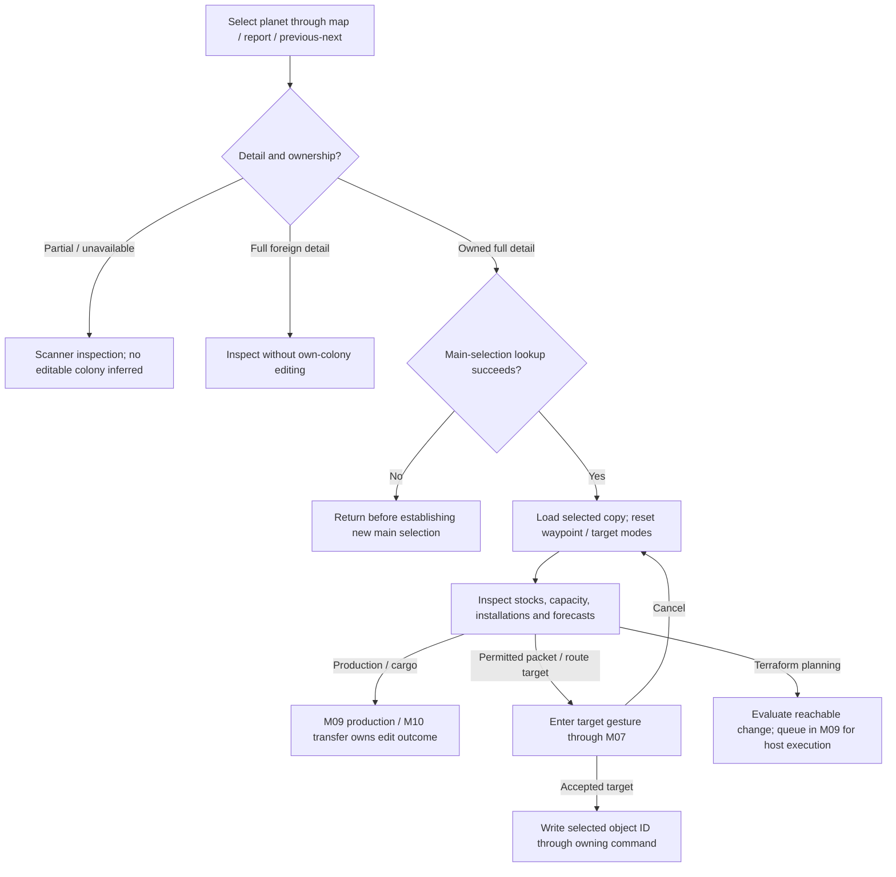
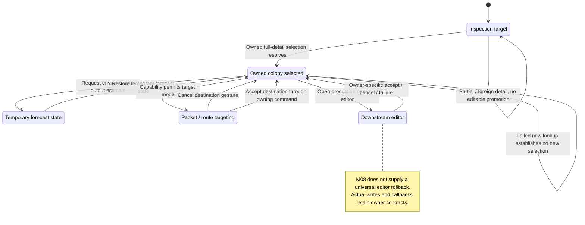

# M08 — Planet and Colony Management

Status: source-derived specification; formal coverage and external obligations
are distinguished below. Inspected 2026-10-24 at
`e2eae18cff0f990db20415c1c2262aed2022f95b` with the existing local specification
collection. No runtime behavior changes are proposed by this document.
Canonical definitions: [entry point](M08-colony-specification.dfy),
[M08Colony](dafny/M08-colony.dfy).
Verification: [M08–M11 collection results](README.md#m08m11-verification).

[Workflow and state diagrams](#workflow-and-state-diagrams) provide a visual reading path.

## 1. Purpose, scope and ownership

Help a player inspect a planet and understand its population, environment,
mineral stocks, installations, resources and orbital facilities before issuing
orders. A colony is an owned planet, not a separate persisted entity. Unknown
and estimated information must retain its knowledge status.

M08 owns colony inspection, limits and the planet/fleet pane container. [M07](M07-galaxy-map-and-navigation.md)
owns map selection and navigation; [M09](M09-production-management.md) owns
construction orders; [M10](M10-fleet-operations.md) owns orbital cargo and routes;
[M11](M11-ship-and-starbase-design.md) supplies base capabilities. [M18](M18-turn-generation.md) owns host phase sequencing; [M19](M19-game-rules-and-resolution.md) retains the
resolution rules for population, mining, environment, destruction, visibility
and detection until decomposed into their gameplay owners. This is proposed responsibility allocation,
not evidence that those source boundaries are isolated today.

[S06](S06-shared-game-state.md) owns PLANET identity, units and knowledge;
[M04](M04-race-design.md) owns race settings. Existing canonical habitat rules
remain `M04Pricing.Habitat`/`FDesire` in
[M04 pricing](dafny/M04-race-pricing.dfy). Capacity, ordinary/AR resources and
factory productivity remain `M03Scoring.Capacity`, `EffectivePopulation`,
`Factories`, `OrdinaryResources`, `ARExpr` and `FARResources` in
[shared gameplay calculations](dafny/M03-scoring.dfy). Their physical filename
reflects their earlier setup use; do not copy those formulas into this module.

## User stories and requirements

Actor: a player with an active turn and a planet visible at some knowledge level.
Management requires owned, fully detailed state. Stories describe source-derived
goals, not user research. All stories below are **Observed**; proof and runtime
coverage are separate from [behavior status](README.md#requirement-ids-and-status).

**M08-US01 — Inspect the selected planet.** As a player, I want navigation to
show the correct planet and its available details so that I can assess it without
mistaking foreign or partial information for editable colony state. Select from
the map/report or use previous/next; a failed lookup does not manufacture a colony.

**M08-US02 — Understand colony capacity and output.** As a player, I want
population, capacity, operable installations and resource output explained so
that I can decide what to build or transport. Inspect the population, industry,
minerals and resources tiles; racial rules and current versus forecast values
remain distinct. Inspection itself does not generate a turn.

**M08-US03 — Assess terraforming.** As a player, I want current and achievable
habitability so that I can plan improvement. Inspect environment and available
terraforming; unavailable technology and immune axes contribute no change.
Actual construction is queued in M09 and applied by the host.

**M08-US04 — Reach colony actions and orbital facilities.** As a player, I want
production, orbital fleets, packet destination and route controls connected to
the current colony so that I can issue the right order. Controls use base and
ownership capability checks; cancel the destination gesture or downstream dialog
through its owner without changing an unrelated colony.

**M08-US05 — Keep the colony pane usable.** As a player, I want tiles to remain
reachable after resize, scrolling, collapse or selection changes so that I can
inspect and operate the colony on supported displays. Scroll position is local
view state and resets when the selected object's identity or kind changes.

## 2. State and interfaces

| State / unit | Contract |
| --- | --- |
| `sel.pl`, `sel.fl`, `sel.grobj`, `sel.id`, `sel.pt` | Selected copies and identity; write-back is explicit through lookup APIs. Map-only selection may differ from main editable selection. |
| `rgwtMin[0..2]`, `[3]` | Mineral cargo quantities and population in hundreds of colonists. S06 retains storage widths; visible colonist counts are not raw cargo units. |
| `rgEnvVar`, `rgEnvVarOrig` | Current and original three-axis environment; terraforming bounds use original values plus available ability. |
| `cFactories`, `cMines`, `cDefenses` | Built quantities, distinct from maximum constructible, maximum operable and actually operating values. |
| `fStarbase`, `isb`, `iScanner`, `idFling`, `idRoute` | Orbital design binding, scanner and order destinations; zero/sentinel meanings stay with S06/S01. |
| Pane columns, expansion, scroll offsets, wheel remainder | Transient UI state; no new save-file fields. Tile width is 198 logical pixels. |

## 3. Workflows and canonical rules

### 3.1 Selection and capability

Evidence: [planet.c](../src/core/planet.c), `ChangeMainObjSel`, `SelectAdjPlanet`,
`IdFindAdjStarbase`; [planetui.c](../src/ui/planetui.c), `PlanetClick`,
`ClickInPlanetOrders`. Canonical projections: `Select`, `ConstructionBase`.

`ChangeMainObjSel` loads the chosen record, updates location, resets the active
waypoint and destination-setting modes, and refreshes controls. Planet selection
may also load the first owned orbiting fleet. Lookup failure returns before
establishing a new main selection. `SelectAdjPlanet` routes partial/unavailable
planet detail to scanner selection; full foreign detail does not become an
editable main colony. Owned previous/next follows the report's planet ordering
and wraps. Base navigation filters owned bases with nonzero hull cargo capacity,
the construction-capacity field, rather than every orbital installation.

Mineral and industry popups explain stocks/concentrations, built and operating
counts. Production and cargo actions hand off to M09/M10. An AR colony does not
have the ordinary planetary scanner control. Packet destination mode is enabled
only with a usable mass driver; route selection is a separate M07 gesture.
Downstream writes use the selected object ID, not screen coordinates alone.

### 3.2 Capacity, installations and resources

Evidence: `CalcPlanetMaxPop`, `PctPlanetCapacity`, `CMaxMines`,
`CMaxFactories`, `CMaxOperableMines`, `CMaxOperableFactories`, `CMinesOperating`,
`CFactoriesOperating`, `CMaxDefenses`, `CMaxOperableDefenses`, `CResourcesAtPlanet`.
Models: the shared definitions in §1, plus `CapacityPercent`, `Installations`,
`Operable`, `Operating`, `Defenses`, `OperableDefenses`.

Population capacity is race/habitat dependent; AR uses its owned orbital hull.
The percentage display rounds using half the capacity, returns zero for a
nonpositive capacity and caps at 999. Installation limits have a floor of ten
for ordinary races; operable factories/mines have a floor of one even for very
small population. Built count still caps actual operation. Next-year operability
uses the population-growth estimate; it is not simply today's displayed count.
Unowned planets have no operating factories/mines; AR has no factories and its
mining count uses a square-root population rule instead of constructed mines.

Ordinary maximum defenses clamp four times habitability to 10–100; operability
also depends on population. AR maximum/operable defenses are zero. Resources
use effective population above capacity, factory productivity and integer
rounding; AR instead uses the checked binary64 expression in `FARResources`.
Zero population yields zero resources. M09 owns research reservation and queue
spending. Its host truncation is distinct from popup formatting through `LMulDiv`.

These integer models specify the normal nonoverflowing game domain. The C
functions still narrow selected results to 16-bit fields. Unrepresentable
products, malformed race values and zero-width nonimmune habitat intervals are
not silently assigned new behavior by these mathematical functions.

### 3.3 Terraforming and forecast boundaries

Evidence: `FCanTerraformLppl`, `IpctCanTerraformLppl`, `IBestTerraform`,
`PctPlanetOptValue`; [util.c](../src/core/util.c), `ChgPopFromPlanet`;
[mine.c](../src/core/mine.c), `EstMineralsMined`.
Models: `Terraform`, `TerraformSteps`; M04 habitat evaluation.

Technology/catalog lookup supplies the best available all-axis ability, then
stronger axis-specific ability. Ignore immune axes and zero ability. Bounds
extend from the original environment and reject raw endpoints on the wrong
side of the current value before clamping to 1–99. At an absolute boundary,
clamping can leave an endpoint equal to the current value (zero steps). Helpful terraforming moves only toward the preferred
value, stopping there. Harmful terraforming chooses the farther reachable
endpoint; equal endpoint distances favor the lower one, and no farther endpoint
means no change. The model represents an absent bound with `None`, not a numeric
environment value. `IpctCanTerraformLppl` sums reachable helpful steps.

`PctPlanetOptValue` temporarily changes environment to compute a forecast and
restores it. There is a viewpoint distinction: its requested player selects the
preferred environment, while the final changed-environment desirability call
uses `idPlayer`; the no-change path uses the requested player. This observed
behavior is retained as boundary E08-2 pending a targeted multi-player test.

Growth has hostile-world loss, crowding/overcapacity branches and fractional
`iDeltaPop` carry; a forecast with `fUpdate == FALSE` must not apply that carry.
Mining forecasts can apply changes to a copy. Neither a growth-rate percentage
nor ideal habitat alone is a complete next-year prediction. [M19](M19-game-rules-and-resolution.md) now specifies safe-domain hostile/crowded
growth, fractional carry and mining yield/depletion bands. Full depletion loops,
best-axis choice and forecast copy/writeback remain E08-2; these models do not
claim a verified full host simulation.

### 3.4 Orbital and pane behavior

`IWarpMAFromLppl` requires a base on a planet with an owner and, for another player's base,
full design knowledge. It chooses the highest installed mass-driver speed;
`Drivers` sets the two-driver flag only when a second occupied slot has that
highest speed. Multiple components in one slot are not counted as two slots.
`StargateRangeFromLppl` uses the first qualifying gate slot and maps unlimited
range to 10000; catalog extraction and gate usability belong to E08-3/M10.

[planetpaneui.c](../src/ui/planetpaneui.c) computes content extents, refits both
scrollbars in two passes, clamps offsets and coalesces deferred refit messages.
Six planet tiles and seven fleet tiles use two columns; collapsed tiles retain
their header height. Selection identity/kind changes reset offsets and wheel
remainder. Ordinary wheel input scrolls vertically, Shift-wheel horizontally;
horizontal-wheel direction follows its dedicated handler. `Offset` specifies
clamping/reset. Pixel layout, wheel-notch extraction and lifecycle cleanup are
E08-4 and the existing M07/S05 input contracts.

## 4. Acceptance criteria and traceability

All criteria are Observed requirements. Given/When/Then outcomes are traceable
below; proof vectors do not establish C refinement.

| ID / story | Given / When / Then | Rule and source | Evidence / gap |
| --- | --- | --- | --- |
| M08-AC01 / US01 | Given partial planet detail, when adjacent selection runs, then only scanner selection is requested; given a full foreign planet, it is not promoted to editable colony state. | `Select`; `SelectAdjPlanet` | Model witnesses/source; full knowledge-level UI matrix open. |
| M08-AC02 / US01, US04 | Given owned orbital installations, when navigating construction bases, then only nonzero construction-capacity bases qualify and navigation wraps. | `ConstructionBase`; `IdFindAdjStarbase`; ordering E08-1 | Source; wrap and mixed-base UI coverage open. |
| M08-AC03 / US02 | Given population 12500 and capacity 10000, when displaying capacity, then show 125%; at population 100000 cap the display at 999%. | `CapacityPercent`; `PctPlanetCapacity` | `PercentBound`, `AcceptanceVectors`; no dedicated C equivalence test. |
| M08-AC04 / US02 | Given an AR colony, when querying factory/defense limits, then they are zero; given a small ordinary colony, operable industry can be one but operation cannot exceed built count. | `Installations`, `Operable`, `Operating`, `Defenses`; shared resources | `ARHasNoInstallations`, vectors; broad regression is indirect. |
| M08-AC05 / US03 | Given current/original 70, ideal 50 and ability 10, when calculating helpful terraforming, then only lower bound 60 exists; immunity removes both bounds. | `Terraform`; `FCanTerraformLppl` | `HelpfulAxis`, vectors; catalog adapter open. |
| M08-AC06 / US03 | Given a colony snapshot, when computing optimal habitat or non-updating growth, then live environment/population/carry remain unchanged. | E08-2; `PctPlanetOptValue`, `ChgPopFromPlanet` | Source; targeted forecast-purity test open. |
| M08-AC07 / US04 | Given occupied mass-driver slots at 5, 7 and 7, when inspecting the base, then highest speed is 7 with the two-driver flag; unavailable base knowledge yields no usable driver. | `Drivers`, E08-3; `IWarpMAFromLppl` | Model vector for aggregation; knowledge gate source-only. |
| M08-AC08 / US05 | Given scroll position beyond new content, when resizing, then clamp it; when selecting a different object, reset it to zero. | `Offset`; pane refit | `ScrollBound`, vectors; display matrix open. |

## 5. Interaction and quality requirements

| ID | Requirement / status | Measurement and evidence |
| --- | --- | --- |
| M08-IR01 | Observed: previous/next, tile collapse, wheel and scrollbar controls operate on the current selection; scanner-only detail must not suggest editable ownership. | Inspect command dispatch and selection; keyboard-only coverage of every tile action remains Open. |
| M08-IR02 | Observed: collapse and resizing keep scrollable content reachable; selection changes reset position. | E08-4; compare content/client extents and offsets. DPI, font enlargement and minimum usable viewport matrix Open. |
| M08-IR03 | Open: every population/environment/capacity value and tile action has an accessible name, knowledge status and keyboard alternative. | S05/UI owner must choose accessibility API and verify focus/screen-reader behavior; no compliance claim. |
| M08-QR01 | Observed compatibility: calculations preserve units, truncation and binary64 boundaries. | Shared formal definitions and native regression; no C refinement proof. |
| M08-QR02 | Observed integrity: inspection does not mutate persistent colony state. | Forecast copy/restore boundary E08-2; acceptance snapshot test remains Open. |
| M08-QR03 | Open responsiveness target: selection/refit completes within an agreed latency at largest supported universe and font scale. | UI owner to set percentile/time and benchmark; two-pass/coalesced source structure is not measured performance. |
| M08-QR04 | Observed text contract: UTF-8 names and messages obey byte budgets and complete code-point truncation. | [Unicode boundaries](../docs/UNICODE-BOUNDARIES.md), S01; planet-pane multilingual visual qualification Open. |

## 6. Coverage inventory, evidence and open decisions

| Boundary | Accounted rules / reason not fully formalized | Owner / next evidence |
| --- | --- | --- |
| E08-1 | Report ordering, wrapping, lookup side effects, control enablement and disclosure project live arrays and knowledge levels. `Select`/`ConstructionBase` cover decisions, not all adapters. | M08/M07/S06; add mixed owned/foreign/unknown UI scenarios. |
| E08-2 | Catalog ability selection, `IBestTerraform` axis ranking, complete mineral-depletion loops, optimum-viewpoint distinction and forecast copy/restore. [M19](M19-game-rules-and-resolution.md) now models growth fractional carry and selected mining arithmetic; full native state/refinement and remaining floating traces stay open. | M08/M19/S03; numerical companion and snapshot tests. Existing habitat/resources are already formal, not deferred here. |
| E08-3 | Base/driver/gate/scanner catalog extraction, visibility gates and destination eligibility. `Drivers` covers only ordered driver aggregation. | M08/M10/M11/M19; source-backed catalog fixtures. |
| E08-4 | Pane layout, native focus, drawing, popups, drag/collapse, two-pass scrollbar measurement and teardown depend on SDL wrapper state. | S05/M08; display/input/lifecycle qualification. |

Evidence sources are the named functions above, [gameplay qualification](../docs/GAMEPLAY-QUALIFICATION.md),
[unit tests](../tests/unit/README.md) and the
[client workflow harness](../tests/compat/win32_client_startup.c). Tutorial
checkpoints exercise only part of colony interaction. No dedicated exhaustive
colony numerical suite is implied by the broad runtime run.

Open decisions: M08/M19 maintainers own the exact forecast/turn seam and
remaining numerical companion; M08/M19 own the foreign-viewpoint acceptance
matrix; UI/S05 owns accessibility, supported-display and performance targets.
A change to an observed quirk needs a separate behavior decision and regression
baseline change, not an edit that silently describes preferred behavior.

## Workflow and state diagrams

These reading projections summarize [Selection and capability](#31-selection-and-capability), [Terraforming and forecast boundaries](#33-terraforming-and-forecast-boundaries) and the
[canonical contracts](M08-colony-specification.dfy) at the inspection revision recorded above.
States are explanatory milestones, not new persisted fields or a claim of
complete C/model refinement. Terminal nodes end the illustrated operation.

### Workflow

### State and recovery

Inspection and forecasts do not execute a host turn. Capability gates, lookup effects, forecast domains, and downstream cancellation remain those specified above; no foreign or unknown state is promoted into an editable colony.
