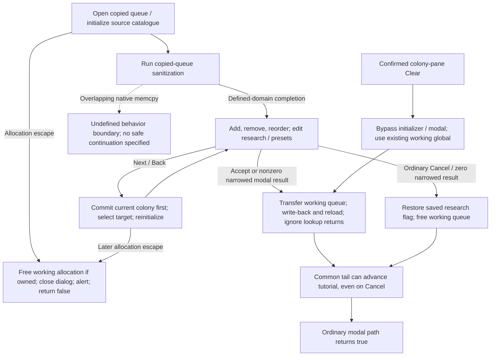
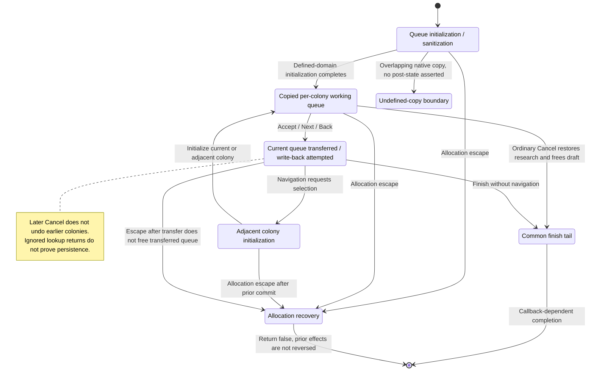

# M09 — Production Management

Status: source-derived specification; formal coverage and external obligations
are distinguished below. Inspected 2026-10-24 at
`e2eae18cff0f990db20415c1c2262aed2022f95b` with the existing local specification
collection. No runtime behavior changes are proposed by this document.
Canonical definitions: [entry point](M09-production-specification.dfy),
[production rules](dafny/M09-production.dfy), [editor contracts](dafny/M09-editor.dfy),
[preset contracts](dafny/M09-presets.dfy), [lifecycle controller](dafny/M09-lifecycle.dfy)
[native cost vectors](M09-production-costs.md) and [forecast controller](M09-production-forecast.md) and [construction algorithm](M09-production-builder.md) and [host handoffs](M09-production-execution.md).
Verification: [M08–M11 collection results](README.md#m08m11-verification) and
[production preset continuation](README.md#production-preset-command-continuation), with the
[shared modal-width correction](README.md#transport-preset-and-quantity-control-continuation) and
[editor initialization/command results](README.md#production-editor-initialization-and-command-continuation), followed by
[lifecycle verification](README.md#production-lifecycle-and-starbase-navigation-continuation).

[Workflow and state diagrams](#workflow-and-state-diagrams) provide a visual reading path.

## 1. Purpose, scope and ownership

Let a player plan colony construction, inspect cost and estimated completion,
reuse production presets, and understand how the host consumes that plan.
Queue editing and queue execution share item semantics but happen at different
times. A committed queue edit is still pending player state until [M06](M06-player-session-and-turn-orders.md)
saves/submits orders through [S01](S01-game-file-orders.md).

[M08](M08-planet-and-colony-management.md) supplies population, installations,
resources and terraforming capacity. [M11](M11-ship-and-starbase-design.md)
supplies designs, availability and component costs. M12 owns research policy;
M18 owns overall phase ordering; M19 retains resolution effects outside production. S03 owns stable
catalog identifiers; [S06](S06-shared-game-state.md) owns `PROD`/`PLPROD`
representation. The module split is a responsibility proposal, not a code refactor.

## User stories and requirements

Actor: a player managing an owned colony in an active turn; the host is the
execution actor. Source-derived goals below are **Observed**, with explicit
coverage gaps rather than implied full verification.

**M09-US01 — Compose a production queue.** As a player, I want to add, remove,
reorder and clear available items so that the colony spends its resources in my
chosen order. Work on a copied queue, inspect changes and accept or cancel.
Unavailable items and count/row limits constrain the editor.

**M09-US02 — Plan from costs and estimates.** As a player, I want mineral and
resource costs and estimated completion so that I can assess the plan. Estimates
advance a copied colony under their own assumptions; unknown future events do
not become guaranteed completion dates.

**M09-US03 — Reuse automatic production policy.** As a player, I want templates
and automatic rows so that routine construction tracks colony needs. Apply a
preset, retain manual work, edit custom presets and cancel custom changes if
needed. Automatic production has distinct host skip/block outcomes.

**M09-US04 — Manage several colonies.** As a player, I want Next/Back in the
editor so that I can process colonies quickly. Moving commits the current
colony before opening the next one; cancelling the later colony does not undo
those earlier commits. Shift navigation selects construction-capable bases.

**M09-US05 — Preserve partial construction and explain blocking.** As a player,
I want the host to account for previous progress and available resources so that
partially built items and automatic policies resolve predictably. The host
reserves research, spends costs and applies completed objects; invalidated
capabilities and object-creation failures have distinct outcomes.

## 2. State and interfaces

| Value | Contract |
| --- | --- |
| Selected planet queue / `lpplProdGlob` | Persistent selected queue versus editor copy; empty committed queue becomes NULL. |
| `fNoResearch` and saved prior flag | Checkbox modifies selected state during editing; ordinary cancel restores the prior flag. |
| `PROD` | Item category/ID, count and percentage already owned by S06/S01; model `Row` is a logical projection. |
| Source-list counts | Finite availability or 1023 unlimited sentinel. Normal Add requests/merges cap at 1020; native rows retain ten-bit counts through 1023. Add refuses new rows at 40 but can still merge; preset import has separate bounds. |
| Cost/resources vectors | Four dimensions in order iron, boranium, germanium, resources. Never combine mineral inventory with research resources. |
| Completion estimates | First/last build year within a 99-year simulation, with 100 as beyond-horizon sentinel. |
| Four UI `ZIPPRODQ` templates; five stored slots | Settings/global policy state, separate from a particular colony's current queue. S02 loads/writes five; this UI offers/snapshots the first four. |

## 3. Workflows and rules

### 3.1 Open, edit and close

Evidence: [produce.cpp](../src/core/produce.cpp), `InitProduction`,
`FinishProduction`; [produceui.cpp](../src/ui/produceui.cpp),
`ChangeProduction`, `ProductionDlg` / `ProdCommandHandler`. Models: `Row`, `Fits`, `Quantum`, `AddCount`, `Availability`,
`CanInsert`, `Remove`, `Swap`, `Editor`, `Finish`.

The [editor contract](dafny/M09-editor.dfy) specifies catalogue construction,
the actual copied-row sanitization loop, Add/Remove and reorder. It reuses
S01/M09Presets' native row widths, identity comparison and quantity returns,
and M09Production's modifier quantum and merge caps. The older `Availability`
function is a scalar valid-selection projection; the editor model preserves
actual native wrap and supplied inactive-catalog selections.

#### 3.1.1 Initial queue and source catalogue

`InitProduction` saves the research flag, allocates/copies the existing queue's
active prefix, and sets its count. An existing zero-count queue requests zero
rows; no prior queue requests capacity two but still has active count zero
(`AllocateInitial`). Unused new allocation bytes are not assumed zero. It then
selects the supplied 64-row catalogue buffer, or reuses `pProdGlob` for a null
argument, zeroes it and appends entries in this order (`Catalog`):

| Entries, in order | Eligibility and quantity |
| --- | --- |
| Ship designs 0–15 | Have a current base with nonzero hull capacity; design is neither free nor gift and mass <= capacity. Quantity 1023. |
| Base designs 0–9, encoded item 16–25 | Neither free nor gift; exclude the current design only if a base is installed. Quantity 1. |
| Genesis / item 13 | `FLookupPart` returns available. Quantity 1. |
| Packets / items 14–17 | `IWarpMAFromLppl` returns positive. Quantity 1023 each. |
| Manual factories/mines/defenses / items 7–9 | Subtract installed count from the respective `CMax*` result, store as uint16 then test as int16. If positive, factory/mine quantity caps at 1020; defense quantity narrows directly to ten bits. |
| Manual alchemy / item 11 | Always present, quantity 1023. |
| Planetary scanner / item 27 | Scanner index is 31 and primary trait is not AR/8. Quantity 1. |
| Manual terraforming / item 12 | Positive int16 `IpctCanTerraformLppl` result, narrowed to ten bits. |
| Automatic items 0–6 | Quantity 1023; AR excludes 0–2, TT/3 excludes 4–5. |

`Ships`, `Bases`, `Installation` and `Automatic` preserve the source ordering.
For example defense/terraform quantity 1024 becomes a present row with count
zero; it is not automatically omitted. A maximum result -32768 minus one
installed item wraps to signed 32767 before the factory/mine clamp. `Catalog`
proves a conservative bound of 44 entries, safely below the physical 64; the
native all-eligible/base-installed fixture yields 43 because its current base
is excluded. Thus a full 64-active-entry catalog fault in the generic preset
model is outside this normal initializer's output domain.

The inputs identify actual getters and fields: signed 16-bit `CMaxFactories`,
`CMaxMines`, `CMaxDefenses`, `IWarpMAFromLppl`, `IpctCanTerraformLppl`; 12-bit
installed counts; 5-bit scanner; 4-bit base index (must be <10 when a base is
installed); unsigned 16-bit design mass and construction capacity; design
free/gift flags; availability result and primary trait. These values are supplied
projections from [planet.cpp](../src/core/planet.cpp), `FLookupPart`, hull lookup and live design arrays.
Their full calculation/reference/lifetime refinement remains M08/M11/M19/S03/S06
work. The model does not replace those rules with independently invented formulas.

#### 3.1.2 Sanitization and its undefined boundary

The copied queue is processed using both a logical loop index and an advancing
`PROD *`. A match clamps that physical row's count to source availability, then
subtracts the clamped count unless the source is unlimited. Zero-count rows
remain; progress and unused bits are preserved. A missing entry decrements the
active count, with a `memcpy` of following rows when any remain.

That copy is not a general safe filter. With two or more following rows its
source and destination overlap, so C behavior is undefined. `Sanitize` reports
`OverlappingCopy` with the state and byte-range position reached before that
operation; this is an analysis boundary, not a C error result or recovery action.
No post-copy success is asserted. When exactly one row follows, the copy itself
is defined, but the loop decrements its index and still increments its pointer.
It therefore visits the old final physical row rather than the moved active
row. For `[unavailable, factories(count=10)]` and factory availability 1, the
active copied row can remain count 10 while the old physical row becomes 1 and
availability becomes zero. `Sanitize` retains this pointer/index distinction.

[Source fixtures](../tests/spec/check_production_editor_source.py) demonstrate
that defined case and stop at detected overlapping ranges before calling libc.
They do not execute the undefined copy or predict a particular library's result.
The [known-bug record](../docs/KNOWN-BUGS.md#production-editor-queue-sanitization--located-on-main)
keeps real UI reachability, original-binary comparison and any repair separate
from this documentation task.

#### 3.1.3 Add, Remove and reorder

Add first maps the selected *visible* source row through positive-quantity
catalogue entries. A missing source selection does nothing. It copies the raw
source row and requests 1 normally, 10 with Shift, 100 with Control, or 1020 with
both (`Quantum`); modifier requests cap to available count. It decrements finite
availability immediately, before locating a merge, checking row limits or
reallocating through [memory.cpp](../src/core/memory.cpp). Availability 1023 remains unlimited. Invalid supplied source ranks
can select an inactive allocated entry; a no-modifier request from its zero
count wraps availability to 1023. A physical index beyond the catalogue is an
explicit undefined access boundary. Neither is a normal list selection.

The queue list has a header at selection zero. With a selected row, Add first
tries that row, then its successor for matching kind/item. If neither matches,
it inserts **after** the selected row. Header selection tries the first row,
otherwise inserts at the start. No selection tries the last row, otherwise
appends; an empty queue inserts at zero (`Destination`, `Locate`). This corrects
the earlier specification's claim that insertion was before the selected row.

Merging preserves all other row bits and clamps the sum to 1020, with automatic
alchemy/item 3 additionally capped at 1. A newly inserted alchemy row does not
use that merge cap and can contain 1020. Availability is not refunded for merge
caps. At >=40 rows a nonmerge beeps and redraws without refilling either list,
although availability has already changed; merging remains allowed. If insertion
needs reallocation (count equals the uint8 capacity header), it requests count+4.
A reallocation escape preserves the preceding availability decrement before the
outer cleanup described in §3.2. Success shifts complete rows with `memmove`,
updates count, refills the queue and requests the inserted/merged selection.
It refills the source list only if that source quantity has reached zero.

Remove ignores the header/no selection. It finds the matching catalogue entry,
requests the same modifier quantum, or forces a 1020 request for automatic
alchemy, then caps to the row's count. Finite availability returns narrow to ten
bits; unlimited remains 1023. Surviving rows keep progress and unused bits.
Empty rows shift out; the next row keeps the selection position, or the prior
row is selected when deleting the last row. If the queue becomes empty, no
explicit selection call is made after refilling. The source list refreshes only
if its *previous* availability was zero (`Remove`, `Effects`). Thus a 1023-count
alchemy row loses 1020 and leaves 3; no blanket remove-all claim is made.

Up/Down exchange complete neighboring rows only for valid movable list
selections (`Move`, `MovePreserves`); header/edge selections do nothing. Models
use valid queue-selection results -1..count; they do not claim malformed native
indices are safe. `Effects.selection=-1` means no explicit selection request,
not that a list refill is guaranteed to leave selection -1. Actual window focus,
repaint, callback behavior and all lifecycle effects remain separate adapters.

### 3.1.4 Completion, recovery and navigation

The [lifecycle controller](dafny/M09-lifecycle.dfy) specifies call ordering and
state effects in `FinishProduction`, `ChangeProduction`, close/Next/Back command
blocks and initial list selection. Each `Step`, `ExitStep`, `Recover` or
`Navigate` continuation after an event takes the **actual post-callback state**.
It does not assume lookup, selection, drawing or tutorial callbacks are pure.
Handle identities are logical tokens: adapters still owe allocation validity,
distinct saved/working ownership, header access and native lifetime evidence.

| Path | Observed effects, in order |
| --- | --- |
| Accept / nonzero `fWrite` | Free the selected editor queue. Free a nonnull working allocation with active header zero and replace it by null. Transfer the working pointer to the selected planet, null the global, call `FLookupPlanet(idWriteBack, &sel.pl)`, then call it again using the **current** `sel.pl.id`. Ignore both return values. If the post-reload `fAi` is false, fill the production list and redraw production/orbit. |
| Ordinary Cancel | Restore `sel.pl.fNoResearch` from `gd.fNoResearchSav` and free the working queue. The selected queue pointer is unchanged by these statements; there is no write-back/reload or production-list refresh on this branch. |
| Common finish tail | Null the working global again. If the current tutorial flag is set and player is zero, set tutorial progress and call `AdvanceTutor`, even on Cancel. There is no cleanup after that callback, so null/global/research postconditions cannot be extended across arbitrary callback mutation. |
| Modal return | Free the procedure instance, zero the dialog handle and clear `fDlgUp`, then finish using the modal result narrowed to signed 16 bits. Zero (including raw 65536) cancels; nonzero (including -1) takes the write branch. After finishing, draw planet stats only for nonzero `fSuccess` and current planet selection. Restore the previous allocation-error environment and return TRUE even on ordinary Cancel. |
| Direct Clear | The colony-pane button first requires YES from its confirmation. `ChangeProduction(TRUE)` then bypasses initializer and modal setup/cleanup, assigns `fSuccess=1` and uses the same finish path. With the expected null working global it installs no queue and leaves research unchanged; it does **not** force a nonnull stale working pointer to null before finishing. Valid entry/global state is a caller obligation. |
| Allocation escape | Free a nonnull working queue, null the global, end a live production dialog with result zero, then zero the handle/clear `fDlgUp`, alert, restore the previous allocation-error environment and return FALSE. This does not restore research or reverse an earlier commit. If the escape occurs after transfer to the selected queue, the global is already null and recovery does not free that transferred pointer. |

`FLookupPlanet` in [util.cpp](../src/core/util.cpp) is not an atomic assignment: its write path logs changes,
allocates/copies the persistent queue and can call the tutorial; its selected
read path uses `FDupPlanet`. The [S06 planet editor companion](S06-planet-editor-contracts.md)
now specifies queue/prefix copying, entry dispatch and allocation effects, with
an integrated actual lookup/duplicate/finish source fixture. Full logging, heap,
selection lifetime and tutorial outcomes remain explicit S06/M06/S04/M16
obligations. The controller and fixtures prove that the caller continues
on a false result and uses post-callback identity/AI state; they do not prove
successful persistence, alias safety or unchanged selection after callbacks.
`Finish` in the older scalar model is a per-colony value projection under those
assumptions, not a stronger native transaction guarantee.

IDOK/IDCANCEL first clear the global dialog handle, save sticky position, then
end the actual dialog with 1/0 (`CommandClose`, `CloseEvents`). Next/Back calls
`FinishProduction(TRUE)` **before** checking Shift, requesting selection and
reinitializing. Ordinary navigation requests `SelectAdjPlanet(+1/-1, 0)`;
Shift requests `SelectAdjPlanet(0, IdFindAdjStarbase(currentID, next))`. The
[canonical M07 selector](dafny/M07-adjacent.dfy) preserves native array order;
no eligible base returns -1. Even a no-op selection still reinitializes the
current colony. A later Cancel or reinitialization escape does not undo an
earlier write-back. Actual `SelectAdjPlanet` report/cache/editor effects and
reentrancy remain M07/S05/S06 obligations, not guarantees of this call schedule.

Reinitialization uses `InitProduction(NULL)`, retaining the existing catalog
buffer, then `InitializeProductionDlg`, reads the client rectangle and
invalidates the text band from `yTopFutureTech` to `yTopFutureTech + 9*dyArial8`.
Initialization sets title, fills available items and requests source selection
zero even for an empty source list. It selects the last nonautomatic queue row
plus the list-header offset, or header zero if every row is automatic
(`QueueSelection`), then updates the research checkbox from current selection.
The model proves this index is in 0..count and all later rows are automatic.
The native fixture uses bounded title text; full localized formatting into the
86-byte buffer, actual list-selection success and callbacks remain external.
Neither queue completion nor navigation submits orders to the host by itself.

### 3.2 Templates and automatic policies

The canonical [preset command model](dafny/M09-presets.dfy) owns queue
application, custom-slot payload edits and the two cancellation boundaries.
[S02 owns storage codecs](S02-preference-contracts.md#transport-and-production-preset-codecs):
five persisted slots, twelve packed rows per slot, quantity/item normalization,
and forced localized Default in slot P1. `Stored` projects M09's physical slot
into that existing codec; it does not introduce another file format.

#### 3.2.1 Applying or clearing a queue

`ProdCommandHandler` first returns **every old active row's** quantity to the
first source-catalog entry matching object kind and item ID. Availability 1023
is unlimited and stays unchanged. Other sums narrow to ten bits: 1020+4 becomes
0; 1020+3 becomes 1023 and therefore ignores later returns. There is no second
reservation pass for retained or appended rows. `Find`, `ReturnQuantity` and
`Release` preserve this order. If no active match exists, C accesses index
`cProdGlob`: an inactive but physically allocated slot when the active count is
below 64, or an out-of-allocation access when it is 64. `CatalogFault` marks the
latter undefined boundary; it is **not** an error result returned by C.

Import allocates `max(1, old active count + preset count)` rows, zeroes them,
copies complete old nonplanet rows and planetary rows with item >=7, and
appends the permitted preset rows in order. AR (primary trait 8) rejects items
0–2; TT (trait 3) rejects items 4 and 5. New rows have object kind planet and
zero progress/unused bits; retained rows keep all 32 bits. The command does not
check the slot's valid flag. It installs the new queue, frees the old working
queue and copies the preset research flag. `Retained`, `Allowed`, `Appended`
and `Apply` specify these effects.

Import bypasses Add's 40-row limit. Allocation uses the full row count, while
both allocated-capacity and active-count headers are eight bits. Thus 40 manual
rows plus twelve preset rows produce count 52; 255 manual rows plus one produce
256 allocated rows with both headers zero. `FinishProduction(TRUE)` subsequently
treats a zero active count as an empty queue and frees it. This is observed
behavior, not an approved capacity policy or a claim that ordinary UI interaction
can create every modeled input. Clear shares the availability-return pass but
only sets the active count to zero: it leaves the working allocation, row bytes
and research flag unchanged (`Clear`). Direct `ChangeProduction(TRUE)` is a
separate immediate-finish path, not this button's dispatch.

Allocation failure occurs after availability changes and before freeing the
old working queue or installing the preset research flag. `ChangeProduction`'s
longjmp handler frees any working queue, ends any production dialog, clears its
handles/up flag, restores the previous allocation handler, alerts and returns
FALSE. It does not restore the saved research flag. `AllocationEscape` and
`AllocationRecovery` distinguish this from ordinary dialog Cancel; allocator
and UI calls remain explicit external outcomes.

#### 3.2.2 Custom slots and cancellation

`ProductionDlg` offers valid indices 0–3, then a separator and Customize. It
snapshots exactly 160 bytes (four 40-byte slots). The caller narrows the
customization return to int16_t (`OuterDialogResult`); zero restores those bytes
and nonzero keeps edits. Thus raw 65536 restores, while -1 keeps changes. The fifth stored slot and
`gd.fChgZipProd` are outside the snapshot and survive either outcome
(`FinishCustom`, `SnapshotKeepsFifth`, `DirtyAfterCustom`). Ordinary production
Cancel likewise does not revert these global preferences. `Choose` maps a
normal popup result through valid slots in order. A supplied separator or other
unmatched nonnegative result falls through to slot 4; the normal popup makes
the separator unselectable, so this is not a fifth offered preset.

`ZipProdDlg` Import copies only automatic planetary rows (items 0–6), stopping
at twelve, sets valid/count/research and preserves inactive packed words beyond
the copied prefix. Default/index 0 skips the rename dialog and preserves its
name. Other slots seed rename with their existing name or `Custom(index)`;
zero dialog result skips the payload edit, while any nonzero result accepts
and substitutes `Custom(index)` for an empty name. Rename alone does not make
an invalid slot valid. The name copy preserves bytes beyond its new NUL.
Both Import and Rename set the dirty flag even when nested rename is cancelled.
`Capture`, `CopyPolicy`, `CopyKeepsInactive`, `NameCopy` and `Edit` cover this
payload behavior.

Delete sets only valid=false and dirty=true; name, research, count and packed
rows remain. `EnableZipProdBtns` enables Rename/Delete only for a valid
nondefault selection (`CanRenameDelete`), but dispatch itself has no guard
against programmatic deletion of Default. Delete does not call that button
refresh helper afterward. Radio selection, actual focus/paint and modal event
ordering remain UI integration obligations. `FillZipProdLB` shows a placeholder
for an invalid or empty slot; otherwise quantity is omitted for count 1 or
alchemy/item 3, and shown even for count 0 on other items (`Display`, `Labels`).
Ampersands in accepted names are doubled for radio-label display (`EscapeLabel`).

#### 3.2.3 Native mapping and evidence limits

| Model input / result | Source projection and domain |
| --- | --- |
| `Row(value, unused)` | `PROD`: count 10 bits, item 7, object 3, progress 7, unused 5; `value` reuses S01's canonical order fields. |
| Queue and catalog | Active queue prefix selected by uint8 `iprodMac`; physical 64-entry source catalog plus `cProdGlob` in 0–64. Initialization/sanitization is specified in §3.1.1–2; pointer validity and full getter/callback refinement remain E09-1 obligations. |
| `Slot` / `Stored` | `ZIPPRODQ`: 13 name bytes with a NUL, normalized boolean flags, count 0–12 and all twelve native packed words. Names and nonempty localized fallbacks are bounded to twelve non-NUL bytes before copying; malformed buffers, oversized localized defaults and arbitrary raw flag bytes are outside this adapter domain. |
| Allocation / dialog outcomes | Supplied success or escape and signed dialog result; proof does not establish actual heap, rendering or event-loop outcomes. `Apply` includes the full allocated buffer and modulo-256 headers; `Clear` retains the active row prefix without reallocating. |

[Linked production checks](../tests/spec/check_production_presets_source.py)
compile the current command blocks, customization snapshot, display/button
helpers, allocation header code and native structs. Controlled GUI/localization
and allocation doubles check 13,140 assertions, including all 3,328 pairs of
queue count 0–255 and preset count 0–12, trait filtering, retained progress,
inactive availability, wrap/unlimited state, nested/outer cancellation and
allocation recovery. They do not execute an out-of-allocation access or prove
whole-editor/allocator refinement. A valid empty-name, zero-row slot still
serializes to `aa`, which S02 rejects on reload; the storage limitation remains.

Host automatic factory/mine/defense rows use next-year operable capacity minus
built count. Minimum terraforming is skipped on a positive-habitat colony whose
growth is nonnegative; maximum terraforming uses remaining capability. Packet
rows need driver and destination. Automatic alchemy can support the following
item. A mineral-blocked auto row without alchemy can yield `NoneAuto`/`SomeAuto`
so later queue work can continue; ordinary blocking must not be substituted.
`Result` models the exact result classification, not the full execution loop.

### 3.3 Costs and estimation

The [cost companion](M09-production-costs.md) and [canonical native model](dafny/M09-costs.dfy)
now specify full `GetProductionCosts` vector/branch/slot arithmetic over explicit
M11 quote inputs, including source widths, mixed player contexts and the
no-default incoming-buffer path. The older scalar rules below are arithmetic
projections; they do not imply native equivalence outside their no-wrap domains.

Evidence: `GetProductionCosts`, `EstimateItemProdSched` in [produce.cpp](../src/core/produce.cpp).
Models: `AlchemyCost`, `TerraformCost`, `ChangedHullCost`, `ChangedSlotCost`,
`BaseCost`; M11 part/hull pricing. Integer divisions and their order are retained.

Design costs use their stored calculated hull totals. A changed base hull credits
part of the old cost with a half-new-cost floor. For the same hull, slot credit
uses different floors for category change (30%), item change (20%), or identical
part (zero), then limits each credit to remaining total. After credits, ISB or
AR discounts remove one fifth and the base cost is halved with upward rounding.
The native `Slots` pass now retains overlapping occupancy, source order and
signed narrowing. E09-2 retains helper/catalog/pointer extraction, rather than
leaving the caller slot algorithm unnamed.

Factory cost uses race factory-build resources and germanium 4 minus the cheap
factory flag; tutorial factories use 2 minus that flag in each mineral. Mines
use race build-resource cost and no minerals. Defenses use the defense catalog,
with the Inner Strength factor. Alchemy costs 100 resources, or 25 with Mineral
Alchemy. Terraforming costs 100, or 70 with Total Terraforming, then halves for
Claim Adjuster. Packet types use trait-specific pure/mixed ore costs; scanners
and Genesis use catalog pricing. The full caller switch is in `Planetary`;
lookup/quote production remains E09-2 and M11-owned, with stable S03 item IDs. Multiplying by requested count occurs only when the caller
asks for more than a single item's cost.

The estimator copies the planet/queue, simulates mining, resources, production,
installations and growth for years 1–99, and returns the first/last completion
or sentinel 100. Research reservation uses integer truncation unless suppressed.
It does not forecast all future research unlocks, battles, incoming transports
or random events. Special signed query modes also expose resource/research estimates; request
65535 adds reserved research back after low-16-bit narrowing. A selected automatic
alchemy/item-3 row before the queue end returns -1/-1. These are named E09-3 cases,
covered by the [forecast controller](M09-production-forecast.md). Its copy,
native budget, partial/row ordering, output aliasing and cleanup are now modeled;
E09-3 still retains actual helper/refinement and display obligations. The local
copy does not imply global purity: generation-active RNG/messages and AR live
fleet flags have explicit [effect boundaries](M09-production-forecast.md#local-copying-does-not-establish-global-purity).

### 3.4 Host execution and paid progress

Evidence: [turn2.cpp](../src/core/turn2.cpp), `Produce`, `CBuildProdItem`,
`FBuildObject`; models `Research`, `Paid`, `Charge`, `DimensionPercent`,
`Progress`, `CanComplete`, `Result`.

`Produce` mines first, then evaluates colony resources/queues. It reserves
research before production unless suppressed. Previously paid cost uses signed-32
multiplication, unsigned reinterpretation, then division by 100; the nonnegative
scalar model is a restricted projection. A full item can complete only if every
remaining dimension fits. Otherwise the loop computes each limiting percentage
using both `(available + paid)` and the one-unit rounding allowance; it chooses
the minimum and charges the difference between new and old paid amounts.
`ChargeTelescopes` proves scalar accounting. The [builder companion](M09-production-builder.md)
and `M09Builder.Step` specify native cap, payment, blocking, retry, partial and
publication order; `PaidChargeBalance` and `CompletePaymentBalance` prove defined
per-dimension accounting. Automatic mineral blocks can bypass partial charging.
Signed overflow and an uninitialized deficit read are explicit undefined-domain
boundaries, not successful native results.
Alchemy may add one unit of each mineral per resource-priced conversion.
Completed ordinary items decrement count and reset percentage; automatic
partials may materialize a manual one-item row.

The source processes validation, cost deduction and object application in order.
`FBuildObject` can reject after costs were spent, including some design/fleet
capacity failures; there is no general rollback promise. With all 512 fleets in
use, ship construction may add to a compatible fleet or report lost construction.
Base changes can invalidate queued ships/packets. The host later updates
populations, research, random events and population scoring snapshots. Those
phase consequences remain [M18](M18-turn-generation.md)/[M19](M19-game-rules-and-resolution.md), with E09-4 accounting for the boundary here.

## 4. Acceptance criteria and traceability

All criteria below describe Observed behavior, including current limitations.

| ID / story | Given / When / Then | Rule / source | Evidence / gap |
| --- | --- | --- | --- |
| M09-AC01 / US01 | Given an available item, when adding with Shift+Control, then request 1020 subject to availability/merge caps; a new row at 40 is refused after finite availability decrement. | `Quantum`, `CanInsert`, `Availability`; `ProductionDlg` / `ProdCommandHandler` | Editor `Add` vectors/source fixtures cover merge/refusal and pre-limit availability effects; real UI/focus qualification Open. |
| M09-AC02 / US01 | Given two neighboring queue rows, when moving one past the other, then preserve the row multiset and swap their priority. | `Swap`; `ProductionDlg` / `ProdCommandHandler` | `SwapKeepsRows`; ordinary queue workflow harness. |
| M09-AC03 / US01 | Given a copied queue and changed research flag, when ordinary Cancel runs, then restore the original queue/flag; Accept installs the copy. | `Finish`, lifecycle `Step`; `FinishProduction` | `CancelRestores`, `CancelKeepsSelected`, linked production pointer/research cases. Post-tutorial mutation and allocation escapes are separate boundaries (§3.1.4). |
| M09-AC04 / US02 | Given changed-base dimension 100 and old 80, when costing the changed hull, then intermediate cost is 60; discounted base dimension 101 resolves to 41. | `ChangedHullCost`, `BaseCost`, native `ChangedHull`/`Ship`; [cost contract](M09-production-costs.md) | Scalar/native vectors and source comparisons. Full M11 quote extraction remains Open; native wrap cases are separately specified. |
| M09-AC05 / US02 | Given work unfinished through year 99, when estimating, then use sentinel 100 for the unfinished end; keep the local-copy contract separate from helper/global effects. | `Step`, `VisitBound`; [forecast contract](M09-production-forecast.md); `EstimateItemProdSched` | Checked horizon/shape rules and actual-body fixtures; helper purity is conditional and global side effects remain explicit. |
| M09-AC06 / US03 | Given manual and automatic queue rows, when importing a preset, then retain manual work and replace allowed automatic policy; custom-preset Cancel restores the template snapshot. | `Retained`, `Appended`, `Apply`, `FinishCustom`; `ProductionDlg` / `ProdCommandHandler` | `PresetVectors`, `SnapshotKeepsFifth`; linked production preset checks. Dirty state/fifth slot are outside rollback. |
| M09-AC07 / US04 | Given edits to colony A, when Next commits A then colony B is cancelled, then A remains committed and B restores its own prior state. | `Navigate`, `NavigationCommitsFirst`; §3.1.4 | Linked production A-commit/B-cancel and post-commit initialization-escape fixtures with explicit lookup/selection doubles. S06 now checks native read/write queue-copy effects; full logging/selection refinement remains E09-1. |
| M09-AC08 / US05 | Given costs [10,100], availability [5,40] and no progress, when calculating partial progress, then the limit is 40%; charges use each dimension's integer paid difference. | `Progress`, `Charge`; `CBuildProdItem` | Vectors, `ChargeTelescopes`; full-loop refinement Open. |
| M09-AC09 / US03, US05 | Given mineral-blocked automatic work without alchemy and no completed item, when classifying its outcome, then use NoneAuto; ordinary new partial progress yields BlockedDiff. | `Result`; `CBuildProdItem` | Vectors/source; auto-order combinations Open. |
| M09-AC10 / US05 | Given spent construction cost and a subsequent object-creation rejection, when the host reports failure, then do not claim the cost was refunded. | E09-4; `Produce`, `FBuildObject` | [Actual Produce/builder fixtures](../tests/spec/check_host_production_source.py) retain charges after controlled rejection; [actual application fixtures](../tests/spec/check_construction_effects_source.py) now cover the exact 512-fleet failure branch with a full roster. The [actual eligibility integration](../tests/spec/check_construction_buildability_source.py) also composes the real checker, availability and catalog bodies through Produce for that post-charge failure. Saved-game failure regression and full object/helper refinement remain Open. |
| M09-AC11 / US01, US03 | Given finite catalog availability 1020 and returns 3 then 1, when Clear or Import releases rows, then retain unlimited 1023; a single return of 4 wraps to 0. | `Release`, `ReturnQuantity`, `Clear`; `ProdCommandHandler` | `AvailabilityVectors`; native source fixtures. Missing-match physical-boundary behavior is explicit in §3.2.1. |
| M09-AC12 / US03 | Given 255 retained rows and one preset row, when importing successfully, then allocate 256 rows and narrow active/capacity headers to zero. | `Apply`; `ProdCommandHandler`, `LpplAlloc` | `PresetVectors`; native count-pair matrix. No safe universal 40-row invariant asserted. |
| M09-AC13 / US03 | Given a custom slot, when cancelling its nested rename, then preserve the payload but set dirty; cancelling the outer customization restores only the first four slots. | `Edit`, `FinishCustom`, `DirtyAfterCustom`; `ZipProdDlg`, `ProductionDlg` | Checked vectors/general snapshot property and native fixtures; real modal integration remains Open. |
| M09-AC14 / US03 | Given thirteen automatic rows interspersed with manual work, when copying to a preset, then retain the first twelve automatic rows; a shorter copy leaves inactive packed storage unchanged. | `Capture`, `CopyPolicy`, `CopyKeepsInactive`; `ZipProdDlg` | General suffix property plus native capture-limit/tail fixtures. |
| M09-AC15 / US01, US03 | Given successful availability release followed by allocation escape, when production cleanup runs, then free the working queue/end the dialog and return FALSE without restoring research. | `AllocationEscape`, `AllocationRecovery`; `ChangeProduction` | Native injected-longjmp/recovery fixture and formal vectors; actual memory exhaustion is not simulated. |
| M09-AC16 / US03 | Given an invalid or empty slot, when listing it, then show the automatic-orders placeholder; otherwise suppress quantity for alchemy or count 1, and escape name ampersands for radio labels. | `Display`, `Labels`, `EscapeLabel`; `FillZipProdLB`, `ZipProdDlg` | Formal and linked production label vectors; localized rendering and screen-reader qualification Open. |
| M09-AC17 / US01 | Given current capabilities, when building availability, then preserve ship/base/planetary/automatic order and native count widths; defense amount 1024 becomes a present zero-count row. | `Catalog`, `Installation`; `InitProduction` | Checked catalogue size/row bounds and native ordering/trait/width fixtures; getter derivation/refinement remains explicit. |
| M09-AC18 / US01 | Given an unavailable row followed by a count-10 factory row with availability 1, when sanitizing, then the moved active row may remain 10 while the old physical row becomes 1. Stop formal interpretation before any overlapping memcpy. | `Sanitize`; `InitProduction` | Formal/native defined-case witness and guarded overlap-range fixtures; no claimed runtime recovery or UI reproduction. |
| M09-AC19 / US01 | Given selected row A followed by B, when adding C matching neither, then insert after A; matching B merges into B, and header selection inserts/merges at the start. | `Destination`, `Locate`, `Add`; `ProdCommandHandler` | Checked vectors and native header/selected/absent-selection cases. |
| M09-AC20 / US01 | Given 40 rows and a nonmerge with finite availability 1, when adding, then reduce availability to zero, beep/redraw and leave both lists unrefilled. | `Add`, `Effects`; `ProdCommandHandler` | Formal/native refusal fixture; absence of a source-list refresh is distinct from unchanged availability. |
| M09-AC21 / US01, US03 | Given auto-alchemy, when inserting with both modifiers, then allow 1020; merging caps the row at 1, while removing from a native count 1023 requests 1020 and leaves 3. | `Add`, `Remove`, `AddCount`; `ProdCommandHandler` | Formal/native insertion/merge/removal vectors; no new gameplay policy approved. |
| M09-AC22 / US01 | Given a selected row, when removing its last item, then preserve neighboring raw rows and request the successor/prior selection; an emptied queue gets no explicit selection call. Refresh source only when its prior count was zero. | `Remove`, `Effects`; `ProdCommandHandler` | Native amount/modifier matrix and selection/progress/unused-bit cases; actual list default selection remains S05. |
| M09-AC23 / US01 | Given no saved queue versus a saved empty queue, when initializing, then allocate capacities 2 versus 0, both with active count zero. An Add reallocation escape occurs after availability decrement. | `AllocateInitial`, `Add`; `InitProduction`, `LpplReAlloc` | Formal/native allocation-size and injected-reallocation-escape fixtures; full allocation/UI lifecycle remains E09-1. |
| M09-AC24 / US01 | Given valid queue selection, when moving up/down, then swap complete adjacent rows without changing their multiset; header/edge selections do nothing. | `Move`, `MovePreserves`; `ProdCommandHandler` | General multiset property and native directional/selection cases. |
| M09-AC25 / US01 | Given nonzero Accept and an empty working allocation, free both the prior selected queue and empty working allocation, install null, and invoke write-back/reload even if either returns false. | Lifecycle `Step`, `InstallTransfers`; `FinishProduction` | Formal vectors and native empty/null/nonempty × accept/cancel × AI/tutorial/player matrix; lookup effects remain an explicit adapter. |
| M09-AC26 / US01 | Given modal result 0, 1, -1, 65536 or 65537, narrow to signed 16 bits before finishing; every ordinary return is TRUE, and stats redraw uses current post-finish selection. | `Accepted`, `ExitStep`, `OrdinaryReturnDoesNotSignalAcceptance`; `ChangeProduction` | Formal/native width and tutorial-mutation cases. A TRUE result is not proof of acceptance or write success. |
| M09-AC27 / US01 | Given confirmed direct Clear and a null working global, skip initialization/modal interaction and install a null queue without changing research. A nonnull global is consumed by the same finish path. | `ExitStep`, `Step`; colony pane / `ChangeProduction(TRUE)` | Native null/nonempty-entry fixtures; confirmation is source-backed, full pane integration remains Open. |
| M09-AC28 / US01, US04 | Given allocation escape before initialization, during the modal, after queue transfer or during navigation reinitialization, perform available cleanup and return FALSE without restoring research or undoing an earlier write. | `Recover`, `FailureDoesNotRestoreResearch`; `ChangeProduction` | Injected longjmp at five explicit callback stages; actual allocation/persistence failure effects remain external. |
| M09-AC29 / US04 | Given Next/Back, commit before selection and initialize even when Shift finds no eligible base. Later cancellation applies to the new visit only. | `Navigate`; M07 `Target`; `ProdCommandHandler` | Native command trace, A/B cancellation, no-base and post-commit escape cases. Full navigation callbacks remain M07-owned. |
| M09-AC30 / US01 | Given automatic/manual queue rows, initialize selection to the last manual/nonplanet row plus one, or header zero for an all-automatic/empty queue; request available item zero and current research checkbox. | `QueueSelection`; `InitializeProductionDlg` | General index/last-row properties, all 511 automatic/manual patterns through eight rows and a fleet-row case; GUI success and localized title formatting remain Open. |
| M09-AC31 / US02 | Given a known four-word quote, nonzero single-item mode preserves it even for count zero; quantity mode multiplies all four dimensions modulo 2^32. | `Cost`, `Scale`, `ScaleIdentity` in [native costs](dafny/M09-costs.dfy); `GetProductionCosts`. | General scale properties, width witnesses and [source matrix](../tests/spec/check_production_cost_source.py); actual quote extraction remains E09-2. |
| M09-AC32 / US02 | Given an existing same-hull base, subtract the signed bare-hull quote, then credit only paired occupied slots through the old base's slot bound in source order. | `Ship`, `Slots`; [design calculation](M09-production-costs.md#design-costs-and-ordered-base-credits). | Checked vector/monotonicity contracts and deterministic multi-slot source cases. Above-16 slot bounds are undefined-domain markers, not native errors. |
| M09-AC33 / US02 | Given raw new/old totals 65535 on different base hulls, the native intermediate is 32767, while the unbounded scalar projection is 32768. | `ChangedHull`; native signed half-old/difference narrowing. | Formal witness and all-word changed-hull source cases; no replacement of stored design costs. |
| M09-AC34 / US02 | Given paired slots, narrow signed quote products and the 3/7 or 2/8 factors before division; apply each unsigned credit without increasing the remaining total. | `SlotCost`, `Credit`, `NativeCreditEquivalent`, `Slots`; [source](../src/core/produce.cpp). | General native-credit equivalence and monotonic pass; 65,536-word × match/count matrices in [source fixtures](../tests/spec/check_production_cost_source.py). |
| M09-AC35 / US02 | Given different colony and pricing players, packet/Claim Adjuster behavior uses colony primary trait; factory/mine costs, Total Terraforming, Inner Strength and base ISB/AR use pricing-player data. | `Inputs`, `Planetary`, `Ship`; [context table](M09-production-costs.md#planetary-costs-and-player-contexts). | Native cross-player trait/tutorial matrix and source race accessors; live owner/pricing identities remain an adapter obligation. |
| M09-AC36 / US02 | Given a free valid design, return four zeros before part quotation; invalid roster/current-base/slot accesses remain outside the defined native result domain. | `Ship`, native early return and explicit marker cases. | Formal index marker and native free-design/zero-quote fixtures; no new validation or error handling claimed. |
| M09-AC37 / US02 | Given an unhandled item and an initialized output buffer, preserve those unit words and apply requested quantity; other nonfleet categories follow the same planetary switch. | `Planetary`, `Cost`; [quantity and observations](M09-production-costs.md#quantity-and-observations). | Native all-item/nonfleet cases and checked unknown-item vectors. Indeterminate input-buffer outcomes remain undefined. |
| M09-AC38 / US02, US05 | Given Genesis or scanner construction, consume four priced part words; generic scanner 27 maps to planetary index 0, while explicit scanners 18..26 map to item minus 18. | `Planetary`; `GetProductionCosts` lookup/price branches. | Native source switch/cursor cases with bounded quote providers; M11/S03 pricing and failed lookup behavior remain explicit. |
| M09-AC39 / US02 | Given explicit versus fallback queue, copy its full active words using its maximum header, then cache count and initialize outputs; a missing queue or undersized usable extent has no claimed successful native result. | `Source`, `Prepare`, `RowsMatch`, `Start`; [copy domain](M09-production-forecast.md#interface-input-domain-and-copied-storage). | Checked shared-copy/controller definitions and [native allocation/copy fixtures](../tests/spec/check_production_forecast_source.py), including escaped initialization. |
| M09-AC40 / US02 | Given signed-16 gross resources and signed-eight research percentage, reserve truncating signed product/100 unless the post-resource local flag suppresses it; available plus reserved equals gross. | `ReserveResources`; `CResourcesAtPlanet` return type and estimator caller. | General bounds/conservation and native signed-query/percentage fixtures; [producer arithmetic/handoffs](M08-colony-economy.md) now specified, full source/context refinement remains open. |
| M09-AC41 / US02, US05 | Given an inherited partial, process index -1 before visible rows, with no partial-output pointer; a new queue-row partial retains its raw progress/unused fields. | `Partial`, `RowAt`, `Step`; [row ordering](M09-production-forecast.md#year-and-row-ordering). | Actual estimator/builder case produces progress 59 and builds the inherited factory before the next automatic row; builder numeric transitions are modeled; helper/pointer refinement and termination remain E09-4. |
| M09-AC42 / US02 | Given automatic alchemy/item 3 before the queue end, selected row returns -1/-1; otherwise preserve alchemy through empty rows. A final item-3 row gets count 1020. | `AlchemyRow`, `Step`; `EstimateItemProdSched`. | Formal/native index/count/carry fixtures; manual item 11 does not take this branch. |
| M09-AC43 / US02 | Given target completion/skip, update first/last then exit before installation or final mineral-stock updates; other rows use post-builder item/category and 12-bit installation wrapping. | `TargetStopsBeforeInstall`, `CompleteRow`, `Step`; [results](M09-production-forecast.md#firstlast-results-and-post-build-effects). | Formal/native early-return, 0/0, mutation and wrapping cases; full native builder output relation remains open. |
| M09-AC44 / US02 | Given native status words, use unsigned 0/1/2 terminal comparisons and signed-16 >=5 for loop stopping; stop normal yearly simulation after pass 99. | `StatusWord`, `Step`, `VisitBound`; estimator/native enum. | Checked controller and all 65,536 scripted status words, plus actual builder cases. Synthetic status/built pairs do not certify builder reachability. |
| M09-AC45 / US02 | Given a signed query request, return a low-16 resource value; only 65535 adds reserved research. If output pointers alias, retain each assignment's shared-word effect, including horizon overwrite. | `Query`, `First`, `Last`, `Step`; native result locations. | Signed-query/alias formal vectors and native fixtures. Output storage must be valid and separate from input/queue storage. |
| M09-AC46 / US02, US04 | Given ordinary exit, free the current local queue; allocation/copy escape precedes output initialization, while later helper escape has no local cleanup/rollback promise. | `Prepare`, `Step` cleanup; [failure domain](M09-production-forecast.md#interface-input-domain-and-copied-storage). | Five injected escape stages and guarded copy fixtures, plus actual cleanup events; full outer recovery/heap frames remain open. |
| M09-AC47 / US02, US05 | Given forecast calls with generation active, mining may consume RNG draws and alchemy may emit messages; AR apply=true mining can clear live remote-miner flags even when generation is false. | [Global effects](M09-production-forecast.md#local-copying-does-not-establish-global-purity); M19 `MiningDraws`/`MiningMarks`, M09 `AlchemyMessage`; GAP-16. | Actual estimator/mining/builder fixtures with explicit services; whole UI/AI context and repair decision remain open. |
| M09-AC48 / US02, US05 | Given an automatic item, quote before cap helpers, narrow installation subtraction to signed 16 bits, clamp negatives, apply terraform/packet guards and force item-3 count 1000; preserve the automatic caller row. | `Prepare`, `AutomaticRetainsCaller`; [cap mapping](M09-production-builder.md#automatic-cap-and-helper-order). | Checked cap/wrap vectors and native helper-order/quantity matrix; actual capacity and planet-helper derivation remains M08/M19. |
| M09-AC49 / US02, US05 | Given an unaffordable dimension, compute rounding limits in order and retain earlier mineral/resource block flags; an automatic mineral block bypasses partial payment, while other defined charges preserve available plus paid. | `Step`, `PaidChargeBalance`, `AutoBlockSkipsPayment`; [payment workflow](M09-production-builder.md#payment-and-retry-workflow). | General transition/accounting proofs and source differential cases over all packed percentages. No monotonic-progress claim over malformed signed inputs. |
| M09-AC50 / US05 | Given execution on the enabled-alchemy conversion path, convert up to the last deficit at price 25/100, add all minerals, subtract unsigned resource cost and retry only when the deficit is met; keep prior paid amounts across retries. | `Step` Alchemize/AddMineral; shared `AlchemyCost`. | Native trait/resource/retry cases and checked transition invariants; general total termination remains an explicit obligation. |
| M09-AC51 / US02, US05 | Given an unmet conversion deficit with positive resources and partial storage, overwrite it with a cleared manual-alchemy partial and charge rounded progress. Final automatic publication fills only a count-zero partial and retains the local row's unused bits. | `Step` PartialAlchemy/Publish, `AutoPartialRetainsUnused`; [completion](M09-production-builder.md#completion-caller-writes-and-observable-results). | Native empty/populated/null partial cases, raw-word comparisons and formal properties. Preview does not suppress partial creation. |
| M09-AC52 / US02, US05 | Given preview mode, retain the caller row but still compute quantities, charges, partial output and status. Emit conversion messages only for nonzero signed-16 totals outside preview while generating. | `Step`, shared `Result`/`StatusWord`/`AlchemyMessage`. | All eight statuses and preview/trait/generation fixtures check raw caller/partial words, all resources and message payloads. |
| M09-AC53 / US02, US05 | Given native arithmetic, check signed intermediates before casts and preserve 7/10/16-bit stores and unsigned compound subtraction. At signed overflow or an uninitialized deficit read, assign no deterministic C outcome. | `Step`, `MissingNeedBoundary`; [domain](M09-production-builder.md#interface-storage-and-execution-domain). | Checked boundary transitions; native fixture filter excludes undefined vectors before execution, with ASan/UBSan fatal. This is not an implemented validation/error path. |
| M09-AC54 / US05 | Given defined helper inputs, independent valid storage and alchemy disabled, the modeled construction trace terminates in Done or a named undefined-arithmetic boundary. A pending finite trace with alchemy enabled is not reported as completed. | `NoAlchemyStepProgress`, `FinishNoAlchemy`, `Run`; [execution domain](M09-production-builder.md#interface-storage-and-execution-domain). | Checked decreasing-rank and total-function proofs; native differential cases remain bounded evidence, not universal C termination/refinement. |
| M09-AC55 / US02 | Given a forecast builder call, map inherited partial to an absent output pointer and visible rows to the existing partial slot; only Done resumes with exact row/partial/resources/built/status values. Pending and undefined traces do not yield fabricated completion. | `Begin`, `Presence`, `Resources`, `Execute`, `Resume`; [forecast handoff](M09-production-execution.md#builder-to-forecast-handoff). | Checked shape, pointer-presence, value projection and zero-fuel properties; actual source input/helper/frame refinement remains open. |
| M09-AC56 / US05 | Given host production, distinguish null from allocated-empty queues, capture suppression/stocks before the resource query, preserve native extra-resource arithmetic and reserve research only for a nonzero adjusted nonempty-queue budget. | `Enter`, `EntryPlan`, `Extra`, `Reserve`, `ResearchConservation`; [host resources](M09-production-execution.md#host-entry-and-resources). | Actual caller checks all signed-16 gross values with seven extras and captured callback mutations; four zero denominators are excluded before native execution. |
| M09-AC57 / US05 | Given manual planetary work, validate scanner, packet and installation/terraform limits before building; query absolute then operable capacity, narrow the subtraction and send the limit notice for reduced as well as removed rows. | `Validate`, `ValidationCalls`; [validation](M09-production-execution.md#validation-before-construction). | Native all-item/category/guard/cap matrix and checked row bounds; actual capacity/helper formulas remain M08/M19. |
| M09-AC58 / US05 | Given a preceding automatic-alchemy row, carry one boolean into construction/removal. Remove at most that one row plus current work, preserve inactive words, and decrement the native header/cursor even when a callback changed the active extent. | `CarryAlchemy`, `RemoveRow`; [queue operations](M09-production-execution.md#physical-queue-operations-and-ordinary-exit). | Native single/consecutive alchemy and tail-move cases; checked stale-header/underflow vectors. Complete callback pointer/index refinement remains open. |
| M09-AC59 / US05 | Given a positive built count, apply objects after charging; on rejection clear the captured row count only for nonplanet/manual work. Preserve status, test owner/null restart before status routing, remove only Complete, and stop on signed status >=5. | `AfterApplication`; [application ordering](M09-production-execution.md#application-result-and-queue-control). | Actual Produce with actual builder and controlled rejection, plus all 65,536 scripted status words. Real object-creation/fleet-capacity effects and dead captured pointers remain explicit boundaries. |
| M09-AC60 / US05 | Given positive partial work on a stopping status, resize only when used equals maximum, move active rows right and prepend before eight-bit used increment. Resize/copy failure retains earlier effects; 255 rows can wrap used/maximum to zero. | `Prepend`, `PrependPreservesOldActive`, `PackedRoundTrip`; GAP-15. | Native all counts 1..255, exact/spare extent, guard and post-charge resize escape; low-level allocator/whole-host qualification remains open. |
| M09-AC61 / US05 | Given a host construction call, use an empty partial output and calcOnly=false; latch automatic-done false for statuses 3/4. Send the completed notice only for a null queue or exhausted cursor with the latch still true. | `ExecuteBuilder`, `AutoDone`, `CompletedNotice`; [caller control](M09-production-execution.md#application-result-and-queue-control). | Canonical builder composition and native status/partial/application matrix; pending traces remain pending and full annual/phase frames remain M18/M19 obligations. |
| M09-AC62 / US05 | Given base-triggered queue invalidation, stably remove queued ship/manual-packet rows, reset surviving base progress at its physical source before copying, and preserve other bits/tail effects. Refresh matching selected planets after processing a nonempty queue even when no row was removed. | `Compact`, `Invalidate`; [physical invalidation](M19-construction-effects.md#starbase-replacement-and-queue-invalidation). | Actual KillQueuedShips/KillQueuedMassPackets/base source fixtures and checked shape/vector contracts; complete selected-copy/callback frames remain S06/S05. |
| M09-AC63 / US05 | Given Genesis application followed by ordinary host completion, publish the three working mineral amounts; do not infer that direct planet-stock zeroing persists over that publication. | `FinalStock`, M19 `Rebirth`; [GAP-17](README.md#gap-17). | Actual Produce/builder/application/RNG witness confirms the overwrite; full game/original qualification and intended erase/preserve behavior remain open. |
| M09-AC64 / US05 | Given charged construction, keep built quantity, actual applied quantity and boolean result separate: installation clipping can apply less without refund, packet allocation failure can return true without a new object, and ship-capacity failure returns false after charging. | M19 `Install`, `PacketApplication`/`PacketAccepted`, M10 `ShipPlan`; [applied effects](M19-construction-effects.md). | Actual host/application/list/ID-exhaustion fixtures with explicit economy/availability providers; complete state/helper and saved-game qualification remain open. |
| M09-AC65 / US02, US05 | Given a native resource word, sign-extend it into forecast reservation; host applies its separate extra-resource rule and skips a zero adjusted queue budget. Preserve captured host suppression versus forecast post-query context. | M08 `ForecastResources`, `HostQueueResources`; [native resource producer/handoffs](M08-colony-economy.md#resource-production-and-native-publication). | Checked reuse of existing forecast/host budget contracts; native producer and separate caller fixtures. End-to-end helper/global state and saved-game context remain open. |
| M09-AC66 / US02 | Given forecast local apply=true mining, advance working stocks/concentrations/depletion levels with the complete M19 loop and retain ordered AR remote quantities, live-fleet marking and inherited generation/RNG effects. | `Estimate`, `Deplete`, `Remotes`; [mining/depletion](M19-mining-and-depletion.md). | Native mining source matrices and existing estimator/mining integration fixtures; full copied-state/pointer/global/caller refinement remains open. |
| M09-AC67 / US02 | Given an M12 empire-budget request for an owned nonempty queue, preserve its initial gross-resource query before the estimator query; the budget contribution is the estimator's signed first output, while initial helper effects still occur. | M12 `Loop`/`Receive`; [budget preview](M12-development-and-budget-quotes.md#budget-preview-allocation-queries-and-captured-bounds). | Actual research-controller source fixtures with declared gross/estimator post-states; complete M09/M12 native helper/caller-state integration remains open. |
| M09-AC68 / US05 | Given a nonempty planetary item-12 validation request, obtain the actual signed M08 terraforming total before the builder: clip a smaller positive limit, drop zero/negative limits and preserve the terraform notice. Other validation branches omit that query. | `ValidateTerraform`, canonical `Validate`/`ValidationCalls` and M08 `TerraformCount`; [handoff](M08-colony-capabilities.md#terraforming-total-and-production-limits). | Actual Produce/count/Can/builder/selection/application cases; undefined capability reads produce no completed decision, while costs/messages/allocator/annual frames retain their named boundaries. |

## 5. Interaction and quality requirements

| ID | Requirement / status | Measurement and evidence |
| --- | --- | --- |
| M09-IR01 | Observed: list selection, Add/Remove, ordering, modifiers and cost feedback refer to the selected row; header selection is excluded from row operations. | Source controls and ordinary Continue workflow; full keyboard-only traversal Open. |
| M09-IR02 | Observed transaction boundary: Cancel affects the current colony; Next/Back has already committed prior colonies. Proposed improvement: communicate this before navigation. | E09-1; product/UI owner to approve wording; no new warning is claimed implemented. |
| M09-IR03 | Open: queue priority, automatic/manual status, progress, cost and unavailable choices have accessible names and focus feedback. | S05/UI accessibility audit and supported-display/font matrix required. |
| M09-QR01 | Observed compatibility: preserve four-dimensional integer cost rounding, paid progress and execution order. | Canonical arithmetic plus full native regression; host-loop proof boundary explicit. |
| M09-QR02 | Observed limits: normal Add has 40-row/1020-count limits; estimation horizon is 99 years. | Source and vectors; template import is an explicit exception, not assumed bounded by Add. |
| M09-QR03 | Open: estimate latency budget at maximum accepted queue/catalog/colony size. | UI/M19 owners to choose percentile and timing target; no benchmark claimed. |
| M09-QR04 | Observed persistence/text: committed orders retain S01 item IDs/field widths and UTF-8 byte limits. | S01 codecs, [Unicode contract](../docs/UNICODE-BOUNDARIES.md); save/reload integration and non-ASCII queue label coverage distinct. |

## 6. Coverage inventory, evidence and open decisions

| Boundary | Rules / reason not fully formalized | Owner / next evidence |
| --- | --- | --- |
| E09-1 | Catalogue/helper and pointer refinement, full lookup/selection/tutorial/modal callback effects and reentrancy remain open. Lifecycle call order, accept/cancel/direct Clear, Next/Back, post-transfer recovery and initial selection now have checked contracts and bounded source fixtures (§3.1.4), alongside catalogue, sanitization, Add/Remove/reorder and preset commands. | M09/M08/M11/M19/S03/S05/S06; complete getter/metadata inputs, full logging/heap/selection ownership and callback reentrancy beyond the checked S06 read/write-copy adapter, full modal cases and localized title-buffer refinement. Sanitization repair requires a separate behavior change; no successful result is asserted past overlap. |
| E09-2 | The complete caller cost vector, ordered slot credits, native narrowing, trait/tutorial switch and quantity/retained-buffer behavior now have checked contracts and source comparisons. Complete M11/S03 quote derivation, helper side effects, lookup failure and caller pointer/identity adapters remain open. | M09/M11/S03/S06; bind actual catalog/tech quotes and every native caller domain to the [cost companion](M09-production-costs.md), retaining M11’s undefined pricing boundary. |
| E09-3 | Forecast copy preparation, full controller, native budget/query arithmetic, partial/row order, post-build state, output aliasing and cleanup now have checked contracts/native fixtures. M08/M19 now specify native capacity/resources/installations/growth and numeric handoffs. The full numeric mining/depletion/AR remote loop now has [M19 contracts](M19-mining-and-depletion.md); source/copied-state/helper frames, builder termination/refinement, pointer/heap frames and presentation remain open. GAP-15 copy extents and GAP-16 RNG/live-fleet/message effects are explicit. | M09/M08/M12/M19/S04/S06/S05; [forecast companion](M09-production-forecast.md) names each missing adapter and caller-context qualification. No global purity or end-to-end simulation claim. |
| E09-4 | The complete CBuild numeric/control step relation now covers native caps, paid amounts, cumulative blocks, alchemy retries, partials and caller/status/message publication. Alchemy termination over declared game inputs, complete native helper/pointer/callback/object refinement, annual/planet loop state and failure frames remain open. Applied family algorithms and physical queue invalidation now have M19/M10/M09 contracts. Host entry/resource, manual validation, row removal/prepend and post-application routing now have checked caller contracts. | M09/M18/M19; [builder contract](M09-production-builder.md), checked transition/accounting properties and native differential vectors; [host execution companion](M09-production-execution.md), complete callback/Produce/FBuildObject state and real fleet-capacity/auto-policy integration scenarios. |

Evidence: named functions above; [Continue workflow harness](../tests/compat/win32_client_startup.cpp)
for ordinary production commit/cancel/reopen; [turn2 tests](../tests/unit/test_turn2.cpp)
for population-score timing, not a general production test suite; broad native
regression and partial tutorial. Runtime results are recorded in the linked
collection run, independently of formal proofs.

Open decisions: M09/UI owns whether to change refused-Add availability and make
navigation commits more visible; M09/M19 owns template capacity policy and
failure-after-charge semantics. These observed behaviors must not be repaired
by changing prose alone. Numerical and accessibility gaps have owners above.

## Workflow and state diagrams

These reading projections summarize [Editor initialization](#311-initial-queue-and-source-catalogue), [Completion, recovery and navigation](#314-completion-recovery-and-navigation) and the
[canonical contracts](dafny/M09-lifecycle.dfy) at the inspection revision recorded above.
States are explanatory milestones, not new persisted fields or a claim of
complete C/model refinement. Terminal nodes end the illustrated operation.

### Workflow

### State and recovery

These are caller/controller milestones. Sanitization can reach the documented undefined overlapping-copy boundary; no safe state is asserted beyond it. Direct Clear requires the correct working-global entry state. Tutorial and selection callbacks may mutate post-finish state.
