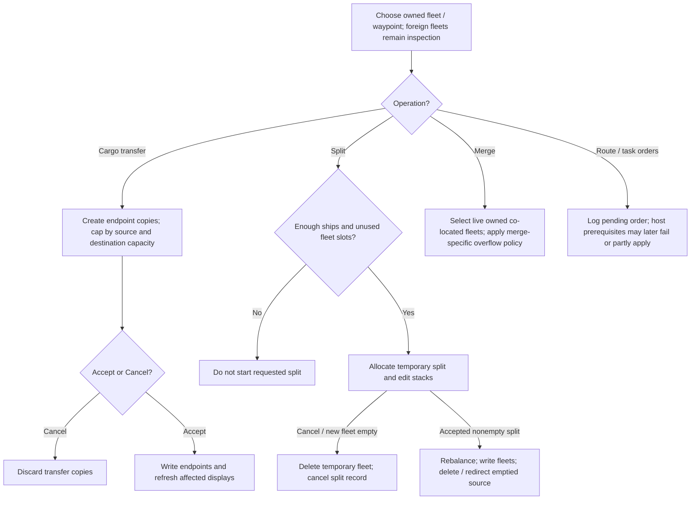
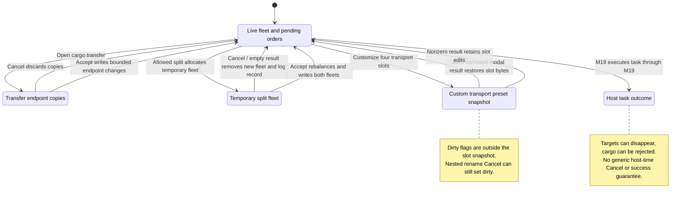

# M10 — Fleet Operations

Status: source-derived specification; formal coverage and external obligations
are distinguished below. Inspected 2026-10-24 at
`e2eae18cff0f990db20415c1c2262aed2022f95b` with the existing local specification
collection. No runtime behavior changes are proposed by this document.
Canonical definitions: [entry point](M10-fleet-specification.dfy),
[M10Fleet](dafny/M10-fleet.dfy) and [transport commands](dafny/M10-presets.dfy).
Verification: [M08–M11 collection results](README.md#m08m11-verification) and
[transport command continuation](README.md#transport-preset-and-quantity-control-continuation).

[Workflow and state diagrams](#workflow-and-state-diagrams) provide a visual reading path.

## 1. Purpose, scope and ownership

Let a player inspect fleets, transfer cargo and ships, compose waypoint tasks,
and organize fleets without losing their identities, orders or constrained
resources. Orders express intent; movement, task completion and hazards resolve
later. Issuing an order does not guarantee its eventual target remains valid.

[M07](M07-galaxy-map-and-navigation.md) owns map hit testing and route gestures;
M10 owns their fleet-order effects. [M08](M08-planet-and-colony-management.md)
owns colony controls, [M11](M11-ship-and-starbase-design.md) supplies design
statistics and M14 owns battle-plan policy/review. M15 owns reports; M19 retains
intelligence/visibility, hazards, spatial objects and combat resolution; M18
owns overall host phase ordering.
These are ownership proposals around currently interleaved implementation.
[S06](S06-shared-game-state.md) owns fleet IDs, cargo, damage and task schemas;
[S01](S01-game-file-orders.md) owns command encoding/replay and [M06](M06-player-session-and-turn-orders.md)
owns saving/submitting the edited turn.

## User stories and requirements

Actor: a player with a selected own fleet and active turn; host for later task
resolution. Full cargo/composition editing requires sufficient knowledge and
capability. Source-derived stories below are **Observed**, not claims of complete
UI or host verification.

**M10-US01 — Inspect and identify a fleet.** As a player, I want name,
composition, damage, cargo, fuel and orders tied to the selected fleet so that
I can distinguish it from other fleets at the same location. Browse adjacent
fleets, select an orbiting fleet, inspect a design or rename; cancel rename to
retain the prior name. Foreign selection remains subject to knowledge limits.

**M10-US02 — Compose a route and tasks.** As a player, I want to add/delete
waypoints, set speed and tasks, and choose repeat orders so that the fleet
executes my plan. Select a waypoint, change its task-specific controls and inspect
feedback. Invalid origin deletion is refused; preset cancellation restores the
preset snapshot. Saved commands and host outcomes remain separate.

**M10-US03 — Transfer cargo safely.** As a player, I want to move available
cargo between eligible objects so that I can supply colonies/fleets without
exceeding capacity. Edit both copied endpoints, accept to write them or cancel
to discard. Reverse transfer uses the other source stock and destination space.

**M10-US04 — Split or exchange ships.** As a player, I want to move design
stacks between fleets or create smaller fleets so that composition matches my
mission. Check fleet capacity, allocate a temporary split, adjust stacks and
accept. Cancel or accept with no ships in a newly allocated split removes the
temporary fleet and cancels its split log record.

**M10-US05 — Merge compatible fleets.** As a player, I want to combine owned
co-located fleets so that I can operate them together. Select candidates and
accept; cancellation leaves fleets intact. Merge limits and damage/healing state
must be preserved, including ships that cannot fit the destination stack.

**M10-US06 — Assess fuel and later task outcomes.** As a player, I want speed,
fuel/range and task feedback so that I can judge whether a route is feasible.
Fleet designs, cargo and racial effects shape estimates; stargates, mines,
combat and changing targets can change execution. Host messages and the next
turn report the actual result.

## 2. State and interfaces

| State | Contract |
| --- | --- |
| Fleet identity | S06 player/slot identity; 512 fleets per player. Preserve IDs in orders and redirects after deletion/merge. |
| `rgcsh[16]`, `rgdv[16]` | Per-design signed 16-bit ship counts and packed damage distributions. Empty stacks differ from missing design slots. |
| `rgwtMin[0..4]` | Three minerals, colonists in hundreds, fuel; fuel occupies separate tank capacity. |
| `lpplord`, `cord`, `iordMac`, `sel.iwpAct` | Ordered waypoints, mirrored count and active selection. Origin at index zero is retained by UI deletion. |
| `grTask` and task union | S06 `Task`/`Action` describe variants; changing task clears the old union before defaults. |
| Repeat, battle plan, no-heal | Independent fleet settings; merging must retain no-heal from either input. |
| `XFER[2]` / temporary split | Copied endpoint state and possible allocated fleet; requires explicit commit/cleanup. |

## 3. Workflows and canonical rules

### 3.1 Selection, names and order controls

Evidence: [ship.c](../src/core/ship.c), `SelectAdjFleet`;
[shipui.c](../src/ui/shipui.c), `ShipCommandProc`, `FillFleetCompLB`,
`FillOrdersLB`, `UpdateOrdersDDs`, `ClickInShipOrders`;
[ship2ui.c](../src/ui/ship2ui.c), `RenameDlg`, `ZipOrderDlg`.
Rules: S06 typed `Task`, `Action`, `Waypoint`; S01 order effects; adapter E10-1.

Owned previous/next follows the fleet report ordering and wraps. Selecting a
foreign fleet routes to scanner inspection rather than promoting it to own-fleet
editing. The fleet dropdown distinguishes objects at the selected location.
Rename logs only an accepted changed name and refreshes reports/map/messages.
Battle-plan selection hands policy editing to M14 and stores the selected plan.
Repeat updates its flag and writes back the fleet.

Changing waypoint task clears the old union and initializes task-specific
parameters. Tasks include no task, transport, colonize, remote mine, merge,
scrap, lay mines, patrol, route and transfer ownership; transport contains
per-cargo actions. Catalog, capability and target restrictions control available
UI choices. Selecting a merge task can find a suitable friendly fleet at the
waypoint, preferring matching composition and suitable existing orders. Full
target-preference and task-default logic remain E10-1; preset/transport-control
contracts below do not establish host task success.

[S02 owns transport preset storage](S02-preference-contracts.md#transport-and-production-preset-codecs),
including five action/12-bit-quantity groups, bounded names and the checked codec
round trip. Storage accepts action nibbles 0–15; that is not evidence every
value is a valid executable task. M10 specifies apply/edit/cancel below; host
per-action eligibility/execution remains E10-4. The four-slot writer's ignored
failures remain visible in S02's persistence contract.

#### 3.1.1 Applying transport presets

Evidence: `ClickInShipOrders`, `DrawShipWayPtOrders`, `UpdateOrdersDDs` and
`ShipCommandProc` in [shipui.c](../src/ui/shipui.c). The transport task's drawing
path exposes the preset diamond. Its click handler assumes live selected-fleet
and active-waypoint storage; the inner command does not recheck the task tag.
The [command model](dafny/M10-presets.dfy) separates the initial write from the
subsequent control refresh (`Apply`, `RefreshTransport`, `Complete`).

| Built-in menu index | Minerals 0–2 | Colonists 3 | Fuel 4 | Quantity fields before refresh |
| --- | --- | --- | --- | --- |
| 0 | Load All | None | Load Dunnage | Preserve all five prior quantities. |
| 1 | Unload All | Unload All | Load Dunnage | Preserve all five prior quantities. |
| 2 | Wait Percent | None | Load Dunnage | Set minerals to 100; preserve colonist/fuel quantities. |
| 3 | None | None | None | Clear all five quantities to zero. |

`Builtin` and `QuantityPreserved` retain this distinction between changing action
codes and clearing payload bytes. A custom choice copies the entire ten-byte
`TASKXPORT`, including raw quantities and action nibbles, without revalidation.
Neither path changes `grTask`, coordinates, target, speed or other order flags.
Both call fleet write-back, `UpdateOrdersDDs(1)`, then redraw; write-back's return
is ignored. These calls are not file publication or host receipt.

The menu contains four built-ins, a separator at 4, valid custom indices in slot
order, another separator only when custom entries exist, then Customize. There
are 6–11 entries (`ValidIndices`, `MenuCount`, `Choose`). Return -1 cancels.
A supplied 4 or other negative value except -1 takes the no-op switch path but
still writes/refreshes/redraws. A supplied nonnegative custom rank beyond the
valid slots makes the unbounded native scan leave the four-slot array;
`OutsideSlots`/`UndefinedSlotRead` mark that undefined access, not a returned C
error. The normal popup prevents selecting separators; its int16 result and
valid menu index are explicit adapter inputs.

#### 3.1.2 Editing custom transport slots

`ZipOrderDlg` offers four slots with no special Default slot. Import always
opens the shared rename dialog, including index 0, then copies the active
waypoint's complete transport union and marks the slot valid. Rename alone
changes only the name and does not validate an invalid slot. A nonzero nested
rename result accepts the edit; empty accepted text becomes localized
`Custom(index)`. Zero leaves payload unchanged. Both commands nevertheless set
`gd.fChgZipOrd`, including cancelled rename. Delete sets valid=false and dirty
but retains name and task bytes; `EnableZipBtns` enables Rename/Delete for any
valid slot, and Delete does not refresh that enablement afterward.

The caller snapshots all four 24-byte `ZIPORDER`s (96 bytes). It stores the
customization return in **int16_t** before the zero/nonzero decision: a raw
65536 becomes zero and restores the snapshot, while -1 remains nonzero and
keeps changes. `FinishCustom` uses the shared `OuterDialogResult` definition
also used by M09. Dirty state is outside the snapshot. Ordinary 0/1 modal
results have their expected Cancel/Accept meaning; this is not a promise to
roll back global dirty flags or other callback effects.

`Edit`, `Delete`, `FinishCustom` and `DirtyAfterCustom` specify payload changes.
`Stored` reuses S02's transport representation. Name copies and radio-label
ampersand escaping reuse the existing `M09Presets.NameCopy`/`EscapeLabel`
helpers rather than duplicating their byte rules. Normal rename input and
nonempty localized fallback fit twelve bytes plus NUL; copying preserves bytes after
the new NUL. Radio selection/focus/paint and tutorial callbacks remain native
integration obligations.

#### 3.1.3 Quantity editing and synchronous refresh

The cargo dropdown orders fuel first, then ironium, boranium, germanium and
colonists. With zero cargo capacity it offers fuel only. Rebuilding selects
the first offered nonzero action, otherwise fuel (`CargoIndex`, `CargoChoice`,
`FirstActive`, `SelectedCargo`). Action choices are codes 0–9; fuel replaces the
Dunnage label with Load Optimal. A stored action nibble 10–15 cannot select a
normal action entry and yields -1. Changing action writes the low four bits of
the selected result, retaining quantity before refresh; a supplied -1 therefore
stores nibble 15 (`ChangeAction`, `SelectedAction`).

`ShipCommandProc` reads at most seven text bytes through an eight-byte buffer,
parses `atoi`, **narrows to int16_t**, then clamps negative values to zero and
positive values to 100 for action-selection 5/6 or 4000 otherwise. It compares
the narrowed value with the clamp result to decide whether to alert and replace
the text (`ParseAmount`, `NormalizeAmount`). Thus 65636 becomes 100 without an
alert; 32768 becomes -32768 then zero with an alert; -65535 becomes 1 without an
alert. `40001234` is read as `4000123`, narrows to 2427 and stays 2427. This is
observed native behavior, not ordinary validation of the original input number.
Text is rewritten only when clamping changes the narrowed value; these no-alert
strings can remain visible while the stored amount differs. Nonnumeric `junk`
parses to zero without rewriting it.
The parser model uses bounded ASCII/C-locale text; other locale classification
and invalid UTF-8/control-buffer behavior remain S04/S05 adapters.

`UpdateOrdersDDs` writes the selected row's quantity into the edit control.
The actual [SDL edit control](../compat/win32/src/edit.c), `WM_SETTEXT` and
`ChangedEdit`, synchronously sends EN_CHANGE for a live single-line edit; the
[control creation](../src/ui/planetui.c) uses that style. Consequently a refresh
can normalize one selected quantity, even if its action disables user editing.
The amount handler writes back once normally. If clamping replaces text, the
nested notification writes back once and the outer handler writes again. A
preset application therefore has two write-back calls in this bounded adapter,
or three when it alerts, including the initial preset write. Other cargo rows
retain their quantities (`RefreshOnlySelected`). `Complete` preserves the
initial payload separately from the state after those notifications. This
composition assumes live controls, consistent normal task/cargo selections,
C-locale parsing, returning write-back/alert calls and no unrelated reentrant mutation; arbitrary callback effects
or a destroyed window are not claimed to satisfy it.

Actions 0/1/2/7 disable quantity input; 5/6 display percent units and other
selections use the cargo unit (`Control`). The customization paint path differs:
it fetches `idsAction + raw action`, and if that label ends in a period, replaces
its last three bytes with a space, quantity and literal `kT`. It does not select
units from the action enum, so a percentage action can display `120kT` there.
`ActionLabel` records this source behavior. Empty labels or period-ending labels
shorter than three bytes are explicit invalid-buffer boundaries. Localized
label fit, actual drawing and accessibility remain S03/S05 obligations.

#### 3.1.4 Native mapping and evidence

`ITEMACTION` is a 4-bit action and 12-bit quantity; `TASKXPORT` is five such
entries in mineral/mineral/mineral/colonist/fuel order. `Payload` reuses S02's
packed-domain constraints, while `Typed` maps supported codes to S06's existing
`Action`. Percent quantities above 100 fail S06's strict `ActionFits` even
though raw storage admits them; codes 10–15 have no supported typed mapping.
This projection does not silently reject or repair saved presets. The 18-byte
ORDER's transport union is at offset 8; copies do not overwrite the preceding
fields. `Slot` retains all thirteen name bytes and normal boolean validity.
Malformed pointers, invalid active waypoint/cargo indices, oversized localized
fallbacks and arbitrary callbacks are outside the checked native adapter.

[Source-extracted transport checks](../tests/spec/check_transport_presets_source.py)
compile the current menu/customization, amount/action, refresh and label/control
blocks with native structures. The **131,593 assertions** cover all sixteen
valid-slot masks, all 65,536 int16 bit patterns under both quantity limits, all
32 active-cargo masks with/without cargo space, raw union preservation, callback
write order, nested and outer cancellation, and the int16 modal return boundary.
GUI/localization/write-back doubles do not qualify actual rendering, lifetime
or publication. They implement the documented notification adapter, not an
arbitrary event loop. Shared M09 fixture correction adds a corresponding modal
return test without changing runtime code.

### 3.2 Waypoint removal and repeat

`DeleteCurWayPoint` refuses the origin and fleets with no later waypoint. For a
later waypoint it removes that entry, moves the active index backward, and also
removes the next entry if its coordinates now coincide with the previous one.
This coordinate comparison does not require equal task or object identity.
Normal versus backup deletion then chooses the active neighbor differently and
refreshes scanner paths. `Delete` models the resulting sequence and
`OriginSurvives` proves origin retention; UI focus/index adaptation is E10-1.

Host `DeleteWpFar` has a different contract: repeat recycles the removed entry
unless the index is 86, there are only two orders, or the last waypoint shares
the removed entry's coordinates. Otherwise it decrements both counts. `Recycle`
retains these exceptions. Map append/move limits and gestures remain in M07;
route execution/automatic targeting in `KillUsedWaypoints`, `NoAutoTrackFleet`,
`AutoRouteFleet` and `AutoFleetOrder` remains E10-4.

### 3.3 Cargo transfer

Evidence: `GetCargoFree`, `GetFuelFree`, `ChgCargo`, `XferSupply` in ship.c;
`TransferStuff`, `TransferDlg`, `FTrackXfer` in shipui.c.
Models: `Transfer`, `Balance`, `Move`, `Finish` for nonnegative valid stock/capacity.

Cargo space subtracts the first four cargo quantities; fuel has a separate tank.
`XferSupply` selects source by requested sign, caps by source availability,
asks the destination how much it accepts, and removes only that accepted amount
from the source. Colonists cannot be changed on a partially detailed fleet;
planets do not accept fuel and transferable Things accept only mineral cargo.
Object-class-specific capacity/ownership/knowledge adapters are E10-2.

The dialog manipulates copies. Accept writes the endpoints and refreshes affected
planet/fleet/mineral displays; Cancel discards them. Deep-space jettison has its
own `grobjOther`/log behavior and is not a persistent second fleet. `Move` proves
conservation between two valid modeled endpoints, not conservation across every
jettison, invasion or enemy transfer host rule. Already over-capacity or malformed
negative state is outside this bounded transfer projection.

### 3.4 Splits and merges

`FCanSplit` needs more than one ship and an unused fleet slot; `FCanSplitAll`
also requires enough slots for all resulting single-ship fleets. `CanSplit` and
`CanSplitAll` model the valid fleet-count domain. The dialog allocates a new split
before editing; cancellation and empty-new-fleet acceptance delete it and cancel
its split record. Accept transfers ship stacks, rebalances cargo/fuel/damage,
writes both fleets and deletes an emptied source with the required redirect.

Merge dialog candidates are live, owned and co-located. The selected current
fleet is preferred as destination when selected; at least two selected fleets
are needed. UI bulk merge and host two-fleet merge have different count policies.
`Merge2Fleets` fills each destination stack up to 32767, keeps overflow ships in
the source and deletes the source only if it is emptied (or marks dead in its
no-delete mode). `Merge` models this **two-fleet** behavior; it is not a claim
that `FFleetMergeAll` partially absorbs overflowing fleets. The latter retains
a fleet that would overflow, covered by the existing unit test. `NoHeal` combines
flags so a fleet that gated/fought/hit mines cannot gain healing by merging.

`FleetTransferCargoBalance` proportions cargo/fuel according to lost carrying
capacity, allocates integer remainders across cargo types, and reconciles packed
damage fractions. Products above source thresholds use binary64. That algorithm
is E10-3: simple aggregate conservation does not prove its rounding or damage
behavior. Target redirects on deletion/merge are S01/S06 integration obligations.

### 3.5 Fuel estimates and host execution

Evidence: `EstFuelUse`, `IFindIdealWarp`, `IWarpForWaypoint`,
`LFuelUseToWaypoint` in ship.c; [ship2.c](../src/core/ship2.c),
`FStargateJump`, `MdCalcStargateDamage`, task/route helpers;
[turn.c](../src/core/turn.c), [turn3.c](../src/core/turn3.c).
Models: `Efficiency`, `FuelTerm`, `FuelTotal`, `Range`, plus existing
[M03 scoring/speed](dafny/M03-scoring.dfy); ordered/full simulation E10-4.

Estimation looks up each design's engine, applies the 15% IFE fuel reduction,
allocates cargo in ascending efficiency groups and accumulates per-design fuel.
An incomplete engine slot uses a high consumption sentinel. Distance uses the
source's rounded Euclidean calculation. Small products use integer division;
large ones use binary64 before truncation. Ordinary fuel use adds nine before
dividing by ten; range mode omits it and returns a large sentinel for zero rate.
The large-rate range branch divides rate by 1000 before division to limit products.
These order/rounding choices are not interchangeable with a single real formula.
`FuelTerm` covers only the nonoverflowing integer branch; floating-distance,
cargo assignment, warp choice and radiating-engine side effects remain E10-4.

Host gates, movement, pursuit, hazards, colonization, mining, transport, patrol,
scrap, route and ownership transfer require task-specific prerequisites and
ordered phases. S06 formalizes their payload domain, not success. A target can
disappear, cargo can be rejected or ships damaged/destroyed. Full host resolution
is explicitly inventoried under E10-4 with M19/M18 ownership; this module
does not claim all task algorithms are proved by the command model.

## 4. Acceptance criteria and traceability

All criteria are Observed. Model proof, source review and runtime evidence are
kept separate.

| ID / story | Given / When / Then | Rule / source | Evidence / gap |
| --- | --- | --- | --- |
| M10-AC01 / US01 | Given an owned fleet, when accepted rename changes its name, then log the name change and refresh views; Cancel preserves the name. | E10-1; `ShipCommandProc`, `RenameDlg`; S01 name effect | Source; name/focus/UTF-8 matrix Open. |
| M10-AC02 / US02 | Given a route, when deleting the origin, then refuse; deleting a later waypoint also removes a newly adjacent equal-coordinate waypoint. | `Delete`; `DeleteCurWayPoint` | `OriginSurvives`, vectors; fleet workflow covers append/delete, not all equal-coordinate task combinations. |
| M10-AC03 / US02 | Given repeat orders and two entries, when retiring an entry, then do not recycle it. | `Recycle`; `DeleteWpFar` | Canonical/source; host recycling matrix Open. |
| M10-AC04 / US03 | Given source 100, destination 20, request 90 and space 30, when permitted transfer runs, then obtain 70 and 50; a forbidden transfer changes neither. | `Move`, `Transfer`; `XferSupply` | `TransferConserves`, vectors; cargo accept/cancel/reverse UI harness. |
| M10-AC05 / US03, US04 | Given copied transfer endpoints or a new temporary split, when cancelling, then discard copied edits and remove/cancel the newly allocated split record. | `Finish`, E10-2/3; `TransferStuff` | Source and fleet workflow; allocation-failure coverage Open. |
| M10-AC06 / US04 | Given three ships and 510 fleets, when splitting all, then capacity permits it; four ships does not fit. | `CanSplitAll`; `FCanSplitAll` | Vectors; capacity-limit UI case Open. |
| M10-AC07 / US05 | Given destination stack 32000 and source 1000, when Merge2Fleets runs, then destination has 32767 and source retains 233. | `Merge`; `Merge2Fleets` | `MergeConserves`; ship unit overflow test. Bulk merge retains whole overflowing fleet separately. |
| M10-AC08 / US05 | Given either merged fleet cannot heal this turn, when merging, then the destination remains unable to heal. | `NoHeal`; `Merge2Fleets` | Ship unit no-heal test; cargo/damage rounding E10-3. |
| M10-AC09 / US06 | Given engine consumption 100 and IFE, when deriving consumption, then use 85; given zero range consumption, use sentinel 1000000000. | `Efficiency`, `Range`; `EstFuelUse` | Vectors; mixed-engine/floating trace model Open. |
| M10-AC10 / US02, US06 | Given a saved task with valid payload, when the host resolves it, then apply current target/capability/phase checks rather than assume the editor guaranteed success. | S06/S01, E10-4 | Source and broad regression; per-task execution proof Open. |
| M10-AC11 / US02 | Given prior quantities, when applying built-in 0/1, then retain all quantities before refresh; built-in 2 changes only mineral quantities to 100 and 3 clears all. | `Builtin`, `QuantityPreserved`; `ClickInShipOrders` | Formal vectors/general property and source fixtures; post-refresh effects are AC15. |
| M10-AC12 / US02 | Given a custom slot, when nested rename is cancelled, then retain payload but mark dirty; accepted Import copies all ten task bytes even for slot 0. | `Edit`, `Stored`; `ZipOrderDlg` | Formal/source fixtures including raw nibble 15 and quantity 4095. No host validity asserted. |
| M10-AC13 / US02 | Given edited custom slots, when the outer result narrows to zero in int16 storage, then restore all 96 snapshot bytes without restoring dirty state. | `FinishCustom`, `OuterDialogResult`, `CancelRestores`; `ClickInShipOrders` | Model/source vectors for 0, -1 and 65536; normal modal integration remains Open. |
| M10-AC14 / US02 | Given amount text 65636, when parsing and narrowing before a percentage clamp, then store 100 without an alert; 32768 narrows negative and is clamped to zero. | `ParseAmount`, `NormalizeAmount`; `ShipCommandProc` | Formal vectors and exhaustive native int16 patterns for both limits; non-C locale remains Open. |
| M10-AC15 / US02 | Given a preset that leaves fuel quantity 4095, when normal single-line refresh selects fuel, then write the initial payload before the notification clamps fuel to 4000; preserve other rows. | `RefreshTransport`, `RefreshOnlySelected`, `Complete`; `UpdateOrdersDDs`, `ChangedEdit` | Source fixture checks initial/final snapshots and three write-back calls; live-window/no-unrelated-reentrancy adapter explicit. |
| M10-AC16 / US02, US06 | Given raw action 15 or percentage 4095, when projecting to task semantics, then do not claim S06-supported valid execution; storage compatibility does not establish action eligibility. | `SelectedAction`, `Typed`, S06 `ActionFits`; `UpdateOrdersDDs` | Checked mapping and source combo-error fixture; complete host execution remains E10-4. |
| M10-AC17 / US02 | Given a percentage action's period-ending custom label, when painting a preset summary, then replace the final three bytes with quantity and literal kT; this path does not infer percent units. | `ActionLabel`; `ZipOrderDlg` | Formal/native label fixtures; malformed/localized buffers and visual/accessibility qualification Open. |

## 5. Interaction and quality requirements

| ID | Requirement / status | Measurement and evidence |
| --- | --- | --- |
| M10-IR01 | Observed: active waypoint, task-specific controls, fleet identity and path redraw track selection; invalid origin deletion provides feedback. | Source/M07 and fleet workflow. Full keyboard-only order editing Open. |
| M10-IR02 | Observed: transfer dialog supports accept/cancel and directional changes; merge list distinguishes fleets with additional orders. | `TransferDlg`, `MergeFleetsDlg`; UI harness covers ordinary workflows. |
| M10-IR03 | Open: cargo, damage, capacity, speed and task union controls have accessible names and unambiguous units; all drag actions have keyboard alternatives. | UI/S05 owns screen-reader, focus and viewport/font-scale audit. |
| M10-QR01 | Observed integrity: valid transfers conserve the modeled commodity, merges retain overflow ships, and temporary split cancellation leaves no orphan/log. | `TransferConserves`, `MergeConserves`, C ship unit tests and workflow; full packed-damage proof absent. |
| M10-QR02 | Observed bounds: 512 fleets, 16 ship-design stacks and signed 16-bit ship counts remain compatible with S01/S06. | Model guards and overflow tests; no widening of saved fields. |
| M10-QR03 | Open: maximum-fleet route editing, merge and fuel-preview latency target. | M10/S05 owner to set workload/percentile/time and benchmark. |
| M10-QR04 | Observed text/persistence: fleet names retain UTF-8 byte limits and commands preserve ID/task layouts. | [Unicode boundaries](../docs/UNICODE-BOUNDARIES.md), S01; multilingual visual and redirect/replay matrix Open. |

## 6. Coverage inventory, evidence and open decisions

| Boundary | Rules / reason not fully formalized | Owner / next evidence |
| --- | --- | --- |
| E10-1 | Selection/report wrap, fleet rename, plan controls, nontransport task defaults/enablement, append/move, active-index recovery and full native modal/lifetime behavior remain. Preset commands/custom rollback, amount/action controls and a bounded synchronous transport refresh now have checked models/source fixtures (§3.1.1–4). S06 owns typed payloads; M07 owns gestures. | M10/M07/M14/M15/S05; complete task/default/target state machine, real reentrancy/lifetime and keyboard scenarios; retain preset/quantity fixtures. |
| E10-2 | Object-specific cargo eligibility/capacity, jettison, endpoint lookup/write-back and error paths. `Move` assumes valid nonnegative endpoints and free capacity. | M10/S06/S01; ownership, partial-detail and rejected-transfer cases. |
| E10-3 | Split allocation/destruction, bulk-merge policy, packed damage averaging, proportional cargo and binary64 threshold/remainder order, redirects. `Merge` covers only per-design two-fleet overflow. | M10/S06; full composition transition model and conservation/rounding fixtures. |
| E10-4 | Fuel cargo assignment/distance/floating branches/warp recommendation; gates and gate damage; arrival/repeat/auto-target helpers; remote mining, colonization, transport, scrap, patrol, route, mine-laying/sweeping, ownership transfer and phase interactions. All are representable future extraction, not unspecified successful tasks. | M10/M19/M18/M14; task-by-task execution companions with RNG, arithmetic and prerequisite traces. |

Evidence: [ship unit tests](../tests/unit/test_ship.c) cover two-fleet overflow,
bulk-merge overflow retention, no-heal and waypoint/warp regressions. The
[client harness](../tests/compat/win32_client_startup.c) has cargo reversal/cancel,
waypoint, repeat/preset, split and merge workflows; its fleet branch is run
explicitly in the collection verification. Native regression covers host outcomes
indirectly; it does not enumerate all task/trait/target combinations.

Open decisions: M10/M19 owns task execution decomposition; M10/S06 owns the
packed-damage and redirect interface; UI/S05 owns accessibility and performance
targets. No behavior change or unified merge policy is approved by this spec.

## Workflow and state diagrams

These reading projections summarize [Cargo transfer](#33-cargo-transfer), [Split and merge](#34-splits-and-merges), [Transport-preset cancellation](#312-editing-custom-transport-slots) and the
[canonical contracts](M10-fleet-specification.dfy) at the inspection revision recorded above.
States are explanatory milestones, not new persisted fields or a claim of
complete C/model refinement. Terminal nodes end the illustrated operation.

### Workflow

### State and recovery

The copied transfer and temporary split paths have different cleanup rules. Preset snapshots do not roll back global dirty flags. Two-fleet and bulk-merge overflow policies remain distinct; command acceptance is not host task completion.
