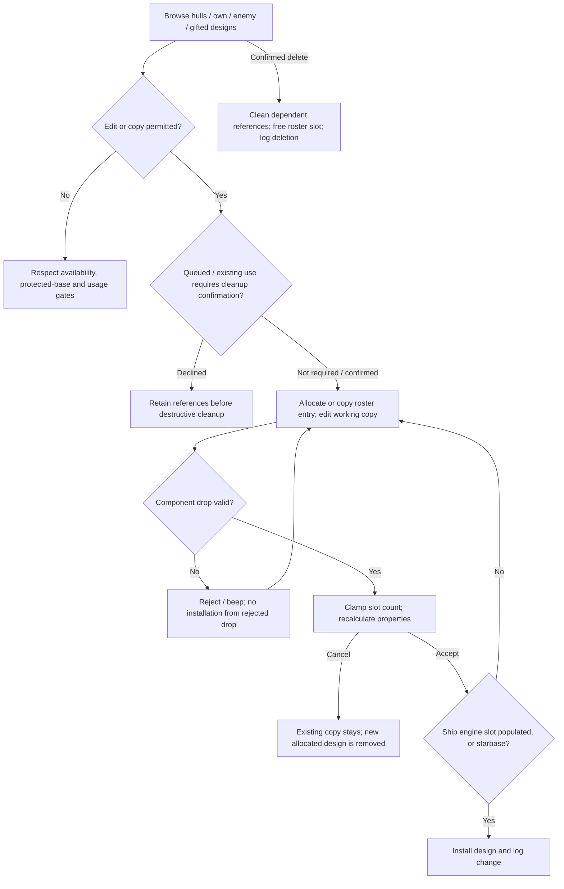
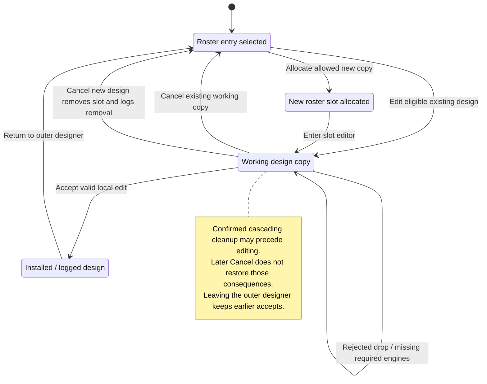

# M11 — Ship and Starbase Design

Status: source-derived specification; formal coverage and external obligations
are distinguished below. Inspected 2026-10-24 at
`e2eae18cff0f990db20415c1c2262aed2022f95b` with the existing local specification
collection. No runtime behavior changes are proposed by this document.
Canonical definitions: [entry point](M11-design-specification.dfy),
[M11Design](dafny/M11-design.dfy).
[Native part availability](M11-part-availability.md) and
[design buildability](M11-design-buildability.md) add the complete lookup and
FCanBuildShdef controller contracts, reviewed 2026-10-26 at
`e3222eb1fbdb01d68067231b5d5ef14a71759b30`.
Verification: [current design-check integration](README.md#design-buildability-continuation)
and earlier [M08–M11 collection results](README.md#m08m11-verification).

[Workflow and state diagrams](#workflow-and-state-diagrams) provide a visual reading path.

## 1. Purpose, scope and ownership

Let a player inspect hulls/components, assemble ship and starbase designs, see
calculated costs/properties, and manage the design roster used by production and
fleets. A design is a reusable numbered template inside one player state;
copying it is not copying an already built fleet.

M11 owns availability, slot composition, design edits and derived design
properties. [S03](S03-static-game-data-and-text.md) owns catalog definitions and generated IDs; those saved hull/part
numbers remain append-only. [M04](M04-race-design.md) supplies race traits, [M12](M12-research-and-technology.md)
technology, [M09](M09-production-management.md) construction costing/queues,
[M10](M10-fleet-operations.md) instantiated ships, and [M19](M19-game-rules-and-resolution.md) combat resolution (with [M14](M14-battle-planning-and-review.md) planning/review).
[S06](S06-shared-game-state.md) owns SHDEF/HUL/HS fields and [S01](S01-game-file-orders.md)
owns design command serialization. [M05](M05-universe-creation.md) consumes the
same helpers for starting designs. The ownership split does not authorize a
refactor or catalog reorder.

## User stories and requirements

Actor: a player with an active turn and design roster. Source-derived stories
are **Observed**. Catalog availability, ownership and knowledge limit what can
be built/copied; an enemy design display is not full knowledge by default.

**M11-US01 — Inspect hulls, parts and known designs.** As a player, I want to
browse ships/starbases, hulls, components and known enemy designs so that I can
understand my options. Lists show the relevant mode and availability; missing
selection disables actions instead of supplying an arbitrary design.

**M11-US02 — Create or copy a design.** As a player, I want a new roster entry
from a hull or eligible design so that I can customize it independently. Allocate
a free slot, copy/init the design and enter editing. Enemy/gift copies require
an available hull and strip unavailable parts. Cancelling a new copy releases
its allocated slot.

**M11-US03 — Assemble a valid design.** As a player, I want to add/remove
compatible components and inspect updated statistics so that the design serves
its purpose. Slot category, capacity and part identity constrain drops; ships
need engines before acceptance. Invalid drops give feedback and do not install
the component.

**M11-US04 — Commit or abandon an edit.** As a player, I want Accept/Cancel
for the working design so that I control roster changes. Accepted edits update
costs and log the design; Cancel keeps an existing roster entry, or frees a new
copy. Earlier confirmed destructive operations are outside this edit rollback.

**M11-US05 — Retire a design deliberately.** As a player, I want deletion to
explain existing/queued usage so that I understand the consequences. Confirm
required removal, or decline and retain the design. Deleting a used design can
destroy its existing ships/bases and remove affected queue items; it is not
merely hiding a catalog row.

**M11-US06 — Understand buildability and calculated properties.** As a player,
I want availability, costs, mass, armor and combat/movement properties based on
my technology and traits so that construction and fleet estimates agree with
the same design. Buildability is rechecked at host construction time; displayed
cost is not a guarantee of future availability or a base-upgrade quote.

## 2. State and interfaces

| State | Contract |
| --- | --- |
| Ship/base rosters | 16 ship design slots and 10 starbase slots per player; command design indices use the base offset of 16. Hull base catalog IDs begin at 32. These are different index spaces. |
| `SHDEF` | Free/gift/detail flags, slot index, turn, built/existing counts, hull and cached power. S06/S01 retain exact widths. |
| `HUL` / `HS` | Hull ID, name, costs, mass, armor and component slots; catalog slot masks/capacities constrain entries. |
| `shdefBuild`, `lpshdefBuild`, `ishdefBuild`, `fHullCopy` | Working copy, selected pointer, target index and whether Cancel must release a newly allocated slot. |
| `mdBuild`, `fStarbaseMode` | Existing/hull/enemy/component/edit views and ship/base roster context. |
| `idPlayer` and lookup context | Availability/cost depend on viewpoint; helper calls temporarily change and restore player context where required. |

## 3. Workflows and canonical rules

### 3.1 Browse and availability

Evidence: [buildui.c](../src/ui/buildui.c), `ShipBuilder`, `SlotDlg`,
`FillBuildDD`, `FillBuildPartsLB`, `UpdateSlotGlobals`;
[build.c](../src/core/build.c), `NthValidShdef`, `NthValidEnemyShdef`;
[parts.c](../src/core/parts.c), `FLookupPart`, `TechStatus`.
Models: `Limit`, `FirstFree`, `Missing`, `TechStatus`, `Lookup`, `CanBuild`.

`FLookupPart` queries primary first in player context, then checks category/item
validity, assigns the catalog pointer and applies trait/visibility restrictions
before technology status. Invalid and restricted are distinct
from future technology. For an allowed row with all six requirements met, the part is available.
One missing level in the current research field is NextTech; a larger deficit
in that sole field returns its encoded later status. Other missing-field
combinations are OtherTech. `Later` stores the source deficit-plus-one code;
it is not an estimated number of years. The complete [native category/trait/hidden-part table](M11-part-availability.md)
now has checked contracts, pointer/query effects and current catalog/source
fixtures. Full caller/context/native memory refinement remains E11-1.

[FCanBuildShdef](M11-design-buildability.md) in [util.c](../src/core/util.c)
saves `idPlayer`, performs the signed-hull/byte-item projection, checks hull then
occupied components for exactly Available, and restores the old context on
ordinary true/false returns. It has no up-front slot-count/target validator;
first invalid native reads and nonreturning calls have no general restoration
promise. It is an availability test rather than a complete design validator. Enemy detail and gifted designs have separate
copy/display constraints.

### 3.2 Allocate and copy

Find a free slot in the selected roster. A source hull supplies structure with
empty component slots; an own nongift design supplies a copy with a new suggested
name. Enemy/gift copying first rejects an unavailable hull and removes unavailable
installed parts, clearing gift status. New copies clear built/existing counts,
set turn/index, recalculate cost, increment roster count, log the new entry and
then edit through a working copy. `FirstFree` returns the sequence length when
full; it does not prove the native UI always guards that sentinel. E11-2 covers
full-roster button/dispatch integrity and name generation.

The AR initial base is protected from the ordinary edit/delete controls. The
selection path also disables editing when ships already exist or queued work
has progress. `CanEdit` models that enablement predicate. Other event paths and
confirmed queue cleanup remain distinct; a disabled button alone is not a
host-side integrity guarantee.

### 3.3 Slot editing

Evidence: `FTrackSlot`, `IDropPart`; models `SlotAccepts`, `Filled`, `CanAccept`.
Empty slots accept categories matching the hull's slot mask. Nonempty slots
accept only the same category and item. Full slots reject addition. Drops onto
the source slot are a no-op; rejected drops beep. Accepted counts clamp to the
slot capacity and move the corresponding amount from a source slot when dragging
an installed component. Preview (`fNoModify`) does not install anything.

Control from the component list requests up to 100, Shift requests up to four,
and an ordinary move from an installed slot requests one. Engine slots request
full fill; removing installed engines removes the slot's set. Dropping in the
removal area decrements/removes components, then recalculates and redraws costs.
`SlotAccepts` takes an already evaluated mask match; native hit testing, modifier
precedence and movement/removal adapters are E11-3.

Accepting a ship without components in engine slot zero is rejected with an
alert. Starbases do not have that requirement. This source check must not be
expanded into a claim that all possible malformed hulls are validated here.

### 3.4 Accept, cancel and delete

Models: `Finish`, `EditResult`; evidence `SlotDlg`, `FCheckQueuedShip`,
`DestroyAllIshdef`, `DestroyAllIshdefSB`, `RemoveIshdefFromAllQueues` in
[ship.c](../src/core/ship.c).

Accept captures the bounded name, resets built/existing counts for the edited
entry, marks it occupied, recalculates cost, installs it in the proper roster
and logs `LogChangeShDef`. Cancel of an existing working copy keeps the prior
roster entry. Cancel of a newly allocated copy marks that slot free, restores
the count and logs the removal. Leaving the outer designer does not undo earlier
accepted actions. The model covers the local edit outcome, not all log/native
control side effects.

`FCheckQueuedShip` computes existing/queued usage and presents a confirmation
when needed. Declining returns before destructive cleanup. Confirmation can
destroy existing objects or remove queued design references, with different
edit/delete queue handling. Deletion marks the slot free, clears counts,
adjusts roster count and logs the change. AR's initial base remains protected.
These cross-object consequences precede or surround edit-copy handling and are
not restored by later edit Cancel. E11-2 inventories cascading cleanup/redirects;
production/fleet references cannot be assumed to survive deletion.

### 3.5 Costs and derived properties

Evidence: [util.c](../src/core/util.c), `UpdateShdefCost`, `GetTrueHullCost`,
`FCanBuildShdef`; ship.c `GetTruePartCost`;
[shared scoring](dafny/M03-scoring.dfy) for `Beam`, `Torpedo`, `Bomb`,
`Capacitors`, `Power`, `Class`, `HighestWarp`, `Speed`.
Models: `Discount`, `Miniaturized`, `QuarterDiscount`, `QuarterSurcharge`,
`CheapEngine`, `Armor`, `Stored`, `Component`, `TotalCost`, `TotalMass`.

Miniaturization uses the minimum excess technology among required fields; if
none are required it uses minimum player technology. Positive excess caps at
19; the ordinary discount is four percentage points per excess level capped at
75, or five capped at 80 with Bleeding Edge Technology. `LMulDiv` rounds the
cost reduction; positive costs retain a minimum of one. Some terraforming and
planetary components skip miniaturization. Trait adjustments then apply, such
as stargate/weapon quarter reductions, Inner Strength weapon surcharge and
Cheap Engines halving with the source rounding. Bleeding Edge can double new
technology cost; complete branch/context behavior is E11-4.

`UpdateShdefCost` starts from the priced hull and accumulates each occupied
component count times its cost/mass. Armor components add their full count times
armor points, halved for Regenerating Shields on a fully known design. That
product is 32-bit before halving; the native overflow regression protects it.
Croby Sharmor/Langston Shell add 65 armor per component; Multi Cargo Pod adds
50. Cost/mass fields retain their low 16 bits; `Stored` models that narrowing
for nonnegative totals. Power cache resets to -1 after recalculation.
`GetTrueHullCost` reads these stored totals; M09 alone owns base upgrade credits
and final base construction discount, so callers must not apply those twice.
The [M09 native cost companion](M09-production-costs.md) now defines complete
caller vector/slot arithmetic over these quote words. It preserves signed
reinterpretation, native narrowing and trait contexts; M11 still owns quote
derivation and its undefined pricing branches.

The aggregate model consumes catalog/pricing projections; it does not generate
all stats from YAML. Cargo, fuel, scanning, jamming, cloaking, mine, terraforming
and gate capabilities remain their consumers' contracts/E11-4. Existing power
and speed models are reused instead of duplicated. Float/native-width details
outside the stated integer domain require source-specific adapters.

## 4. Acceptance criteria and traceability

All criteria describe Observed behavior; no new validation policy is silently
promoted from Open to implemented.

| ID / story | Given / When / Then | Rule / source | Evidence / gap |
| --- | --- | --- | --- |
| M11-AC01 / US01, US06 | Given one missing level in the current research field, when checking technology, then return NextTech; another missing field changes it to OtherTech. | `TechStatus`; `parts.c` | Vectors; full catalog/hidden-part matrix Open. |
| M11-AC02 / US01, US06 | Given an available hull and one restricted occupied part, when checking buildability, then reject and restore the caller's player context. | `CanBuild`, `Check`/`Traverse`; [FCanBuildShdef controller](M11-design-buildability.md). | Checked semantic refinement/ordinary restoration, `BuildNeedsEveryPart`, actual controller+lookup/race/technology composition and native frames. Full caller/lifetime qualification remains E11-1. |
| M11-AC03 / US02 | Given a free slot, when copying an enemy/gift design, then reject unavailable hulls or strip unavailable parts before editing the new entry. | `FirstFree`, E11-1/2; `SlotDlg` | Source; adversarial full-roster/gift-copy matrix Open. |
| M11-AC04 / US03 | Given a full or incompatible slot, when dropping a component, then refuse; compatible addition cannot exceed capacity. | `SlotAccepts`, `Filled`; `IDropPart` | `FillBound`; designer harness drag/remove/reinsert. |
| M11-AC05 / US03, US04 | Given a ship with no engine in slot zero, when accepting, then remain editing and alert; a starbase is exempt. | `CanAccept`, `Finish`; `SlotDlg` | Vector/source; no-engine alert UI case Open. |
| M11-AC06 / US02, US04 | Given a new copied design, when cancelling, then free its slot and restore roster count; existing-edit Cancel retains the original. | `Finish`, E11-2; `SlotDlg` | Vectors; ship/base accept/cancel/delete designer workflow. |
| M11-AC07 / US05 | Given a used design, when declining deletion confirmation, then leave it intact; confirming may destroy instances/remove queued references before freeing/logging the slot. | E11-2; `FCheckQueuedShip`, destruction helpers | Source; harmless new-design deletion covered, populated cascade/recovery tests Open. |
| M11-AC08 / US06 | Given 24 armor components with 1500 points and RS, when calculating armor contribution, then obtain 18000 rather than a signed 16-bit overflow before halving. | `Armor`; `UpdateShdefCost` | Vector; `test_UpdateShdefCost_rs_armor_overflow`. |
| M11-AC09 / US06 | Given cost 100 and one excess technology level without BET, when miniaturizing, then cost is 96; maximum discounts are 75% ordinary and 80% BET. | `Miniaturized`, `Discount`; `GetTruePartCost` | Vectors; complete trait-order/cost adapter Open. |
| M11-AC10 / US04, US06 | Given accepted component edits, when recalculating, then aggregate cost/mass, retain field widths and invalidate cached power before later consumers use it. | `TotalCost`, `TotalMass`, `Stored`, E11-4; `UpdateShdefCost` | Vectors, `StoredWidth`, designer workflow and armor units; all-stat equivalence Open. |
| **M11-AC11** / [M11-US01](#m11-us01), [M11-US06](#m11-us06) | Given six signed level/requirement bytes and any packed current field, preserve source status codes 1, 2, deficit+1 or 99; the range is 1..256 and never Invalid. | [Native status](dafny/M11-native-availability.dfy) `TechStatus`, `TechProjection`, `Code`, vectors. | Actual signed-byte/current/missing-field fixtures; raw deficit 98 can encode 99 without a semantic inverse. |
| **M11-AC12** / [M11-US01](#m11-us01), [M11-US06](#m11-us06) | Given an unrecognized mask or out-of-range byte item, query primary first in player context, return Invalid and preserve the prior union pointer; headless skips the primary getter. | `Kind`, `Lookup`, `LookupRow`; [lookup workflow](M11-part-availability.md#lookup-workflow-and-pointer-effects). | All uint16 masks, byte extents, exact call order and native pointer/frame checks; valid native caller storage remains required. |
| **M11-AC13** / [M11-US01](#m11-us01), [M11-US06](#m11-us06) | Given a valid item, assign its catalog pointer before ordered category/trait denials; return Restricted without a technology call on denial. Retain shield/armor/beam primary restrictions in headless context. | `Policy`, `Lookup`, `Address`, vectors; [all-category inventory](M11-part-availability.md#category-policy-inventory). | Actual primary/trait/headless cases and every catalog pointer, including denied items; full caller/lifetime qualification remains E11-1. |
| **M11-AC14** / [M11-US01](#m11-us01), [M11-US06](#m11-us06) | Given a source trader-exclusive category/item pair, hide it in player context exactly when its own grant bit is absent; headless and unmatched masks/pairs remain unhidden. | `TraderFlag`, `Hidden`, `HiddenMask`; native `FShouldPartBeHidden`. | Every uint16 trader word at all twelve pairs and every uint16 mask; context/catalog lifetimes and real browser presentation remain separate. |
| **M11-AC15** / [M11-US01](#m11-us01), [M11-US06](#m11-us06) | Given an allowed valid item, return 1 headless or query actual technology in player context; preserve short-circuit getter order and the helper's observed PLAYER/GAME/global/HS input frame. | `Policy`, `Lookup`/`LookupRow` result/call contract; [native evidence](M11-part-availability.md#evidence-and-remaining-qualification). | Exact source-call sequences, native full-byte player/game/part/requirement comparisons and identity checks. Mathematical result contracts and finite native frame evidence do not prove universal C memory/caller refinement. |
| **M11-AC16** / [M11-US01](#m11-us01), [M11-US06](#m11-us06) | Given a hull word, classify by signed-16 comparison with 32 before eight-bit item assignment; raw 288 selects base item zero and raw 32768 selects ship item zero. | [Controller model](dafny/M11-design-buildability.dfy) `HullRequest`, `HullVectors`; util.c source. | All 65536 native hull words; raw aliases do not become approved design IDs. |
| **M11-AC17** / [M11-US01](#m11-us01), [M11-US06](#m11-us06) | Given a returning check with valid native storage, select the requested player or -1 headless, and restore the exact saved signed-word global on ordinary true/false return. | `Selected`, `Finish`, `Check`/`Traverse` postconditions; [interface/domain](M11-design-buildability.md#interface-and-source-domain). | Actual helper composition, every saved global word, positive/headless targets and exact getter contexts; undefined/nonreturning paths have no ordinary restoration guarantee. |
| **M11-AC18** / [M11-US03](#m11-us03), [M11-US06](#m11-us06) | Given an available hull and bounded slot storage, visit occupied slots in order, skip count-zero garbage, and query each positive quantity once. Complete with at most seventeen lookups. | `SlotRequest`, `Requirements`, `Traverse`, `Check`; canonical `CanBuild` refinement. | Every occupancy mask and each catalog row/terminator at every slot; native lookup/call order and byte quantities. |
| **M11-AC19** / [M11-US01](#m11-us01), [M11-US06](#m11-us06) | Given hull or component status other than exactly 1, reject at that lookup without querying later parts; hull rejection can precede an oversized declared count. | `RejectBeforeExtent`, `Check`, `Traverse`; [ordered workflow](M11-design-buildability.md#ordered-workflow-rejection-and-restoration). | All byte counts with hull/component failure alternatives, native early-exit and restoration frames; positive future codes still reject. |
| **M11-AC20** / [M11-US03](#m11-us03), [M11-US06](#m11-us06) | Given zero declared slots, let the hull alone determine this availability result; free/gift metadata, engine/capacity/compatibility and construction prerequisites are separate caller rules. | `HullOnly`, `Check`, canonical `CanBuild`; [handoffs](M11-design-buildability.md#caller-handoffs-and-remaining-integration). | Actual free/gift/count/unused-byte frames; a TRUE helper result is not complete design or production acceptance. |
| **M11-AC21** / [M11-US01](#m11-us01), [M11-US06](#m11-us06) | Given an invalid target or a reached seventeenth slot read, retain the modeled selected-player/probe prefix and an undefined-domain marker, without inventing FALSE or restoration. | `ValidPlayer`, `Check`, `EmptyOverrun`; [undefined domains](M11-design-buildability.md#undefined-domains-and-failure-prefixes). | Native candidates are excluded before undefined C execution; earlier rejection may remain defined. Full memory/caller qualification stays E11-1/S06. |

## 5. Interaction and quality requirements

| ID | Requirement / status | Measurement and evidence |
| --- | --- | --- |
| M11-IR01 | Observed: ship/base and view modes have distinct selections, unavailable actions are disabled, slot rejection gives feedback, edit has Accept/Cancel. | `SlotDlg` and designer harness; full keyboard-only assembly Open. |
| M11-IR02 | Observed: name entry is bounded to the stored 32-byte buffer and screen-fit helper; invalid no-engine acceptance explains failure. | UI/source and [Unicode boundaries](../docs/UNICODE-BOUNDARIES.md); multibyte limit/font-scale visual matrix Open. |
| M11-IR03 | Open: each slot exposes category, part/count, capacity and availability in accessible form; component drag/remove has a keyboard equivalent and predictable focus. | S05/UI owner to select implementation and test screen-reader/keyboard behavior. |
| M11-QR01 | Observed compatibility: catalog hull/part IDs, 16/10 roster limits, byte budgets and saved widths remain fixed. | S03/S06/S01, `Limit`, `StoredWidth`; no catalog renumbering. |
| M11-QR02 | Observed calculation integrity: aggregate armor uses widened intermediate before RS halving; cost rounding and cache invalidation preserve source order. | Armor unit regression, canonical models; complete stat derivation remains E11-4. |
| M11-QR03 | Open: component selection/drag/recalculation latency budget at maximum occupied slots and supported font scale. | M11/S05 to agree percentile/workload/latency and benchmark; no timing claim. |
| M11-QR04 | Observed edit integrity: local cancellation frees a new slot or preserves existing design, with earlier destructive actions explicitly excluded. | `Finish`, designer workflow; failure injection and used-design cascade tests Open. |

## 6. Coverage inventory, evidence and open decisions

| Boundary | Rules / reason not fully formalized | Owner / next evidence |
| --- | --- | --- |
| E11-1 | All category/trait/trader/technology decisions, query order and pointer effects now have [native lookup contracts](M11-part-availability.md), signed/natural refinement and actual generated-table/source fixtures. The [complete build-check controller](M11-design-buildability.md) now specifies hull/slot order, raw widths, ordinary context restoration, semantic CanBuild refinement and undefined-read prefixes, with actual helper composition fixtures. [M19 construction eligibility](M19-construction-buildability.md) now consumes that outcome through checked roster/free/guard/metadata contracts and actual FBuildObject/Produce integration cases. Remaining obligations are full native memory/alias/lifetime and caller/context extraction, enemy knowledge and UI/category workflows. M12 can now construct a proved complete scan from a shaped catalog/context; actual host state integration remains separate. | M11/S03/M12/M19/S06; native memory/lifetime/caller mapping and browser/knowledge/annual integration; ordinary FCanBuildShdef restoration now has checked contracts and composed source evidence. |
| E11-2 | Free-slot UI dispatch, copy-name generation, AR protections across paths, roster counters/logs, queued-progress checks, confirmation and destruction/queue-removal cascades. `Finish` is local edit outcome only. | M11/M09/M10/S01; full-roster and populated deletion/decline scenarios. |
| E11-3 | Native hit testing, category bit masks, drag capture, quantity modifiers, source-slot decrement, removal and preview side effects. Scalar acceptance/fill is checked, not every gesture. | M11/S05; keyboard/display/drop-state qualification. |
| E11-4 | Excess-tech extraction, complete special-part/trait pricing order and flags, per-field accumulation/native widths, lazy caches and all other hull capabilities. Existing scoring/speed is canonical; a complete catalog-to-derived-design proof remains open. | M11/S03/S04 and consuming modules; arithmetic companion and catalog-driven tests. |

One source ambiguity belongs to E11-4: `GetTruePartCost` can jump past the
assignment to `cExcess` for excluded planetary/terraforming parts and later read
it in the Bleeding Edge condition. No deterministic result is assigned to that
uninitialized-local path by this specification. M11 maintainers must investigate
and resolve it as a separate bug decision; pure scalar discount functions do
not certify that path.

Evidence: [designer workflow](../tests/compat/win32_designer_workflow.h) exercises
hull selection, component drag/remove/reinsert, ship/base accept/cancel/delete
and original-design preservation. [util unit tests](../tests/unit/test_util.c)
exercise armor and RS overflow. Broad regression is additional indirect evidence;
none establishes all catalog, technology, trait or deletion-cascade combinations.

Open decisions: S03 now supplies the [versioned catalog inventory](S03-catalog-inventory.md); M11/S03 still owns full availability/derived-property refinement;
M11/M09/M10 owns safe deletion and buildability boundaries; UI/S05 owns
accessibility, minimum viewport and responsiveness targets. Do not change saved
IDs or observed destructive behavior while filling those documentation gaps.

## Workflow and state diagrams

These reading projections summarize [Working copies and allocation](#32-allocate-and-copy), [Slot editing](#33-slot-editing), [Accept, cancel and delete](#34-accept-cancel-and-delete) and the
[canonical contracts](M11-design-specification.dfy) at the inspection revision recorded above.
States are explanatory milestones, not new persisted fields or a claim of
complete C/model refinement. Terminal nodes end the illustrated operation.

### Workflow

### State and recovery

The local edit-copy outcome does not restore earlier confirmed fleet/queue cleanup. Full-roster dispatch integrity and malformed slot/native lifetime cases remain external obligations; disabled controls alone are not host-side validation.
