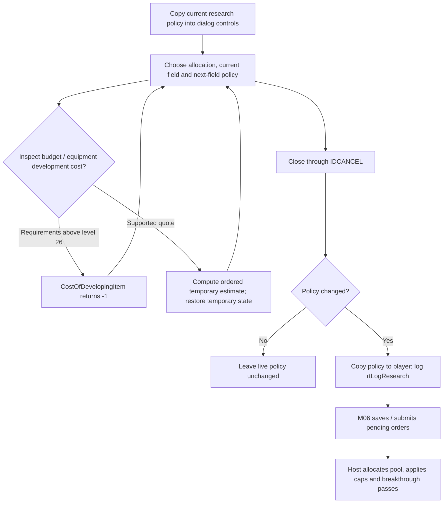
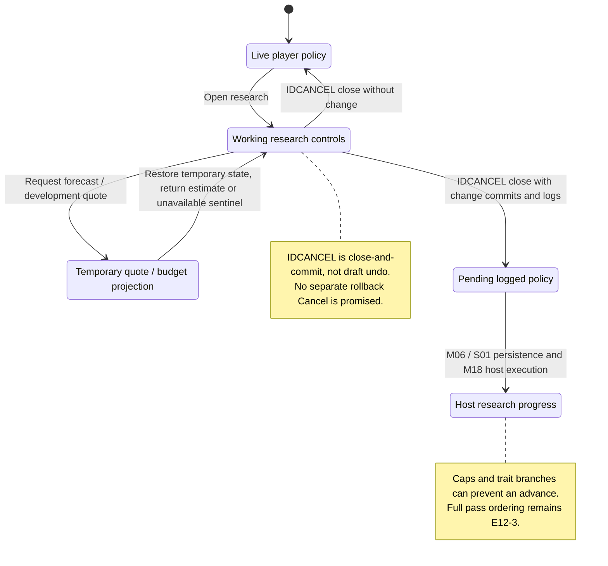

# M12: Research and Technology

Status: source-derived detailed specification; logical ownership is proposed.
Inspected: `e2eae18cff0f990db20415c1c2262aed2022f95b`, 2026-10-24.

Canonical entry: [M12-research-specification.dfy](M12-research-specification.dfy);
[rules and proofs](dafny/M12-research.dfy). Behavior statuses and evidence follow
[the collection conventions](README.md#requirement-ids-and-status).
Native development/budget quotes reviewed 2026-10-25 at
`e3222eb1fbdb01d68067231b5d5ef14a71759b30`; [contracts and evidence](M12-development-and-budget-quotes.md).
[Host advancement/announcements](M12-host-research-resolution.md) reviewed 2026-10-26 at that same revision.

[Workflow and state diagrams](#workflow-and-state-diagrams) provide a visual reading path.

## 1. Purpose, actors and scope

Choose research effort and field priorities, inspect future equipment and convert
research spending into technology. This separates user policy, a forecast and
host breakthroughs. [M08](M08-planet-and-colony-management.md)/[M09](M09-production-management.md)
provide resources/production leftovers; [M11](M11-ship-and-starbase-design.md)
owns part buildability, S03 the catalogs, M18 phase sequencing and M19 shared
resolution. S01 owns the research command bytes; S06 owns player progress.
The existing `M03Scoring.ResearchCost` and technology-cost table in
[scoring](dafny/M03-scoring.dfy) remain canonical; this entry establishes their
gameplay owner without copying the calculation.

Primary actors: A player allocating an owned empire’s research and a host resolving its investment.

### User stories

These source-derived stories describe intent, not evidence of user research.
The prerequisites and triggers are the corresponding workflows below. All
stories describe Observed capabilities with the stated limitations.

**M12-US01 — Set research effort.** As a player, I want to choose a field, allocation and next-field policy so that my empire develops the technology I need.

**M12-US02 — Inspect the budget.** As a player, I want projected spending and remaining costs so that I can compare research with construction.

**M12-US03 — Find equipment requirements.** As a player, I want a component browser showing technology and trait restrictions so that I understand what I can unlock.

**M12-US04 — Resolve breakthroughs.** As a player, I want paid research retained and breakthroughs reported so that later construction uses the resulting technology.

### Story entry and completion conditions

| Story | Trigger and prerequisites | Completion / alternate outcome |
| --- | --- | --- |
| [M12-US01](#m12-us01) | Open research with a loaded player and valid six-field policy. | Close commits changed policy; no edit leaves it unchanged. |
| [M12-US02](#m12-us02) | Change allocation or request a quote with owned colonies/progress available. | Return a forecast/cost and restore temporary state; host effects are separate. |
| [M12-US03](#m12-us03) | Open the technology browser with catalog and player/trait context. | Show available/future/hidden distinctions; trader restrictions remain separate. |
| [M12-US04](#m12-us04) | Host reaches research with spending and current progress. | Retain spending, apply eligible advances and report unlocks; cap/trait branches apply. |

## 2. Inputs, outputs and state

| Area | Contract |
| --- | --- |
| Policy | `iTechNow` 0–5; `iTechNext` 0–5 explicit, 6 same, 7 lowest; `pctResearch` 0–100. |
| Progress | Six technology levels and six accumulated resource values, distinct from last-year resource pool. |
| Dialog | `pctResGlob`, `iResTechNow` and next-field dropdown hold working policy; projected budget is derived. |
| Availability | M11 availability categories plus trader-grant bits; research alone cannot unlock a hidden trader part. |

Persistent records remain [S01](S01-game-file-formats.md); logical state and
identity remain [S06](S06-shared-game-state.md). A derived/working value must not
be treated as a separately committed record or as information known to every player.

## 3. Workflows, rules and handoffs

### Policy editing and closing

[researchui.c](../src/ui/researchui.c) `ResearchDlg` initializes local controls
from the current player. The next-field list maps row zero to same-field (6),
rows 1–6 to fields 0–5, row 7 to lowest (7): `NextChoice`/`ChoiceRow` are canonical.
Changing fields refreshes estimates. The handler named `IDCANCEL` is the dialog's
close/commit path: changed values are copied to the player and `rtLogResearch`
is written. `Close` preserves that observed result. Do not promise Cancel undo
from the control ID. Submission remains M06; an unchanged close does not add a
policy change. Tutorial advancement and focus are UI adapters.

### Costs and projection

[research.c](../src/core/research.c) `GetTechLevelCost` combines the next-level
table with ten times total current levels, applies race cost choice and slow-tech
multiplier, preserving division order. `CostOfDevelopingItem` returns -1 when
any requirement exceeds 26. Otherwise it walks the six fields in index order,
temporarily increments levels, subtracts existing spending and restores levels.
Earlier fields therefore affect later total-level surcharges; this is not six
independent quotes from one unchanged snapshot. The [native quote companion](M12-development-and-budget-quotes.md)
now specifies that full ordered loop, signed-byte/table/cost-choice arithmetic,
uint32 spending reinterpretation, guarded intermediate operations and restoration.
Checked normal-domain refinement reuses M03 `ResearchCost` rather than copying it.

`ProjectedResearchSpending` temporarily changes allocation, sums owned colonies,
uses all resources for an empty queue and the production estimator for a nonempty
queue, then restores allocation. Forecasts inherit M09's mining/growth/horizon
assumptions. The preview is not host execution or a promise about future events.
The [preview controller](dafny/M12-budget-preview.dfy) captures the planet-array
bound, narrows the requested allocation byte, always queries owned-planet gross
resources and reads queue state after that query before choosing its contribution.
Normal restoration writes through current `idPlayer`; original-player restoration
requires a stable global identity. Escaping helpers have no local restoration.
The [native economy producer contract](M08-colony-economy.md) now supplies
capacity/resources/growth widths and M09 budget handoffs. Restoring allocation
and using local forecast production does not establish global helper purity:
[GAP-16](README.md#gap-16) retains RNG, live-fleet and message effects.
The browser uses `FLookupPart`/`TechStatus` and `FShouldPartBeHidden`, including
trader-grant restrictions. The complete [native lookup decisions](M11-part-availability.md)
now have M11 contracts and source fixtures. Category selection, textual display,
UI/caller state and real browser qualification remain E12-2; S03 retains item IDs.

### Applying research

[turn2.c](../src/core/turn2.c) `UpdateResearchStatus` distinguishes pooled annual
resources from previously earned/nonpool advances. Ordinary research receives
the pool in its chosen field. Generalized Research gives rounded-up half to the
primary field and rounded-up 15% to each other field (`PrimaryPool`, `OtherPool`);
the source arithmetic can distribute more than the original pool. Slow-tech storage scales spending
separately from quoted cost. Repeated passes can earn several levels and redirect
leftovers. Levels stop at 26, or 10 for crippled players (`CanAdvance`).

The [host resolution companion](M12-host-research-resolution.md) now specifies
all-player/field/redo order, native spending/pool/rounding and packed policy,
repeated breakthroughs, the full equipment scan, shared grants and recursive
nonpool pass. Dead flags affect the shared divisor without skipping a player's
research. Capped fields can skip the working-spending writeback.

A level-26 breakthrough changes local next=6 to local next=7; this is not itself
a write to packed next policy. Lowest redirection writes the current field and
leaves packed next unchanged; explicit redirection writes packed next=6. Normal
nonnegative lowest agrees with the scalar first-minimum rule; raw signed byte
comparisons and all equipment/notice details are in the companion.

The state machine retains finite-prefix `Run` and adds a derived control rank,
`Finish` and `SufficientFuel` for normal levels, plus a catalog-bounded scan
completion theorem. [The companion explains their domains](M12-host-research-resolution.md#catalog-bound-and-host-control-progress).
Successful Done completion over native-derived arithmetic/policy/storage/service
frames, full lookup/message/pointer/caller-state correspondence and saved-game/
platform qualification remain E12-3. Model terminal markers still distinguish
Pending/Escaped/Undefined from successful completion.

## 4. Acceptance and traceability

All criteria below have **Observed** behavior status except where a rule is
explicitly a caller convention or repository maintenance constraint. A named
model/lemma supplies mathematical evidence within its preconditions. An E-boundary
supplies source evidence and an explicit implementation-test/refinement gap,
not a proved runtime outcome. The dated collection run records actual checks.

| Criterion / story | Given / When / Then | Authoritative rule, source and evidence scope |
| --- | --- | --- |
| **M12-AC01** / [M12-US01](#m12-us01) | Given row zero, when choosing next research, then use same-field code 6; mapping back returns row zero. | `NextChoice`, `ChoiceRoundTrip`; ResearchDlg |
| **M12-AC02** / [M12-US01](#m12-us01) | Given changed working policy, when closing via IDCANCEL, then commit and log it; closing is not rollback. | `Close`; ResearchDlg, S01 research effect |
| **M12-AC03** / [M12-US02](#m12-us02) | Given a projected budget request with stable global player identity, when preview returns ordinarily, then restore the saved allocation and use copied forecast production. Do not infer unchanged RNG, live remote-fleet flags or messages from that local copy. | `Preview`/`Loop`; ProjectedResearchSpending/M09 estimator; [GAP-16](README.md#gap-16). Current-player restoration and full caller/frame qualification remain explicit in M12-AC15/E12-1. |
| **M12-AC04** / [M12-US03](#m12-us03) | Given a trader-exclusive part without its grant, when browsing/build checking, then it remains hidden/restricted even with sufficient technology. | E12-2; FShouldPartBeHidden, M11 |
| **M12-AC05** / [M12-US04](#m12-us04) | Given a pool of 101 with Generalized Research, when distributing it, then primary receives 51 and each other field 16. | `PrimaryPool`, `OtherPool`, vectors |
| **M12-AC06** / [M12-US04](#m12-us04) | Given level 10 and crippled status, when checking a breakthrough, then no further level is allowed; ordinary level 25 may advance. | `CanAdvance`, vectors; UpdateResearchStatus |
| **M12-AC07** / [M12-US02](#m12-us02), [M12-US03](#m12-us03) | Given a technology cost, retain six signed level bytes, narrowed surcharge, actual cost-choice branches and arithmetic right shift before the slow multiplier. | `TechCost`, `CostDefined`, `CostProjection`; [native cost](M12-development-and-budget-quotes.md#native-single-level-technology-cost). Actual source all-byte choices/table contexts; normal M03 cost refinement proved, platform signed conventions remain explicit. |
| **M12-AC08** / [M12-US02](#m12-us02), [M12-US03](#m12-us03) | Given zero levels, standard choices and no prior spending, quote first two fields to level one as 50+60=110, using earlier temporary increases in later total-level surcharges. | `RaiseTo`, `Fields`, `Development`; [ordered quote](M12-development-and-budget-quotes.md#ordered-development-quote-and-restoration). Native ordered trace fingerprints and multi-field fixtures; no independent-field sum is substituted. |
| **M12-AC09** / [M12-US03](#m12-us03) | Given any target byte >26, return -1 before changing levels or querying costs, even for a field already at that target. Negative targets are not rejected by this upper-bound check. | `Development` Unreachable postconditions; actual target/precheck/source fixtures and unchanged-level trace. Raw bytes are not newly approved game settings. |
| **M12-AC10** / [M12-US02](#m12-us02) | Given a field requiring development, reinterpret its uint32 spending, apply slow scaling, negate and accumulate signed quotes in that order; clamp each completed field remainder to zero before total addition. | `Fields`, `RaiseTo`; native spending/slow/negation/addition cases under ASan/UBSan. Undefined candidates are filtered before C, not returned as source errors. |
| **M12-AC11** / [M12-US02](#m12-us02), [M12-US03](#m12-us03) | Given ordinary development quote completion, restore all original levels and leave spending/choices unspent; on undefined arithmetic retain the preceding numeric prefix without promising restoration. | `Development`/`RaiseTo` postconditions and events; actual final-level/spending/choice/player comparisons. Caller aliases and escaping/native memory frames remain open. |
| **M12-AC12** / [M12-US02](#m12-us02) | Given an int32 preview percentage, assign low eight bits to signed allocation: 255 becomes -1 and 256 becomes zero; do not invent a clamp inside the controller. | `Byte`, `Preview`; native boundary/allocation fixtures. UI-supported 0..100 policy and control validation remain separate. |
| **M12-AC13** / [M12-US02](#m12-us02) | Given an owned planet, query gross resources first, then inspect the returned queue state; add gross for null/count-zero queue or the signed-16 estimator first output for nonempty queue. | `Receive`, `Loop`; [budget query ordering](M12-development-and-budget-quotes.md#budget-preview-allocation-queries-and-captured-bounds). Native null/empty/nonempty and post-query queue-change providers; actual helper-state refinement remains open. |
| **M12-AC14** / [M12-US02](#m12-us02) | Given a preview callback changing global planet count, continue the captured array/end traversal; compare each current owner with current global player at its visit. | `Preview`, `Loop`; native count/owner/player post-state providers. Storage lifetime, array replacement and real caller reachability remain S06/E12-1 obligations. |
| **M12-AC15** / [M12-US02](#m12-us02) | Given ordinary completion, restore the saved entry byte through current global player. A declared identity-changing callback may leave the requested byte at the original player; an escaping callback does not run restoration. | `Preview`/`Loop` restoration postconditions; [helper/restoration contract](M12-development-and-budget-quotes.md#helper-traces-failure-prefixes-and-restoration-target). Native post-state/controlled longjmp fixtures; this does not assert actual helpers reach every supplied state. |
| **M12-AC16** / [M12-US02](#m12-us02) | Given a valid captured count <=32767 and signed-word contributions, keep total within -32768*count..32767*count; missing/escaping replies never yield a completed budget. | `BoundedAddition`, `Loop`, `Preview`, `Receive`; proved bounds and native maximum-count signed-extrema fixtures. Numeric trace completeness is not complete C/helper refinement. |
| **M12-AC17** / [M12-US04](#m12-us04) | Given host advancement, visit player/field order including dead players, count only living players for sharing and reset each player's use-pool from the entry flag. | Host `Begin`/`Step`; [pass order](M12-host-research-resolution.md#player-field-and-pass-order). Native 0/negative/1/2/4/16-player, alive/dead and pool/nonpool fixtures; native array/caller frames remain open. |
| **M12-AC18** / [M12-US04](#m12-us04) | Given pooled Generalized Research, latch distributed state two and redo before primary arithmetic; credit other fields in order, storing slow /2 units before updating unhalved signed shared totals. | `PrimaryPool`, `OtherPools`, `OtherAmount`, projection lemmas; [distribution](M12-host-research-resolution.md#annual-pool-generalized-research-and-stored-units). Native signed/unsigned overflow-domain vectors and normal 101-pool cases; no whole-pool conservation is invented. |
| **M12-AC19** / [M12-US04](#m12-us04) | Given an eligible field, subtract native cost, raise level, attempt its notice, scan equipment, then redirect or check again using local spending. A capped field skips cost/store and does not clamp larger initial levels. | `Eligible`, `Check`, `Store`, `RunNormal`; [breakthrough order](M12-host-research-resolution.md#breakthroughs-caps-and-temporary-working-spending). Actual host/cost fixtures and normal-level preservation; successful native-domain completion remains E12-3. |
| **M12-AC20** / [M12-US01](#m12-us01), [M12-US04](#m12-us04) | Given local same-field policy and a level-26 breakthrough, set local next seven; lowest redirection changes packed current only, while explicit next writes packed next six. Preserve low-four-bit policy prefix before invalid raw target indexing. | `Redirect`; [local/packed distinction](M12-host-research-resolution.md#local-next-policy-lowest-comparison-and-redirection), [GAP-18](README.md#gap-18). Native all-256 packed policies and raw-target exclusion; no runtime policy change. |
| **M12-AC21** / [M12-US01](#m12-us01), [M12-US04](#m12-us04) | Given normal nonnegative levels, keep first minimum; raw [-1,0,0,0,0,0] selects field one because the comparison uses an unsigned best byte. | Host `Lowest`, `LowestProjection`; canonical M12 `Lowest`, native raw-level/control fixtures and checked witness. Raw levels are not approved game settings. |
| **M12-AC22** / [M12-US03](#m12-us03), [M12-US04](#m12-us04) | Given a breakthrough, enumerate all sixteen slot masks and successive byte lookup IDs; stop a type only on availability zero. Available matches read the requirement byte; other status values continue. | Announcements `Scan`; [equipment scan](M12-host-research-resolution.md#full-equipment-lookup-and-announcement-algorithm). Native status/query-count/order fixtures and actual lookup/generated-table terminator probe; formal scan completion is conditional on `Complete`; full dynamic pointer/availability extraction remains open. |
| **M12-AC23** / [M12-US03](#m12-us03), [M12-US04](#m12-us04) | Given available matching equipment, preserve hull notice/goto, TT item 8/12/16 suppression and planetary notice groups; form goto by bitwise OR with raw signed iterator, retaining signed mask/item message parameters. | `Scan`, `PartTarget`; native TT/group and byte/signed-16 wrap provider fixtures. Stateful width providers do not establish real-catalog reachability or message delivery. |
| **M12-AC24** / [M12-US04](#m12-us04) | Given slow-tech store/redirect/grant, guard signed +1 then use arithmetic round-half; other-field pool credits use signed truncating /2 instead. Store/add low-32 progress bits. | `StoreAmount`, `Progress`; actual slow, uint32 and prefix/domain cases. Undefined arithmetic is not a source rollback/error result. |
| **M12-AC25** / [M12-US04](#m12-us04) | Given original pool=true and alive>1, visit Stealth recipients in player/field order, use (positive total/alive)/2, require amount>1, notice then credit, then run all players recursively without annual pool. | `GrantPlayer`, `Grants`, `GrantMessage`, `EndGrants`; [shared pass](M12-host-research-resolution.md#shared-research-and-recursive-nonpool-pass). Native dead/alive/recipient/recursive-entry fixtures and global reset; complete phase/helper frames remain open. |
| **M12-AC26** / [M12-US04](#m12-us04) | Given missing/nonreturning part result, invalid pointer/index or undefined arithmetic, retain preceding modeled level/policy/progress/message prefix and stop without fabricated completion. Exhausted run fuel remains Running. | `Scan`/`Step`/`Run`, `TerminalStable`; native controlled lookup longjmp and guarded undefined-domain candidates. Successful native-domain Done completion, message escapes/delivery, native frames and saved-game qualification remain explicit E12-3 work. |
| **M12-AC27** / [M12-US03](#m12-us03), [M12-US04](#m12-us04) | Given a returning complete lookup trace respecting the current sixteen S03 bounds and valid available-part pointers, finish each equipment scan after exactly 255 lookup replies, without byte or signed-word iterator wrap. | [Catalog termination](dafny/M12-catalog-termination.dfy) `Complete`, `ScanCompletes`, `CurrentBound`; [S03 bound](dafny/S03-research-catalog.dfy) and actual generated-enum/lookup fixture. This conditional theorem does not prove arbitrary dynamic replies satisfy the trace contract. |
| **M12-AC28** / [M12-US04](#m12-us04) | Given a shaped Running state with normal levels 0..26, every represented host step decreases a derived natural rank; rank-based execution terminates and sufficient finite fuel agrees with it. | [Host control progress](dafny/M12-host-termination.dfy) `StepDecreases`, `Finish`, `SufficientFuel`; `LevelTotal`/`Step` exact advancement summary. Terminal Pending/Escaped/Undefined remain distinct from Done; E12-3 retains successful native-domain completion and actual helper/frame refinement. |
| **M12-AC29** / [M12-US03](#m12-us03), [M12-US04](#m12-us04) | Given a shaped catalog and selected player context, construct each availability/requirement reply through M11 lookup rules and complete the canonical announcement scan in 255 calls, preserving any supplied reply prefix. | [Equipment lookup adapter](dafny/M12-equipment-lookup.dfy) `AppendTrace`, `ScanCatalog`; [native decision source/model](M11-part-availability.md). This removes the supplied Complete-trace premise for that adapter; actual host context/row/frame mapping, message delivery and successful whole-host completion remain E12-3. |

## 5. Interaction and quality requirements

**M12-IR01 — Caller and interaction requirement (Proposed).** Explain allocation versus projected resources, current versus next field and the close/commit behavior; keep field labels and equipment requirements readable. Keyboard and screen-reader coverage of the complete browser is Open.

**M12-IR02 — Feedback and recovery (Proposed).**
Use the success, no-change, cancellation and failure distinctions in §3. The
owning caller must not imply that a forecast, accepted request or attempted write
is a confirmed final result. Section 3 records current outcomes and their limitations; this requirement does
not establish implementation. Complete keyboard/focus/error-announcement acceptance remains Open with the
caller and S05. No accessibility conformance level is asserted.

**M12-QR01 — Integrity and compatibility (Observed constraints).**
Preserve technology caps and integer order; benchmark budget/quote latency across the largest colony count. Latency percentile, display-size matrix and accessible feedback targets remain Open with M12/S05.

Scenario/check: source/model boundary review and the native regression/build
checks below. Target: preserve the specified existing results and file/catalog
contracts; any intentional runtime change is separate work. Evidence: named
definitions, source pointers and dated checks; uncovered adapters are in §6.

**M12-QR02 — Performance and resource budgets (Open).**
Scenario: the largest supported workload for these workflows on each supported
backend. Method: measure wall time, peak allocation and caller-visible response
time with controlled inputs. Target: no agreed numeric budget or new measurement
in this specification batch. Owner: M12 and the consuming module/platform owner;
absence of a budget does not establish responsiveness.

**M12-QR03 — Text and presentation (Observed boundary / Open qualification).**
Use UTF-8 byte capacities and complete-code-point truncation from
[S04](S04-platform-services.md) and [Unicode boundaries](../docs/UNICODE-BOUNDARIES.md).
Native controls and rendering use [S05](S05-sdl-desktop-implementation.md);
headless/internal APIs have no independent viewport. Check non-ASCII boundary
inputs and the actual caller on supported displays. Target: valid text and the
stated capacities; complete font, large-text, IME and assistive-technology coverage
remains Open with S05 and the caller.

## 6. Coverage inventory and open decisions

The definitions named in §§3–4 are canonical for their stated projections.
The following inventory accounts for rules requiring native inputs/effects or
further decomposition; it is not a claim that their algorithms are proved.

| Boundary | Scope and limitation | Owner / next evidence or decision |
| --- | --- | --- |
| E12-1 | Full ordered development quote/native price and budget-preview controller now have [checked contracts](M12-development-and-budget-quotes.md), normal cost refinement, signed spending/allocation widths, restored-level/current-player frames and source fixtures. Remaining native memory/alias/array/callback/caller-state mapping, real trader/browser workflows, escaping-helper and platform qualification are explicit. Local restoration does not imply global purity (GAP-16). | M12/M09/M08/S06/S04; complete native state/helper adapters and real caller integration/qualification. E12-3 still owns host advancement, not deferred quote arithmetic. |
| E12-2 | Native category/trait/trader/status rules are now specified by [M11](M11-part-availability.md). Browser categories, text, keyboard/focus, popup navigation and actual caller/catalog/UI-state extraction remain open. | M12/M11/S03/S05; availability and accessibility matrix. |
| E12-3 | The [complete host transition/equipment scan](M12-host-research-resolution.md) now specifies all-player/redo order, native pool/spending/policy arithmetic, breakthroughs/caps, lookup/notice order, shared grants and recursive nonpool control, with checked finite-prefix contracts and native fixtures. Catalog-bounded scan completion and normal-level host rank/termination contracts now supplement the prefix model. Successful Done completion from native-derived arithmetic/policy/storage/returning-service frames remains open, alongside full native field/alias/pointer/catalog/message/heap/global/caller-state refinement. The [M11 decision table and M12 catalog adapter](M11-part-availability.md#research-scan-handoff) now derive a complete scan from shaped rows/context; actual host extraction and saved-game/UI/platform qualification remain open. | M12/M19/M11/M15/S03/S06/M18; native-domain Done theorem, actual helper/state extraction and complete phase/caller integration. A rank ending at Pending/Escaped/Undefined or a finite converging fixture does not prove successful native completion. |

## 7. Evidence and verification

[research source](../src/core/research.c), [research dialog](../src/ui/researchui.c), [host research](../src/core/turn2.c), and the [Continue workflow harness](../tests/compat/win32_client_startup.c). No dedicated exhaustive research trait/level suite is claimed.

[Collection verification](README.md#remaining-specifications-verification)
records exact commands and outcomes for this batch. Proofs establish only the
named model properties and witnesses, with their preconditions; they do not prove
that C refines the models or that every UI/platform workflow has been tested.
The boundary inventory and Open interaction/quality requirements remain visible
after a successful formal/build/regression run.

## Workflow and state diagrams

These reading projections summarize [Policy close commits](#policy-editing-and-closing), [Quote and preview limits](#costs-and-projection), [Host research](#applying-research) and the
[canonical contracts](M12-research-specification.dfy) at the inspection revision recorded above.
States are explanatory milestones, not new persisted fields or a claim of
complete C/model refinement. Terminal nodes end the illustrated operation.

### Workflow

### State and recovery

Closing the research dialog is not cancellation of edited policy. A forecast restores its specified temporary state, but does not deliver a breakthrough.
`ProjectedResearchSpending` restores its research-percentage field on ordinary
return; that does not establish [M09 helper/global purity](M09-production-forecast.md#local-copying-does-not-establish-global-purity)
for RNG, AR remote-miner flags or generation-time messages. Save failures and interruption belong to M06/S01/M18; a successful policy edit is not evidence of those later outcomes.
