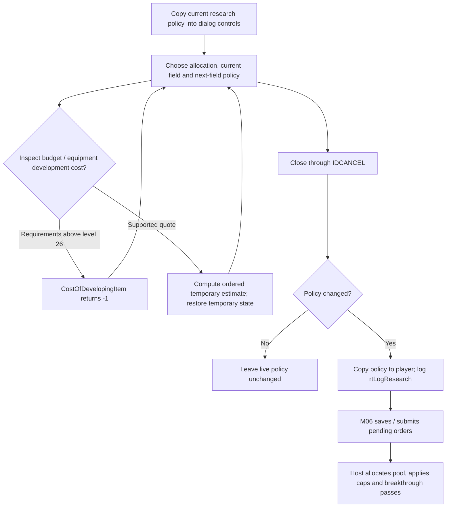
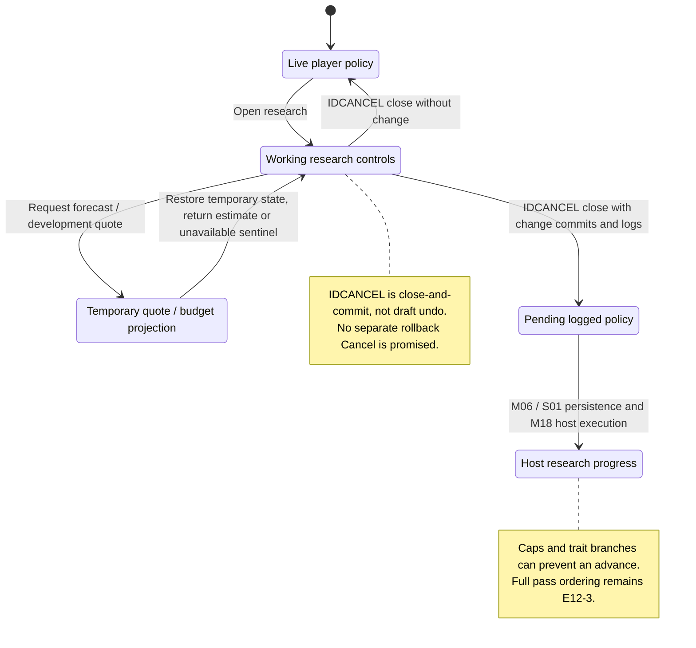

# M12: Research and Technology

Status: source-derived detailed specification; logical ownership is proposed.
Inspected: `e2eae18cff0f990db20415c1c2262aed2022f95b`, 2026-10-24.

Canonical entry: [M12-research-specification.dfy](M12-research-specification.dfy);
[rules and proofs](dafny/M12-research.dfy). Behavior statuses and evidence follow
[the collection conventions](README.md#requirement-ids-and-status).

[Workflow and state diagrams](#workflow-and-state-diagrams) provide a visual reading path.

## 1. Purpose, actors and scope

Choose research effort and field priorities, inspect future equipment and convert
research spending into technology. This separates user policy, a forecast and
host breakthroughs. [M08](M08-planet-and-colony-management.md)/[M09](M09-production-management.md)
provide resources/production leftovers; [M11](M11-ship-and-starbase-design.md)
owns part buildability, S03 the catalogs, M18 phase sequencing and M19 shared
resolution. S01 owns the research command bytes; S06 owns player progress.
The existing `M03Scoring.ResearchCost` and technology-cost table in
[scoring](dafny/M03-scoring.dfy) remain canonical; this entry establishes their
gameplay owner without copying the calculation.

Primary actors: A player allocating an owned empire’s research and a host resolving its investment.

### User stories

These source-derived stories describe intent, not evidence of user research.
The prerequisites and triggers are the corresponding workflows below. All
stories describe Observed capabilities with the stated limitations.

**M12-US01 — Set research effort.** As a player, I want to choose a field, allocation and next-field policy so that my empire develops the technology I need.

**M12-US02 — Inspect the budget.** As a player, I want projected spending and remaining costs so that I can compare research with construction.

**M12-US03 — Find equipment requirements.** As a player, I want a component browser showing technology and trait restrictions so that I understand what I can unlock.

**M12-US04 — Resolve breakthroughs.** As a player, I want paid research retained and breakthroughs reported so that later construction uses the resulting technology.

### Story entry and completion conditions

| Story | Trigger and prerequisites | Completion / alternate outcome |
| --- | --- | --- |
| [M12-US01](#m12-us01) | Open research with a loaded player and valid six-field policy. | Close commits changed policy; no edit leaves it unchanged. |
| [M12-US02](#m12-us02) | Change allocation or request a quote with owned colonies/progress available. | Return a forecast/cost and restore temporary state; host effects are separate. |
| [M12-US03](#m12-us03) | Open the technology browser with catalog and player/trait context. | Show available/future/hidden distinctions; trader restrictions remain separate. |
| [M12-US04](#m12-us04) | Host reaches research with spending and current progress. | Retain spending, apply eligible advances and report unlocks; cap/trait branches apply. |

## 2. Inputs, outputs and state

| Area | Contract |
| --- | --- |
| Policy | `iTechNow` 0–5; `iTechNext` 0–5 explicit, 6 same, 7 lowest; `pctResearch` 0–100. |
| Progress | Six technology levels and six accumulated resource values, distinct from last-year resource pool. |
| Dialog | `pctResGlob`, `iResTechNow` and next-field dropdown hold working policy; projected budget is derived. |
| Availability | M11 availability categories plus trader-grant bits; research alone cannot unlock a hidden trader part. |

Persistent records remain [S01](S01-game-file-formats.md); logical state and
identity remain [S06](S06-shared-game-state.md). A derived/working value must not
be treated as a separately committed record or as information known to every player.

## 3. Workflows, rules and handoffs

### Policy editing and closing

[researchui.c](../src/ui/researchui.c) `ResearchDlg` initializes local controls
from the current player. The next-field list maps row zero to same-field (6),
rows 1–6 to fields 0–5, row 7 to lowest (7): `NextChoice`/`ChoiceRow` are canonical.
Changing fields refreshes estimates. The handler named `IDCANCEL` is the dialog's
close/commit path: changed values are copied to the player and `rtLogResearch`
is written. `Close` preserves that observed result. Do not promise Cancel undo
from the control ID. Submission remains M06; an unchanged close does not add a
policy change. Tutorial advancement and focus are UI adapters.

### Costs and projection

[research.c](../src/core/research.c) `GetTechLevelCost` combines the next-level
table with ten times total current levels, applies race cost choice and slow-tech
multiplier, preserving division order. `CostOfDevelopingItem` returns -1 when
any requirement exceeds 26. Otherwise it walks the six fields in index order,
temporarily increments levels, subtracts existing spending and restores levels.
Earlier fields therefore affect later total-level surcharges; this is not six
independent quotes from one unchanged snapshot. Its exact loop remains E12-1.

`ProjectedResearchSpending` temporarily changes allocation, sums owned colonies,
uses all resources for an empty queue and the production estimator for a nonempty
queue, then restores allocation. Forecasts inherit M09's mining/growth/horizon
assumptions. The preview is not host execution or a promise about future events.
The browser uses `FLookupPart`/`TechStatus` and `FShouldPartBeHidden`, including
trader-grant restrictions. Category selection and textual equipment display are
E12-2, with S03 retaining item IDs.

### Applying research

[turn2.c](../src/core/turn2.c) `UpdateResearchStatus` distinguishes pooled annual
resources from previously earned/nonpool advances. Ordinary research receives
the pool in its chosen field. Generalized Research gives rounded-up half to the
primary field and rounded-up 15% to each other field (`PrimaryPool`, `OtherPool`);
the sum can exceed the original pool by design. Slow-tech storage scales spending
separately from quoted cost. Repeated passes can earn several levels and redirect
leftovers. Levels stop at 26, or 10 for crippled players (`CanAdvance`).

When same-field research reaches 26, the subsequent policy switches to lowest.
Lowest scans fields in order and keeps the first minimum (`Lowest`). Breakthroughs
emit messages and enumerate newly available equipment. Other research grants and
shared research effects can trigger additional passes. The complete pass ordering,
stored-width behavior, grants and recursion are E12-3. Local pool and cap proofs
do not certify that full loop.

## 4. Acceptance and traceability

All criteria below have **Observed** behavior status except where a rule is
explicitly a caller convention or repository maintenance constraint. A named
model/lemma supplies mathematical evidence within its preconditions. An E-boundary
supplies source evidence and an explicit implementation-test/refinement gap,
not a proved runtime outcome. The dated collection run records actual checks.

| Criterion / story | Given / When / Then | Authoritative rule, source and evidence scope |
| --- | --- | --- |
| **M12-AC01** / [M12-US01](#m12-us01) | Given row zero, when choosing next research, then use same-field code 6; mapping back returns row zero. | `NextChoice`, `ChoiceRoundTrip`; ResearchDlg |
| **M12-AC02** / [M12-US01](#m12-us01) | Given changed working policy, when closing via IDCANCEL, then commit and log it; closing is not rollback. | `Close`; ResearchDlg, S01 research effect |
| **M12-AC03** / [M12-US02](#m12-us02) | Given a projected budget request, when preview completes, then restore allocation and leave live production unchanged. | E12-1; ProjectedResearchSpending/M09 estimator |
| **M12-AC04** / [M12-US03](#m12-us03) | Given a trader-exclusive part without its grant, when browsing/build checking, then it remains hidden/restricted even with sufficient technology. | E12-2; FShouldPartBeHidden, M11 |
| **M12-AC05** / [M12-US04](#m12-us04) | Given a pool of 101 with Generalized Research, when distributing it, then primary receives 51 and each other field 16. | `PrimaryPool`, `OtherPool`, vectors |
| **M12-AC06** / [M12-US04](#m12-us04) | Given level 10 and crippled status, when checking a breakthrough, then no further level is allowed; ordinary level 25 may advance. | `CanAdvance`, vectors; UpdateResearchStatus |

## 5. Interaction and quality requirements

**M12-IR01 — Caller and interaction requirement (Proposed).** Explain allocation versus projected resources, current versus next field and the close/commit behavior; keep field labels and equipment requirements readable. Keyboard and screen-reader coverage of the complete browser is Open.

**M12-IR02 — Feedback and recovery (Proposed).**
Use the success, no-change, cancellation and failure distinctions in §3. The
owning caller must not imply that a forecast, accepted request or attempted write
is a confirmed final result. Section 3 records current outcomes and their limitations; this requirement does
not establish implementation. Complete keyboard/focus/error-announcement acceptance remains Open with the
caller and S05. No accessibility conformance level is asserted.

**M12-QR01 — Integrity and compatibility (Observed constraints).**
Preserve technology caps and integer order; benchmark budget/quote latency across the largest colony count. Latency percentile, display-size matrix and accessible feedback targets remain Open with M12/S05.

Scenario/check: source/model boundary review and the native regression/build
checks below. Target: preserve the specified existing results and file/catalog
contracts; any intentional runtime change is separate work. Evidence: named
definitions, source pointers and dated checks; uncovered adapters are in §6.

**M12-QR02 — Performance and resource budgets (Open).**
Scenario: the largest supported workload for these workflows on each supported
backend. Method: measure wall time, peak allocation and caller-visible response
time with controlled inputs. Target: no agreed numeric budget or new measurement
in this specification batch. Owner: M12 and the consuming module/platform owner;
absence of a budget does not establish responsiveness.

**M12-QR03 — Text and presentation (Observed boundary / Open qualification).**
Use UTF-8 byte capacities and complete-code-point truncation from
[S04](S04-platform-services.md) and [Unicode boundaries](../docs/UNICODE-BOUNDARIES.md).
Native controls and rendering use [S05](S05-sdl-desktop-implementation.md);
headless/internal APIs have no independent viewport. Check non-ASCII boundary
inputs and the actual caller on supported displays. Target: valid text and the
stated capacities; complete font, large-text, IME and assistive-technology coverage
remains Open with S05 and the caller.

## 6. Coverage inventory and open decisions

The definitions named in §§3–4 are canonical for their stated projections.
The following inventory accounts for rules requiring native inputs/effects or
further decomposition; it is not a claim that their algorithms are proved.

| Boundary | Scope and limitation | Owner / next evidence or decision |
| --- | --- | --- |
| E12-1 | Multi-field development quote, forecast copy/restore and slow-tech stored units require an ordered state projection; scalar ResearchCost is already formal. | M12/M09; ordered quote and preview-purity fixtures. |
| E12-2 | Browser categories, hidden trader table, text, keyboard/focus and popup navigation consume catalog/UI state. | M12/M11/S03/S05; availability and accessibility matrix. |
| E12-3 | Full research passes, equipment announcements, shared grants, leftover transfer and recursive recomputation remain source-bound; representable but not yet proved by the scalar model. | M12/M19; complete resource/state transition companion. |

## 7. Evidence and verification

[research source](../src/core/research.c), [research dialog](../src/ui/researchui.c), [host research](../src/core/turn2.c), and the [Continue workflow harness](../tests/compat/win32_client_startup.c). No dedicated exhaustive research trait/level suite is claimed.

[Collection verification](README.md#remaining-specifications-verification)
records exact commands and outcomes for this batch. Proofs establish only the
named model properties and witnesses, with their preconditions; they do not prove
that C refines the models or that every UI/platform workflow has been tested.
The boundary inventory and Open interaction/quality requirements remain visible
after a successful formal/build/regression run.

## Workflow and state diagrams

These reading projections summarize [Policy close commits](#policy-editing-and-closing), [Quote and preview limits](#costs-and-projection), [Host research](#applying-research) and the
[canonical contracts](M12-research-specification.dfy) at the inspection revision recorded above.
States are explanatory milestones, not new persisted fields or a claim of
complete C/model refinement. Terminal nodes end the illustrated operation.

### Workflow

### State and recovery

Closing the research dialog is not cancellation of edited policy. A forecast restores its specified temporary state, but does not deliver a breakthrough. Save failures and interruption belong to M06/S01/M18; a successful policy edit is not evidence of those later outcomes.
