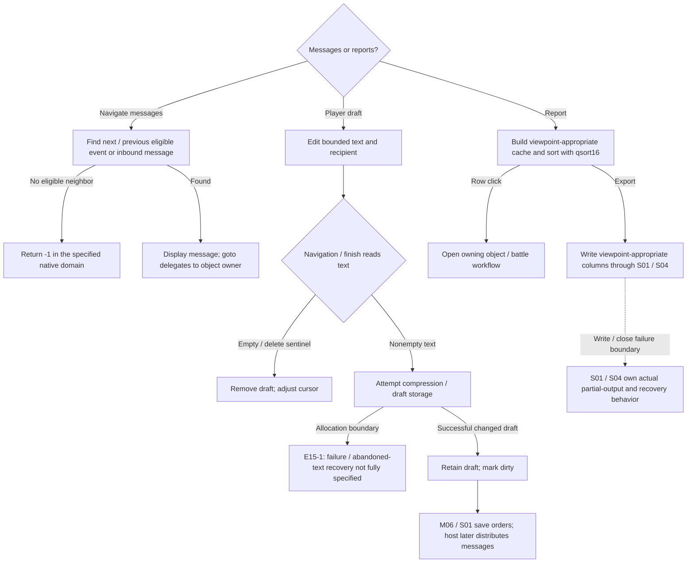
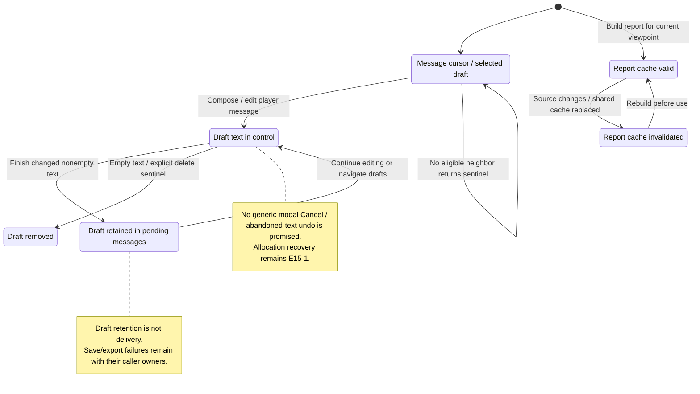

# M15: Messages and Reports

Status: source-derived detailed specification; logical ownership is proposed.
Inspected: `e2eae18cff0f990db20415c1c2262aed2022f95b`, 2026-10-24.

Canonical entry: [M15-reports-specification.dfy](M15-reports-specification.dfy);
[rules and proofs](dafny/M15-reports.dfy). Behavior statuses and evidence follow
[the collection conventions](README.md#requirement-ids-and-status).

[Workflow and state diagrams](#workflow-and-state-diagrams) provide a visual reading path.

## 1. Purpose, actors and scope

Present information already supplied by gameplay rules, retain outgoing
player messages and provide navigation/export. M07 owns object navigation,
M14 replay, M06 saving/submission, S01 message/report bytes and S06 knowledge
levels. Scores use the existing [M03 scoring definitions](dafny/M03-scoring.dfy);
M15 displays them rather than calculating an independent scoring system.

Primary actors: A player reviewing turn events, composing in-game messages and inspecting/exporting reports.

### User stories

These source-derived stories describe intent, not evidence of user research.
The prerequisites and triggers are the corresponding workflows below. All
stories describe Observed capabilities with the stated limitations.

**M15-US01 — Review relevant events.** As a player, I want to navigate/filter turn messages so that I can focus on actionable events.

**M15-US02 — Compose an in-game message.** As a player, I want text and recipient retained with my orders so that other players can receive it on generation.

**M15-US03 — Inspect and navigate reports.** As a player, I want sortable planet/fleet/battle summaries so that I can compare objects and open their details.

**M15-US04 — Export and review results.** As a player or host, I want reports and scores consistent with the current viewpoint so that I can inspect results outside the main panes.

### Story entry and completion conditions

| Story | Trigger and prerequisites | Completion / alternate outcome |
| --- | --- | --- |
| [M15-US01](#m15-us01) | Open/advance messages in a loaded player view. | Select the next qualifying event or inbound message, or reach the sentinel. |
| [M15-US02](#m15-us02) | Edit text/recipient in an outgoing message. | Finalize or delete the draft; host delivery is a later step. |
| [M15-US03](#m15-us03) | Open a report with source arrays and viewpoint knowledge available. | Build/sort eligible rows and navigate selected objects; caps/unknown state apply. |
| [M15-US04](#m15-us04) | Request export/scores with a loaded view and valid output destination. | Produce permitted report content or a reported I/O failure; S01 owns bytes. |

## 2. Inputs, outputs and state

| Area | Contract |
| --- | --- |
| Events | Packed event-message buffer, IDs/arguments/goto targets and current index. |
| Filtering | Per-message-ID bitset, show-filtered toggle and navigation direction; player messages follow events. |
| Drafts | Linked outgoing player messages, recipient, reply reference and encoded length; empty edit can delete a draft. |
| Reports | Report kind, visible columns, sort/subsort/direction, cached entity-ID rows, selection and scroll offsets. |

Persistent records remain [S01](S01-game-file-formats.md); logical state and
identity remain [S06](S06-shared-game-state.md). A derived/working value must not
be treated as a separately committed record or as information known to every player.

## 3. Workflows, rules and handoffs

### Message creation, filtering and navigation

[msg.cpp](../src/core/msg.cpp) packages event messages with catalog-declared argument
counts. No recipient suppresses emission successfully; most messages to ordinary
AI are suppressed, with specific loss/combat exceptions and different Maid
behavior. Buffer-capacity failure differs from suppression. S01 owns compact
argument packing and text formatting; this entry owns the user workflow.

`IMsgNext`/`IMsgPrev` consult ID-based filter bits. Show-filtered mode permits
ordinary navigation over all messages; filtered-only navigation searches filtered
events. Inbound player messages follow event messages and remain reachable even
in the filtered-only path. `Visible`, `Next`, `Previous` and `Eligible` model
both directions: choose the nearest eligible index strictly after/before the
cursor, or -1 if none. Previous accepts the one-past-end cursor used by the UI;
Previous(-1) remains -1 rather than wrapping. Next from the end also returns -1
within the native domain below. From the first inbound message, Previous
searches eligible events; from a later inbound message it returns the preceding
inbound message without inspecting filter bits. Show-all normal traversal does
not decode event IDs. `NextNearest`/`PreviousNearest` prove nearest-index and
exhaustion conditions; `PreviousUndoesNext`/`NextUndoesPrevious` prove inverse
navigation only when starting on an eligible message and a neighbor exists.
Sentinels and an initially hidden event do not satisfy that inverse claim.

The source adapter maps each decoded event ID to its filter bit and each inbound
message to unconditional eligibility. It requires valid packed-message lookup
and an ID within the allocated bitset; `IdmGetMessageN` returning -1 is not a
modeled visible-message fallback, because the source then indexes the bitset
without checking that result. Counts are nonnegative and their sum is at most
32767; cursor is -1 through that sum and filtered-only is 0 or 1. For Next from
the end at 32767, only the show-all shortcut is covered: the other path increments
an int16 cursor beyond its range and then can reach an invalid negative lookup.
That input is outside the defined native adapter domain, not a promised -1.
Restoration's `MessageSeed` never supplies that end cursor.

[Extracted source checks](../tests/spec/check_restoration_source.py) enumerate
0–4 events, 0–2 inbound messages, every filter mask, both toggles, every cursor
including sentinels, and compare both functions with an eligible-index oracle.
They also verify the show-all shortcut makes no ID lookup. Full packed-buffer
decoding, corrupt IDs and UI lifetime remain E15-1. Message goto
dispatches to the appropriate map, research, battle or report owner, and must
retain unavailable/deleted-target behavior instead of inventing an object.

During opening, [M07's restoration controller](M07-galaxy-map-and-navigation.md#61-restoring-selection-after-opening-a-turn)
checks matching saved identity, then current turn and positive saved message.
It seeds one index before the saved value, resets an out-of-range seed to -1,
and calls normal Next. `WriteIniSettings` stores the current zero-based index;
the positive guard therefore does not explicitly restore saved index zero.
Title refresh, invalidation and the conditional tutorial call follow navigation;
M15 owns title/goto content, M16 owns task progression. A controller proof does
not prove those callback effects or assume they leave the cursor unchanged.

### Player-message drafts

[msgui.cpp](../src/ui/msgui.cpp) `FFinishPlrMsgEntry` reads bounded text when navigating
or finishing a draft. Empty text, or explicit delete sentinel 1000, removes the
current draft and adjusts the cursor (`FinishDraft`). Nonempty text is compressed
when beneficial, otherwise stored with the raw-length sign convention; edits
mark the game dirty only when content/recipient changed, while a new draft records
its reply source. A UI draft change is not immediate delivery. M06/S01 publish
orders; `WritePlayerMessages`/`ReadPlayerMessages` handle host distribution.
Allocation failures and restoring abandoned draft text remain E15-1; no generic
modal Cancel transaction is implied.

### Reports, caches and exports

[reportui.cpp](../src/ui/reportui.cpp) `SortReportCache` builds planet rows only for
owned full-detail planets (`PlanetRow`), own fleet rows, known enemy fleet rows
capped at 1020 (`EnemyRows`), or recorded battle rows. Enemy/battle reports share
a miscellaneous cache and invalidate each other. Sorting uses `ICompReport` and
`qsort16`; do not assume stable ties or a generic lexical ordering. Column
choices and sort direction persist through S02. `InvalidateReport` distinguishes
cache reload from redraw; report row indices are not entity IDs.

`ExecuteReportClick` opens corresponding object/detail workflows. Scoring/history
views consume recorded score fields and victory settings. [report.cpp](../src/core/report.cpp)
`DumpUniverse`, `DumpPlanets`, `DumpFleets`, `FDumpCmdLineGame` write viewpoint-
appropriate reports with S01's column/encoding contract. Missing knowledge stays
unknown or estimated; export must not be described as a host-authoritative full
universe when invoked on a player's turn. Printing/map output belongs to S05.

## 4. Acceptance and traceability

All criteria below have **Observed** behavior status except where a rule is
explicitly a caller convention or repository maintenance constraint. A named
model/lemma supplies mathematical evidence within its preconditions. An E-boundary
supplies source evidence and an explicit implementation-test/refinement gap,
not a proved runtime outcome. The dated collection run records actual checks.

| Criterion / story | Given / When / Then | Authoritative rule, source and evidence scope |
| --- | --- | --- |
| **M15-AC01** / [M15-US01](#m15-us01) | Given filtered then unfiltered events, when normal Next runs with filtering enabled, then skip the filtered event. | `Next`, vectors; IMsgNext |
| **M15-AC02** / [M15-US01](#m15-us01) | Given inbound player messages after events, when filtered-only Next reaches them, then they remain reachable. | `Next`; vectors/source |
| **M15-AC03** / [M15-US02](#m15-us02) | Given an empty outgoing draft, when finishing it, then remove its current draft entry rather than send an empty message. | `FinishDraft`; FFinishPlrMsgEntry |
| **M15-AC04** / [M15-US03](#m15-us03) | Given owned partial and owned full-detail planets, when building planet report rows, then include only full-detail entries. | `PlanetRow`; SortReportCache |
| **M15-AC05** / [M15-US03](#m15-us03) | Given more than 1020 known enemy fleets, when building report rows, then cap the row list at 1020. | `EnemyRows`, vectors |
| **M15-AC06** / [M15-US04](#m15-us04) | Given a player turn with partial knowledge, when exporting reports, then preserve S01 knowledge-specific fields and file schema. | E15-2; report.c, S01 external formats |
| **M15-AC07** / [M15-US01](#m15-us01) | Given the end cursor, Previous returns the last eligible message; crossing from the first inbound message searches the event filters. Previous from -1 does not wrap. | `Previous`, `PreviousNearest`, vectors and extracted source enumeration; defined native widths/ID domain above. |
| **M15-AC08** / [M15-US01](#m15-us01) | Given an eligible current message and an eligible neighbor, navigation to that neighbor and back returns the starting message. Hidden starting events and sentinels are excluded. | `PreviousUndoesNext`, `NextUndoesPrevious`, source oracle cases; callback mutation between calls is not assumed absent in live UI. |

## 5. Interaction and quality requirements

**M15-IR01 — Caller and interaction requirement (Proposed).** Keep current event/draft recipient/report selection explicit; offer visible filter state and keyboard navigation. Accessible unknown/estimated cues, long UTF-8 messages and all-column focus order remain Open.

**M15-IR02 — Feedback and recovery (Proposed).**
Use the success, no-change, cancellation and failure distinctions in §3. The
owning caller must not imply that a forecast, accepted request or attempted write
is a confirmed final result. Section 3 records current outcomes and their limitations; this requirement does
not establish implementation. Complete keyboard/focus/error-announcement acceptance remains Open with the
caller and S05. No accessibility conformance level is asserted.

**M15-QR01 — Integrity and compatibility (Observed constraints).**
Keep IDs separate from sorted row indices and retain qsort16 tie behavior. Report export schemas remain S01; M15/S05 owns unmeasured large-report latency and multilingual/display qualification.

Scenario/check: source/model boundary review and the native regression/build
checks below. Target: preserve the specified existing results and file/catalog
contracts; any intentional runtime change is separate work. Evidence: named
definitions, source pointers and dated checks; uncovered adapters are in §6.

**M15-QR02 — Performance and resource budgets (Open).**
Scenario: the largest supported workload for these workflows on each supported
backend. Method: measure wall time, peak allocation and caller-visible response
time with controlled inputs. Target: no agreed numeric budget or new measurement
in this specification batch. Owner: M15 and the consuming module/platform owner;
absence of a budget does not establish responsiveness.

**M15-QR03 — Text and presentation (Observed boundary / Open qualification).**
Use UTF-8 byte capacities and complete-code-point truncation from
[S04](S04-platform-services.md) and [Unicode boundaries](../docs/UNICODE-BOUNDARIES.md).
Native controls and rendering use [S05](S05-sdl-desktop-implementation.md);
headless/internal APIs have no independent viewport. Check non-ASCII boundary
inputs and the actual caller on supported displays. Target: valid text and the
stated capacities; complete font, large-text, IME and assistive-technology coverage
remains Open with S05 and the caller.

## 6. Coverage inventory and open decisions

The definitions named in §§3–4 are canonical for their stated projections.
The following inventory accounts for rules requiring native inputs/effects or
further decomposition; it is not a claim that their algorithms are proved.

| Boundary | Scope and limitation | Owner / next evidence or decision |
| --- | --- | --- |
| E15-1 | Both message traversal directions, sentinels and eligible-neighbor properties now have checked contracts/source fixtures. Remaining: packed-message-to-ID/filter mapping, corrupt-ID/native-overflow inputs, goto dispatch, title/catalog formatting, suppression/buffer bounds and draft compression/linked-list/error lifecycle. M07 specifies restoration callback order, not title/tutorial effects. | M15/S01/S03/S05/M07/M16; full filter/goto/title and draft failure tests. |
| E15-2 | Every report column/comparator, cache invalidation, score/history rendering, export error and print adapter retains its named source and S01 schema. | M15/S02/S04/S05; typed report projections and per-column/knowledge tests. |

## 7. Evidence and verification

[report unit tests](../tests/unit/test_report.cpp), [message source](../src/core/msg.cpp), [report source](../src/core/report.cpp) and [client workflows](../tests/compat/win32_client_startup.cpp). Broad native regression does not cover every UI column/filter combination.

[Collection verification](README.md#remaining-specifications-verification)
records exact commands and outcomes for this batch. Proofs establish only the
named model properties and witnesses, with their preconditions; they do not prove
that C refines the models or that every UI/platform workflow has been tested.
The boundary inventory and Open interaction/quality requirements remain visible
after a successful formal/build/regression run.

## Workflow and state diagrams

These reading projections summarize [Message drafts](#player-message-drafts), [Message navigation](#message-creation-filtering-and-navigation), [Reports and exports](#reports-caches-and-exports) and the
[canonical contracts](M15-reports-specification.dfy) at the inspection revision recorded above.
States are explanatory milestones, not new persisted fields or a claim of
complete C/model refinement. Terminal nodes end the illustrated operation.

### Workflow

### State and recovery

The diagrams separate drafts, navigation, and report-cache lifetimes. They do not assign defined fallback behavior to corrupt message IDs or overflowing cursors. An unavailable goto target does not manufacture an object; export is limited to the player/host viewpoint.
