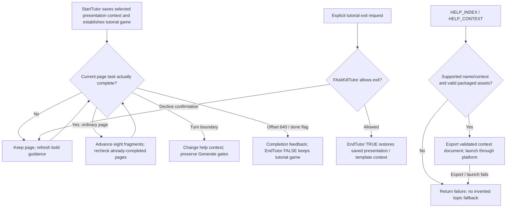
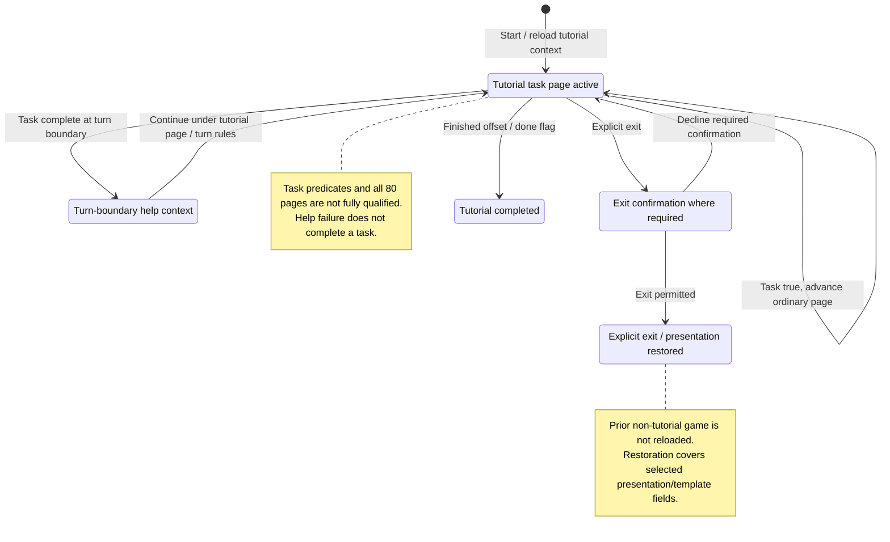

# M16: Tutorial and Help

Status: source-derived detailed specification; logical ownership is proposed.
Inspected: `e2eae18cff0f990db20415c1c2262aed2022f95b`, 2026-10-24.

Canonical entry: [M16-tutorial-specification.dfy](M16-tutorial-specification.dfy);
[rules and proofs](dafny/M16-tutorial.dfy). Behavior statuses and evidence follow
[the collection conventions](README.md#requirement-ids-and-status).

[Workflow and state diagrams](#workflow-and-state-diagrams) provide a visual reading path.

## 1. Purpose, actors and scope

Guide real game operations and present the bundled offline guide. Tutorial
checks observe gameplay modules rather than replacing their rules; M05 owns the
fixed tutorial universe, M18 generation and S02 saved presentation preferences.
S03 owns tutorial text IDs, S05 help launch/render adapters and S01 persisted game
state. Historical guide content is reference material, not an override of current
UTF-8/file/gameplay contracts.

Primary actors: A new player following the tutorial and a player requesting contextual help.

### User stories

These source-derived stories describe intent, not evidence of user research.
The prerequisites and triggers are the corresponding workflows below. All
stories describe Observed capabilities with the stated limitations.

**M16-US01 — Start or resume learning.** As a new player, I want a deterministic tutorial setup and appropriate instructions so that I can learn by operating the game.

**M16-US02 — Advance after completing tasks.** As a learner, I want the tutorial to check my actual actions and explain mismatches so that I advance only when prerequisites are met.

**M16-US03 — Exit or finish the tutorial.** As a learner, I want a clear exit/completion path so that I know what game and presentation state remain.

**M16-US04 — Open relevant help offline.** As a player, I want a contextual topic or contents page so that I can find guidance without a network service.

### Story entry and completion conditions

| Story | Trigger and prerequisites | Completion / alternate outcome |
| --- | --- | --- |
| [M16-US01](#m16-us01) | Choose tutorial with M05 creation or a supported loaded tutorial state. | Show the current instruction; saved presentation is not a prior-game snapshot. |
| [M16-US02](#m16-us02) | Perform an action while a tutorial page is active. | Advance only when its task predicate permits; otherwise show guidance. |
| [M16-US03](#m16-us03) | Request exit or meet the final-page/completion condition. | Apply prompt and presentation-restoration differences; stop tutorial state. |
| [M16-US04](#m16-us04) | Request help contents/context with packaged HTML/assets available. | Open the local topic or return a context/assets/launch failure. |

## 2. Inputs, outputs and state

| Area | Contract |
| --- | --- |
| Tutorial progress | Fragment offset `idt`, bold instruction, error/help context, task/turn/completion flags. |
| Presentation snapshot | Map mode/zoom, toolbar, fleet sort and default production template; not a full prior-game snapshot. |
| Task predicates | FTutorTaskDone and FCheck helpers inspect specific selected objects, queues, cargo, research and routes. |
| Guide | Original HLP archive, generated pages/assets/context map and build stamp; separate from tutorial progress. |

Persistent records remain [S01](S01-game-file-formats.md); logical state and
identity remain [S06](S06-shared-game-state.md). A derived/working value must not
be treated as a separately committed record or as information known to every player.

## 3. Workflows, rules and handoffs

### Starting and checking tasks

[tutor.c](../src/ui/tutor.c) `StartTutor` configures/reloads tutorial context
and uses `FTutorTaskDone` to reach the current relevant page. `SaveGameState`
saves selected presentation/template fields and can destroy an existing
nontutorial game; it does not serialize a general restore point. M06 owns any
surrounding unsaved-game handling. Preserve the archived observer's required
function signatures and struct/global dependencies when implementation changes.

The tutorial has 80 pages of eight text fragments. `Page` maps offset to page;
`AdvanceTutor` checks the actual task, updates the bold hint and advances eight
fragments when done and not at a turn boundary (`Advance`). It may skip several
already-completed pages, checking each. At turn completion it changes the help
context rather than blindly advancing. `FTutorTaskDone` dispatches page-specific
checks for selection, messages, cargo, queues, research, ship design and orders;
those complete predicates are E16-1, not replaced by a single proved boolean.

[M07 restoration](M07-galaxy-map-and-navigation.md#61-restoring-selection-after-opening-a-turn)
can call `AdvanceTutor` after restoring a message, refreshing its title and
invalidating the message window. It sets `tutor.fChange` immediately before the
call; `AdvanceTutor` clears that flag at entry. The restoration controller takes
post-callback state rather than promising the flag, selection or message cursor
survives unchanged. M07's call-order proof does not close M16's page predicates,
auto-actions or full tutorial qualification.

### Completion, exit and recovery

Offset 640 or `fTutorDone` completes the tutorial (`Finished`), shows completion
feedback and calls `EndTutor(FALSE)`. Explicit exit uses `FAskKillTutor`: before
turn 30 it asks; from turn 30 it can exit without that prompt. `EndTutor(TRUE)`
restores the saved presentation/template context; completion keeps the tutorial
game available to continue. It clears tutorial flags/window state and reseeds
randomness. `RestoreGameState` does not reload the pre-tutorial game: its saved-
game branch is empty. A claim of full gameplay rollback would be incorrect.
Failed task checks retain the page and update guidance; early Generate remains
subject to tutorial gates rather than an unrestricted host action.

### Offline help

[help.c](../compat/win32/src/help.c) implements HELP_INDEX/HELP_CONTEXT for the
case-insensitive bare name `stars-help.html`; other filenames and explicit paths
are rejected. It resolves the requested context, finds the packaged guide,
checks its required assets and generation stamp, and validates `offline.html`
against the generated size/CRC and exactly one start-context marker. It exports
a context-specific document using a temporary file, flush/fsync and rename,
then calls `FCompatOpenDocument`. Embedding the context inside the document
supports file-descriptor portals that cannot carry a URL fragment.

`CanOpen` composes the external asset/stamp, successful validated-document export
and launch outcomes with context membership. It does not read a legacy HLP at
runtime. Unknown contexts, unsupported commands/names, invalid or missing assets,
export failure and launcher failure remain failures. Context 13002 is absent;
contents fallback must be explicit, not represented as success opening that topic.

[Help documentation](../docs/WIN32-HELP.md) records the original archive's 413
mappings and 414 topics and historical rendering qualification. Its runtime overview now describes the packaged-HTML adapter above; the archive
analysis remains historical source/extraction evidence, not a runtime HLP dependency.
Archive parsing/generation, HTML export and browser presentation are E16-2.
[tutor2.c](../src/ui/tutor2.c) uses S03's compressed fragments; text arithmetic
ranges must stay consecutive. Existing SDL tutorial checkpoints are partial;
this spec does not claim all 80 pages are automated or that headless launch tests
prove visual rendering.

## 4. Acceptance and traceability

All criteria below have **Observed** behavior status except where a rule is
explicitly a caller convention or repository maintenance constraint. A named
model/lemma supplies mathematical evidence within its preconditions. An E-boundary
supplies source evidence and an explicit implementation-test/refinement gap,
not a proved runtime outcome. The dated collection run records actual checks.

| Criterion / story | Given / When / Then | Authoritative rule, source and evidence scope |
| --- | --- | --- |
| **M16-AC01** / [M16-US01](#m16-us01) | Given tutorial entry from another game, when saving presentation state, then do not claim a full prior-game snapshot exists. | E16-1; SaveGameState/RestoreGameState |
| **M16-AC02** / [M16-US02](#m16-us02) | Given incomplete task state, when advancing, then keep the fragment offset; completed non-turn-boundary tasks advance by eight. | `Advance`, `PendingTaskStays` |
| **M16-AC03** / [M16-US02](#m16-us02) | Given offset 632, when displaying the page, then show page 80; reaching 640 completes the sequence. | `Page`, `Finished`, vectors |
| **M16-AC04** / [M16-US03](#m16-us03) | Given explicit exit before turn 30, when confirmation is declined, then remain in tutorial; accepted exit restores only saved presentation/template fields. | `ExitWithoutPrompt`, E16-1; FAskKillTutor |
| **M16-AC05** / [M16-US04](#m16-us04) | Given context 13002 absent from the map, when opening contextual help, then fail instead of claiming that topic opened. | `CanOpen`, vectors; WinHelpA |
| **M16-AC06** / [M16-US04](#m16-us04) | Given missing assets or a failed launcher, when opening contents, then report failure. | `CanOpen`; E16-2 |

## 5. Interaction and quality requirements

**M16-IR01 — Caller and interaction requirement (Proposed).** Expose page number, current instruction, error and contextual-help action; preserve focus on failed steps. Keyboard-only completion, screen-reader reading order and large-font layout across all 80 pages remain Open.

**M16-IR02 — Feedback and recovery (Proposed).**
Use the success, no-change, cancellation and failure distinctions in §3. The
owning caller must not imply that a forecast, accepted request or attempted write
is a confirmed final result. Section 3 records current outcomes and their limitations; this requirement does
not establish implementation. Complete keyboard/focus/error-announcement acceptance remains Open with the
caller and S05. No accessibility conformance level is asserted.

**M16-QR01 — Integrity and compatibility (Observed constraints).**
Keep eight-fragment ranges stable and reject missing guide assets/context. Tutorial checkpoint coverage is measurable but partial; S05/M16 owns browser-render, accessibility and response-time targets.

Scenario/check: source/model boundary review and the native regression/build
checks below. Target: preserve the specified existing results and file/catalog
contracts; any intentional runtime change is separate work. Evidence: named
definitions, source pointers and dated checks; uncovered adapters are in §6.

**M16-QR02 — Performance and resource budgets (Open).**
Scenario: the largest supported workload for these workflows on each supported
backend. Method: measure wall time, peak allocation and caller-visible response
time with controlled inputs. Target: no agreed numeric budget or new measurement
in this specification batch. Owner: M16 and the consuming module/platform owner;
absence of a budget does not establish responsiveness.

**M16-QR03 — Text and presentation (Observed boundary / Open qualification).**
Use UTF-8 byte capacities and complete-code-point truncation from
[S04](S04-platform-services.md) and [Unicode boundaries](../docs/UNICODE-BOUNDARIES.md).
Native controls and rendering use [S05](S05-sdl-desktop-implementation.md);
headless/internal APIs have no independent viewport. Check non-ASCII boundary
inputs and the actual caller on supported displays. Target: valid text and the
stated capacities; complete font, large-text, IME and assistive-technology coverage
remains Open with S05 and the caller.

## 6. Coverage inventory and open decisions

The definitions named in §§3–4 are canonical for their stated projections.
The following inventory accounts for rules requiring native inputs/effects or
further decomposition; it is not a claim that their algorithms are proved.

| Boundary | Scope and limitation | Owner / next evidence or decision |
| --- | --- | --- |
| E16-1 | All 80 task predicates, hint/error text, auto-completion actions, turn gates, restart and presentation restoration depend on live game/UI state. The page-step contract is formal; task truth remains an external obligation. | M16 and gameplay owners; complete checkpoint inventory and full tutorial qualification. |
| E16-2 | Historical HLP parsing/context extraction, packaged HTML size/CRC/marker validation, asset generation, temporary document publication and OS browser render/launch are native/tooling adapters. | M16/S03/S05; archive tests and real offline rendering/assistive-technology qualification. |

## 7. Evidence and verification

[tutorial source](../src/ui/tutor.c), [help adapter](../compat/win32/src/help.c), [native tutorial harness](../tests/compat/native_tutorial.c), and [historical observer contract](../tests/reference/win32-tutorial/README.md). Existing help and tutorial test results must be distinguished from full desktop/browser acceptance.

[Collection verification](README.md#remaining-specifications-verification)
records exact commands and outcomes for this batch. Proofs establish only the
named model properties and witnesses, with their preconditions; they do not prove
that C refines the models or that every UI/platform workflow has been tested.
The boundary inventory and Open interaction/quality requirements remain visible
after a successful formal/build/regression run.

## Workflow and state diagrams

These reading projections summarize [Task checks](#starting-and-checking-tasks), [Completion and exit](#completion-exit-and-recovery), [Offline help](#offline-help) and the
[canonical contracts](M16-tutorial-specification.dfy) at the inspection revision recorded above.
States are explanatory milestones, not new persisted fields or a claim of
complete C/model refinement. Terminal nodes end the illustrated operation.

### Workflow

### State and recovery

The page-state projection does not replace FTutorTaskDone predicates with a generic boolean guarantee. Exit/Cancel before turn 30 is subject to confirmation; later exit can bypass it. Help launch acceptance is separate from browser rendering and tutorial success.
