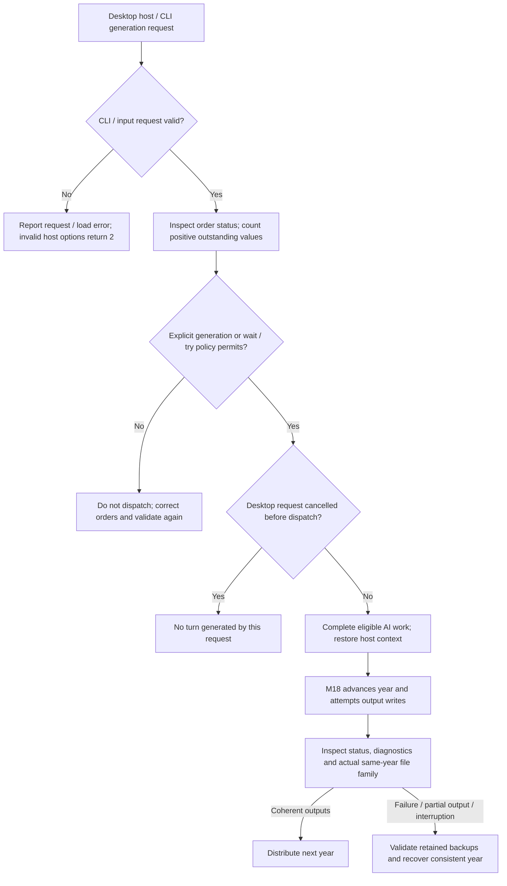
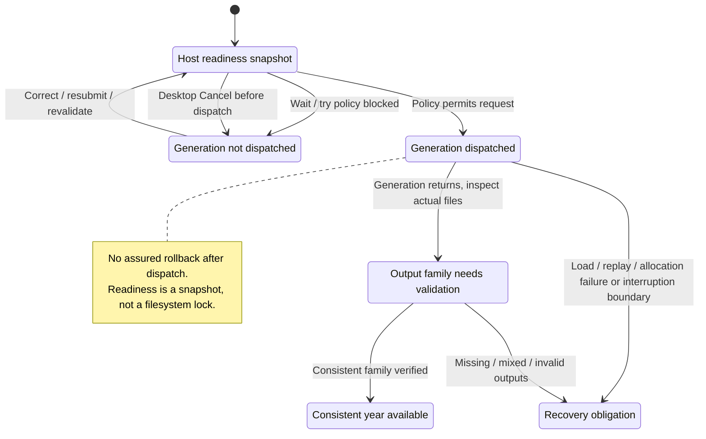

# M17: Host Game Management

Status: source-derived detailed specification; logical ownership is proposed.
Inspected: `e2eae18cff0f990db20415c1c2262aed2022f95b`, 2026-10-24.

Canonical entry: [M17-host-specification.dfy](M17-host-specification.dfy);
[rules and proofs](dafny/M17-host.dfy). Behavior statuses and evidence follow
[the collection conventions](README.md#requirement-ids-and-status).

[Workflow and state diagrams](#workflow-and-state-diagrams) provide a visual reading path.

## 1. Purpose, actors and scope

Collect completed orders, distinguish readiness from file validity, generate on
request and preserve recoverable prior turns. [M01](M01-game-library.md) owns
managed-library selection, import/conflict and metadata publication; this module
owns host readiness and dispatch. [M18](M18-turn-generation.md) owns phase order,
[M20](M20-ai-players.md) supplies AI orders, and [S01](S01-game-file-formats.md)
owns file headers, validation, backups and output publication. A readiness display
is a snapshot, not a lock against another host or player replacing files.

Primary actors: A desktop host operator, an unattended scheduler, and players awaiting the next year.

### User stories

These source-derived stories describe intent, not evidence of user research.
The prerequisites and triggers are the corresponding workflows below. All
stories describe Observed capabilities with the stated limitations.

**M17-US01 — Check readiness.** As a host, I want each player’s order status and the outstanding count so that I can decide whether to generate.

**M17-US02 — Generate when permitted.** As a host or scheduler, I want explicit, wait and try generation policies so that unattended runs respect readiness.

**M17-US03 — Complete AI orders.** As a host, I want eligible missing AI turns generated so that computer players participate.

**M17-US04 — Retain recovery material.** As a host, I want prior files and a clear failure result so that I can diagnose and recover an interrupted generation.

### Story entry and completion conditions

| Story | Trigger and prerequisites | Completion / alternate outcome |
| --- | --- | --- |
| [M17-US01](#m17-us01) | Select a host game/year or request validation with its roster available. | Classify each log and count positive outstanding statuses. |
| [M17-US02](#m17-us02) | Request a year/batch with wait/try policy and readiness known. | Dispatch only when policy permits; report actual generation/file outcomes separately. |
| [M17-US03](#m17-us03) | Ensure AI turns with host roster and completion/log state. | Run eligible missing AI work, then restore host context; existing openable logs skip it. |
| [M17-US04](#m17-us04) | Generate with a configured backup limit or recover after failure. | Retain/inspect available prior files; validate a consistent year before distribution. |

## 2. Inputs, outputs and state

| Area | Contract |
| --- | --- |
| Inputs | Host game identity/year, per-player race/dead/AI flags, candidate order files and generation options. |
| Readiness | One status per player: 0 ready, -1 dead without a blocking file error, 1 missing, 2 incomplete, 3 invalid, 4 wrong year, 5 wrong game. |
| Execution | Requested year count, wait/try flags, AI completion flag, output path, password/dump options and retained backup count. |
| Outputs | Validation report, generated player/host files, backup directories and observable process return value; these are distinct results. |

Persistent records remain [S01](S01-game-file-formats.md); logical state and
identity remain [S06](S06-shared-game-state.md). A derived/working value must not
be treated as a separately committed record or as information known to every player.

## 3. Workflows, rules and handoffs

### Validate and display readiness

[turn.c](../src/core/turn.c) `VerifyTurns` and `CFindTurnsOutstanding` inspect the
current host's expected order files. `Status` captures precedence: an AI slot or
valid completed log is ready; wrong-game, wrong-turn and other file errors then
win even for a dead player; otherwise dead is -1, partial is 2, missing is 1.
Only positive statuses contribute to `Outstanding`. File timestamps/readiness
may change between display and generation; no filesystem lock is implied.
Desktop selection and imported-order staging reuse M01; this does not duplicate
its game-library transaction. A player can correct/re-submit the file and ask for
validation again. Invalid files must remain diagnosable, not silently become ready.

### CLI entry, policy and dispatch

The [S02 host grammar](S02-preference-contracts.md#headless-profile-grammar)
and `S02HostProfile.Lookup`/`Integer` specify INI line/value bounds, duplicate
sections, quoting and native-long conversion domains. This is shared canonical
behavior; the remaining M17 CLI grammar and load/error integration are separate.

[host.c](../src/host/host.c) accepts `--version`, `--ini` and the core command-line
form. Version returns zero; invalid host options, INI or no actionable request
return 2. The joined command buffer is bounded; the legacy core parser does not
support every quoted/space-containing path accepted by a desktop picker.
`ParseCmdLine`/`FRunCmdLine` dispatch validation, batch creation, generation and
report dumps. For generation, `Generate` allows an unconditional request or a
zero-outstanding wait/try request. It does not imply all phase/output operations
will succeed. Validation dispatch returning true is not proof of a successfully
loaded game; inspect the reported error/return value. Headless output is through
[hostui.c](../src/host/hostui.c), without SDL or an interactive modal prompt.

### AI completion, backup and failure

`EnsureAis` runs once per eligibility cycle: for each unfinished AI, an existing
openable order log skips generation; otherwise it calls `DoAiTurn`. That existence
check is weaker than complete order validation. It restores host state after AI
work. `EnsureAI` records the eligibility condition, with M20 owning execution.

The parsed backup count first narrows to signed 16-bit `vcBackupDirs`, then
accepts 1–999, otherwise 1 (`Backups`, forwarding S02 `ConfiguredBackups`).
For example, numeric 65538 becomes 2 before the range test. INI text parsing
remains entry-specific: host `LIniInt` uses `atol`, while the desktop profile
parser additionally recognizes hexadecimal prefixes. `FGenerateTurn`
creates/rotates backups and writes the new turn under M18/S01. This is not an
all-player-file atomic transaction. Host operators must inspect the returned
status, diagnostics and actual files before distribution. A failed load/replay or
allocation ends that attempt and cleans phase state; already completed file work
may survive. Cancelling a desktop request before dispatch does not generate a
turn; interruption after dispatch is E17-2, not an assured rollback. Recovery
uses S01 validation of a consistent saved year and retained backups, never a
blind retry against a mixed output set.

## 4. Acceptance and traceability

All criteria below have **Observed** behavior status except where a rule is
explicitly a caller convention or repository maintenance constraint. A named
model/lemma supplies mathematical evidence within its preconditions. An E-boundary
supplies source evidence and an explicit implementation-test/refinement gap,
not a proved runtime outcome. The dated collection run records actual checks.

| Criterion / story | Given / When / Then | Authoritative rule, source and evidence scope |
| --- | --- | --- |
| **M17-AC01** / [M17-US01](#m17-us01) | Given a dead player with a wrong-game order file, when determining status, then report wrong game (5), not dead (-1). | `Status`, vectors; CFindTurnsOutstanding |
| **M17-AC02** / [M17-US01](#m17-us01) | Given statuses ready, dead, partial and missing, when counting outstanding, then count only the two positive entries. | `Outstanding`, vectors |
| **M17-AC03** / [M17-US02](#m17-us02) | Given outstanding orders, when wait or try is enabled, then do not enter generation; an unconditional generation request may proceed. | `Generate`, vectors; FRunCmdLine |
| **M17-AC04** / [M17-US02](#m17-us02) | Given a dispatched request whose input fails loading, when returning, then preserve failure diagnostics rather than treating dispatch as file-generation success. | E17-1; FRunCmdLine/host main |
| **M17-AC05** / [M17-US03](#m17-us03) | Given an AI whose log can already be opened, when ensuring AI turns, then skip strategy execution for that player. | `EnsureAI`; EnsureAis; M20 |
| **M17-AC06** / [M17-US04](#m17-us04) | Given a retention value outside 1–999 after signed 16-bit narrowing, when reading host preferences, then use one backup. | `Backups`, vectors; host INI loading |
| **M17-AC07** / [M17-US04](#m17-us04) | Given a failed write after other outputs exist, when reporting the attempt, then do not assert an atomic new year. | E17-2; S01 publication contract |
| **M17-AC08** / [M17-US04](#m17-us04) | Given parsed retention 65538, when storing and validating host preferences, then retain two backups after narrowing; do not range-check the unbounded integer first. | `Backups`, S02 `ConfiguredBackups`, vectors; host.c FReadHostIni |

## 5. Interaction and quality requirements

**M17-IR01 — Caller and interaction requirement (Proposed).** CLI callers receive text diagnostics and exit status; no keyboard/focus/display contract applies inside the headless engine. Desktop status, selected host/year and destructive/failed generation feedback belong to M01/S05. Screen-reader status updates and keyboard-only host operations remain Open.

**M17-IR02 — Feedback and recovery (Proposed).**
Use the success, no-change, cancellation and failure distinctions in §3. The
owning caller must not imply that a forecast, accepted request or attempted write
is a confirmed final result. Section 3 records current outcomes and their limitations; this requirement does
not establish implementation. Complete keyboard/focus/error-announcement acceptance remains Open with the
caller and S05. No accessibility conformance level is asserted.

**M17-QR01 — Integrity and compatibility (Observed constraints).**
Keep validation separate from generation and use the current 2.85 file contract. Measure readiness and generation on named game sizes before choosing a latency target; no timeout, file locking or atomic distribution guarantee is established.

Scenario/check: source/model boundary review and the native regression/build
checks below. Target: preserve the specified existing results and file/catalog
contracts; any intentional runtime change is separate work. Evidence: named
definitions, source pointers and dated checks; uncovered adapters are in §6.

**M17-QR02 — Performance and resource budgets (Open).**
Scenario: the largest supported workload for these workflows on each supported
backend. Method: measure wall time, peak allocation and caller-visible response
time with controlled inputs. Target: no agreed numeric budget or new measurement
in this specification batch. Owner: M17 and the consuming module/platform owner;
absence of a budget does not establish responsiveness.

**M17-QR03 — Text and presentation (Observed boundary / Open qualification).**
Use UTF-8 byte capacities and complete-code-point truncation from
[S04](S04-platform-services.md) and [Unicode boundaries](../docs/UNICODE-BOUNDARIES.md).
Native controls and rendering use [S05](S05-sdl-desktop-implementation.md);
headless/internal APIs have no independent viewport. Check non-ASCII boundary
inputs and the actual caller on supported displays. Target: valid text and the
stated capacities; complete font, large-text, IME and assistive-technology coverage
remains Open with S05 and the caller.

## 6. Coverage inventory and open decisions

The definitions named in §§3–4 are canonical for their stated projections.
The following inventory accounts for rules requiring native inputs/effects or
further decomposition; it is not a claim that their algorithms are proved.

| Boundary | Scope and limitation | Owner / next evidence or decision |
| --- | --- | --- |
| E17-1 | S02 now defines INI grammar and numeric domains. Complete CLI grammar, loader/validation error extraction and process/report return-code combinations remain entry-point adapter work. The readiness model consumes classified file results; it does not parse bytes. | M17/S01; CLI fixture/error matrix including missing, partial, malformed and mismatched years. |
| E17-2 | Desktop host UI, concurrent replacements, backup rotation, cancellation after dispatch and recovery from partial output depend on actual filesystem/UI callbacks. | M17/M01/S01; fault injection and an explicit future concurrency/cancellation policy. |

## 7. Evidence and verification

[host entry](../src/host/host.c), [turn dispatcher](../src/core/turn.c), [hosting notes](../docs/TOTALHOST.md), [library acceptance](M01-game-library.md) and [regression harness](../tests/scaffold/REGRESSION.md). Historical hosting notes may describe older interfaces; current source and S01 govern formats.

[Collection verification](README.md#remaining-specifications-verification)
records exact commands and outcomes for this batch. Proofs establish only the
named model properties and witnesses, with their preconditions; they do not prove
that C refines the models or that every UI/platform workflow has been tested.
The boundary inventory and Open interaction/quality requirements remain visible
after a successful formal/build/regression run.

## Workflow and state diagrams

These reading projections summarize [Readiness](#validate-and-display-readiness), [CLI policy and dispatch](#cli-entry-policy-and-dispatch), [AI and recovery](#ai-completion-backup-and-failure) and the
[canonical contracts](M17-host-specification.dfy) at the inspection revision recorded above.
States are explanatory milestones, not new persisted fields or a claim of
complete C/model refinement. Terminal nodes end the illustrated operation.

### Workflow

### State and recovery

The CLI has no interactive modal Cancel; its parse/dispatch results remain entry-specific. The post-generation validation step is an operator obligation, not a new automatic engine gate. An openable AI log is not proof of complete or fresh orders.
