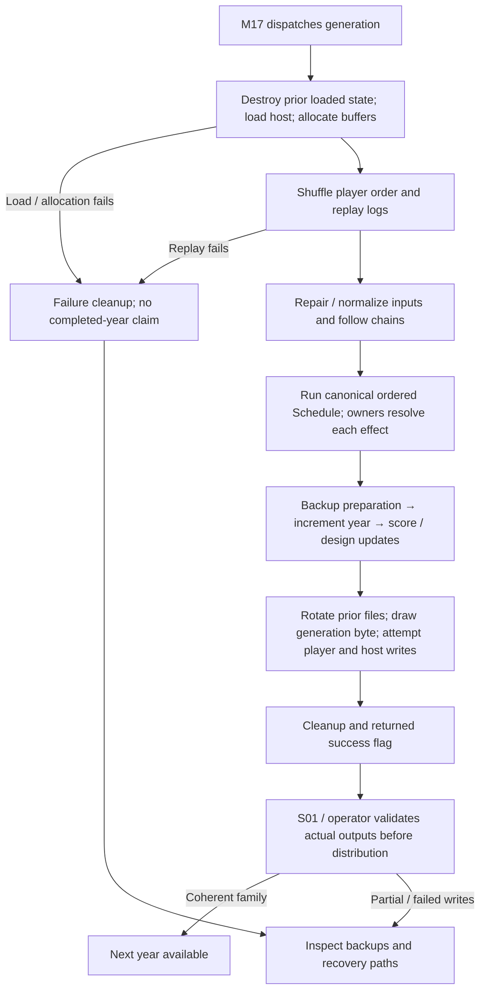
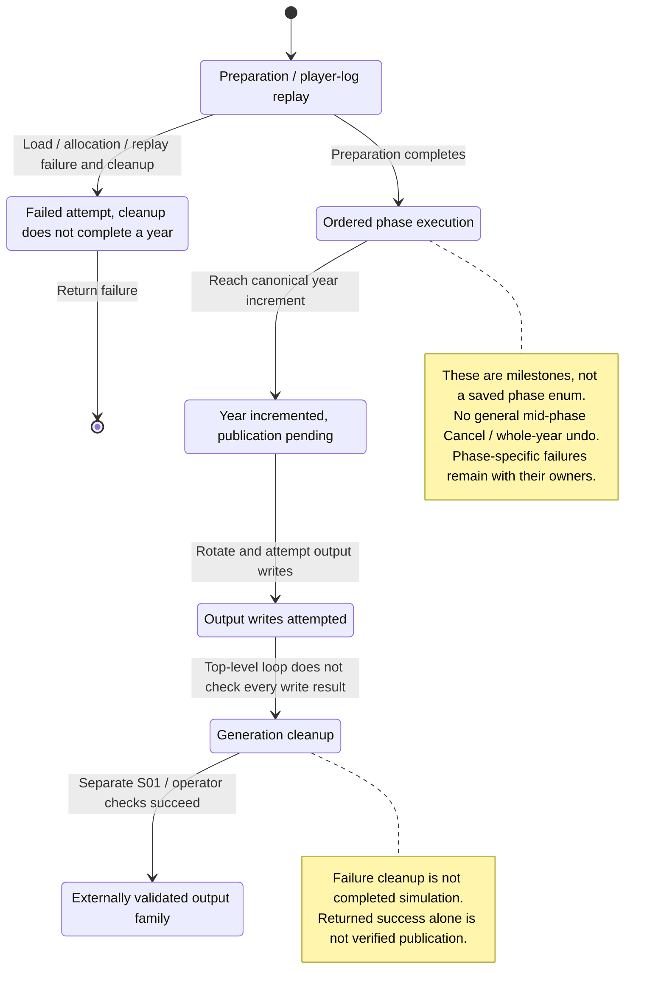
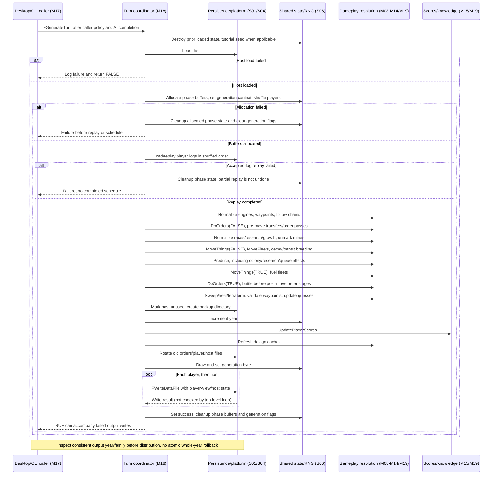

# M18: Turn Generation

Status: source-derived detailed specification; logical ownership is proposed.
Inspected: `e2eae18cff0f990db20415c1c2262aed2022f95b`, 2026-10-24.

Canonical entry: [M18-generation-specification.dfy](M18-generation-specification.dfy);
[rules and proofs](dafny/M18-generation.dfy). Behavior statuses and evidence follow
[the collection conventions](README.md#requirement-ids-and-status).

[Workflow and state diagrams](#workflow-and-state-diagrams) and
[cross-module sequences](#cross-module-sequences) provide visual reading paths.

## 1. Purpose, actors and scope

Coordinate one year’s ordered simulation, keeping prerequisites and phase-local
state coherent. [M17](M17-host-game-management.md) authorizes dispatch and AI
completion; [M19](M19-game-rules-and-resolution.md) and gameplay modules own
individual effects. [S06](S06-shared-game-state.md) owns state/RNG lifetimes and
[S01](S01-game-file-formats.md) owns bytes/publication. This entry specifies the
successful control-flow projection, failure boundaries and observables; it does
not claim the phases are already separate transactional services.

Primary actors: A host advancing a valid game and players depending on a reproducible next year.

### User stories

These source-derived stories describe intent, not evidence of user research.
The prerequisites and triggers are the corresponding workflows below. All
stories describe Observed capabilities with the stated limitations.

**M18-US01 — Apply player orders.** As a host, I want eligible orders loaded and applied consistently so that every player’s choices enter the same simulation.

**M18-US02 — Advance in a stable order.** As a player, I want movement, construction and combat to occur in a defined order so that planning has predictable consequences.

**M18-US03 — Publish the next year.** As a host, I want the resulting year and player views written so that the next turn can begin.

**M18-US04 — Diagnose failed generation.** As a host, I want failure and cleanup distinguished from success so that I can recover without distributing inconsistent turns.

### Story entry and completion conditions

| Story | Trigger and prerequisites | Completion / alternate outcome |
| --- | --- | --- |
| [M18-US01](#m18-us01) | Begin generation after M17 dispatch with host/log inputs. | Load, shuffle and replay; failure takes cleanup rather than later phases. |
| [M18-US02](#m18-us02) | Advance a loaded year whose preparation succeeded. | Apply the canonical phase/order schedule with shared state and RNG. |
| [M18-US03](#m18-us03) | Reach end-of-year publication with resolved logical state. | Increment/score/write; validate outputs separately because write results may be ignored. |
| [M18-US04](#m18-us04) | Encounter load/allocation/replay/output failure or interruption. | Expose failure/partial output and recovery obligations; no automatic whole-year undo. |

## 2. Inputs, outputs and state

| Area | Contract |
| --- | --- |
| Entry | Host file, per-player logs, generation options, RNG state, current year and tutorial mode. |
| Working state | Loaded game, shuffled player sequence, phase buffers, temporary homeworld flags, messages, logs, design caches and follow-route state. |
| Phase cursor | Canonical ordered `Schedule`; advancing requires the expected phase. Internal phase effects remain with their owners. |
| Completion | Incremented year, scores/knowledge, per-player outputs, host output, retained backups and released temporary state. |

Persistent records remain [S01](S01-game-file-formats.md); logical state and
identity remain [S06](S06-shared-game-state.md). A derived/working value must not
be treated as a separately committed record or as information known to every player.

## 3. Workflows, rules and handoffs

### Entry, replay and prerequisites

[turn.cpp](../src/core/turn.cpp) `FGenerateTurn` destroys prior loaded state, uses
`Randomize(1234567890)` in tutorial mode and loads the host. It allocates phase
buffers, initializes generation flags/message position and shuffles player order:
at each index `i`, draw in `[0, n-i)` and swap with `i + draw`. This includes the
last bound-one draw; changing draw count changes later results. `Swap` and
`SwapPermutation` specify the permutation property, while S06 owns RNG state.
Player logs are replayed in that order. A failed replay aborts the attempt; replay
is not modeled as transactional undo. Engine-slot repair, initial waypoint
validation and follow-chain resolution (up to eight passes) precede the schedule.
These input normalization effects are E18-1, not new player orders.

### Ordered successful year

`Schedule` is the authoritative phase sequence. Its descriptive projection is:

| Order | Calls / effects | Owner |
| --- | --- | --- |
| 1–3 | `DoOrders(FALSE)`, normalize races/research/growth, unmark minefields | M18/M19/M12/M04 |
| 4–8 | `MoveThings(FALSE)`, `MoveFleets`, restore homeworld flags, `ThingDecay`, transit breeding | M19/M10 |
| 9–12 | `Produce`, `MoveThings(TRUE)`, fuel fleets, `DoOrders(TRUE)` | M09/M08/M12/M19 |
| 13–18 | Sweep mines, heal ships, auto-terraform, remote terraform, validate waypoints, update guesses | M19/M10/M08/S06 |
| 19–21 | Mark host no longer in use/create backup directory, increment year, update scores | S01/M17/M15/M19 |
| 22–25 | Refresh design caches, rotate prior files, choose generation byte/write files, cleanup | M11/S01/S06 |

`DoOrders` itself has a distinct two-pass contract (`Orders`): post-move battle
first, then thing interactions, first order pass, colonist drops, research update,
second order pass; transfers occur only in the pre-move invocation. The concrete
`SatisfyOrders` mode is 1/2 before movement and 3/4 after. Occupancy flags and
post-move planet-turn clearing occur around those steps. Reordering apparently
independent phases is a behavior change requiring a separate runtime task.

### Publication, failure and cancellation

The year increment precedes scoring and output. Backups rotate `.xN`, `.mN` and
`.hst`; a missing order log can cause the prior player file to be copied instead
of moved. `game.wGen` consumes a further random draw before publication.
`FWriteDataFile` is called for each player and the host, but the top-level loop
does not check each result before setting success. Therefore successful return
alone is not a guarantee that every file was published. S01 owns the precise
partial-output behavior and recovery obligations.

The cleanup path releases allocated phase buffers, clears generation/current-player
state and records failure where applicable. A load, allocation or replay failure
must not be described as a completed year. There is no general mid-phase cancel
transaction. M17 may avoid dispatch; after dispatch, crash/abort recovery requires
validation of files/backups. `Next` checks order only; it cannot certify that a
phase succeeded, that files exist or that cleanup recovered prior disk state.

## 4. Acceptance and traceability

All criteria below have **Observed** behavior status except where a rule is
explicitly a caller convention or repository maintenance constraint. A named
model/lemma supplies mathematical evidence within its preconditions. An E-boundary
supplies source evidence and an explicit implementation-test/refinement gap,
not a proved runtime outcome. The dated collection run records actual checks.

| Criterion / story | Given / When / Then | Authoritative rule, source and evidence scope |
| --- | --- | --- |
| **M18-AC01** / [M18-US01](#m18-us01) | Given n players and an in-range swap, when shuffling an order sequence, then preserve its multiset; retain the source draw count. | `Swap`, `SwapPermutation`; E18-1 RNG adapter |
| **M18-AC02** / [M18-US01](#m18-us01) | Given a failed replay, when generation exits, then take cleanup and do not claim completion of the schedule. | E18-1; FGenerateTurn |
| **M18-AC03** / [M18-US02](#m18-us02) | Given the production phase, when it completes, then move things after production before fueling and post-move orders. | `Schedule`, vectors |
| **M18-AC04** / [M18-US02](#m18-us02) | Given a post-move order phase, when dispatching stages, then resolve battles first; transfers occur only pre-move. | `Orders`, vectors |
| **M18-AC05** / [M18-US02](#m18-us02) | Given a cursor expecting production, when passed healing, then do not advance the cursor. | `Next`, vectors |
| **M18-AC06** / [M18-US03](#m18-us03) | Given a successful logical year, when scoring and writing, then increment the year before scores and output. | `Schedule`; E18-2 output adapter |
| **M18-AC07** / [M18-US04](#m18-us04) | Given one output write failure, when interpreting the top-level success flag, then require separate file validation before distribution. | E18-2; FGenerateTurn/S01 |
| **M18-AC08** / [M18-US02](#m18-us02) | Given annual Produce research completion, enter M12 with a true pool flag; nonpool advancement/recursive grants reuse the same contracts with false, without distributing another annual pool. | M12 `Begin`/`EndGrants`; [host research](M12-host-research-resolution.md), `Produce`/`UpdateResearchStatus`. Actual host entry/recursion fixtures and separate Produce tail spies; normal-level host rank descent and catalog-bounded scans now have proofs. Successful native-domain completion and complete phase/state integration remain open. |

## 5. Interaction and quality requirements

**M18-IR01 — Caller and interaction requirement (Proposed).** Generation has a caller/result interface rather than direct controls. M17 owns dispatch and status; M15 owns resulting player events. UI cancellation is only established before dispatch. Progress, interruptibility and accessible status are Open decisions for M17/S05.

**M18-IR02 — Feedback and recovery (Proposed).**
Use the success, no-change, cancellation and failure distinctions in §3. The
owning caller must not imply that a forecast, accepted request or attempted write
is a confirmed final result. Section 3 records current outcomes and their limitations; this requirement does
not establish implementation. Complete keyboard/focus/error-announcement acceptance remains Open with the
caller and S05. No accessibility conformance level is asserted.

**M18-QR01 — Integrity and compatibility (Observed constraints).**
Preserve phase order, units, signed truncation, qsort16 tie order, binary64 boundaries and RNG consumption. The full native baseline is the current regression oracle; agreement is scoped to its scenarios, not proof of every possible game. Large-game memory/time budgets remain Open.

Scenario/check: source/model boundary review and the native regression/build
checks below. Target: preserve the specified existing results and file/catalog
contracts; any intentional runtime change is separate work. Evidence: named
definitions, source pointers and dated checks; uncovered adapters are in §6.

**M18-QR02 — Performance and resource budgets (Open).**
Scenario: the largest supported workload for these workflows on each supported
backend. Method: measure wall time, peak allocation and caller-visible response
time with controlled inputs. Target: no agreed numeric budget or new measurement
in this specification batch. Owner: M18 and the consuming module/platform owner;
absence of a budget does not establish responsiveness.

**M18-QR03 — Text and presentation (Observed boundary / Open qualification).**
Use UTF-8 byte capacities and complete-code-point truncation from
[S04](S04-platform-services.md) and [Unicode boundaries](../docs/UNICODE-BOUNDARIES.md).
Native controls and rendering use [S05](S05-sdl-desktop-implementation.md);
headless/internal APIs have no independent viewport. Check non-ASCII boundary
inputs and the actual caller on supported displays. Target: valid text and the
stated capacities; complete font, large-text, IME and assistive-technology coverage
remains Open with S05 and the caller.

## 6. Coverage inventory and open decisions

The definitions named in §§3–4 are canonical for their stated projections.
The following inventory accounts for rules requiring native inputs/effects or
further decomposition; it is not a claim that their algorithms are proved.

| Boundary | Scope and limitation | Owner / next evidence or decision |
| --- | --- | --- |
| E18-1 | Host loading/replay, all allocation/cleanup branches, normalization, follow chains, flags, exact RNG draw sites and phase effects are native state adapters. The schedule abstracts these effects without asserting them. | M18/S06/gameplay owners; fixed-seed replay, fault injection and phase-state snapshots. |
| E18-2 | Backup creation/rotation, generation-byte storage, per-player views and ignored write results are filesystem/state adapters. No all-file transaction or C refinement is proved. | M18/S01/M17; output validation and interrupted-year recovery fixtures. |

## 7. Evidence and verification

The [M09 host execution contract](M09-production-execution.md) now supplies
production entry/resource, manual validation, builder handoff and queue/application
routing rules. Complete native object/callback and annual-state effects remain
open; the phase cursor alone does not prove them.

[FGenerateTurn](../src/core/turn.cpp), [Produce](../src/core/turn2.cpp), [order effects](../src/core/turn3.cpp), [native regression](../tests/scaffold/REGRESSION.md), and [binary64 boundaries](../docs/DOUBLE-PRECISION.md). Frozen original fixtures are historical evidence and must not be regenerated.

[Collection verification](README.md#remaining-specifications-verification)
records exact commands and outcomes for this batch. Proofs establish only the
named model properties and witnesses, with their preconditions; they do not prove
that C refines the models or that every UI/platform workflow has been tested.
The boundary inventory and Open interaction/quality requirements remain visible
after a successful formal/build/regression run.

## Workflow and state diagrams

These reading projections summarize [Entry and replay](#entry-replay-and-prerequisites), [Canonical schedule](#ordered-successful-year), [Publication and cleanup](#publication-failure-and-cancellation) and the
[canonical contracts](M18-generation-specification.dfy) at the inspection revision recorded above.
States are explanatory milestones, not new persisted fields or a claim of
complete C/model refinement. Terminal nodes end the illustrated operation.

### Workflow

### State and recovery

Schedule and Orders remain canonical for exact ordering and RNG use. The diagrams do not add a transactional phase API, cancellation hook, arbitrary mid-year resume, or automatic file-validation step to the engine.

## Cross-module sequences

This source-derived reading projection groups synchronous calls by logical owner.
Rechecked at `c3259e255f37af9c1fad0b7c749d36db157ee60e` on 2026-10-25.

### Replay orders, resolve the year, and publish player views

Trace: [entry/replay](#entry-replay-and-prerequisites),
[ordered schedule](#ordered-successful-year), [publication/failure](#publication-failure-and-cancellation),
[M19 effects](M19-game-rules-and-resolution.md), [S06 lifetimes/RNG](S06-shared-game-state.md),
[S01 publication](S01-game-file-formats.md),
[canonical Schedule and Orders contracts](M18-generation-specification.dfy).
Evidence: [turn.cpp](../src/core/turn.cpp) `FGenerateTurn`, `DoOrders`,
[turn2.cpp](../src/core/turn2.cpp) `Produce`, `UpdateResearchStatus`,
[turn3.cpp](../src/core/turn3.cpp) order effects. Covers [M18-US01–US04](#user-stories).

The arrows preserve phase order but group internal work: `Schedule` and `Orders`
remain authoritative, including the two order passes, post-move battle ordering,
binary64 boundaries and RNG draw counts. Missing or ignored logs differ from a
failed replay; the detailed S01/M06 reader conditions still apply. There is no
generic phase-level cancellation. Recovery and interrupted/partial publication
remain E18-1/E18-2 external obligations rather than verified transactions.
