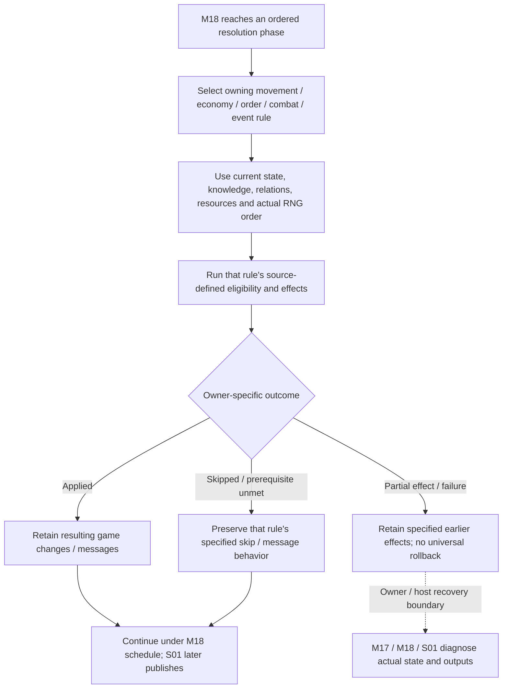
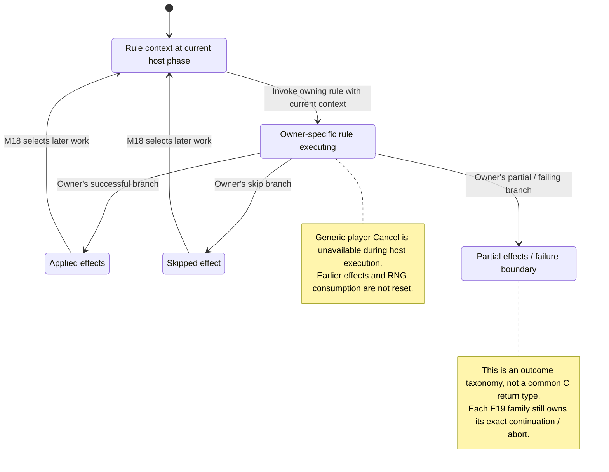

# M19: Game Rules and Resolution

Status: source-derived detailed specification; logical ownership is proposed.
Inspected: `e2eae18cff0f990db20415c1c2262aed2022f95b`, 2026-10-24.

Canonical entry: [M19-resolution-specification.dfy](M19-resolution-specification.dfy);
[rules and proofs](dafny/M19-resolution.dfy). Behavior statuses and evidence follow
[the collection conventions](README.md#requirement-ids-and-status).
Native growth/carry/writeback reviewed 2026-10-25 at
`e3222eb1fbdb01d68067231b5d5ef14a71759b30`; [economy companion](M08-colony-economy.md).
[Native mining/depletion](M19-mining-and-depletion.md) is reviewed at that same revision.

[Workflow and state diagrams](#workflow-and-state-diagrams) provide a visual reading path.

## 1. Purpose, actors and scope

Own the shared resolution surface while retaining specialized rules in their
existing owners. This provisional group accounts for every major host rule
family; it is not a second production, research or fleet algorithm.
[M18](M18-turn-generation.md) fixes when effects occur. M08/M09/M10/M11/M12/M13
own colony, production, fleet, design, research and relation contracts; M14 owns
plans/replay rather than combat simulation. S06 state, S03 catalogs and S01
persistence remain independent. Detailed inventory boundaries below identify
native algorithms still requiring stronger models and dedicated qualification.

Primary actors: Players whose plans become game outcomes, and hosts running the authoritative simulation.

### User stories

These source-derived stories describe intent, not evidence of user research.
The prerequisites and triggers are the corresponding workflows below. All
stories describe Observed capabilities with the stated limitations.

**M19-US01 — Resolve colony economy.** As a player, I want growth, mining and construction to follow my colony’s conditions so that economic planning is meaningful.

**M19-US02 — Resolve encounters.** As a player, I want movement, minefields and combat to use the relevant designs, relations and orders so that conflict has explainable outcomes.

**M19-US03 — Resolve tasks and objects.** As a player, I want colonization, transports, packets and universe objects resolved in the defined phases so that my orders affect the next year.

**M19-US04 — Preserve reproducibility.** As a host, I want the same complete input state to reproduce results so that changes can be detected and failures diagnosed.

### Story entry and completion conditions

| Story | Trigger and prerequisites | Completion / alternate outcome |
| --- | --- | --- |
| [M19-US01](#m19-us01) | Enter an economic phase with an owned populated colony and trait/capacity inputs. | Apply the appropriate normal/hostile/crowding/mining branch and owner-specific effects. |
| [M19-US02](#m19-us02) | Reach movement/combat with relevant fleets, plans and relations. | Apply eligibility then native encounter resolution; losses/events become host state. |
| [M19-US03](#m19-us03) | Execute an order/object phase with current target and object state. | Apply task-specific success/partial/skip/failure effects; changed targets can invalidate plans. |
| [M19-US04](#m19-us04) | Run a controlled regression with full state/catalog/RNG/platform inputs. | Compare decoded outputs and identify the first divergence without changing the frozen oracle. |

## 2. Inputs, outputs and state

| Area | Contract |
| --- | --- |
| Authoritative state | Host players, colonies, designs, fleets, space objects, orders, relations and race traits; player knowledge is a projection. |
| Numeric domains | Population/cargo hundredths and stored units, mineral concentration/depletion carry, resources, fuel, damage, coordinates and binary64 intermediates. |
| Effects | State mutation, messages, battle records, resource/technology changes, ownership changes and derived visibility. |
| Randomness/order | Shared RNG stream, sorted iteration and phase-local order are inputs to outcomes, not incidental implementation details. |

Persistent records remain [S01](S01-game-file-formats.md); logical state and
identity remain [S06](S06-shared-game-state.md). A derived/working value must not
be treated as a separately committed record or as information known to every player.

## 3. Workflows, rules and handoffs

### Economy: canonical rules and domains

`EstMineralsMined` in [mine.cpp](../src/core/mine.cpp) uses the local sentinel `cMines=-1`
to compute operating mines. An unowned/empty local colony produces the sentinel
triple (-1,-1,-1), not three zero yields. For a productive colony, the `Concentration`
rule applies a homeworld floor of 30 except non-AR remote mining; `MiningScaled`
retains local efficiency division order and remote mining's direct product.
`Yield` uses the integer quotient plus one only when generation is active and a
0–99 draw is below the nonzero remainder. A forecast omits that increment only when its generation flag is false;
`EstimateItemProdSched` does not force the flag false or restore RNG state.
`MiningDraws` specifies draw eligibility, while `MiningMarks`/`RemoteEligible`
specify AR apply=true live remote-miner flag changes and first-null traversal.
See the [forecast effects](M09-production-forecast.md#local-copying-does-not-establish-global-purity).
Those scalar yield projections exclude native overflow/cast effects. The native mining contract below adds signed-width guards and explicit input boundaries (E19-1).

The [mining/depletion companion](M19-mining-and-depletion.md) now specifies the
complete native three-mineral loop, byte level/concentration transitions,
signed yield/RNG order, stock publication, first-null AR fleet traversal and
sequential recursive quantities/marking. It reuses `Concentration`,
`DepletionBand`/`DepletionLeft` and proves normal-domain yield/eligibility
refinements. Depletion demand uses the unadjusted mine/concentration product;
it does not use efficiency-adjusted or randomized yield. M10 supplies the
[checked fleet capacity algorithm](dafny/M10-mining-capacity.dfy). Complete native
pointer/catalog/RNG/caller-state correspondence remains E19-1.

`ChgPopFromPlanet` in [util.cpp](../src/core/util.cpp) returns zero for unowned/empty colonies.
For populated colonies, hostile habitat uses `HostileLoss`; non-hostile growth
uses `GrowthAt`, given the owner's capacity and growth/habitat-derived rate.
`CrowdedRate` preserves quarter-capacity cutoff, quadratic crowding, truncation
order, maximum overcrowding loss and the `[capacity, capacity+10)` no-change
band. `Carry` preserves signed C division and normalized hundredths 0–99;
`CarryBound` proves that range. These functions require non-overflowing native
inputs, positive population/capacity for the non-hostile branch and an existing
valid remainder. The [native growth contract](dafny/M19-native-growth.dfy) now
adds owner/zero checks, signed rate narrowing, guarded native intermediates,
raw eight-bit carry and optional writeback. Its valid-carry refinements reuse
`Carry`; `NoUpdatePreserves` proves the modeled population/carry frame only.
The [economy companion](M08-colony-economy.md#growth-carry-and-optional-writes)
records source call order, undefined boundaries and carry-before-population
writeback. Full caller death handling and helper frames remain E19-1.
The rate/capacity definitions are reused from M08, not independently set.
Production payment/completion is [M09](M09-production-management.md), with
[host caller contracts](M09-production-execution.md) for queue/resource/application
routing. The [construction-effects companion](M19-construction-effects.md) now
specifies applied construction families; full native helper/pointer/state refinement
remains open. Research
allocation/breakthroughs are [M12](M12-research-and-technology.md), with
[host research transitions](M12-host-research-resolution.md) and explicit liveness/helper/phase limits.

### Complete resolution ownership inventory

| Rule family | Entry/effect and authoritative specification | Remaining native obligation |
| --- | --- | --- |
| Planet economy | `ChgPopFromPlanet`, `EstMineralsMined`, `Produce`; M08/M09 and the arithmetic above | E19-1 |
| Movement, fuel, following and gates | `MoveFleets`, movement helpers, `ship2.c`; [M10](M10-fleet-operations.md) | E19-2: route execution, hazards, arrival and packed damage |
| Orders and cargo | `SatisfyOrders`, `DropColonists`, `TransferToOthers`; M10/S01 task/transport discriminators | E19-3: mode-specific effects, conflicts and partial transfers |
| Production, technology and designs | `Produce`, `CBuildProdItem`, `UpdateResearchStatus`; M09/M12/M11 | Their execution/breakthrough/deletion boundaries |
| Battle participation and targeting | `DoBattles`, `FAttackPlayer`; M13 relation/attack policy and M14 plans | E19-4: battle setup, rounds, targeting and retreat |
| Weapons, losses and battle record | `battle.c`, damage helpers and S01 battle serialization | E19-4: initiative, movement, hit/kill and salvage ordering |
| Bombing, invasion and ownership | `battle.c`, `DropColonists`, task handlers; M08/M10/S06 | E19-3/E19-4: defenses, ground combat, extinction and messages |
| Minefields | `MoveFleets`, `SweepForMines`, `UnmarkMineFields`, `mine.c` | E19-2: detection, laying/decay, intersection RNG, losses and sweeping |
| Packets, wormholes and trader | `MoveThings`, `ThingDecay`, `DoThingInteractions`, `thing.c` | [Construction packet effects](M19-construction-effects.md#mineral-packets); E19-5 retains movement/collisions/events |
| Transit growth, repair and terraforming | `BreedColonistsInTransit`, `HealShips`, `AutoTerraform`, `RemoteTerraforming`; M08/M10/M13 | E19-1/E19-2: per-fleet/planet mutation and order |
| Knowledge, score and victory | `UpdateGuesses`, `UpdatePlayerScores`; S06 knowledge, [M03 scoring/victory](dafny/M03-scoring.dfy), M15 presentation | E19-6: actual visibility/score/end-condition evaluation |
| Race/trait effects and random events | `SetRaceStat` and consumers across these families; M04 trait data | E19-1–6: exact contextual effects, no blanket trait equivalence |

`WormholeMove` specifies the bounded movement magnitude from last movement and
stability, including clamp 0–6; it does not specify displacement coordinates,
re-pairing or discovery. Each family uses source state and consumes randomness
at its actual phase, not an independent per-rule stream. S03 owns numeric catalog
values; S04 owns native arithmetic/rounding adapters.

### Failure, cancellation and observable outcomes

Planning acceptance does not promise host success: target ownership, availability,
relations or resources can change before resolution. Apply the owning task's
skip, partial-success, abort and message behavior, preserving earlier effects.
This entry does not impose an all-or-nothing simulation transaction. M18 handles
load/allocation/replay failure and cleanup; S01 handles output failure; M17 owns
recovery. There is no generic player cancellation once host execution starts.
M15 exposes messages/reports; M14 replays recorded battles without re-resolving
them. Any intentional rule change needs its own code change, changelog and moved
native regression baseline; this specification changes no gameplay.

## 4. Acceptance and traceability

All criteria below have **Observed** behavior status except where a rule is
explicitly a caller convention or repository maintenance constraint. A named
model/lemma supplies mathematical evidence within its preconditions. An E-boundary
supplies source evidence and an explicit implementation-test/refinement gap,
not a proved runtime outcome. The dated collection run records actual checks.

| Criterion / story | Given / When / Then | Authoritative rule, source and evidence scope |
| --- | --- | --- |
| **M19-AC01** / [M19-US01](#m19-us01) | Given homeworld concentration 1, when locally mining, then use 30; ordinary non-AR remote mining uses 1. | `Concentration`, vectors; EstMineralsMined |
| **M19-AC02** / [M19-US01](#m19-us01) | Given scaled yield 1234, when generating with draw 33, then produce 13; draw 34 or generation=false produces 12. | `Yield`, `YieldBound`, `MiningDraws`, vectors; forecast caller retains the current generation flag. |
| **M19-AC03** / [M19-US01](#m19-us01) | Given signed hundredths -1 and carry 0, when normalizing growth, then produce change -1 and remainder 99. | `Carry`, `CarryBound`, vectors |
| **M19-AC04** / [M19-US01](#m19-us01) | Given population capacity+5 and valid carry, when calculating non-hostile growth, then preserve carry with zero change. | `GrowthAt`, vectors |
| **M19-AC05** / [M19-US02](#m19-us02) | Given a fleet encounter, when selecting attack eligibility, then use directed relations and its battle policy before resolving weapons. | M13 `Attack`; E19-2/E19-4 |
| **M19-AC06** / [M19-US03](#m19-us03) | Given extreme wormhole movement inputs, when computing magnitude, then clamp to 0–6; retain object-specific movement as an explicit dependency. | `WormholeMove`, vectors; E19-5 |
| **M19-AC07** / [M19-US04](#m19-us04) | Given a regression scenario and complete controlled state, when running current generation, then compare decoded checkpoints to the native baseline and report the first unexpected difference. | E19-6; regression harness; S06 RNG |
| **M19-AC08** / [M19-US01](#m19-us01) | Given AR local apply=true mining and eligible owned orbiting remote miners before the first null slot, clear their live `fHereAllTurn` flags after recursive mining returns. A local planet copy does not isolate the global fleet array. | `RemoteEligible`, `MiningMarks`, `MiningHoleStops`; [actual mining/forecast fixtures](../tests/spec/check_production_forecast_source.py), including the 9,216-case eligibility matrix. Full fleet/capacity/heap/context refinement remains E19-1/GAP-16. |
| **M19-AC09** / [M19-US01](#m19-us01) | Given completed factory/mine/defense work, clip against signed-16 absolute capacity minus 12-bit installed count; reject nonpositive results, otherwise apply low-12-bit count before merging the signed-16 message count. Do not equate message quantity with installation delta. | `Install`; [construction effects](M19-construction-effects.md#planetary-installations-and-no-op-items). Full signed-capacity source matrix and overflow/message vectors; [native capacity producers](M08-colony-economy.md) now specified, full lookup/state refinement remains E19-1. |
| **M19-AC10** / [M19-US01](#m19-us01) | Given base replacement, announce and invalidate downgraded queued ships before switching; preserve old/new warp-query order and sequential counters, including same-slot existence cancellation. Clear target and manual packets only when the new queried ability is nonpositive after an old nonpositive ability. | `BasePlan`, `Downgrade`, `BaseCounters`, `SameBaseExistence`, `BaseFling`; actual base/counter/queue source fixtures. Full helper/selection frames remain open. |
| **M19-AC11** / [M19-US03](#m19-us03) | Given packet work, reject zero ability before missing target, choose trait-specific ore quantities and native requested warp/decay, then match the first packet with exact raw fields and weight below 1630. Allocation failure sends a notice but returns true. | `PlanPacket`, `FindPacket`, `PacketApplication`, `PacketAccepted`; [packet contract](M19-construction-effects.md#mineral-packets). Actual trait/warp/quantity matrix, threshold and native per-kind ID-exhaustion cases; full allocator/state refinement remains open. |
| **M19-AC12** / [M19-US03](#m19-us03) | Given merged/new packet stocks, preserve signed-16 mineral addition/clamp and signed-16 mineral+9 narrowing before each 14-bit weight update; three stocks of 32760 yield weight 6556. Existing matching uses raw values before new-field narrowing. | `Combined`, `Weight`, `MergePacket`, `NewPacket`; native packed THPACK fixtures and checked shape/weight bounds. Packet movement/decay remain E19-5. |
| **M19-AC13** / [M19-US01](#m19-us01), [M19-US03](#m19-us03) | Given Genesis, broadcast first, preserve AR installations/scanner, clear direct mineral fields and consume twelve RNG draws in per-axis 50/50/40/40 order; set current/original environment equally and concentration from the separate draws. Keep later host working-stock publication distinct. | `GenesisPlan`, `GenesisBounds`, `Rebirth`; actual RNG/application/host fixtures. [GAP-17](README.md#gap-17) records ordinary host stock overwrite; historical comparison and intended behavior remain open. |
| **M19-AC14** / [M19-US01](#m19-us01) | Given terraform work, consume one best-axis result per native iteration; zero is a no-op, valid signed axes clamp environment to 1..99 before messaging, invalid axes have no defined indexed result. Incomplete supplied choices stay pending. | `TerraformCount`, `TerraformStep`, `TerraformTrace`; general call-count conservation and native signed-byte/axis/negative-count fixtures. Best-axis selection remains M08/E19-1. |
| **M19-AC15** / [M19-US01](#m19-us01) | Given generic scanner 27, set global player to owner for lookup and to -1 after ordinary return, message before writing the low-five-bit scanner; explicit scanner IDs preserve prior global player. | `ScannerInstall`, actual `SelectScanner`/M08 selector; [source contract](M08-colony-capabilities.md#scanner-selection-and-construction-order). Native real lookup and all nine-item availability-subset fixtures include unavailable floor zero and message-time prior scanner. Complete message/alias/lifetime/escaping frames remain M15/S06. |
| **M19-AC16** / [M19-US01](#m19-us01), [M19-US03](#m19-us03) | Given direct object application, preserve branch-specific design/index access and rejection order; planetary IDs 3/10/11 return true without another mineral mutation. Out-of-array design markers are not implemented error returns or supported orders. | `Route`, `Family`, `NoOpOnlyKnown`; [input domain](M19-construction-effects.md#interface-outcome-and-ownership), native rejection/no-op fixtures. Source parameter is not directly used to refund charged resources; helper frames remain explicit. |
| **M19-AC17** / [M19-US01](#m19-us01) | Given native growth, return zero before helpers for unowned/empty planets; hostile loss does not query capacity/growth rate, while non-hostile growth uses owner context and the narrowed initial rate. | Native `Grow`, `TrueRate`, `Calls`; [growth contract](M08-colony-economy.md#growth-carry-and-optional-writes). Actual growth/race/habitat bodies and typed helper fixtures; full lookup frames remain open. |
| **M19-AC18** / [M19-US01](#m19-us01) | Given crowded/overfull population, preserve quarter-capacity cutoff, guarded fullness/square/product order, capacity..capacity+9 dead band and rough/fine growth branch. | `Grow`, `FinishGrowth`, native vectors; independent source comparisons exclude undefined arithmetic before C. Whole mining-phase/caller-state integration and death handling remain open. |
| **M19-AC19** / [M19-US01](#m19-us01) | Given raw carry 0..255, adjust only once; zero non-hostile hundredths becomes one. For valid carry <100, agree with canonical signed carry; raw 200 at zero hundredths produces change 1/carry 101. | `CarryGrowth`, `CarryLoss`, `NormalGrowthCarry`, `NormalLossCarry`; all-byte prior-carry source fixtures and checked refinements. No new saved-game normalization is imposed. |
| **M19-AC20** / [M19-US01](#m19-us01) | Given update=false, preserve modeled population/carry; update=true stores new carry before population addition. Undefined addition does not imply rollback or a C error result. | `Publish`, `NoUpdatePreserves`; actual update/non-update source cases under ASan/UBSan. Full global/helper frames and saved-game qualification remain open. |
| **M19-AC21** / [M19-US01](#m19-us01) | Given mining count -1, return (-1,-1,-1) for unowned/empty planets before operating/efficiency/fleet queries; every other count selects remote arithmetic. | `Estimate`; [interface](M19-mining-and-depletion.md#interface-state-and-workflows). Actual native sentinel/count/population fixtures; helper/pointer frames remain open. |
| **M19-AC22** / [M19-US01](#m19-us01), [M19-US04](#m19-us04) | Given a nonzero signed yield remainder during generation, consume Random(100), increment only when draw < signed remainder, then publish output. A negative remainder consumes a draw without increment. | `NativeYield`, `UsesDraw`, `YieldProjection`, `Axis`; actual source scripted/all-draw and seeded RNG fixtures. Exact caller RNG extraction remains open. |
| **M19-AC23** / [M19-US01](#m19-us01) | Given apply=true, credit signed stock before depletion, using unadjusted mine/concentration demand /100; efficiency and stochastic yield do not change that demand. | `Axis`, `Deplete`; [yield/application](M19-mining-and-depletion.md#yield-rounding-and-application). Native signed-efficiency and stock/domain cases; undefined addition is excluded before C, not recovered by it. |
| **M19-AC24** / [M19-US01](#m19-us01) | Given concentration 100, stored level 1 and demand 1, preserve zero-left continuation to concentration 99/level 253 in two iterations; zero level denotes 256 and partial branch floors before prior-level clamp. | `Deplete`, `DepletionArithmetic`; [complete loop](M19-mining-and-depletion.md#complete-concentration-and-level-loop). All 65536 byte concentration/level pairs at three mine counts; checked monotonicity and max(0,concentration-1) iteration bound. |
| **M19-AC25** / [M19-US01](#m19-us01) | Given apply=false, preserve modeled ore stocks/concentrations/levels and live-fleet marks; outputs and generation-active RNG may change. | `Estimate`/`Axes`/`Remotes` frame postconditions; actual apply/nonapply native cases. This is a numeric frame under returning helper inputs, not global purity. |
| **M19-AC26** / [M19-US01](#m19-us01), [M19-US03](#m19-us03) | Given owned local AR mining, process positive-capacity eligible fleets in array order against the state left by earlier calls; add all three returned quantities before marking each fleet. Stop at first hole. | `Remotes`, `AddOutputs`; [remote order](M19-mining-and-depletion.md#remote-traversal-eligibility-and-prefix-effects). Reversed 100/4000-capacity fixture yields 4160 versus 4172; full array/alias/caller-state refinement remains open. |
| **M19-AC27** / [M19-US01](#m19-us01), [M19-US03](#m19-us03) | Given a remote fleet, test planet/owner/dead/signed order-count guards before first-order dereference; zero/negative counts do not prevent access. Query capacity only after task=3. | `Candidate`, `Remotes`, `EligibilityProjection`; native short-circuit/hole/waypoint matrix. Missing order is a boundary, not a fabricated ineligible return. |
| **M19-AC28** / [M19-US01](#m19-us01) | Given undefined signed multiplication, stock/output addition, missing helper/pointer or draw, retain prior numeric prefix and a named undefined/pending outcome without claiming rollback or a C error result. | `Axis`, `Axes`, `AddOutputs`, `Remotes`, `FromOperating`; native source cases filter undefined inputs before C and run defined cases with ASan/UBSan. Full native escaping-helper frames remain open. |
| **M19-AC29** / [M19-US01](#m19-us01), [M19-US04](#m19-us04) | Given host research, reuse M12 native player/field/redo, pool/spending, breakthrough/equipment and shared-recursion transitions; do not substitute preview quotes or scalar pool formulas. | M12 `Begin`/`Step`/`Run`; [host research](M12-host-research-resolution.md). Numeric/control transitions, normal-level host rank descent, catalog-bounded scan completion and actual native host fixtures. Successful native-domain Done completion and whole-year/helper/caller-state refinement remain open. |
| **M19-AC30** / [M19-US01](#m19-us01), [M19-US03](#m19-us03) | Given fleet application, reject a ship item without a base before owner/roster reads; otherwise read the owner roster and selected design before free/check guards. Free designs skip the helper. | [Eligibility handoff](dafny/M19-construction-buildability.dfy) `Gate`, `NoBaseSkipsOwner`, `FreeSkipsCheck`, `ReadyUsesRoute`. Actual FBuildObject plus real checker/catalog integration; invalid reached reads remain domain markers. |
| **M19-AC31** / [M19-US01](#m19-us01) | Given a nonfree selected design, use the exact M11 Check outcome under the planet owner; ordinary return restores the saved global. Ship rejection attempts a failure notice, while base rejection does not. | `Gate.check` exact postcondition and stages; [guard order](M19-construction-buildability.md#guard-and-lookup-order). Native request/getter/context and complete expected-frame comparisons; Ready is separate from eventual object application. |
| **M19-AC32** / [M19-US01](#m19-us01), [M19-US04](#m19-us04) | Given base eligibility TRUE, use the notification's full signed hull index separately from the checker's byte item. Retain the restored-global/check prefix if that read is outside the catalog. | `HullMetadata`, `DecodedHullSafe`, vectors; [projection difference](M19-construction-buildability.md#availability-and-notification-use-different-hull-projections), GAP-20. The address proof assumes the inspected FReadShDef upper hull condition; complete decoder/admission/writer/lifetime refinement remains open. |
| **M19-AC33** / [M19-US01](#m19-us01) | Given a base notice, choose its variant from stored design cargo and its cargo parameter from the selected catalog hull; assign that uint16 payload through the signed-word parameter, so 65535 arrives as -1. | `BaseNotice`, canonical `BaseMessage`/native `Word`, metadata vectors; [notice contract](M19-construction-buildability.md#base-notification-data-and-narrowing). Actual generated-catalog/message-argument comparisons; delivery and UI presentation remain M15/S05 work. |
| **M19-AC34** / [M19-US01](#m19-us01), [M19-US03](#m19-us03) | Given an eligible base application and returning state-preserving intervening helpers, derive old capability from its actual design; a positive old warp skips the replacement capability query and retains fling settings. Otherwise use the new design and canonical BaseFling, including packet invalidation on zero new capability. | `DesignFling`, native M08 `Lookup`, existing `BaseFling`; [handoff](M08-mass-driver-capability.md#construction-and-packet-workflows). Actual helper/base/packet/Post-charge Produce fixtures; full message/callback/alias/annual qualification stays open. |
| **M19-AC35** / [M19-US01](#m19-us01) | Given queued terraforming application, derive each helpful choice through the actual M08 pipeline, apply the canonical signed/clamped step and repeat for the unsigned construction count, including zero-choice iterations. Preserve an explicit nonordinary prefix rather than claiming successful application. | `SelectTerraform`, `RunTerraform`, existing `TerraformStep`/`TerraformCount`; [handoff](M08-terraform-selection.md#remote-substitution-and-construction-handoffs). Numeric iteration conservation and native Best/Can/habitat/application fixtures; message and whole-year frames remain separate. |
| **M19-AC36** / [M19-US01](#m19-us01), [M19-US04](#m19-us04) | Given remote terraforming choice, snapshot the target owner before actor copy, use actor capability with owner habitat, and restore the complete target PLAYER on ordinary return. Invalid owner is reached before Best's unowned guard; nonordinary evaluation has no general rollback guarantee. | `Remote`, canonical `Best`; [remote substitution](M08-terraform-selection.md#remote-substitution-and-construction-handoffs). Native whole-PLAYER frame and asymmetric owner/actor technology/preference fixtures; full fleet/task/annual and alias/lifetime refinement stay open. |

## 5. Interaction and quality requirements

**M19-IR01 — Caller and interaction requirement (Proposed).** Host rules accept game state and return mutations/events, with no direct keyboard or viewport contract. M08–M16 own explanations, selection and accessible outcome presentation. Explanations must distinguish forecast, known state and actual host result; comprehensive explanations of every hidden/random effect remain Open.

**M19-IR02 — Feedback and recovery (Proposed).**
Use the success, no-change, cancellation and failure distinctions in §3. The
owning caller must not imply that a forecast, accepted request or attempted write
is a confirmed final result. Section 3 records current outcomes and their limitations; this requirement does
not establish implementation. Complete keyboard/focus/error-announcement acceptance remains Open with the
caller and S05. No accessibility conformance level is asserted.

**M19-QR01 — Integrity and compatibility (Observed constraints).**
Preserve integer units, signed division, storage widths, binary64 boundaries, iteration order and exact RNG consumption. No probabilistic fairness or strategic-balance claim is proved. Performance and complete rule-family test coverage remain measurable Open work for the named owners.

Scenario/check: source/model boundary review and the native regression/build
checks below. Target: preserve the specified existing results and file/catalog
contracts; any intentional runtime change is separate work. Evidence: named
definitions, source pointers and dated checks; uncovered adapters are in §6.

**M19-QR02 — Performance and resource budgets (Open).**
Scenario: the largest supported workload for these workflows on each supported
backend. Method: measure wall time, peak allocation and caller-visible response
time with controlled inputs. Target: no agreed numeric budget or new measurement
in this specification batch. Owner: M19 and the consuming module/platform owner;
absence of a budget does not establish responsiveness.

**M19-QR03 — Text and presentation (Observed boundary / Open qualification).**
Use UTF-8 byte capacities and complete-code-point truncation from
[S04](S04-platform-services.md) and [Unicode boundaries](../docs/UNICODE-BOUNDARIES.md).
Native controls and rendering use [S05](S05-sdl-desktop-implementation.md);
headless/internal APIs have no independent viewport. Check non-ASCII boundary
inputs and the actual caller on supported displays. Target: valid text and the
stated capacities; complete font, large-text, IME and assistive-technology coverage
remains Open with S05 and the caller.

## 6. Coverage inventory and open decisions

The definitions named in §§3–4 are canonical for their stated projections.
The following inventory accounts for rules requiring native inputs/effects or
further decomposition; it is not a claim that their algorithms are proved.

| Boundary | Scope and limitation | Owner / next evidence or decision |
| --- | --- | --- |
| E19-1 | Caller population death-handling, whole annual-state and economic/research integration. [Native colony economy](M08-colony-economy.md) and the [full numeric mining/depletion/ordered AR remote loop](M19-mining-and-depletion.md) now have checked contracts and source fixtures. Full lookup/habitat/catalog/helper/pointer/alias frames, RNG/floating trace extraction and actual phase/caller-state correspondence remain open. M12 now supplies [host research operational transitions](M12-host-research-resolution.md), with total liveness/refinement still open. | M19/M08/M09/M10/M12/S04/S06; native adapters, complete task/phase integration and saved-game evidence. |
| E19-2 | Complete movement, gates, minefields, fuel, repair, transit growth and packed per-ship damage algorithms beyond the checked construction-stack adapter. Existing M10 formulas cover selected projections, not every host branch. | M19/M10; route/hazard/repair state fixtures with controlled RNG. |
| E19-3 | Every mode-specific task, invasion/drop, transfer, colonization and transport state mutation including contention and changing targets. Native remote-terraform choice now has an M08 player-substitution/selection/restoration contract and actual fixtures; complete remote-fleet permission, iteration and annual task effects remain open. S01 owns command bytes, not successful execution. | M19/M10/M08; one fixture per task/mode/outcome and invalidated target. |
| E19-4 | Combat rounds, targeting/initiative, beam/torpedo/bomb calculations, damage allocation, retreat, destruction and battle recording use mutable arrays, sort order and floating boundaries. | M19/M14/S04; full combat-state model and record/state comparison; native regression is partial coverage. |
| E19-5 | Packet/trader/wormhole/salvage movement, decay, interactions and random events beyond the bounded magnitude rule. Packet construction/merge and other FBuildObject family rules now have focused contracts. M08 supplies the complete [mass-driver capability controller](M08-mass-driver-capability.md), composed through conditional construction and actual checker/catalog/packet/Produce fixtures; complete helper/native-state refinement remains open. | M19/M08/S06; object-type/phase/RNG fixtures and explicit decomposition decision. |
| E19-6 | Full knowledge projection, score/victory input extraction and integration, and global reproducibility across platforms. Existing M03 scoring/victory formulas remain canonical; their model proofs are not native refinement or an exhaustive simulation proof. | M19/S06/M15/M03; visibility/score/victory vectors and expanded regression coverage. |

## 7. Evidence and verification

[resolution source](../src/core/turn.cpp), [economy/research](../src/core/turn2.cpp), [task resolution](../src/core/turn3.cpp), [combat](../src/core/battle.cpp), [mining](../src/core/mine.cpp), [objects](../src/core/thing.cpp), [population arithmetic](../src/core/util.cpp), and [known bugs](../docs/KNOWN-BUGS.md). Existing source behavior, including known bugs, is not an endorsement of a new rule.

[Collection verification](README.md#remaining-specifications-verification)
records exact commands and outcomes for this batch. Proofs establish only the
named model properties and witnesses, with their preconditions; they do not prove
that C refines the models or that every UI/platform workflow has been tested.
The boundary inventory and Open interaction/quality requirements remain visible
after a successful formal/build/regression run.

## Workflow and state diagrams

These reading projections summarize [Resolution ownership](#complete-resolution-ownership-inventory), [Failure and cancellation](#failure-cancellation-and-observable-outcomes) and the
[canonical contracts](M19-resolution-specification.dfy) at the inspection revision recorded above.
States are explanatory milestones, not new persisted fields or a claim of
complete C/model refinement. Terminal nodes end the illustrated operation.

### Workflow

### State and recovery

Both diagrams are an ownership/outcome projection across heterogeneous rule families, not a newly proved common algorithm. Planning acceptance cannot guarantee host success. Bounded economy properties do not close movement, battle, depletion, event or visibility algorithms.
