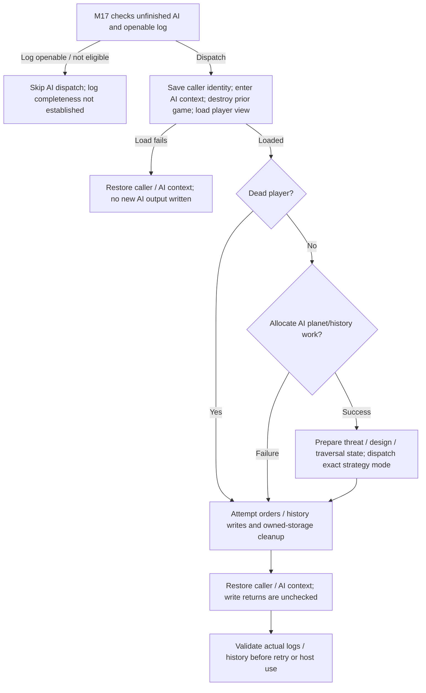
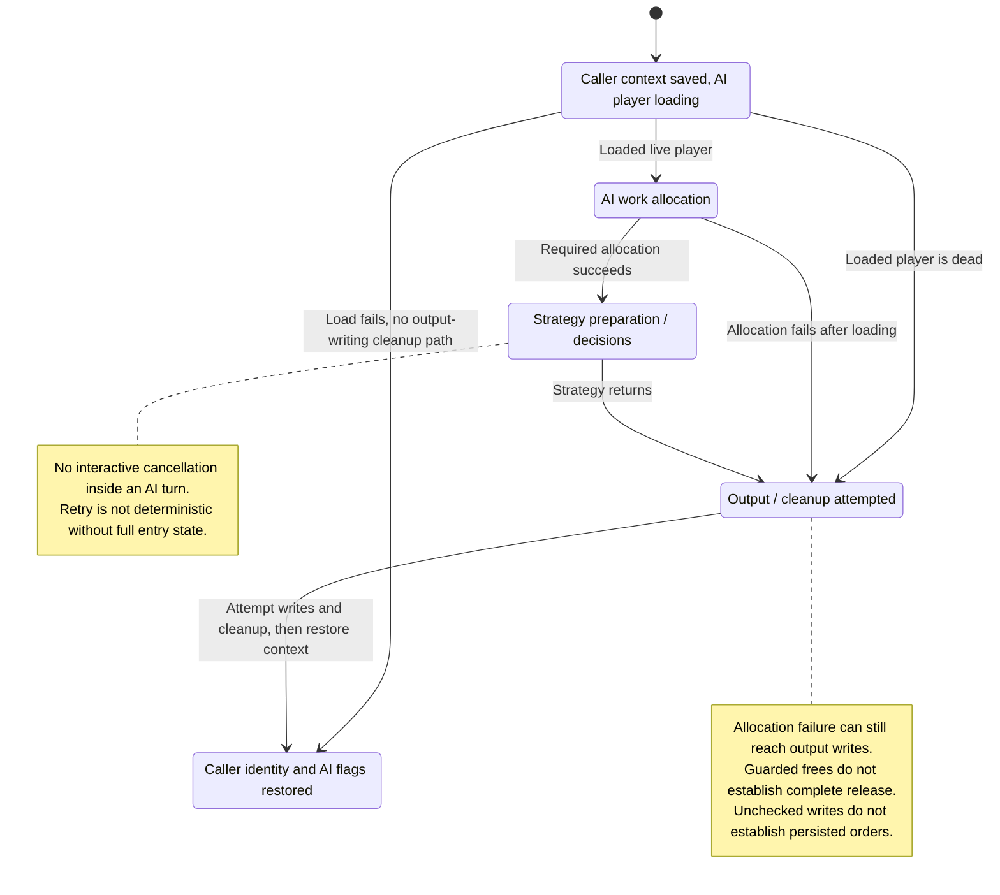

# M20: AI Players

Status: source-derived detailed specification; logical ownership is proposed.
Inspected: `e2eae18cff0f990db20415c1c2262aed2022f95b`, 2026-10-24.

Canonical entry: [M20-ai-specification.dfy](M20-ai-specification.dfy);
[rules and proofs](dafny/M20-ai.dfy). Behavior statuses and evidence follow
[the collection conventions](README.md#requirement-ids-and-status).

[Workflow and state diagrams](#workflow-and-state-diagrams) provide a visual reading path.

## 1. Purpose, actors and scope

Load an AI player’s view, choose orders according to the selected strategy and
persist those orders/history for normal host execution. M17 decides which AI
needs work; M18 later replays/resolves orders. M20 owns decision policy, while
M08–M13 own the gameplay meanings of those orders, S03 owns recipes and S01 owns
log/history bytes. Strategy quality, fairness and optimality are not inferred
from execution or from a passing regression.

Primary actors: A host running computer-controlled empires and human players sharing their game.

### User stories

These source-derived stories describe intent, not evidence of user research.
The prerequisites and triggers are the corresponding workflows below. All
stories describe Observed capabilities with the stated limitations.

**M20-US01 — Take an AI turn.** As a host, I want a selected AI to act on its player view so that it supplies orders for the coming year.

**M20-US02 — Use the selected strategy.** As a player setting up opponents, I want their chosen AI identity and recipes honored so that setup choices affect play.

**M20-US03 — Persist decisions and memory.** As a host, I want AI orders and memory saved so that subsequent generation and AI turns can use them.

**M20-US04 — Reproduce and diagnose choices.** As a maintainer, I want controlled traversal and RNG behavior so that strategy regressions can be detected.

### Story entry and completion conditions

| Story | Trigger and prerequisites | Completion / alternate outcome |
| --- | --- | --- |
| [M20-US01](#m20-us01) | Ensure/request a computer turn with its player file available. | Load/prepare/dispatch or follow the distinct load/dead/allocation failure path. |
| [M20-US02](#m20-us02) | Select a strategy at setup or supply a mode override at AI entry. | Resolve saved/override mode and dispatch its ID; random setup selector is not a runtime strategy. |
| [M20-US03](#m20-us03) | Reach AI cleanup after load, including dead/allocation-failure paths. | Attempt log/history writes and verify actual artifacts separately. |
| [M20-US04](#m20-us04) | Initialize traversal or sample a nearby planet under controlled state. | Preserve tutorial/non-tutorial draw counts and reservoir/retry order. |

## 2. Inputs, outputs and state

| Area | Contract |
| --- | --- |
| Inputs | Player slot/view, AI mode, optional override (65535 means keep saved mode), history and shared RNG/tutorial context. |
| Working state | Per-planet temporary records, planet pointer lists, history buffer, design powers, perceived danger and owned-planet traversal order. |
| Strategies | 0 Robotoid, 1 Turin Drone, 2 Automitron, 3 Rototill, 4 Cybertron, 5 Macinti, 7 Maid; random selector 6 is resolved during creation. |
| Outputs | In-memory orders/design/research/production changes and attempted log/history writes; allocation/load failure are distinct outcomes. |

Persistent records remain [S01](S01-game-file-formats.md); logical state and
identity remain [S06](S06-shared-game-state.md). A derived/working value must not
be treated as a separately committed record or as information known to every player.

## 3. Workflows, rules and handoffs

### Entry, strategy and cleanup

[ai.c](../src/core/ai.c) `DoAiTurn` saves the caller's player identity, sets AI
context, destroys prior loaded game state and loads that player's `.mN` view.
Load failure restores identity/AI context and returns without writing AI output.
Dead players skip strategy. It allocates planet records/pointers and AI history;
allocation failure also skips strategy but reaches cleanup, where writes are
attempted. `Enter` distinguishes these outcomes rather than treating every early
exit as equivalent. `Mode` preserves the saved mode for override 65535.

Before dispatch, `ComputeShdefPowers`, `MarkPlanetsUnderAttack`,
`IncreaseAIMinefieldSizes` and `InitRandomPlanetList` prepare evaluation state.
`Dispatch` maps the exact mode IDs above; random selector 6 is not another runtime
strategy implementation. Cleanup calls `FWriteLogFile` and `FWriteHistFile`, attempts
working-storage cleanup and restores caller/AI state. The planet-buffer free is
inside the history-buffer guard; if history allocation failed after planet-buffer
allocation, this branch does not establish complete release (E20-2). The write results are not checked
here, so successful strategy execution is not proof of persisted orders/memory.
M17's `EnsureAis` may skip an AI because a log is openable; that is not a claim
that the log is complete or a fresh strategy was run.

### Strategy ownership inventory

| Decision family | Source / dependency | Coverage |
| --- | --- | --- |
| Robotoid / Turin Drone / Automitron / Maid dispatch and shared turn preparation | `ai.c`, `aiutil.c` | Formal mode mapping; E20-1 policy internals |
| Rototill / Cybertron / Macinti and specialized planners | `ai2.c`, `ai3.c`, `ai4.c` | E20-1 branch/threshold/order inventory |
| Expansion, target choice, threat assessment and fleet assignment | AI source files, `MarkPlanetsUnderAttack`, nearby-planet selection | Selected traversal contract below; E20-1 |
| Design selection/upgrades and component preferences | AI helpers, S03 recipes/preferences, M11 design properties | S03 stable IDs and M11 checks; E20-1 selection |
| Colony queues, economy and research | AI planning helpers, M08/M09/M12, S03 research order | Gameplay owners define effects; E20-1 policy thresholds |
| Relations, battle plans and strategic movement | AI helpers, M10/M13/M14 | Commands/policies use owner contracts; E20-1 |
| Persistent AI memory and submitted commands | S01 history/log records | Byte contracts are S01; native persistence adapter E20-2 |

This inventory covers the decision surface without claiming that every heuristic
has been translated to mathematics. In particular, source-derived goals do not
establish human-quality play, access only to publicly visible information in all
helpers, or order-validation equivalence with every human dialog.

### Traversal, randomness and failure recovery

`InitRandomPlanetList` builds the owned-planet list in source traversal order and
shuffles outside tutorial mode. `ShuffleDraws` preserves zero tutorial draws and
`n-1` normal draws, unlike M18's all-player shuffle. `IdRandomPlanetNearby` uses
reservoir replacement when its eligible-candidate draw is zero (`Reservoir`);
distance eligibility remains E20-1. The starbase-avoid option retries a selected
starbase at most twice and may still return one; it is not a hard exclusion. Perceived minefield
sizes use the source binary64 square-root/add/truncate/square sequence, not an
integer approximation (E20-1/S04).

There is no interactive cancellation inside the AI turn. Before dispatch M17 can
avoid it; after a failure, verify the actual log/history before retrying. A load
failure preserves no new strategy output; a later failure may leave writes or
partially updated memory. A rerun may consume a different RNG state unless the
full entry state is restored. Do not interpret empty or failed AI work as a
strategic decision to do nothing.

## 4. Acceptance and traceability

All criteria below have **Observed** behavior status except where a rule is
explicitly a caller convention or repository maintenance constraint. A named
model/lemma supplies mathematical evidence within its preconditions. An E-boundary
supplies source evidence and an explicit implementation-test/refinement gap,
not a proved runtime outcome. The dated collection run records actual checks.

| Criterion / story | Given / When / Then | Authoritative rule, source and evidence scope |
| --- | --- | --- |
| **M20-AC01** / [M20-US01](#m20-us01) | Given a player-view load failure, when entering an AI turn, then return through the no-write load-failure path. | `Enter`; DoAiTurn; E20-2 |
| **M20-AC02** / [M20-US01](#m20-us01) | Given allocation failure after loading, when cleaning up, then skip strategy but still attempt log/history writes. | `Enter`; DoAiTurn; E20-2 |
| **M20-AC03** / [M20-US02](#m20-us02) | Given mode 7, when dispatching, then select Maid; mode 6 is a creation-time random selector, not Maid. | `Dispatch`, vectors |
| **M20-AC04** / [M20-US02](#m20-us02) | Given override 65535, when choosing the strategy mode, then retain the saved mode. | `Mode`, vectors |
| **M20-AC05** / [M20-US03](#m20-us03) | Given completed strategy execution, when writing AI artifacts, then distinguish attempted writes from confirmed persisted results. | E20-2; FWriteLogFile/FWriteHistFile |
| **M20-AC06** / [M20-US04](#m20-us04) | Given n owned planets, when initializing traversal, then tutorial consumes no shuffle draws; normal mode uses max(n-1,0). | `ShuffleDraws`, vectors |
| **M20-AC07** / [M20-US04](#m20-us04) | Given an eligible candidate draw of zero, when sampling nearby planets, then replace the reservoir candidate. | `Reservoir`; E20-1 eligibility |

## 5. Interaction and quality requirements

**M20-IR01 — Caller and interaction requirement (Proposed).** AI execution is headless; M03 owns opponent setup and M17 owns host errors/status. Strategy names and failure outcomes need distinguishable text. Keyboard, focus and supported displays apply through those callers; explainability and accessible strategy diagnostics remain Open.

**M20-IR02 — Feedback and recovery (Proposed).**
Use the success, no-change, cancellation and failure distinctions in §3. The
owning caller must not imply that a forecast, accepted request or attempted write
is a confirmed final result. Section 3 records current outcomes and their limitations; this requirement does
not establish implementation. Complete keyboard/focus/error-announcement acceptance remains Open with the
caller and S05. No accessibility conformance level is asserted.

**M20-QR01 — Integrity and compatibility (Observed constraints).**
Preserve mode IDs, catalog recipes, history widths, player-view identity, RNG traversal and binary64 boundaries. Measure time/memory by strategy and universe size before assigning budgets. Strategic strength, fairness, information limits and complete heuristic coverage remain Open decisions.

Scenario/check: source/model boundary review and the native regression/build
checks below. Target: preserve the specified existing results and file/catalog
contracts; any intentional runtime change is separate work. Evidence: named
definitions, source pointers and dated checks; uncovered adapters are in §6.

**M20-QR02 — Performance and resource budgets (Open).**
Scenario: the largest supported workload for these workflows on each supported
backend. Method: measure wall time, peak allocation and caller-visible response
time with controlled inputs. Target: no agreed numeric budget or new measurement
in this specification batch. Owner: M20 and the consuming module/platform owner;
absence of a budget does not establish responsiveness.

**M20-QR03 — Text and presentation (Observed boundary / Open qualification).**
Use UTF-8 byte capacities and complete-code-point truncation from
[S04](S04-platform-services.md) and [Unicode boundaries](../docs/UNICODE-BOUNDARIES.md).
Native controls and rendering use [S05](S05-sdl-desktop-implementation.md);
headless/internal APIs have no independent viewport. Check non-ASCII boundary
inputs and the actual caller on supported displays. Target: valid text and the
stated capacities; complete font, large-text, IME and assistive-technology coverage
remains Open with S05 and the caller.

## 6. Coverage inventory and open decisions

The definitions named in §§3–4 are canonical for their stated projections.
The following inventory accounts for rules requiring native inputs/effects or
further decomposition; it is not a claim that their algorithms are proved.

| Boundary | Scope and limitation | Owner / next evidence or decision |
| --- | --- | --- |
| E20-1 | All strategy branch thresholds, role assignment, target/route eligibility, design/production/research heuristics, binary64 evaluations and exact per-branch RNG draws are native strategy algorithms. The mode/traversal model does not prove their choices. | M20/M08–M14/S03; strategy-specific input/order fixtures, visibility review and explicit quality/balance criteria. |
| E20-2 | Player-view loading, allocations, global-state restoration, history packing, command generation and ignored persistence results are state/I/O adapters. | M20/S01/M17; failure injection and log/history/replay comparison, especially dead/allocation-failure paths. |

## 7. Evidence and verification

[AI entry](../src/core/ai.c), [AI helpers](../src/core/aiutil.c), [AI2](../src/core/ai2.c), [AI3](../src/core/ai3.c), [AI4](../src/core/ai4.c), [AI4 unit tests](../tests/unit/test_ai4.c), and [regression scenarios](../tests/scaffold/REGRESSION.md). Existing scenarios exercise selected AI families; they do not qualify every strategy, especially all Maid behaviors.

[Collection verification](README.md#remaining-specifications-verification)
records exact commands and outcomes for this batch. Proofs establish only the
named model properties and witnesses, with their preconditions; they do not prove
that C refines the models or that every UI/platform workflow has been tested.
The boundary inventory and Open interaction/quality requirements remain visible
after a successful formal/build/regression run.

## Workflow and state diagrams

These reading projections summarize [Entry, strategy and cleanup](#entry-strategy-and-cleanup), [RNG and recovery](#traversal-randomness-and-failure-recovery) and the
[canonical contracts](M20-ai-specification.dfy) at the inspection revision recorded above.
States are explanatory milestones, not new persisted fields or a claim of
complete C/model refinement. Terminal nodes end the illustrated operation.

### Workflow

### State and recovery

Load failure and later allocation failure deliberately have different output behavior. M17 can avoid dispatch, but an interrupted AI turn has no general rollback contract. The diagrams preserve E20 strategy, memory-release and persistence limits.
