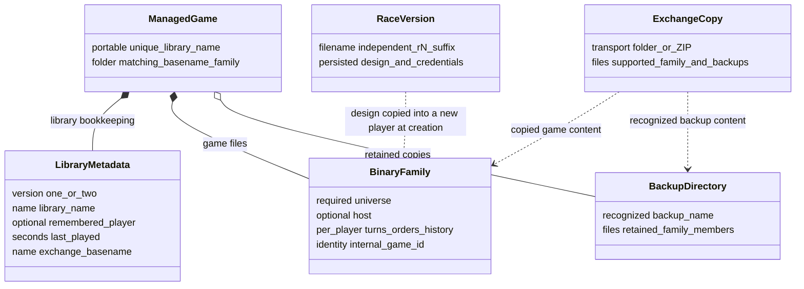

# S01 external formats and library persistence

Part of [S01](S01-game-file-formats.md). These boundaries transport or describe game
state but are not additional binary game-record kinds. M01/M02 own library
choices, M03/M05 own batch setup/generation and M15 owns report meanings.

The [Dafny specification](S01-game-file-specification.dfy) formalizes these data and
conditions. [S01 §1.2](S01-game-file-formats.md#12-what-the-formal-model-establishes) maps
each area to its definitions and states the proof boundary. These tables retain
the source evidence and distinguish writer output from observed reader behavior.

[Data-model and relationship diagrams](#data-model-and-relationship-diagrams) provide a visual map.

## Story-linked requirements

This companion enables [S01-US03](S01-game-file-formats.md#s01-us03)
(exchange), plus [S01-US01](S01-game-file-formats.md#s01-us01) for metadata/report
meaning. Actors are host operators, players importing/exporting and developers
implementing the adapters. Preconditions depend on the entry: a valid batch
request, inspected file family, loaded report viewpoint, or staged archive.

Main paths are parse batch → normalize/generate; project report → write text;
and inspect import/export → choose destination/conflict action → stage → publish.
No-match, duplicate/conflict, Cancel, malformed ZIP and restoration failure are
separate alternatives. Successful text/ZIP transport does not establish legal
gameplay state or a playable family. The owning M01/M02/M03/M05/M06/M15/M17
workflow supplies user decisions and completion meaning.

| ID / parent story / status | Acceptance criterion | Rule, evidence and coverage |
| --- | --- | --- |
| <a id="s01-ext-ac01"></a>S01-EXT-AC01 / US03 / Observed | Given a valid UTF-8 batch definition, when parsed, then preserve its line/number/path grammar and batch defaults; relative race paths resolve from process working directory. | [Batch](#1-batch-universe-definitions), S01External batch predicates and M03 `FBatchValue`; existing S01-A28/creation fixtures. Input acceptance still does not prove complete generation. |
| <a id="s01-ext-ac02"></a>S01-EXT-AC02 / US01 / Observed | Given a loaded player viewpoint, when exporting reports, then preserve the declared tab-separated columns/CRLF and unknown/estimated meanings; blank fields are not invented exact zeros. | [Reports](#2-text-report-exports), S01External report definitions; S01-A29 and `test_report.c` golden comparisons. Reports are not a restorable snapshot. |
| <a id="s01-ext-ac03"></a>S01-EXT-AC03 / US03 / Observed | Given later-turn publication or an external export-copy failure, then apply the documented affected-player retirement or already-saved-local-state outcome; failed restoration exposes a recovery obligation. | [Publication](#4-importexport-publication-boundaries); `FTransition`, `FImportEffect`, `FExportFailureAfterSave` in [external model](dafny/S01-external.dfy); S01-A24–A26. File operations/durability remain external. |
| <a id="s01-ext-ac04"></a>S01-EXT-AC04 / US03 / Observed | Given a ZIP traversal entry or a violated CRC/name/size condition, when extraction validates, then reject before managed publication rather than accept it as a game file. | [ZIP](#5-zip-envelope); `FZipName`, `FZipEntry`, `FArchive`; S01-A27, export runner. Some CRC/non-UTF8 cases are source requirements without focused tests. |

| ID / status | Interaction or quality requirement and check | Owner / gap |
| --- | --- | --- |
| <a id="s01-ext-ir01"></a>S01-EXT-IR01 / Observed interface | Keep destination, replacement/conflict and recovery choices at their workflow owner. Distinguish transport validation from game acceptance in caller feedback. | M01/M02/M06/M17 UI and host CLI; keyboard/focus/accessibility/display checks inherit those owners, not the archive codec. |
| <a id="s01-ext-qr01"></a>S01-EXT-QR01 / Observed | Preserve UTF-8 portable names, exchange basename, metadata schema and documented archive bounds. Test collision/path/encoding failures and report field fidelity. | [Names](#3-library-metadata-and-names), ZIP/report model and tests; raw filenames do not establish game identity. |
| <a id="s01-ext-qr02"></a>S01-EXT-QR02 / Open | Measure peak staging/extraction disk and memory use, copy/export time and restoration failure behavior on named storage/filesystem. Retain existing limits; overall budgets and crash-recovery expectations are unagreed. | S01/S04/M01; [S01-QR02/03](S01-game-file-formats.md#s01-qr02). No all-or-nothing filesystem claim. |

[Ownership and acceptance](#6-ownership-and-acceptance) and the S01 validation
companion retain the unresolved policy/test gaps. This layer transports data;
it does not introduce a new file format, library UI, shell grammar or gameplay rule.

Checks for this story expansion are recorded in the
[collection verification](README.md#story-expansion-verification).

## 1. Batch universe definitions

Evidence: [create.c](../src/core/create.c) `GenNewGameFromFile` and
[utilgen.c](../src/core/utilgen.c) `PszGetLine`, `CParseNumbers`.
[M03 §4.8](M03-new-game-wizard.md#48-batch-input-is-a-separate-entry-point) owns
semantic ranges, defaults, threshold conversions and subsequent normalization.
This section specifies the input syntax.

The entire file must be <16000 bytes and strict UTF-8 without embedded NUL.
An initial UTF-8 BOM is allowed. Lines may end in CRLF, CR or LF. `PszGetLine`
removes leading ASCII spaces, terminates at the line ending and does not trim
trailing spaces. Use a final newline and complete all required lines. No comment,
quote or backslash-escape syntax exists. Path lines are whole strings; command-line
quoting limitations are separate from the definition-file grammar.

Numeric lists accept decimal digits and ASCII spaces only: no signs, tabs,
commas or hexadecimal prefixes. Parsing stops after its maximum field count;
extra tokens are not uniformly rejected. Arithmetic accumulation wraps through
32-bit operations. A robust producer should emit exactly the documented field
count within range instead of relying on overflow or ignored suffixes.

For `P` players, the required line sequence is:

| Line | Syntax | Meaning |
| --- | --- | --- |
| 1 | title | Nonempty, <=31 UTF-8 bytes. |
| 2 | `size density distance [seed]` | Up to four numbers; first three ranges 0–4,0–3,0–3. Omitted values retain zero initialization; seed invokes Randomize. |
| 3 | seven 0/1 values | Extra fuel, slow tech, BBS, no random events, AI alliance, visible scores, clumping, in that order. Omitted trailing values remain zero. |
| 4 | `P` | 1–16. |
| 5 through 4+P | race path or `#type level` | First player must be a race path. For later players, type 0=random, 1–6=AI types; level 0=random, 1–4=easy through expert. |
| 5+P | `enabled [percent]` | Planet ownership victory. |
| 6+P | `enabled [level fields]` | Technology victory. |
| 7+P | `enabled [score]` | Score victory. |
| 8+P | `enabled [lead]` | Lead over second place. |
| 9+P | `enabled [production]` | Production in thousands. |
| 10+P | `enabled [ships]` | Capital ships. |
| 11+P | `enabled [years]` | Highest score after elapsed years. |
| 12+P | `required_count [minimum_years]` | Count 0–7. Minimum years required only when count >0. |
| 13+P | output basename | UTF-8 path within szBase capacity; an exact lowercase `.xy` suffix is stripped. |

`enabled` is 0 or 1; thresholds are required only for enabled conditions. Their
ranges and quantization belong to M03's table; e.g. 64% stores the raw value
for 60%. Batch setup does not inherit desktop victory defaults. Race paths
are resolved by file opening against process working directory, not automatically
relative to the `.def` file. Current reader checks race-line length against
`szWork`; output copying checks `szBase` and rejects excess rather than
silently splitting UTF-8. The optional trailing `lpbDefUni` pointer has no
consumer in the current source; it is not an additional specified custom-map
language. Do not invent supported trailing coordinate syntax.

A minimal one-player input (requires a valid local `humanoid.r1`):

```text
Example
0 0 1 12345
0 0 0 0 0 0 0
1
humanoid.r1
0
0
0
0
0
0
0
0
game
```

Use the fixed-seed launch contract in
[REGRESSION.md](../tests/scaffold/REGRESSION.md) when comparing results; the
seed here alone does not seed every later process. Generation can normalize
races, reject/replace invalid designs and alter names/icons under M03/M05 rules.
Input acceptance and complete output-file creation are distinct success checks.

## 2. Text report exports

Evidence: [report.c](../src/core/report.c) `DumpUniverse`, `DumpPlanets`,
`DumpFleets`, `FDumpCmdLineGame`; exact labels in
[text/strings.txt](../text/strings.txt), IDs 0x04dc–0x04e1; fixtures in
[tests/unit/golden](../tests/unit/golden).

These are UTF-8, tab-separated reports with CRLF row endings, no BOF, encryption
or checksum, and no general quoted-field/escape layer. Empty columns often mean
unknown/inapplicable, not zero. A save-format importer must not treat them as
complete restorable state. Writers require a loaded game and player viewpoint;
failures alert and can leave partial direct output.

| Report | Path | Ordered columns |
| --- | --- | --- |
| Universe | `<base>.map` | `#`, X, Y, Name. `#` is planet ID+1; positions and names come from `.xy` and name catalog. |
| Planets, ordinary | `<base>.pla` | Planet Name, Owner, Starbase Type, Report Age, Population, Value, Production Queue, Mines, Factories, Def %, S Iron, S Bora, S Germ, Iron MR, Bora MR, Germ MR, Iron MC, Bora MC, Germ MC, Resources. |
| Planets, per-player | `<base>.pN` | Ordinary columns, then Grav, Temp, Rad, GravOrig, TempOrig, RadOrig, Terra, Cap, Scan, Pen, Driver, Warp, Route, GateRange, GateMass, PctDmg. |
| Fleets, ordinary | `<base>.fle` | Fleet Name, X, Y, Planet, Destination, Battle Plan, Ship Cnt, Iron, Bora, Germ, Col, Fuel. |
| Fleets, per-player | `<base>.fN` | Ordinary columns, then Owner, ETA, Warp, Mass, Cloak, Scan, Pen, Task, Mining, Sweep, Laying, Terra, Unarmed, Scout, Warship, Utility, Bomber. |

The header is assembled from two ordinary catalog rows or three per-player
rows, replacing `*` delimiters with tabs. Report Age is `game.turn - observation
turn`. Textual percentages, estimates, task descriptions and names are
presentation values. Visibility controls which rows/columns are available;
M15 owns their calculations and any future machine-readable export design.
No round-trip quoting scheme for names containing delimiters is promised by
these direct string writes. `.map/.pla/.fle/.pN/.fN` are not recognized as game
family members by library family-copy validation.

## 3. Library metadata and names

Library user workflows now live in [M01 Game Library](M01-game-library.md) and
[M02 Race Library](M02-race-library.md). Shared portable-name/path predicates
live in [S01 library names](dafny/S01-library-names.dfy); this companion retains
metadata bytes, archive formats and publication contracts.

Evidence: [libraryui.c](../src/ui/libraryui.c)
`FWriteLibraryMetadataValues`, `FReadLibraryMetadata`, `FImportFamilyMember`,
`FPortableLibraryName`, `FPortableRaceFilename`; accepted behavior in
[ADR 0001](../docs/adr/0001-desktop-managed-libraries.md).

Managed game folders contain a matching-basename binary family and `.library`.
Current metadata is unencrypted text, LF-terminated, no BOM emitted:

```text
2
<library name>
<remembered zero-based player, or -1>
<last played Unix time in decimal seconds>
<exchange basename>
```

Version 1 has the first four lines; its exchange basename defaults to library
name. Reader accepts version 1 or 2, nonempty names, player -1 through 15 and
nonnegative timestamp, checking destination capacities. This parser is not a
second binary format validator and does not explicitly validate every textual
property of its metadata lines. Writer uses `.library.tmp`, checks formatted
write and close, then `ReplaceNativeFile` to publish. No fsync-based power-loss
transaction is established by that sequence.

Library names are portable filenames, unique without regard to capitalization;
in-game title remains unchanged on rename. Race library names derive from the
singular race name with unsuitable filename characters adjusted. Existing
race names/filenames can differ. A version suffix `.rN` is independent of player
slots. Version reuse compares complete persisted design fields and both names,
including credentials, while ignoring fLearned and unused name padding; a
16-bit race checksum alone is insufficient for equality.

Family recognition is case-insensitive on basename and extension. `.xy` and
`.hst` map to player -1; `.mN/.hN/.xN` require one or two decimal digits, no
leading zero, and N<=16. Matching-stem malformed player-family extensions mark
an import/export as bad rather than silently omit the companion. Other unrelated
files are not core family records. Backup directory recognition/copying belongs
to library management (`FBackupDirectoryName`, `CopyBackupDirectory`).

## 4. Import/export publication boundaries

### 4.1 Family inspection and import

`FInspectImportFile` checks BOF size/signature, major/minor 2.85, expected dt and
player, and nonzero game ID. It scans record framing to EOF. For orders/history
it accepts empty or two-byte EOF; host/turn require two-byte EOF. For `.xy`, it
checks total length `88+4*n` (n<=999), tag 7 length 64, and final two-byte EOF,
but does not decrypt GAME to prove that its planet count matches n.

The whole-family first pass requires same internal identity across recognized
members, one universe, and at least one player turn or host file. Duplicate
player-turn slots are rejected. It records player years, but does not enforce
all cross-file turn/wGen relationships among optional orders/history/host files.
The second pass copies recognized members and backups into staging, writes new
metadata, then installs the folder. Initial import does not preserve an
external `.library` as authoritative metadata; exchange basename comes from the
imported family. A directory must have one discoverable top-level universe;
a ZIP's enclosing-directory convention cannot substitute for it.

### 4.2 Later turns, conflicting turns and host orders

`FImportSubsequentTurn` matches a standalone `.mN` by internal game ID to managed
universes. Multiple matching copies require destination selection. Byte-identical
incoming/current files are no-ops. A first file for a player checks that the
player exists in decrypted GAME and installs the staged file while retaining
orders/history. An actual later turn queries orders presence, preserves the
previous turn temporarily, replaces it, then removes that player's old orders
only if the query reported TRUE. A FALSE query can leave an existing orders
file despite a successful import; failure to remove observed orders
attempts restoration and reports a recoverable previous path if restoration
also fails. History and other players remain. The
[M01 publication companion](M01-import-publication.md) owns exact source control
flow, ignored cleanup results, restore retries and surviving-file outcomes. S01
`PublishLaterTurn` describes completed logical retirement, not every native TRUE
return.

For changed same-year/older files, Replace stages the whole game and copies that
player's `.mN/.xN/.hN` into a fresh `backup.000`–`backup.999` directory before
installing the incoming turn. It moves the old folder to a held path, publishes
the stage, restores on publication failure and warns if old-copy cleanup fails.
Separate Copy stages a new named family and substitutes the incoming turn.
**Observed distinction:** `FStageConflictingTurn` only replaces the turn; it does
not apply the later-turn path's order-retirement step. Existing copied orders
and history remain for subsequent core validation. Do not assume conflict
replacement and forward advancement have identical cleanup semantics.

`FImportLibraryOrders` requires a selected managed host game, valid `.xN`,
matching game/turn/wGen against `.hst`, matching `.xy`, and player membership
in decrypted GAME. Identical orders are a no-op. A different existing file
requires a replacement choice; the incoming file is staged, re-inspected and
replaced. These checks do not prove all commands can replay successfully.

The core supports appended turn segments, but `FInspectImportFile` currently
stops at the first EOF and requires it to be the physical end. This rejects
ordinary multi-segment turns before the later fMulti branch can help. It is an
explicit unresolved implementation gap, not a new format restriction imposed
by this specification.

### 4.3 Exports and race import

Game export stages recognized current family files and recognized backups,
requires universe plus a playable host/turn member, then publishes an external
folder or ZIP. It does **not** export arbitrary files or internal `.library`
metadata. The folder destination is a new child named after the managed game;
ZIP entries are rooted at the family itself. It rejects destinations inside
the source game and path lengths that cannot preserve full companion names.
Session saving belongs to the caller before this file-copy operation.

Orders export uses a stronger save path than ordinary direct save: write staged
orders/history, preserve prior history, replace history then orders, attempt
history rollback on failure, restore submission state, then stage/copy the
ordinary orders file externally. Failure in the final external copy can occur
after the managed game has been saved successfully. The selected player's
`.xN` suffix is enforced after choosing a name. Suggested basename is the
exchange basename; changing it does not change internal game/player identity.

Race import runs `FWasRaceFile`, performs any legacy conversion/confirmation,
then uses the current race writer into a staged library destination. Source
files are unchanged. Protected modern race export retains its existing bytes
and password behavior. Managed version scanning only reads current 2.85 race
files and does not trigger legacy conversion/password dialogs. The protected
legacy policy conflict remains recorded in the S01 entry.

## 5. ZIP envelope

Evidence: [libraryzip.c](../src/ui/libraryzip.c) `FZipLibraryDirectory`,
`FUnzipLibraryArchive`, `FZipSafeName`, `FZipNameUtf8Supported`.
This section specifies the implemented ZIP subset, not a general-purpose
archive standard or an additional Stars! record format.

Export emits classic single-disk ZIP: method 0 (stored), UTF-8 flag 0x0800,
local headers, central directory and EOCD, CRC32 per file, no encryption,
extra fields or comments, zero DOS date/time, at most 65535 entries, 32-bit
sizes/offsets. Files are collected recursively from staging; symlinks fail.
Empty directories need not be preserved. Whole files are read into memory.
Archive output is staged with exclusive temporary creation and replaced only
after write/close success.

Import accepts methods 0 and 8 (raw deflate), with central-directory sizes/CRC.
Checks include:

- EOCD plus comment reaches physical EOF; one disk only; entry counts agree;
  central directory bounds do not pass EOCD; at most 4096 entries.
- Per entry, nonempty name <512 bytes, no embedded NUL; no encrypted flag;
  no Unix symlink or reparse-point attribute; disk-start zero.
- UTF-8 flagged names must be valid UTF-8; without that flag only ASCII names
  are accepted. Unsupported name encoding has its own result code. No CP437
  or CP1252 filename guessing occurs.
- No absolute path, backslash, colon, byte below 0x20, empty path component, `.`
  or `..` component. Directory entries' final slash is removed before this
  check. Parents are created within the fresh staging directory.
- Local signature, flags, method, name length and exact filename must match
  the central entry; compressed data must end before central-directory start.
- Each declared uncompressed entry size <=64 MiB, total declared uncompressed
  bytes <=512 MiB (directory entries count toward both limits).
  Compressed bytes are allocated as declared; this is not a matching 64 MiB
  compressed-allocation bound.
- Stored compressed/uncompressed sizes must match; deflate must end with exact
  consumed and produced counts. CRC32 must match. Existing output files and
  duplicate file destinations fail exclusive creation rather than overwrite.

ZIP64, multi-disk and encrypted archives are outside this supported subset.
Directory entries are handled as parent creation and do not take the same
file-data CRC path. General unknown ZIP extras are skipped by declared length;
there is no promise to preserve them on re-export. Import extracts to a fresh
stage, then applies ordinary family validation; failure removes the stage
through the caller. Successful extraction alone is not successful game import.

## 6. Ownership and acceptance

Keep portable-name rules and conflict choices in M01/M02, numeric batch setup
in M03/M05, and column semantics in M15. S01 preserves binary identity across
those operations. A transport copy should preserve file bytes; regenerated
metadata, archive timestamps and compression choices are separate envelopes.

[Validation and acceptance](S01-game-file-validation.md) records exact existing
fixture/test coverage and the remaining malformed-input, transactional and
policy decisions. No atomic multi-file transaction, authenticated save format,
or unrestricted ZIP compatibility is implied by these workflows.

## Data-model and relationship diagrams

<a id="s01-data-managed-storage"></a>
### Managed storage, metadata, backups, and exchange copies

Source-derived projection rechecked at `7abe8083788d2f991e54eb9fc108a5468f82d2a1`
on 2026-10-25. Trace: [story-linked requirements](#story-linked-requirements),
[metadata/names](#3-library-metadata-and-names),
[publication boundaries](#4-importexport-publication-boundaries),
[ZIP](#5-zip-envelope), [canonical specification](S01-game-file-specification.dfy):
`Metadata`, `MetadataBytes`, publication predicates in
[S01External](dafny/S01-external.dfy); [M01 ownership](M01-game-library.md),
[M02 race versions](M02-race-library.md), [library glossary](../GLOSSARY.md).
Evidence: [libraryui.c](../src/ui/libraryui.c) `FWriteLibraryMetadataValues`,
`FReadLibraryMetadata`, `FImportLibraryGame`, `FExportLibraryGame`;
[libraryzip.c](../src/ui/libraryzip.c) archive transport.



This groups storage roles, not additional binary record kinds. A valid family
import needs a universe plus at least one player turn or host file. Several managed
copies can share one internal game ID. Library name, stored game title and
exchange basename are different values; metadata's remembered player can be
absent, and version 1 derives exchange basename from library name. The race
library is separate: `.rN` is a race version, not game player N. Creation copies
the design into a player snapshot, not a live link to future library edits.
Game export copies the supported family/recognized backups; it does not promise
all arbitrary sidecars or `.library` metadata. Import copies remain independent
of their sources. Staging, rename and replacement failure/recovery stay with
M01/M02/S01; the associations imply neither crash durability nor all-file atomicity.
