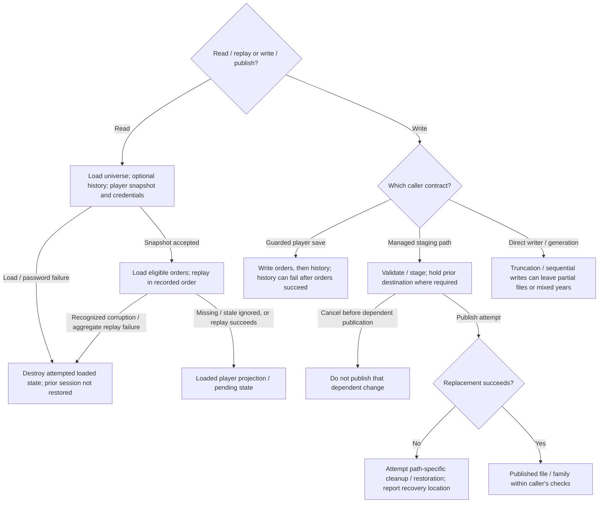
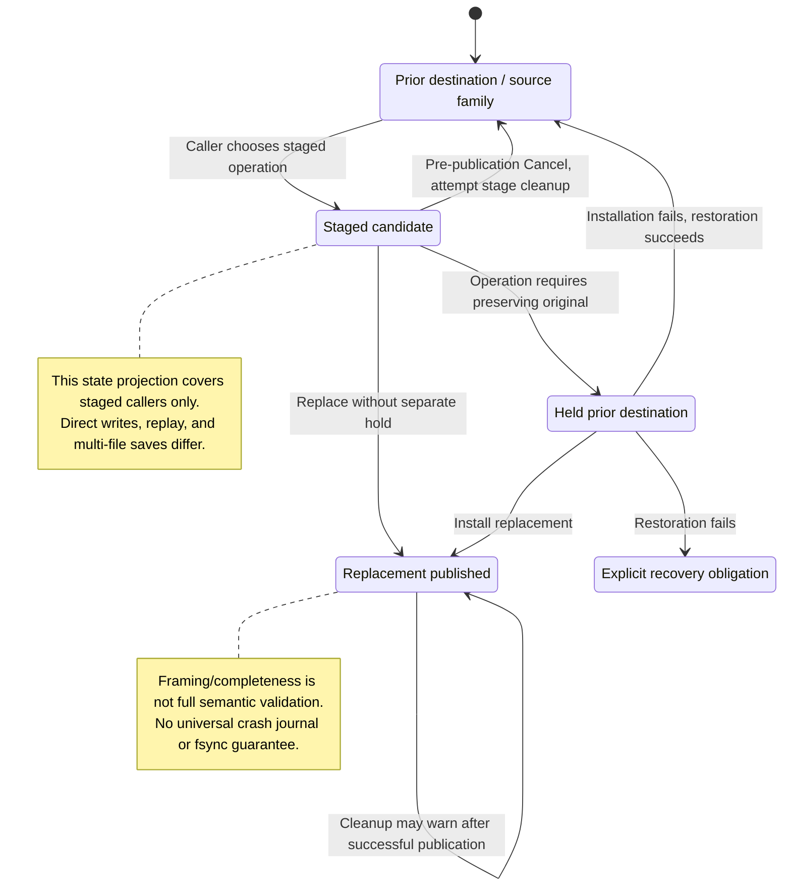
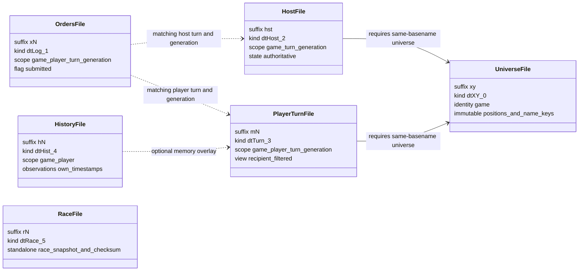
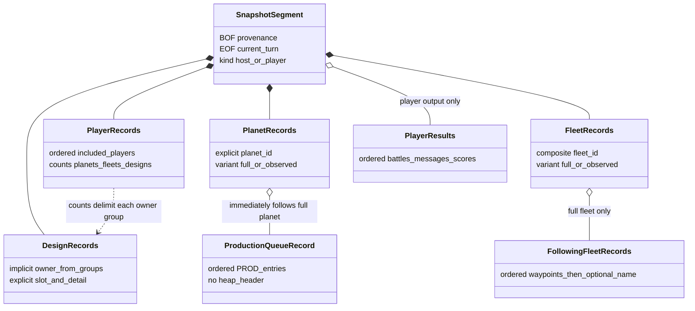

# S01: Game-file Formats, Persistence and Validation

Status: source-derived specification of the current persistence boundary, with
Dafny data definitions and conditions for the formalized boundary described below.
Inspected revision: `e2eae18cff0f990db20415c1c2262aed2022f95b` on
`codex/module-specifications`, 2026-10-23; the Dafny extension was rechecked at
the same revision on 2026-10-24. The local M03/M04 drafts were also
consulted. This specification changes no runtime behavior or compatibility policy.

[Workflow and state diagrams](#workflow-and-state-diagrams) provide a visual reading path.
[Data-model and relationship diagrams](#data-model-and-relationship-diagrams) map the shared values and references.

## User stories and requirements

Actors are the player preserving a turn/race, the host operator exchanging files,
and a developer implementing compatible persistence. Context includes file kind,
identity/player/year, version and the caller's active state. Use the [status
conventions](README.md#requirement-ids-and-status); proposed validation must remain
distinct from the checks actually made by each reader.

### Stories and workflows

<a id="s01-us01"></a>
**S01-US01 — Preserve game information (Observed).** As a player, I want saved
game/race information to retain its documented meaning so that reopening it
reconstructs the appropriate state. The caller chooses a file family, encodes
ordered records, then later decodes the supported representation and companions.
Unknown/partial knowledge stays distinct from exact values; raw byte equality is
not promised where writer canonicalization, salt or history merging intervenes.

<a id="s01-us02"></a>
**S01-US02 — Replay the intended orders (Observed).** As a player or host, I want
saved commands applied to the intended snapshot in their recorded order so that
pending decisions have the documented effects. Validate at the chosen entry
point, load the counted log/messages and replay. Missing/mismatched logs,
generation-only commands and partial failure have distinct outcomes; replay is
not generally idempotent or transactional.

<a id="s01-us03"></a>
**S01-US03 — Exchange a coherent file family (Observed).** As a host operator or
player, I want import/export to match the correct game, participant and year so
that exchange does not mix unrelated state. Inspect, choose destination/conflict
handling, stage and publish/copy. Cancellation before publication and failure
after staging/publication follow different recovery paths. M01/M02/M06/M17 own
the user choices, not the binary record codec.

<a id="s01-us04"></a>
**S01-US04 — Detect invalid data before accepting it (Proposed stronger boundary).**
As a developer, I want a bounded decoder with explicit validation and publication
outcomes so that malformed input cannot masquerade as a valid snapshot. Decode
to candidate state, validate the kind-specific contracts, then publish or return
an error. Current readers do not uniformly implement this proposed workflow;
[validation](S01-game-file-validation.md) records actual behavior and policy gaps.

### Acceptance and traceability

| ID / story / status | Observable criterion | Canonical rules and implementation evidence | Verification or gap |
| --- | --- | --- | --- |
| <a id="s01-ac01"></a>S01-AC01 / US01 / Observed | Given canonical supported output, when records are read, then use the declared fixed widths, variant tags, text encoding and file-kind ordering rather than native struct layout. | [Grammar](#3-file-grammar-and-ordering), [record companion](S01-game-file-records.md#story-linked-requirements); [formal inventory](#12-what-the-formal-model-establishes). | Existing record/codec predicates and byte vectors; only named lemmas establish round trips. |
| <a id="s01-ac02"></a>S01-AC02 / US01 / Observed | Given text at a UTF-8 byte boundary, when written/read through bounded text adapters, then preserve complete code points and reject invalid encodings according to the adapter contract. | [Text records](S01-game-file-records.md#32-user-strings); `FUtf8`, `ReadText`, `ReadCompressed`; existing S01-A vectors. | Encoding tests and codec witnesses; not a claim about every legacy/raw reader. |
| <a id="s01-ac03"></a>S01-AC03 / US02 / Observed | Given one replayed command fails and another follows, when `FRunLogFile` runs, then attempt the later command and aggregate failure without undoing prior effects. | [Orders](S01-game-file-orders.md#4-identity-replay-and-failure); S01Orders effects and M06 `ReplaySucceeded`. | Source/model projection; all command combinations/partial effects are not exhaustively tested. |
| <a id="s01-ac04"></a>S01-AC04 / US02 / Observed | Given an orders envelope that differs in year/player/game, then validation depends on the actual entry point; the proposed typed match rejects it, while the raw loader's documented checks remain narrower. | [Validation by entry](S01-game-file-validation.md#1-validation-by-entry-point); S06 `Matches`, S01 file predicates. | Explicit source distinction; prevents treating a schema predicate as a universally enforced check. |
| <a id="s01-ac05"></a>S01-AC05 / US03 / Observed | Given a successful later-player-turn publication with orders presence reported TRUE, retain unrelated player files/history and retire the affected old orders; a FALSE orders query can skip retirement despite native TRUE. Restoration failure remains a recovery obligation. | [External publication](S01-game-file-external.md#4-importexport-publication-boundaries); `PublishLaterTurn`, `FTransition`, `FImportEffect`. | Existing S01-A24–A27 and library tests; no crash-atomic family guarantee. |
| <a id="s01-ac06"></a>S01-AC06 / US04 / Proposed | Given a truncated/malformed candidate or invalid references, when a strict adapter validates, then reject before publishing candidate state; compatibility repairs and unknown-tag policy must be explicit. | [Strict decoder](S01-game-file-validation.md#2-proposed-strict-decoder-contract); `ReadRecord`, `PublishDecoded` and kind-specific predicates. | Formal bounded predicates; end-to-end strict C adapter and several policies remain open. |

### Interaction and quality requirements

| ID / status | Requirement, check and target | Owner / evidence / remaining decision |
| --- | --- | --- |
| <a id="s01-ir01"></a>S01-IR01 / Observed | Expose each reader/writer's actual result and side effects to its caller. Interpret save/submit/import feedback through that workflow rather than one universal success bit. | M01/M02/M06/M17 own UI/CLI interaction, focus and accessible error presentation; S01 itself has no viewport. |
| <a id="s01-ir02"></a>S01-IR02 / Proposed | A future bounded adapter returns enough stage/context information for callers to identify the rejected file/record and any recovery obligation, without claiming that partial writes were undone. | [Proposed interface](#53-proposed-interface-for-a-port); result/error schema and caller accessibility integration are not delivered. |
| <a id="s01-qr01"></a>S01-QR01 / Observed | Preserve format 2.85, fixed field/record widths, UTF-8 byte budgets and context-specific canonicalization. Test wire vectors, not native struct equality. | Records/codec companion; root contract and existing tests. Protected legacy policy conflict stays Open. |
| <a id="s01-qr02"></a>S01-QR02 / Observed | Distinguish rejected input, partial decoded effects, completed writes, staging and publication/restoration failure. Inject each failure stage and compare the relevant prior/durable state. | External/publication model and S01-A vectors; filesystem durability/atomicity assumptions remain explicit. |
| <a id="s01-qr03"></a>S01-QR03 / Open | Measure decoding/encoding time and peak allocations for largest legal files and malformed-length cases on named storage/platforms. Specify aggregate resource budgets before adding limits. | S01/S04; existing per-record/ZIP bounds do not establish a global safe memory or latency budget. |

The four companions own records, orders, external formats and validation. Their
story-linked criteria specialize these stories without renumbering existing
S01-A acceptance vectors. §§1–2/5–6 retain scope, state, compatibility and recovery;
open policies remain in the validation companion.

Checks for this story expansion are recorded in the
[collection verification](README.md#story-expansion-verification).

## 1. Purpose and scope

S01 translates between durable bytes and game state. It covers every currently
emitted game-file family, record framing and payloads, text and stream codecs,
read/write sequencing, order replay, identity checks, legacy race conversion,
and the persistence boundaries of library packaging and text exports.

Read the documents together:

| Document | Contract |
| --- | --- |
| [Dafny specification](S01-game-file-specification.dfy) | Entry point for the complete S01 model: foundation, codecs, records, orders, file families, external formats and checked witnesses. |
| This entry | File families, file grammars, state mappings, workflows, compatibility and recovery. |
| [Binary records and codecs](S01-game-file-records.md) | Byte order, headers, XOR stream, strings, every state-record payload and its logical mapping. |
| [Orders and replay](S01-game-file-orders.md) | Every order tag, variable payloads, replay effects and limitations. |
| [External formats](S01-game-file-external.md) | Batch definitions, reports, library metadata, imports/exports and ZIP envelope. |
| [Validation and acceptance](S01-game-file-validation.md) | Validation by entry point, acceptance vectors, fixture coverage, verification and unresolved decisions. |

**Observed** describes the inspected source, including permissive or incomplete
validation. **Required contract** describes repository policy or a well-formed
writer output. **Proposed** identifies a future interface or strengthening;
it is not a claim about the current implementation. In particular, a required
record length below does not mean every reader checks that length.

S01 owns encoding, decoding and file-set consistency. M06 owns the player's
session and save/submit decisions; M17/M18 own host readiness and turn execution;
M01/M02 own library decisions; M03/M05 own setup and creation; M15 owns report
meaning. S06 owns logical state, including unknown and last-known values; S03
owns the catalogs whose stable IDs appear in files. A native C struct, a Dafny
value, and a disk record are different representations; Dafny datatype constructor order is never a wire encoding.

### 1.1 Dafny is the notation for data and conditions

The entry point [S01-game-file-specification.dfy](S01-game-file-specification.dfy) includes
all S01 definitions. [S01-game-file-contracts.dfy](S01-game-file-contracts.dfy) retains the
foundational types; the focused modules below extend them. This document explains their meaning,
source correspondence and limits; the other S01 tables retain the complete byte
layouts and observed workflows. New formal conditions belong in the corresponding Dafny module rather
than in disconnected pseudocode. The notation follows the
[Dafny 4.11 reference manual](https://dafny.org/v4.11.0/DafnyRef/DafnyRef).

- Subset types state field ranges; `datatype` names alternatives and their data.
- `predicate` states a condition; it does not assert that the C reader enforces it.
- `requires` is a caller obligation; `ensures` is a result guarantee under those
  obligations. Lemma bodies discharge the stated proof obligations.
- `seq` retains order and multiplicity. `map` is used for already identified
  managed player slots, not for wire records whose order carries meaning.

For example, these declarations distinguish byte values, valid player slots and
unknown observations. They use mathematical integers, not new native widths:

```dafny
type U8 = n: int | 0 <= n < 256
type PlayerId = n: int | 0 <= n < 16
datatype Known<T> = Unknown | Observed(value: T, turnSeen: U16)
```

`U16` is defined in the companion. `Unknown` remains different from an observed
zero. A full-format record filtered for a Claim Adjuster still needs the visibility
mapping described below; the datatype alone does not perform that conversion.

### 1.2 What the formal model establishes

| S01 area | Formal definitions | Model boundary |
| --- | --- | --- |
| Foundation | [S01-game-file-contracts.dfy](S01-game-file-contracts.dfy): widths, `Header`, `FrameRoundTrip`, UTF-8 predicates, typed waypoints, managed-game invariant and publication postconditions | Original contracts remain available to consumers. |
| Integer packing and XOR | [S01-codecs.dfy](dafny/S01-codecs.dfy): `LE`, `Unsigned`, `Bits`, `Signed`, `InitXor`, `NextSeed`, `Crypt`, `CryptConsumption` | Signed C division/wrapping, literal prime table, stream initialization, partial-word consumption, and BOF/EOF exceptions. |
| Text and credentials | Codec module: `ByteNibbles`, `PackNibbles`, `Decompress`, `ReadText`, `WriteText`, `RaceChecksum`, `Password`, `LegacyText` | Raw/nibble encodings, padding, bounded UTF-8, normalized PLAYER checksum, signed-byte hash and CP1252 conversion. |
| BOF, GAME, STARPACK | [S01-records.dfy](dafny/S01-records.dfy): `FBofBytes`, `FWriterBof`, `FGameBytes`, `StarWord`, `StarX`, field tables | Explicit offsets and bit fields; current reader and writer requirements are separate. |
| PLAYER/races | Record module: `FPlayer`, `FPlayerObserved`, `PlayerImage`, `FRacePayload`, `PlayerFields`, `PlayerArrays` | Canonical/legacy payload extents, current trailing-byte/relation tolerance, reconstruction and checksum over decoded original names. |
| Planets and queues | Record module: `PlanetEnd`, `SparseEnd`, `FPlanet`, `FQueue`, improvement/base/production field tables | Flag-dependent lengths, sparse widths, habitat bounds, history suffix, full/partial variants and progress fields. |
| Designs and fleets | Record module: `FDesign`, `FleetTail`, `FFleet`, `DamageRead`, `RepairBitmap`, `FKeepFullDesign`, `RepairSlot` | Variable slots/counts/cargo/damage, full/partial extents and specified loader repairs. Catalog lookup results enter as explicit parameters. |
| Waypoints and battle plans | Record module: `FWaypoint`, `FPlan`, task/plan field tables; foundation `WaypointTask` | Wire sizes and task domains; log plan acceptance permits the observed extra tactic/target values. |
| Messages | Record module: `CatalogEnd`, `FPlayerMessage`, message field tables | Catalog-supplied argument counts, parameter widths, compressed/raw lengths, UTF-8, legacy link handling. |
| Battles | Record module: `FBattle`, `EventsEnd`, `FBattleChunks`, `WriteBattleChunks`, token/event/kill field tables | Complete blob boundaries, token/event widths and writer continuation grouping; combat calculations belong to M14. |
| Scores/things/AI | Record module: `ScoreFields`, `ThingFields`, variant field tables, `ThingPlayerView`, `FAiHistory`, `Chunks` | Fixed widths, discriminators, knowledge masking/reward removal, AI-specific lengths and chunking. |
| Every order tag | [S01-orders.dfy](dafny/S01-orders.dfy): `FCommand`, `FReplayContext`, `CommandFields`, `CargoWidth`, `WaypointCommand`, `ExpandWaypoint` | Payload and contextual checks are proposed strict conditions; the existing replay is not uniformly this strict. |
| Replay effects | Orders module: `Replay`, `ApplyGenerationGate`, `ApplySimple`, `QueueProgress`, `ClearDesignProgress`, `FCargoResult` | Sequencing through failures, unknown/generation-only no-ops, one-use queue progress, design invalidation and cargo conservation. Gameplay supplies individual command outcomes. |
| Complete file groups | [S01-files.dfy](dafny/S01-files.dfy): `Snapshot`, `FSnapshot`, `FDesignGroups`, `OrdersRecords`, `HistoryRecords`, `FRaceFile` | Snapshot groups now include battles, messages, credential, scores and things; counts, owner grouping, histories, order framing and trailers are explicit. |
| Wire emission | Files module: `WireRecords`, `SegmentWire`, `UniverseWire`, `StarBytes` | Headers and BOF/EOF stay plaintext; per-record encryption and raw `.xy` coordinates have distinct boundaries. |
| Compatibility and projection | Files module: `FAppendedTurns`, `FLibrarySegments`, `FLibraryFamily`, `FHostOrders`, `FLegacyRaceOutput`, `FScoreVisible`, `ClaimAdjusterPlayer` | Strict companion rules, observed multi-segment library mismatch, original-byte race validation, policy alternatives and selected visibility transformations. |
| Batch definitions and reports | [S01-external.dfy](dafny/S01-external.dfy): `Batch`, `FBatch`, `FDefinitionBytes`, `FNumericLine`, `ParseNumbers`, `DefinitionLines`, `DigitStep`, `TrimLeadingSpaces`, `StripXY`, `Columns`, `ReportRow` | Decoded line data, size/encoding/range conditions, numeric wrapping, path suffix behavior, column order and unescaped tab/CRLF output. |
| Metadata/family names | External module: `Metadata`, `FMetadata`, `MetadataBytes`, `FFamilySuffix`, `FPlayerSuffix` | v1/v2 defaults, bounds and serialization; library UI naming/uniqueness remains M01/M02. |
| ZIP | External module: `Crc32`, `FZipName`, `ZipEntry`, `FZipEntry`, `FArchive`, `FZipOutput` | Exact entry/name/local-header/size/CRC conditions and writer subset. Deflate's returned bytes/counts and filesystem outcomes are explicit inputs, not assumed verified algorithms. |
| Save/import/export failures | External module: `Publication`, `FTransition`, `FDirectFailure`, `FExportFailureAfterSave`, `FImportEffect` | Staging/holding/publication/retirement/restoration/cancellation and recovery-needed states; direct partial writes and save-before-export failure are distinct. |
| Witnesses | [S01-witnesses.dfy](dafny/S01-witnesses.dfy), plus lemmas beside their definitions | Concrete accepted/rejected payloads, CRC, one-use queue progress, invalid ZIPs and restoration traces supplement general postconditions. |

The model now represents the previously prose-only S01 format and workflow
areas. **Specification coverage is not an end-to-end implementation proof.**
Field tables specify byte interpretation; predicates state acceptance conditions;
functions give value transformations; transition relations enumerate permitted
outcomes. Only declared postconditions and lemma assertions are proof claims.
Well-formedness checking alone does not establish a decoder/encoder round trip
or correspondence with C.

Remaining dependencies are explicit inputs at module boundaries: versioned
catalog entries and message argument counts (S03), gameplay legality and each
command's state effect (M08–M19), Deflate results, and filesystem success/failure.
`Replay` takes a total state-transition function; its sequencing is specified
without declaring that arbitrary supplied gameplay effects are correct. ZIP
entry data describes a parsed archive, not a verified parser for the ZIP standard.
`FBatch` describes parsed definition lines; the numeric token loop and line
encodings are modeled, while platform path resolution remains a refinement
obligation. Record predicates
are not a complete hostile-input semantic validator: cross-reference existence,
all gameplay domains and allocation policies still need the strict adapter in
S01-D03. The existing bounded projections remain for consumers, but complete
file-group conditions now live in `S01Files`.

The original `RaceImport` flags and `Candidate.Valid` still denote caller
obligations in the foundation. The extended race path `FRaceFile` /
`FLegacyRaceOutput` instead computes the checksum from original decoded payload
bytes and relates converted names/passwords explicitly. `LegacyPolicy` separates
root-supported imports from observed protected-race replacement without deciding
S01-D01. Formalizing recovery does not introduce transactional I/O or close any
implementation issue.

## 2. Inputs, outputs and owned state

### 2.1 File-family inventory

A filename suffix locates a candidate file; its BOF identifies the contents.
`N` is 1–16 for a player filename and maps to zero-based player `N-1`.
A numbered race suffix is a library version, unrelated to player number.

| Family | BOF `dt` | BOF player | Payload / logical role | Companion requirement |
| --- | ---: | --- | --- | --- |
| `.xy` | 0 (`dtXY`) | -1 | Game identity, creation settings, title, victory settings and immutable planet positions/name IDs. | Necessary for loading a host or player session. |
| `.xN` | 1 (`dtLog`) | N-1 | Ordered edits plus outgoing player messages and submission flag. | Needs matching base game state, turn and generation; cannot reconstruct a player session alone. |
| `.hst` | 2 (`dtHost`) | -1 | Authoritative players, planets, designs, fleets, things and battle plans; optional host credential. | Same-basename `.xy`; orders and AI history are separate inputs. |
| `.mN` | 3 (`dtTurn`) | N-1 | Information visible to one player, including current messages, battles and scores; may contain appended years. | Same-basename `.xy`; `.hN` and `.xN` are optional overlays. |
| `.hN` | 4 (`dtHist`) | N-1 | Last-known planets, other players/designs, filters, score history and AI memory. | Must match game and player; does not require the current turn number. |
| `.rN` | 5 (`dtRace`) | writer uses -1 | One race/player snapshot plus race checksum. | Standalone. It does not contain hulls, fleets, or a universe. |

Evidence: [save.c](../src/core/save.c) `SetSzWorkFromDt`, `WriteBOF`,
`FWriteDataFile`; [log.c](../src/core/log.c) file writers;
[race.c](../src/core/race.c) `FWasRaceFile`. `SetSzWorkFromDt` does not provide
a race suffix case: race writers supply an explicit filename to `FCreateFile`.
The game title, library name and exchange basename remain distinct under
[ADR 0001](../docs/adr/0001-desktop-managed-libraries.md).

### 2.2 State and lifetime

The current API uses global state: `game`, `rgplr`, planets, fleet pointers,
design arrays, things, battle/message heaps, scores, `lpLog`, `hf`, `hdrCur`,
`rgbCur`, `wVersFile`, `lSaltCur`, file XOR seeds and `penvMem`. It is not a
reentrant parser. `ReadRt` changes the current record and cipher state;
`FReadFleet` consumes following order/name records and leaves the next record
ready, whereas `FReadPlanet` reads the current payload without advancing it.

| Stored information | S06 interpretation | Missing or recomputed information |
| --- | --- | --- |
| `.xy` GAME + star packs | Universe identity/setup; planet ID is array position; star-pack ID selects a name catalog row. | No colony ownership, minerals, orders or mutable simulation state. |
| Full `rtPlr` | Race snapshot plus mutable player research, traits, relations, credentials and production template. | No separate race-design entity ID; costs and rule effects come from catalogs/rules. |
| Partial `rtPlr` | Identity/counts/icon/AI mode plus names. | Homeworld, credentials, habitat, tech, economy, research and relations are not supplied. Zero-filled decode is not proof those logical values are zero. |
| Planet records | Current or historical observation; optional colony installations, cargo, starbase and routing. | Position/name resolved via `.xy`; absent detail may retain historical knowledge; queue arrives separately. |
| Design records | Full or partial ship/starbase definition in an implicitly identified player's roster. | Hull characteristics, mass/cost caches and scanner values derive from S03 and M11; partial designs hide slots. |
| Fleet records | Identity, position, composition, visible cargo; full variants add damage, plan and orders. | Pointers, heap links and transient motion/power state are not serialized; partial fleets hide orders and exact damage. |
| Things | Tagged minefield, packet/salvage, wormhole or trader state. | Player copies mask other players' knowledge; trader reward is withheld. |
| Battles/messages/scores | Recorded outcomes and notifications, constrained to the recipient. | Not a simulation checkpoint at an arbitrary battle phase. Message text depends on the catalog. |
| `.xN` | Sequence of commands against a particular turn. | Not a replacement world snapshot; replay requires the same starting state and order. |
| `.hN` | Player memory and AI-specific persisted memory. | No authoritative fleet roster or complete current player; cannot replace `.mN` or `.hst`. |

There is no general save of gameplay RNG seeds. `WriteBOF` uses clock and a
`Random(2000)` draw for its file salt; file-XOR seeds are reconstructed from BOF
and are distinct from gameplay RNG state. Deterministic generation also needs
controlled process startup, seed, launch boundaries and catalogs, as specified
in [regression guidance](../tests/scaffold/REGRESSION.md) and
[M03](M03-new-game-wizard.md).

### 2.3 Companion conditions in Dafny

The strict orders condition is defined as follows in the companion:

```dafny
predicate FOrdersFor(orders: Bof, snapshot: Bof, iPlayer: PlayerId) {
  FCurrentBof(orders) && FCurrentBof(snapshot) &&
  orders.kind == Orders && snapshot.kind in {Host, Turn} &&
  FSameGame(orders, snapshot) && orders.iPlayer == iPlayer &&
  (snapshot.kind == Host || snapshot.iPlayer == iPlayer) &&
  orders.turn == snapshot.turn && orders.wGen == snapshot.wGen
}
```

The host sentinel is -1; player slots are 0–15. Player membership in the
particular game's roster is an additional caller obligation. `FHistoryFor`
requires the same game/player but permits a different history turn. General
current-version acceptance ignores the increment, while the writer emits zero.
`CompatibilityVectors` checks these distinctions and rejects protected legacy
races under the root policy without resolving the broader current-code behavior.

## 3. File grammar and ordering

In this section `TAG(length)` denotes a framed record; `*` means zero or more,
`?` optional, and counts come from the preceding state, not a universal count
record. EOF is an actual tag 0; reaching the operating-system end of file does
not substitute for it. Tags and layouts are in [the record reference](S01-game-file-records.md).

### 3.1 Universe `.xy`

```text
BOF(16, dt=0, player=-1)
GAME(64)
raw STARPACK[GAME.cPlanMax]       # 4 bytes each; no HDR; no XOR
EOF(2, payload=GAME.cPlayer)
```

Total size is `88 + 4*cPlanMax`. X starts at 1000 and accumulates each unsigned
10-bit `dx`. Y is absolute. The order in the array is the planet identity;
the 10-bit star-pack `id` is a planet-name catalog ID. `GenerateWorld` writes
this file once before host/player companions; its turn is normally zero.
`FLoadGame` checks the GAME length/title, decodes coordinates, checks the upper
galaxy bounds and name-ID bound, then requires EOF. It does not perform all
of the strict checks proposed in the validation reference.

### 3.2 Host and player snapshot segments

```text
BOF(16, dt=2 or 3)
(BTL_DATA CONTINUE*)*            # player only, participating battles
PLAYER*                         # included/dead players; ascending player order
CHANGE_PASSWORD(4)?             # host credential, only if nonzero
MESSAGE* PLAYER_MESSAGE*        # player only
(PLANET_A|PLANET_B PROD_QUEUE?)* # in planet order; queue follows its planet
SHIP_DESIGN*                    # ship slots, grouped by included player
(FLEET_A ORDER{cord} STRING? | FLEET_B)*
SHIP_DESIGN*                    # starbase slots, grouped by included player
SCORE*                          # player only
(THING_COUNT THING{count})?
BATTLE_PLAN*
EOF(2, payload=current turn)
```

The PLANET alternative above means `(PLANET_A PROD_QUEUE?) | PLANET_B` for
current writer output: only full planets carry queues. Counts of planets and
fleets are summed from PLAYER records. Ship/starbase design counts in PLAYER
identify how many records belong to each player. No design-owner field exists
in `rtShDef`. Preserve group ordering even if a future model uses maps.
The loader also accepts and skips one `rtSel` between things and battle plans;
the current writer emits none.

`SetVisiblePlanFleet` prepares inclusion/detail and count fields. Host snapshots
use full authoritative state; player snapshots are filtered projections. Dead
players are written in full detail. A Claim Adjuster's view of another live
player uses a full-format copy whose region from `idPlanetHome` up to the names
is cleared, then only the three habitat arrays are restored. A full-format
record therefore does not always mean every logical field is known.

A player's score records include their own and dead players' scores, all scores
when the game is over, or all when public scores are enabled and turn >=20.
Battle output can force participant/design inclusion. Save preparation during
turn generation also fixes tracking/patrol waypoints and may send messages;
`FWriteDataFile` is not a side-effect-free serialization routine.

### 3.3 Appended player turns

`FAppendFile` marks the existing first BOF `fMulti`, seeks to the physical end,
and writes a fresh BOF before another complete segment. The old EOF remains.
Each BOF resets the XOR stream. `WriteBOF` currently ignores its `fMulti`
parameter and zero-initializes that bit: the existing first header is the marker,
not the subsequently appended headers.

`FOpenFile` with multi checking reads the last EOF's turn to identify the latest
year, then can rewind. `FLoadGame` consumes each segment, demotes the previous
own planets to historical detail, resets roster counts and battle-plan counts,
and proceeds to the next BOF. An unexpected non-BOF after EOF causes an
"ignoring unexpected data" warning. Additional BOFs are not put through the
whole `FOpenFile` identity/version validation again.

**Known boundary mismatch:** `FInspectImportFile` in the library requires the
first encountered EOF to be the physical end, so it rejects ordinary concatenated
multi-year files even though the core supports them. Its later `fMulti` handling
does not bypass that rejection. This is a source-derived gap, not a newly fixed
behavior or a successful multi-year import claim.

### 3.4 History `.hN`

```text
BOF(16, dt=4, player=N-1)
HISTORY_HEADER(4)
PLANET_B{cPlanet}                # observation turn suffix on each
MESSAGE_FILTER(cbbitfMsg)
PLAYER*                         # other known players only
SHIP_DESIGN*                    # other players' ships, then starbases
SCORE*                          # retained observations within last 100 turns
AI_DATA*                        # concatenated blob, chunks <=1023
EOF(0)
```

The writer calls `WritePlanet` with tag 15 for detail below `detSome`, but that
function takes its early B-record path and emits tag 14; tag 15 is not a separate
current emitted layout. History excludes the owning player's PLAYER/designs.
The loader also has a trailing THING block reader; `FWriteHistFile` emits none.
History cPlanetExtra is the owner's fleet count, used as allocation slack,
not another count of planet records. The score window starts at
`max(0,game.turn-100)` and the loader retains at most 101 entries per player.

### 3.5 Orders and race files

Orders:

```text
BOF(16, dt=1, player=N-1)
LOG_HEADER(17, tag=9)
order records occupying exactly cbLog bytes INCLUDING their HDRs
PLAYER_MESSAGE*
EOF(0)
```

`cbLog` excludes BOF, LOG_HEADER, outgoing messages and EOF. The detailed log
contract is [Orders and replay](S01-game-file-orders.md).

Races:

```text
BOF(16, dt=5, writer player=-1)
PLAYER
EOF(2, payload=IRaceChecksum(decoded PLAYER))
```

Race integrity is computed over the reconstructed 192-byte PLAYER, not the
compressed bytes or BOF. The checksum is a 16-bit XOR, not a unique identity or
authentication guarantee. See [race checksums](S01-game-file-records.md#race-checksum-and-password-hash).

## 4. Workflows and file-set consistency

### 4.1 Create a game

M03 supplies accepted setup/races; M05 builds logical state. `GenerateWorld`
writes `.xy`, `.hst`, then every `.mN`. No `.xN` or `.hN` is required to declare
the initial family complete. The original companion loop ignores individual
`FWriteDataFile` return values. Batch generation can therefore report success
without proving all companions complete.

The desktop's `FFinishLibraryGame` separately checks BOF identity/type/player,
framing and final EOF for `.xy`, `.hst` and every player output, then publishes
`.library`. Failure removes pending outputs/folder and reports failure. This
is a framing/completeness check, not a full semantic reload. M05 acceptance
must check all required outputs rather than trust the generation return alone.

### 4.2 Open a player turn

1. Load same-basename `.xy`, establishing game settings and planet identities.
2. Try `.hN` silently. If unavailable, use no history. Recognized corrupt history
   warns and discards planet/thing history via the fallback path; do not assume
   this is a transaction rolling back every global touched during history load.
3. Open `.mN`, match game and player, derive the current turn/generation from the
   snapshot when the universe's turn is zero, and load all snapshot segments.
4. Check the player's password against `lSalt`; merge current planets into sorted
   history. Retain better design knowledge where `FReadShDef` allows it.
5. Unless `gd.fDontDoLogFiles`, load `.xN` and replay commands. Missing/stale or
   unrelated orders can be ignored successfully; recognized corrupt log/replay
   failure aborts the load. Recount planet/fleet ownership after replay.

Current `.mN` things replace historical things; the loader frees the old list
before the current thing block. Current owned planets read from history first
are demoted to unowned/`detSome` until current observations replace them. A
historical value is not an authoritative report of current ownership.

On a general load failure `FLoadGame` clears dirty, destroys the current game,
closes the stream and returns false, optionally showing the title screen. It
does not preserve the previously open game as a transactional snapshot.

### 4.3 Save, submit, export and host

Saving a player session writes `.xN` plus `.hN`; it normally does not rewrite
`.mN`. `gd.fSubmit` becomes the orders BOF `fDone`. Save and Save & Submit are
therefore distinct. `FWriteLogFile` clears dirty only on its successful path;
`FCanLeaveCurrentGame` restores dirty if the following history save fails and
keeps the session open. The older `PromptSaveGame` does not check both results.

Orders export first resolves unsaved work and copies the selected ordinary
`.xN`; it does not independently mark it submitted. The exchange basename is
a suggested external filename, not game identity. Host import checks game,
player, turn and generation against `.xy`/`.hst`, then stages/replaces the
orders file. See [external workflows](S01-game-file-external.md).

`FOpenFile` checks submitted state when generating without force; an unsubmitted
file can set `gd.fPartialTurn` and fail readiness. `FRunLogFile` applies all
records in order and accumulates failure without transactional rollback.
`VerifyTurns`/`CFindTurnsOutstanding` and generation policy belong to M17/M18.

During generation, `FGenerateTurn` clears the host in-use marker, creates the
backup directory, increments turn, moves old `.xN` and `.mN`/`.hst` into backup,
and chooses a new three-bit `wGen`. When orders are absent, it copies rather
than moves the previous `.mN`, then attempts to append the new turn. It writes
player outputs followed by host output. It does not check every writer result.
These are sequential filesystem operations, not an all-or-nothing commit.

### 4.4 Import a new or later file set

A new managed game needs `.xy` and at least one `.mN`, or `.xy` and `.hst` for
host-only use. Additional matching player files are allowed; each player's
latest year can differ. Initial library import checks framing/identities,
copies into staging, then publishes a folder and metadata. It does not decode
and validate every gameplay field before copying.

A standalone later `.mN` can use the existing matching universe. Match by
internal game identity; prompt for a destination if multiple managed copies
match. An identical file is a no-op. For a later turn, stage and verify the new
file, query orders presence, preserve the old one, replace it, then retire only
that player's orders when the query reported TRUE. A FALSE query can leave old
orders despite success; if retirement fails, attempt restoration. First-time import for a player retains
any existing orders/history. Same-year or older changed turns use explicit
Cancel/Replace/Separate Copy decisions and conflict backups. Details and failure
boundaries are in [External formats](S01-game-file-external.md).

## 5. Rules, compatibility and preservation

### 5.1 Format version

Current writers emit `verMajor=2, verMinor=85, verInc=0` (`wVersion=0x2aa0`).
General readers require major/minor 2.85; they do not require increment zero.
The product's git-derived release version is independent. Older and newer
versions are distinguished in `FOpenFile`/`FMarkFile`; `FLoadLogFile` takes a
more permissive ignore-with-status path for incompatible orders.

The required policy from root [AGENTS.md](../AGENTS.md) permits unprotected
2.49–2.84 race import only. Legacy games, turns, orders, histories and protected
races are outside that supported policy. Never retag arbitrary legacy game
bytes as a conversion method: pre-2.80 battle layouts and text encodings differ.
The offline tutorial converter is narrowly scoped asset tooling.

**Unresolved policy conflict:** accepted [ADR 0002](../docs/adr/0002-utf8-application-text.md),
[encoding documentation](../docs/UNICODE-BOUNDARIES.md), and current
`FWasRaceFile` also permit a protected legacy race after confirmation of a new
UTF-8 password. The old hash is discarded, without authenticating/recovering the
old password. This spec records that observed behavior while retaining the
root policy as the supported requirement. No policy document or implementation
was changed to settle the disagreement.

For legacy races the parser validates original framing and checksum before
CP1252 conversion. Versions 2.49–2.54 store only the singular name; the plural
is derived by appending `s` after checksum verification. Versions >=2.55 store
both. Conversion to UTF-8 may exceed 31 bytes and requires confirmation of a
complete-code-point shortened name; cancellation aborts. Modern protected
races use `FCheckPassword` when requested by the caller. Imported races are
written back as 2.85 through the ordinary current writer.

### 5.2 Round trips

S01 has three distinct comparison contracts:

- **Opaque copy:** copying/exporting a race, turn or family member preserves
  its exact file bytes. Renaming the family does not rewrite game title/identity.
- **Decoded record preservation:** tools may compare decrypted bytes while
  excluding explicitly named clock-derived fields. The regression comparator
  also reports specific unused storage differences as warnings.
- **Logical load/save:** reproduces the exposed logical state after the reader's
  repairs, defaults and visibility rules. It does not promise byte identity.

Normal load/save can change salt/encryption, compressed representation, name
padding, omitted zero fields, inferred counts, flags, sorted/merged history,
invalid design slots, design mass, fleet damage bounds, and task scratch bytes.
Full host state cannot be recovered from a player file; one player's visibility
must not be treated as authoritative zero/default state for other players.
Unknown tags and padding are not retained by a general lossless AST in the game.

### 5.3 Proposed interface for a port

A port may expose `inspect_header`, `decode_universe`, `decode_snapshot`,
`merge_history`, `decode_orders`, `replay_orders`, `decode_race`, and corresponding
writers. Return file kind, identity, byte offset/tag on errors, decoded values,
known/unknown distinctions, and repair diagnostics. Use explicit little-endian
field operations, bounded record slices and typed IDs. Validate into temporary
state before publishing. Keep game-rule mutations in their owning module.

The companion gives the proposed failure contract a precise result definition:

```dafny
function PublishDecoded<T>(prior: T, candidate: Candidate<T>): T
  ensures candidate.Invalid? ==> PublishDecoded(prior, candidate) == prior
  ensures candidate.Valid? ==> PublishDecoded(prior, candidate) == candidate.value
{ if candidate.Valid? then candidate.value else prior }
```

The caller must establish validity before supplying `Valid(value)`; this function
specifies publication, not decoding. `PublishLaterTurn` separately uses a
`requires FLaterTurn(...)` precondition and postconditions for target replacement,
order retirement and preservation of the rest of the managed game. This is the
completed logical effect; native TRUE alone does not establish the orders-query
premise. The [M01 publication companion](M01-import-publication.md) specifies
source-specific partial effects and return/cleanup/restore outcomes.

This is proposed API separation. Preserving the wire format is required;
changing malformed-input acceptance, replay side effects, atomicity, or gameplay
repairs is separate implementation work with its own tests and decisions.

## 6. Cancellation, failure and recovery

| Boundary | Observed preservation / failure behavior |
| --- | --- |
| Direct `FCreateFile` / stream write | Opens/truncates destination; short writes alert and long-jump. A partial file can remain. Close does not constitute an explicit fsync durability guarantee. |
| Snapshot or family generation | Can leave mixed years or missing companions; backup generation is sequential. Writer return values alone do not establish complete success. |
| Orders + history save | Two files, independently written. History failure can follow a successful orders save; `FCanLeaveCurrentGame` keeps dirty state for retry. |
| Load/replay | Mutates globals during parse and command application; failure is not rollback. General session-load failure destroys loaded state. |
| Managed race save | Writes a staged file, closes it, then `ReplaceNativeFile`; ordinary replace failure removes stage and preserves previous destination. This is not a promise of recovery from every long-jump or power loss. |
| Metadata / ZIP export | Write temporary file, check write/close, replace final destination. Failure removes temporary output when reached through normal cleanup. |
| Later-turn import | Stage, recheck, query orders, preserve previous turn, replace, retire observed orders. FALSE query skips retirement despite success; failed retirement attempts restoration. [M01 outcomes](M01-import-publication.md#first-player-and-later-turn-publication) distinguish cleanup remnants and failed recovery. |
| Conflict replacement / rename | Stage complete family, move existing folder to hold, publish replacement, restore hold on failure; cleanup failures can leave a recoverable held copy. |
| User cancellation | No dependent publication should occur; race-name/password confirmation and library conflict choices return failure/cancel. Existing external import sources are copied, not edited. |

No universal crash journal or filesystem-wide transaction exists. Recovery must
inspect complete same-identity file sets and backups; mixing a host year with
orders from a different `turn` or `wGen` is not a supported recovery procedure.

## 7. Acceptance and evidence

Verify the formal definitions from the repository root with Dafny 4.11.0:

```sh
dafny verify spec/S01-game-file-specification.dfy --verify-included-files --verification-time-limit 30
```

`--verify-included-files` is required: verifying the entry file alone would not
check the included definitions. `FrameRoundTrip` covers every bounded record;
`CryptConsumption` proves per-record stream advancement. Witnesses cover codecs,
payloads, compatibility, replay, CRC, ZIP rejection and recovery.
`PublishLaterTurn` and `PublishDecoded` verify their result conditions for all
inputs meeting their preconditions. This command requires the standalone Dafny
verifier; Dafny is not a dependency of the SDL client or command-line host.


[Validation and acceptance](S01-game-file-validation.md) supplies concrete vectors,
source/test evidence, actual verification results, and the bounded list of open
policy and validation decisions. All current emitted record tags are covered by
the binary and orders references. Unused/reader-only tags are identified explicitly;
this is not a specification of every historical Stars! variant.

Related modules: [M03](M03-new-game-wizard.md), [M04](M04-race-design.md),
[race logical model](M04-race-data-model.md), and the
[S03 catalog specification](S03-static-game-data-and-text.md) and
[S06 shared-state specification](S06-shared-game-state.md). These owners now
supply the versioned catalogs and logical types; S01 retains their serialized
mappings without inventing a second shared type system.

## Workflow and state diagrams

These reading projections summarize [File-set workflows](#4-workflows-and-file-set-consistency), [Cancellation and recovery boundaries](#6-cancellation-failure-and-recovery) and the
[canonical contracts](S01-game-file-specification.dfy) at the inspection revision recorded above.
States are explanatory milestones, not new persisted fields or a claim of
complete C/model refinement. Terminal nodes end the illustrated operation.

### Workflow



### State and recovery



Read/load, direct write, and staged publication are separate contracts. S01 does not retrofit cancellation or transaction guarantees onto all of them. Recovery must validate a consistent identity/year/generation family rather than mix independently surviving files.

## Data-model and relationship diagrams

These source-derived reading projections link the existing file contracts to
their logical roles. Rechecked at `7abe8083788d2f991e54eb9fc108a5468f82d2a1` on
2026-10-25. They do not introduce a file version or strengthen current readers.

<a id="s01-data-file-family"></a>
### File companions and their identity scopes

Trace: [S01-US01](#s01-us01), [US02](#s01-us02),
[family inventory](#21-file-family-inventory), [companion conditions](#23-companion-conditions-in-dafny),
[canonical contracts](S01-game-file-contracts.dfy): `Bof`, `FSameGame`,
`FOrdersFor`, `FHistoryFor`; [file rules](dafny/S01-files.dfy) `FLibraryFamily`.
Evidence: [save.c](../src/core/save.c) `SetSzWorkFromDt`, `WriteBOF`;
[file.c](../src/core/file.c) `FLoadGame`, `FOpenFile`;
[log.c](../src/core/log.c) `FLoadLogFile`, `FWriteHistFile`.



Arrows are companion/matching obligations, not containment or a promise that
every raw reader validates every field. Orders and history are optional player
load inputs. History may have a different turn; orders matching includes turn
and generation plus the intended player. Roster membership is a caller check.
The universe's creation turn is not required to equal the mutable snapshot turn.
`.mN/.xN/.hN` use player ID+1 (1–16); `.rN` uses independent race versions.
Filenames locate candidates; BOF kind/provenance identify content. Race files
are standalone reusable designs, not members of a game's player family. Current
game-related files use 2.85; legacy race policy and the protected-race conflict
remain [separately documented](#51-format-version).

<a id="s01-data-snapshot-records"></a>
### Snapshot record groups and logical-state mappings

Trace: [S01-US01](#s01-us01), [state mapping](#22-state-and-lifetime),
[snapshot grammar](#32-host-and-player-snapshot-segments),
[appended turns](#33-appended-player-turns), [history](#34-history-hn),
[canonical specification](S01-game-file-specification.dfy): `Snapshot`,
`FDesignGroups`, `FSnapshot`, `FAppendedTurns`; [S06](S06-shared-game-state.md).
Evidence: [save.c](../src/core/save.c) `FWriteDataFile`, `WritePlanet`,
`WriteRtShDef`, `WriteFleet`; [file.c](../src/core/file.c) `FReadPlanet`,
`FReadShDef`, `FReadFleet`; [log.c](../src/core/log.c) `FWriteHistFile`.



This is a relationship map, not the byte-order grammar: §3.2 also specifies
things, battle plans, host credentials and exact group order. Design owner is
not stored in `rtShDef`; player counts and ordered groups establish it. Full
fleets consume following orders/name records; partial fleets do not supply
those fields. Planet positions/name keys come from `.xy`. Player results are
recipient-scoped; host snapshots omit battle/message/score blobs. A full-format
PLAYER can still hide fields in a filtered view. History is a separate memory
grammar, not another full snapshot. Appended `.mN` files contain complete BOF/EOF
segments; core support does not remove the library inspector's single-segment
restriction. Heap pointers, allocation capacities and gameplay RNG seeds are
not serialized by these relationships.
