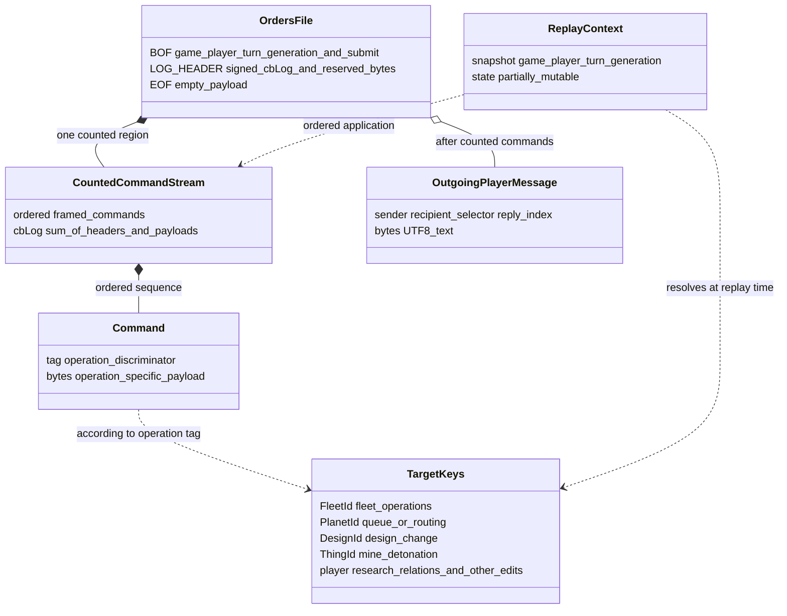

# S01 orders, commands and replay

Part of [S01](S01-game-file-formats.md); byte notation and codecs are in
[Binary records](S01-game-file-records.md). Evidence is
[log.c](../src/core/log.c), especially `WriteMemRt`, `FWriteLogFile`,
`FLoadLogFile`, `FCheckLogFile`, `FRunLogFile` and `FRunLogRecord`, with
[structs.h](../src/core/structs.h) supplying the fixed-width field overlays.

The [Dafny specification](S01-game-file-specification.dfy) formalizes these data and
conditions. [S01 §1.2](S01-game-file-formats.md#12-what-the-formal-model-establishes) maps
each area to its definitions and states the proof boundary. These tables retain
the source evidence and distinguish writer output from observed reader behavior.

[Data-model and relationship diagrams](#data-model-and-relationship-diagrams) provide a visual map.

## Story-linked requirements

This companion supports [S01-US02](S01-game-file-formats.md#s01-us02)
(replay decisions) and [S01-US04](S01-game-file-formats.md#s01-us04)
(strict validation). The direct actors are session/host developers; players and
hosts depend on preserved command order and identity. Entry requires the correct
snapshot/player context and a bounded or historically accepted log as specified.

Workflow: append/coalesce edits according to command-specific rules, serialize
the counted commands and outgoing messages, reload against the correct snapshot,
then replay in order with logging suppressed. Missing/ignored logs differ from
malformed accepted logs; replay aggregates failures and can retain partial effects.
Host-only commands are not automatically applied by desktop replay. Save prompts,
export delivery and host receipt remain M06/M17 responsibilities.

| ID / parent story / status | Acceptance criterion | Rule, evidence and coverage |
| --- | --- | --- |
| S01-ORD-AC01 / US02 / Observed | Given a 200-unit Ironium-only cargo delta, when canonical encoding runs, then use the signed word form, mask 1 and payload length 8, preserving endpoint direction. | [Cargo](#31-cargo-deltas); [orders model](dafny/S01-orders.dfy), existing S01-A vectors and `test_log.c`. Gameplay transfer legality/refunds remain M10/M19. |
| S01-ORD-AC02 / US02 / Observed | Given a failure followed by another command, when replay runs, then attempt both in order and return aggregate failure; repeating replay need not reproduce the same state. | [Replay](#4-identity-replay-and-failure); source `FRunLogFile`, M06 `ReplaySucceeded`; command effects in S01Orders. Model aggregate/source, not a general replay-idempotence proof. |
| S01-ORD-AC03 / US02 / Observed | Given password/template commands, when desktop replay occurs, then generation-only changes remain unapplied; host-generation replay follows the distinct command branch. | [Inventory](#2-complete-current-command-inventory), tags 36/46, S01Orders; `FRunLogRecord`. Selected command tests exist; full command/context product remains uncovered. |
| S01-ORD-AC04 / US04 / Proposed | Given truncated waypoint prefix or incorrect counted-log exhaustion, when a strict decoder validates, then reject before applying it; observed permissive reads stay separately documented. | [Waypoint encoding](#33-waypoint-compression), [strict validation](S01-game-file-validation.md#2-proposed-strict-decoder-contract); S01Orders/S01Files predicates. No complete strict C replay adapter delivered. |

| ID / status | Interaction or quality requirement and check | Owner / gap |
| --- | --- | --- |
| S01-ORD-IR01 / Observed interface | Preserve accepted/ignored/failed distinctions and tell the caller that failure may follow partial state effects. User prompts, keyboard/focus and submission wording follow [M06 requirements](M06-player-session-and-turn-orders.md#user-stories-and-requirements). | S01/M06/M17; no orders-codec viewport or interaction scheme. |
| S01-ORD-QR01 / Observed | Preserve command order, coalescing rules, logging suppression and generation context. Differentially compare replay from equivalent initial snapshots, not by replaying twice into one mutated state. | S01Orders and command tests; no commutativity or transaction guarantee. |
| S01-ORD-QR02 / Open | Measure log/replay cost and allocations for declared command mixes and near/over warning threshold. A 32000-byte warning is not capacity enforcement; agree actual budgets through [S01-QR03](S01-game-file-formats.md#s01-qr03). | M06/S01; hardened limits would require a separate behavior decision. |

The existing inventory remains canonical for payloads and effects; M08–M14 own
edit legality. Acceptance vectors live in the validation companion and retain
their existing IDs. Recovery and stronger malformed-input handling remain open
at the owning session/persistence boundary.

Checks for this story expansion are recorded in the
[collection verification](README.md#story-expansion-verification).

## 1. Envelope and editing state

`.xN` contains BOF, tag 9 LOG_HEADER, `cbLog` bytes of framed commands,
zero or more player messages, then empty EOF. The LOG_HEADER has i16 cbLog
at offset 0 and fifteen reserved bytes at 2–16; the writer zeros reserved bytes.
The log byte count includes command headers. Outgoing player messages are
outside that count and use the state-record message format.

`lpLog` holds framed plaintext commands in memory. `imemLogCur` is its byte
length, `imemLogPrev` the preceding record position, and `hdrPrev` the previous
header. `WriteMemRt` marks the session dirty unless logging is disabled. It
warns when the proposed length exceeds 32000, but does not stop writing solely
because of that warning. This is not a reliable hard input-size guard.

Current UI edits can coalesce a preceding same-fleet/same-index waypoint update,
a preceding relations edit, or a same-planet queue replacement. Consecutive cargo
transfers with identical endpoint classes/IDs are accumulated, the earlier
record canceled, and zero net deltas omitted. Split/merge/transfer ordering must
be retained; commands are not a commutative set.

`FWriteLogFile` may append the changed default production template before writing,
then emits each command using `WriteRt` (individual encryption boundaries),
then outgoing messages and EOF. Successful completion clears dirty and requests
a displayed turn-number update. No checksum authenticates the command sequence.

## 2. Complete current command inventory

Lengths below describe well-formed payloads. Actual enforcement differs by case;
do not infer uniform bounds checks from the table. `idPlayer` is the replaying
player, established by the session/host workflow. Byte offsets start at zero.

| Tag | Payload | Replay effect and observed checks |
| ---: | --- | --- |
| 0 | No command data | No-op if present inside the counted log. File EOF is separate. |
| 1 / 2 / 25 | u16 id1 at 0, u16 id2 at 2, u8 classes at 4 (grobj1 low nibble, grobj2 high), u8 item mask at 5, selected i8/i16/i32 deltas at 6 | Cargo movement; low five mask bits select Ironium/Boranium/Germanium/colonists/fuel in order. Details below. |
| 3 | i16 fleet id at 0, u16 index at 2 | Delete waypoint at index&0x7fff; high bit requests deletion of two entries. Requires existing fleet, positive order count and sufficient entries. |
| 4 | i16 fleet id, i16 insertion index, then ORDER bytes, maximum 22 bytes total | Insert at index 0 through cord; allocate/move following entries. Short form zero-fills omitted ORDER suffix; clears no-auto-track. |
| 5 | Same layout as tag 4 | Replace existing waypoint at index. Short form zero-fills omitted suffix; clears no-auto-track. Current replay's index/length validation is incomplete for malformed negative/truncated inputs. |
| 10 | i16 fleet id, i16 repeat value (4 bytes) | Set one-bit fRepOrders; requires fleet lookup. |
| 11 | i16 fleet id, i16 waypoint index, i16 task (6 bytes) | Set grTask; verifies fleet, index less than cord and task <10, without a complete lower-bound/length validation contract. |
| 23 | u16 id1,id2 at 0,2; packed object classes at 4; unaligned u16 design mask at 5; selected i16 deltas from 7 | Transfer ships between two fleets of the same owner, per slot; rebalance cargo, mark composition changes, delete emptied fleets. |
| 24 | i16 source fleet id (2 bytes) | `LpflNewSplit`; must find source and successfully create split fleet. The returned identity is determined by game allocation, not stored in this command. |
| 27 | u16 change word; optional encoded RTSHDEF | Change word mdChg bits 0–3, player 4–7, design slot 8–12, unused 13–15. Mode 0 deletes (2 bytes), mode 1 installs design at offset 2. Player must equal replay player and be <cPlayer; slot 0–25; cannot replace an in-use design with existing ships. |
| 29 | i16 planet id, then PROD entries (2+4*n bytes) | Replace queue; zero entries clears it. Planet must belong to replay player. Progress is matched against old items, not accepted arbitrarily. |
| 30 | Battle-plan record or two-byte deletion | Player/index validated; ordinary tactic <=6 and target categories <=8; append limited to 16. Valid deletion delegates to `FDeleteBattlePlan`; some invalid deletion targets are ignored successfully. |
| 34 | i8 research percent at 0, packed tech nibbles at 1 (2 bytes) | Percent 0–100; current field 0–5; next field 0–7. Writes PLAYER.pctResearch/iTechCur. RTRESEARCH next nibble is unsigned while PLAYER overlays it as signed. |
| 35 | i16 planet id, u32 packed change (6 bytes) | No-research bit 0, fling target 1–10, fling warp 11–14, route target 15–24, unused 25–31. Requires owned planet; copies these values. |
| 36 | i32 credential hash (4 bytes) | Changes player lSalt only while generating a turn; desktop replay leaves it unchanged. |
| 37 | i16 fleet IDs, even length >=2 | First ID is merge destination. With only that ID, gather all live owned fleets at its location; otherwise resolve listed IDs, mark composition changes and call `FFleetMergeAll`. |
| 38 | i8 relation[cPlayer] | Copies relation values into replay player's array. No comprehensive value/length check in this switch case. |
| 42 | i16 fleet id, i16 plan index (4 bytes) | Looks up fleet and assigns to u8 iplan; no independent plan-range check here. |
| 43 | u16 thing idFull, i16 detonation flag (4 bytes) | Thing must exist and be a minefield; assigns into u8 fDetonate. Does not contain a THING snapshot. |
| 44 | i16 fleet id, i16 object class, encoded name at offset 4 | Bounds/UTF-8 checks through `FReadUserString`; fleet must exist. Frees previous name; empty string clears it. Lookup uses fleet ID rather than dispatching on stored object class. |
| 46 | Prefix of ZIPPRODQ1, at most 26 bytes | Only while generating: reject cb>26, otherwise copy supplied prefix into player's production template. Desktop replay leaves it unchanged. |

Other tags have no switch case and return success without applying a command.
Tag 40 messages are handled by log loading after the counted command bytes;
putting one inside `cbLog` does not make it an outgoing message automatically.
A future implementation should define strict length/domain rejection separately
instead of describing the current fallthrough as validated extensibility.

## 3. Variable encodings

### 3.1 Cargo deltas

For tags 1/2/25, size is `6 + popcount(mask&31)*width`. Positive delta adds to
endpoint 1 and subtracts from endpoint 2; negative reverses direction. Object
classes use planet=1, fleet=2, other=4, thing=8. `grobjOther` means the second
endpoint is absent/space; it is not a missing planet lookup.

`LogMakeValidXfer` chooses width from the largest absolute quantity: <=127 byte,
<=32767 word, otherwise dword. Thus -128 does not get the byte encoding from
this writer even though an i8 can represent it. The presence mask omits zero
quantities. A 200-unit Ironium transfer with no other cargo uses tag 2, mask 1,
length 8, and one little-endian signed word at offset 6.

Replay looks up endpoints. A missing destination fleet belonging to another
player can be ignored rather than fail. `ChgCargo` bounds realizable quantities
and generates shortfall messages. Negative/removal operations run before
positive/addition operations across two passes. During generation, inter-player
colonist drops and transfers accumulate into `COLDROP`/`XFERFULL` for later
resolution. Undelivered amounts are refunded by the existing replay logic;
stealing and hostile transfer handling depend on gameplay ownership/traits.
See `FRunLogRecord` and its unit test for refunds. The persistence contract
preserves exact signed deltas and sequencing; M10/M19 own the movement rules.

### 3.2 Ship deltas

Tag 23 size is `7 + 2*popcount(design_mask)`. Object classes are present in the
packed byte, but replay resolves both IDs as fleets. Counts are signed deltas
for each design slot. Replay rejects differing owners, bounds source/destination
counts in its two-pass transfer, calls `FleetTransferCargoBalance`, commits both
fleets, and deletes one if all counts reach zero. This is a change to ship
composition, not the five-slot cargo transfer above.

### 3.3 Waypoint compression

Tags 4/5 serialize an RTWAYPT with 4-byte fleet/index prefix and 18-byte ORDER,
then trim **all trailing zero bytes from the entire 22-byte structure**. The
writer does not explicitly floor the encoded length at four. Ordinary valid
waypoints retain their prefix due to later nonzero fields. A port must preserve
the zero-extension meaning but explicitly decide how to reject malformed
prefixes rather than inherit unchecked `cb-4` copies. The decoder reconstructs
missing ORDER bytes as zero; it is not nibble text compression.

### 3.4 Queue and design changes

Tag 29 carries only PROD entries after a planet ID. For each incoming nonzero
progress field, replay searches a previous queue item with matching object/item
and nonzero progress, consumes that entitlement, or clears the new progress if
no old item matches. It then replaces the queue.

Tag 27 clears progress of queued items referencing the changed design across
the player's planets before deleting/installing that design. Deletion delegates
to `DestroyAllIshdef`; creation/update uses the same `FReadShDef` repairs as
snapshot loading. Invalid nonzero modes are not a documented extension; some
fallthrough cases can already have changed queue progress. Parsing and applying
this command are not an atomic operation.

## 4. Identity, replay and failure

`FLoadLogFile` clears its in-memory log cursor first. Missing files can return
success with no log. It requires BOF major/minor 2.85, matching game id, equal
turn and generation; older/unrelated files are ignored, future-turn/generation
mismatches report a message and are ignored. It does not itself validate BOF
player/type/signature. Host readiness uses `FOpenFile` through `FCheckLogFile`,
which adds player/turn/submitted checks; library orders import also checks kind,
signature, player membership, game id, turn and wGen before publishing.

The log reader takes cbLog from the next record without requiring literal tag
9/length 17, walks framed records until its running count reaches/exceeds that
value, then consumes player messages and requires EOF. It does not uniformly
validate exact count exhaustion, command sizes or allocation bounds. `FCheckLogFile`
walks structure but does not run every command or prove semantic legality.

`FRunLogFile` sets fLogOff, walks commands in original order and combines all
return values with `&=`. It continues after a failure, then restores fLogOff and
invalidates fleet-link caches. Prior successful effects and partial effects of
a failed command remain. Calling replay twice is not idempotent; transfer,
split and insert commands can apply twice. Always start from the correct saved
snapshot before replay. Higher-level `FLoadGame` failure destroys the loaded
session; direct host replay has its own generation policy.

## 5. Acceptance boundaries

A conforming writer emits correct BOF identity, exact cbLog, legal lengths and
field domains, commands in order, messages outside cbLog, and empty EOF. A port
must test the following separately:

- Exact wire encoding and zero-extension of short waypoint records.
- Replay from equivalent initial state, including generation-only commands.
- Coalescing that preserves resulting state without assuming every command
  commutes with intervening edits.
- Observed permissive reads versus a proposed strict malformed-input policy.
- Failure after partial effects, and the surrounding session's recovery behavior.

Concrete vectors and coverage are in [Validation and acceptance](S01-game-file-validation.md).
No change to log semantics, malformed-input policy or baseline accompanies this
specification.

## Data-model and relationship diagrams

### Orders envelope, counted commands, and replay targets

Source-derived projection rechecked at `7abe8083788d2f991e54eb9fc108a5468f82d2a1`
on 2026-10-25. Trace: [story-linked requirements](#story-linked-requirements),
[envelope](#1-envelope-and-editing-state), [command inventory](#2-complete-current-command-inventory),
[replay boundaries](#4-identity-replay-and-failure),
[canonical specification](S01-game-file-specification.dfy): `FOrdersFor`,
`OrdersData`, `FOrdersFile`; [shared target keys](S06-shared-game-state.md#21-identity-domains-and-adapters).
Evidence: [log.c](../src/core/log.c) `FWriteLogFile`, `FLoadLogFile`,
`FRunLogFile`, `FRunLogRecord`, `WriteMemRt`.

`cbLog` includes each command's two-byte header but excludes BOF, LOG_HEADER,
outgoing messages and EOF. Commands are not a commutative set; adjacent edits
may coalesce before saving. Targets and payloads vary by tag, and replay can
allocate/remap/delete entities, so keys do not promise permanent live references.
`FOrdersFor` is a stronger matching contract than checks in every actual log
reader. A submitted flag does not establish host receipt or successful execution.
Replay tries remaining commands after a false command result and can leave
partial changes; it is not a transaction or generally idempotent. The 32000-byte
warning is not a hard length guard. Unknown/fallthrough tags and strict proposed
validation retain the separate behavior described in §2 and §4.
