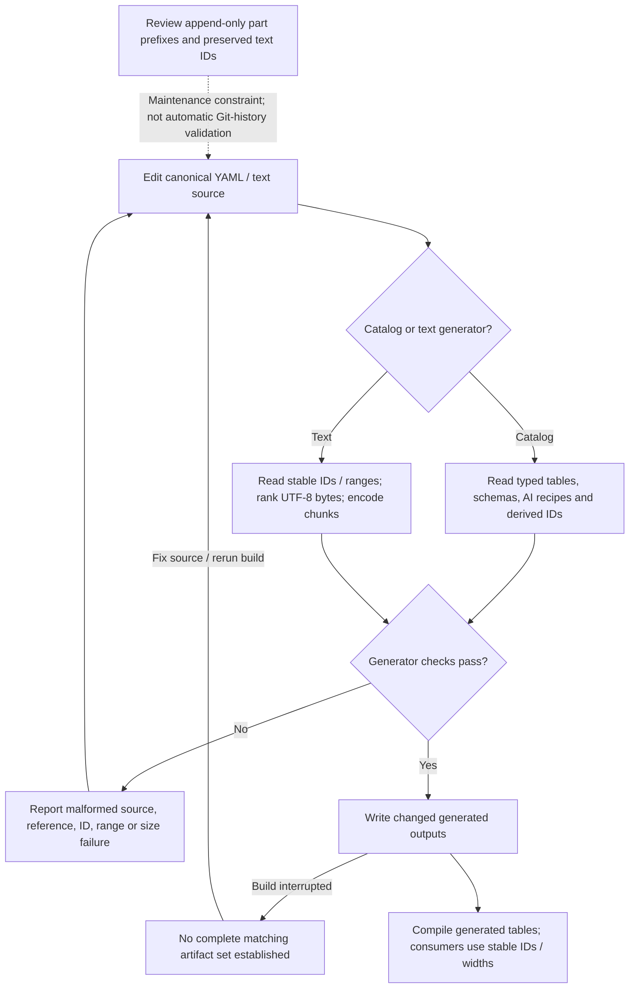
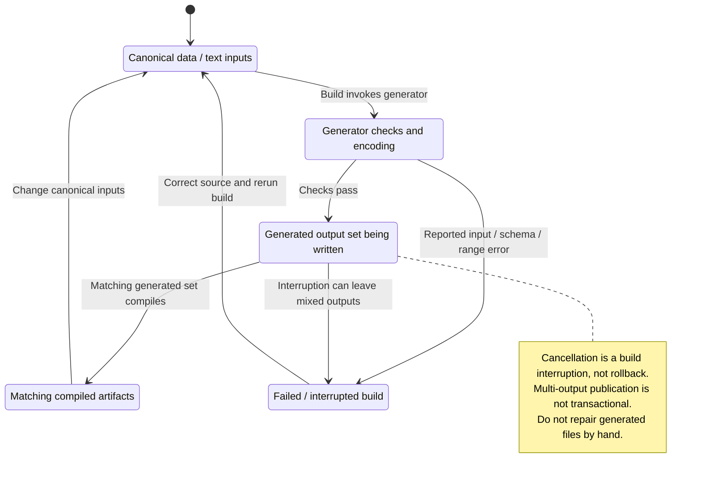

# S03: Static Game Data and Text

Status: source-derived detailed specification; logical ownership is proposed.
Inspected: `e2eae18cff0f990db20415c1c2262aed2022f95b`, 2026-10-24.

Canonical entry: [S03-catalogs-specification.dfy](S03-catalogs-specification.dfy);
[rules and proofs](dafny/S03-catalogs.dfy). Behavior statuses and evidence follow
[the collection conventions](README.md#requirement-ids-and-status).

[Workflow and state diagrams](#workflow-and-state-diagrams) provide a visual reading path.

## 1. Purpose, actors and scope

Define the generated catalog boundary: source schemas, positional identities,
derived fields, text encoding and versioned values. Gameplay modules own effects
and formulas; S01 owns their serialized references, S06 logical entities, M11
part/design calculations and M20 strategy. The accompanying
[catalog inventory](S03-catalog-inventory.md) pins every YAML/text input and its
generator/schema so readers can retrieve exact values without a second divergent
copy. This entry supersedes the map's planned S03 breakdown.

Primary actors: A catalog maintainer and consuming gameplay/UI developers enabling stable player content.

### User stories

These source-derived stories describe intent, not evidence of user research.
The prerequisites and triggers are the corresponding workflows below. All
stories describe Observed capabilities with the stated limitations.

**S03-US01 — Maintain compatible catalogs.** As a maintainer, I want stable hull/part/text identities so that existing saved references keep their meaning.

**S03-US02 — Generate typed data.** As a developer, I want schema-checked generated tables so that invalid catalog edits fail before gameplay uses them.

**S03-US03 — Provide game text.** As a player, I want correctly decoded names, messages and tutorial text so that the UI presents readable content.

**S03-US04 — Reproduce catalog inputs.** As a maintainer, I want exact versioned catalog values and embedded constants identified so that generation and AI behavior can be reproduced.

### Story entry and completion conditions

| Story | Trigger and prerequisites | Completion / alternate outcome |
| --- | --- | --- |
| [S03-US01](#s03-us01) | Edit an existing positional catalog with the prior version available. | Preserve its prefix and arithmetic IDs; review compatibility beyond compilation. |
| [S03-US02](#s03-us02) | Build after YAML/schema changes. | Generate typed data or stop on a validation/compiler error; fix source before rerun. |
| [S03-US03](#s03-us03) | Build/decode text using explicit IDs and declared ranges. | Preserve UTF-8 bytes, ranges and size limits; malformed source fails. |
| [S03-US04](#s03-us04) | Reproduce a catalog-dependent result at a named revision. | Use exact catalog/generator/schema/core references, not YAML alone. |

## 2. Inputs, outputs and state

| Area | Contract |
| --- | --- |
| Source records | Ordered YAML tables with named entries, typed C struct fields and optional omitted-zero values; AI specialized layouts. |
| Generated artifacts | Stable enums/dataids.h, data_tables.c, textids.h and compressed string tables; generated output is derived, not hand-edited. |
| Identity | Part positions and hull IDs reach saved designs; explicit text IDs and arithmetic ranges reach code. |
| Text data | UTF-8 byte strings, ranked byte alphabet, nibble stream and 64-string chunks; decompression remains the S01 codec contract. |

Persistent records remain [S01](S01-game-file-formats.md); logical state and
identity remain [S06](S06-shared-game-state.md). A derived/working value must not
be treated as a separately committed record or as information known to every player.

## 3. Workflows, rules and handoffs

### Tables, schemas and derived fields

[datagen.py](../data/datagen.py) `TABLES` declares 21 ordinary tables: ship/base
hulls, starting designs, 14 equipment families, default plans and predefined/AI
races. `PREFERENCES`, `RESEARCH` and six `RECIPES` describe specialized AI inputs.
The inventory lists actual paths, generated arrays, schemas, counts and hashes.
[structs.h](../src/core/structs.h) and compiler checking establish widths/field
names; omitted fields initialize to zero. Numeric values retain native field
units, with meanings supplied by M04/M08–M12; they are not normalized into a new
unit system. List/map initialization follows the generator's typed layout.

Derived part IDs use `PartId(index)=index+1`; starbase hull indices continue at
32 (`BaseHull`). Hull slot counts, positional plan IDs and derived IDs cannot be
supplied as competing manual fields. Only `f`-prefixed fields accept YAML boolean
values (`BooleanField`); flag-list/C-expression syntax is separately constrained
by the generator. `sz` fields are UTF-8 literals without embedded NUL; generated
size assertions include the terminator (`StringFits`). Nested/indexed arrays,
expression tokens and derived-field validation remain E03-1.

The repository's append-only part policy is `AppendOnly`: preserve the complete
existing prefix when adding entries. `PrefixStable` proves prior indices keep
their values under that condition. This is a maintainer constraint, not a claim
that the generator compares Git history and automatically rejects reordering.
A deletion/reorder therefore requires review even if generated C compiles.

### AI-specific data and embedded constants

AI recipe records are packed slot-preference sequences indexed by named offsets;
optional recipe-index arrays preserve source order. Their fixed padded lengths
are 141/301/182/248/301/85 for Turin Drone/Robotoid/Automitron/Macinti/Cybertron/
starbases. Part preferences preserve run lengths and the 150-entry storage shape.
Research orders pack `(field << 5) | level`, using Energy, Weapons, Propulsion,
Construction, Electronics and Biotechnology order. E03-1 covers validation of
references, slot shapes, counts and padding. M20 chooses among these values;
S03 does not assign strategic meaning independently.

YAML/text are not the entire simulation input. The inventory also locates
embedded research costs, race pricing, mineral/minefield, movement, combat and
creation tables. Their values are pinned by source revision/hash; the consuming
module owns operation order and contextual interpretation. S03 supplies identity
and provenance, not another combat/growth/research formula.

### Text generation and runtime consumption

[textgen.py](../text/textgen.py) reads strings, messages, tutorial and planet
names. Explicit IDs increase, gaps remain empty and `@range` checks consecutive
IDs (`Consecutive`). Never renumber a removed text row; preserve arithmetic
ranges used by code. The encoder ranks UTF-8 bytes by frequency, ties by byte
value, encodes rank as repeated 15 nibbles plus remainder (`Nibbles`), and groups
64 entries (`TextChunk`/`TextOffset`). Encoded lengths must fit 255 nibbles
(`TextLength`) and chunk offsets the source 0x7fff limit. S01's codec owns runtime
nibble decode, not a duplicated algorithm here. The catalog's encoding is not a
license to truncate inside a UTF-8 code point.

Generation reports malformed source, invalid references, duplicate/out-of-order
IDs and range/size failures. Outputs are written only when changed; multi-output
interruption is not a transactional publish contract. Fix the source and rerun
the build to recover; do not patch generated files. Cancellation during build
means no claim of a complete matching artifact set. Runtime lookup bounds,
format placeholders and all font/render behavior remain explicit E03-2/E03-3
obligations, especially arithmetic lookups not covered by a named range.

## 4. Acceptance and traceability

All criteria below have **Observed** behavior status except where a rule is
explicitly a caller convention or repository maintenance constraint. A named
model/lemma supplies mathematical evidence within its preconditions. An E-boundary
supplies source evidence and an explicit implementation-test/refinement gap,
not a proved runtime outcome. The dated collection run records actual checks.

| Criterion / story | Given / When / Then | Authoritative rule, source and evidence scope |
| --- | --- | --- |
| **S03-AC01** / [S03-US01](#s03-us01) | Given an existing catalog prefix, when adding a compatible entry, then every old position retains its value. | `AppendOnly`, `PrefixStable`; repository append-only policy |
| **S03-AC02** / [S03-US01](#s03-us01) | Given an initial part index zero, when deriving its saved ID, then use 1; first base hull uses 32. | `PartId`, `BaseHull`, vectors |
| **S03-AC03** / [S03-US02](#s03-us02) | Given a boolean value for a non-f-prefixed field, when validating data, then reject it. | `BooleanField`; datagen value validator |
| **S03-AC04** / [S03-US02](#s03-us02) | Given a UTF-8 string using capacity bytes before its terminator, when checking the generated field, then reject the overflow. | `StringFits`, vectors; generated static assertions |
| **S03-AC05** / [S03-US03](#s03-us03) | Given ID 65, when selecting text chunk/offset, then use chunk 1 and offset 1. | `TextChunk`, `TextOffset`, vectors |
| **S03-AC06** / [S03-US03](#s03-us03) | Given ranked byte 30, when nibble-encoding it, then emit 15,15,0. | `Nibbles`, vectors; S01 decode |
| **S03-AC07** / [S03-US03](#s03-us03) | Given encoded length 256 or a broken declared arithmetic range, when validating text, then reject the input. | `TextLength`, `Consecutive`; E03-2 parser |
| **S03-AC08** / [S03-US04](#s03-us04) | Given a catalog-dependent behavior comparison, when identifying inputs, then include generator/schema and embedded-constant versions as well as YAML/text. | S03 inventory; E03-3 |

## 5. Interaction and quality requirements

**S03-IR01 — Caller and interaction requirement (Proposed).** The caller interface is generated IDs/tables and build errors. M11/M15/M16 own equipment browsers, messages and tutorial presentation. Human-readable diagnostics for malformed data are Observed in tooling; localization, screen-reader reading and display/font coverage remain Open with S05.

**S03-IR02 — Feedback and recovery (Proposed).**
Use the success, no-change, cancellation and failure distinctions in §3. The
owning caller must not imply that a forecast, accepted request or attempted write
is a confirmed final result. Section 3 records current outcomes and their limitations; this requirement does
not establish implementation. Complete keyboard/focus/error-announcement acceptance remains Open with the
caller and S05. No accessibility conformance level is asserted.

**S03-QR01 — Integrity and compatibility (Observed constraints).**
Preserve all IDs, byte budgets and deterministic generation. A successful compile does not prove old positions retain meaning. Record generator/source versions for reproducibility; exact text layout and translation targets remain Open rather than inferred from UTF-8 support.

Scenario/check: source/model boundary review and the native regression/build
checks below. Target: preserve the specified existing results and file/catalog
contracts; any intentional runtime change is separate work. Evidence: named
definitions, source pointers and dated checks; uncovered adapters are in §6.

**S03-QR02 — Performance and resource budgets (Open).**
Scenario: the largest supported workload for these workflows on each supported
backend. Method: measure wall time, peak allocation and caller-visible response
time with controlled inputs. Target: no agreed numeric budget or new measurement
in this specification batch. Owner: S03 and the consuming module/platform owner;
absence of a budget does not establish responsiveness.

**S03-QR03 — Text and presentation (Observed boundary / Open qualification).**
Use UTF-8 byte capacities and complete-code-point truncation from
[S04](S04-platform-services.md) and [Unicode boundaries](../docs/UNICODE-BOUNDARIES.md).
Native controls and rendering use [S05](S05-sdl-desktop-implementation.md);
headless/internal APIs have no independent viewport. Check non-ASCII boundary
inputs and the actual caller on supported displays. Target: valid text and the
stated capacities; complete font, large-text, IME and assistive-technology coverage
remains Open with S05 and the caller.

## 6. Coverage inventory and open decisions

The definitions named in §§3–4 are canonical for their stated projections.
The following inventory accounts for rules requiring native inputs/effects or
further decomposition; it is not a claim that their algorithms are proved.

| Boundary | Scope and limitation | Owner / next evidence or decision |
| --- | --- | --- |
| E03-1 | YAML parsing, full C schema/type/layout validation, symbolic expressions, specialized recipe references/packing and generated compiler checks are build adapters. Prefix preservation is a reviewed policy, not an implemented history check. | S03/M11/M20; generator negative fixtures, compiled-table checks and compatibility review. |
| E03-2 | Text parsing, rank-frequency construction, chunk byte alignment/offsets, format placeholder agreement, range declarations and runtime table loading are generator/codec adapters. | S03/S01/M15/M16; round-trip and malformed/range/Unicode fixtures. |
| E03-3 | Embedded constants and every catalog value are versioned source dependencies; hashes prove identity, not semantics or gameplay balance. Fonts/render/localization and complete catalog-consumer coverage are not proved. | S03/gameplay/S05; source-manifest review and consuming-module fixtures. |

## 7. Evidence and verification

[data generator](../data/datagen.py), [text generator](../text/textgen.py), [runtime strings](../src/core/strings.c), [schemas](../src/core/structs.h), [catalog inventory](S03-catalog-inventory.md), and [game text boundaries](../docs/UNICODE-BOUNDARIES.md). Generated tables are checked by the normal build; formal witnesses cover selected mapping/size contracts.

[Collection verification](README.md#remaining-specifications-verification)
records exact commands and outcomes for this batch. Proofs establish only the
named model properties and witnesses, with their preconditions; they do not prove
that C refines the models or that every UI/platform workflow has been tested.
The boundary inventory and Open interaction/quality requirements remain visible
after a successful formal/build/regression run.

## Workflow and state diagrams

These reading projections summarize [Catalog schemas and stable IDs](#tables-schemas-and-derived-fields), [Text generation and failure](#text-generation-and-runtime-consumption) and the
[canonical contracts](S03-catalogs-specification.dfy) at the inspection revision recorded above.
States are explanatory milestones, not new persisted fields or a claim of
complete C/model refinement. Terminal nodes end the illustrated operation.

### Workflow

### State and recovery

The diagrams show generator/build milestones, not a proof of every schema, parser or runtime formatting rule. Source hashes establish provenance. Append-only IDs require review even when generation and compilation succeed.
