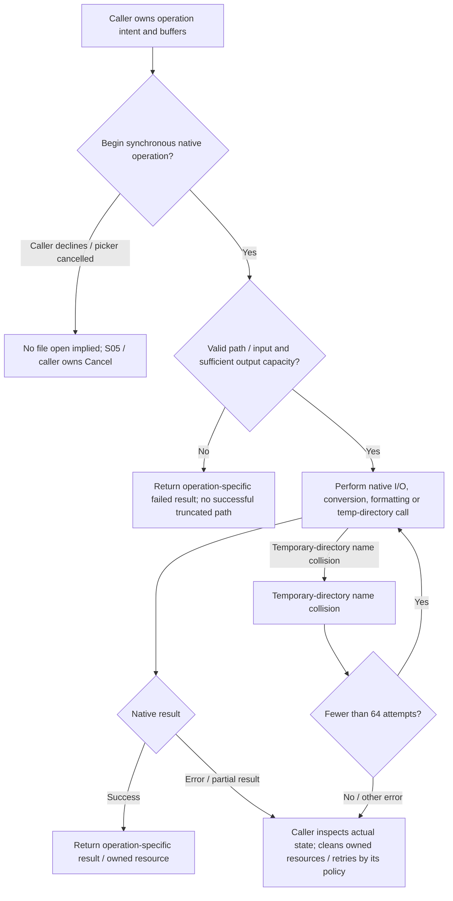
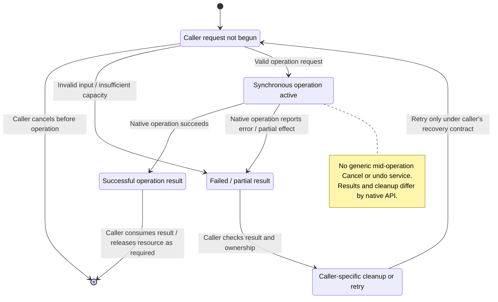

# S04: Platform Services

Status: source-derived detailed specification; logical ownership is proposed.
Inspected: `e2eae18cff0f990db20415c1c2262aed2022f95b`, 2026-10-24.
Integer-format continuation: `e3222eb1fbdb01d68067231b5d5ef14a71759b30`, 2026-10-27.

Canonical entry: [S04-platform-specification.dfy](S04-platform-specification.dfy);
[rules and proofs](dafny/S04-platform.dfy). Behavior statuses and evidence follow
[the collection conventions](README.md#requirement-ids-and-status).

[Workflow and state diagrams](#workflow-and-state-diagrams) provide a visual reading path.

## 1. Purpose, actors and scope

Provide the native service boundary without exposing operating-system APIs to
game rules. S01 owns save files and import/export semantics; S02 owns preference
location policy; S05 owns desktop handles/rendering. This entry complements the
existing [arithmetic contracts](dafny/S04-arithmetic.dfy), reuses S01 encoding
contracts and records native adapters. The host uses these services without SDL;
platform equivalence is scoped to verified/tested behaviors, not assumed.

Primary actors: Core/UI developers and operators needing portable file, text, arithmetic and clock behavior.

### User stories

These source-derived stories describe intent, not evidence of user research.
The prerequisites and triggers are the corresponding workflows below. All
stories describe Observed capabilities with the stated limitations.

**S04-US01 — Use portable files.** As a developer, I want consistent file/path operations so that desktop and host handle the same valid files.

**S04-US02 — Preserve text safely.** As a player, I want names and paths kept as valid UTF-8 so that non-ASCII text survives loading and display.

**S04-US03 — Preserve native calculations.** As a maintainer, I want sorting, formatting and arithmetic boundaries explicit so that portability changes do not silently alter turns.

**S04-US04 — Handle service failure.** As an operator, I want failed file/temp/buffer operations reported accurately so that callers can recover without invented success.

### Story entry and completion conditions

| Story | Trigger and prerequisites | Completion / alternate outcome |
| --- | --- | --- |
| [S04-US01](#s04-us01) | Call native filesystem/file APIs with nonempty UTF-8 paths and owned buffers. | Return actual operation/output or failure; caller owns transaction recovery. |
| [S04-US02](#s04-us02) | Convert/copy/format bounded text. | Preserve valid complete code points and terminator capacity, or report failure. |
| [S04-US03](#s04-us03) | Sort, round or read clock values through native services. | Retain documented order/width/rounding semantics; timer callers own wrap interpretation. |
| [S04-US04](#s04-us04) | Encounter collisions, permissions, allocation or buffer failure. | Return bounded failure without claimed success; cleanup/retry belongs to the caller. |

## 2. Inputs, outputs and state

| Area | Contract |
| --- | --- |
| Paths and files | Strict nonempty UTF-8 input paths, caller-owned output buffers, modes/handles and operation-specific failure results. |
| Text | UTF-8 bytes, optional UTF-16/legacy conversion, formatted buffers and byte-safe prefixes. |
| Numeric services | Fixed-width clock readings, qsort16 comparator/order and LMulDiv/signed/binary64 boundaries. |
| External state | Filesystem permissions, existence/races, current directory, temporary locations, OS errors and resource availability. |

Persistent records remain [S01](S01-game-file-formats.md); logical state and
identity remain [S06](S06-shared-game-state.md). A derived/working value must not
be treated as a separately committed record or as information known to every player.

## 3. Workflows, rules and handoffs

### Files and paths

[filesystem.h](../src/platform/filesystem.h) defines a C ABI over
[filesystem.cpp](../src/platform/filesystem.cpp). Paths are strict nonempty UTF-8;
output buffers are caller-owned, non-aliasing and initialized empty for failed
output operations. The contract never silently truncates a successful path.
`PathFits` describes valid nonempty text fitting with a terminator. Returned paths
use generic `/` separators. `DirectoryChanged` distinguishes a successful actual
create/remove from no change or an error; remove is not recursive. File open/read/
write/seek/close wrappers in [native.cpp](../src/platform/native.cpp) retain native
modes and caller-visible errors (E04-1), not S01-level transaction guarantees.

Temporary directory creation canonicalizes the temp base and tries up to 64
names using a `stars-` prefix and 32 hexadecimal random digits. Capacity is checked
before creating; name collisions retry, other errors fail; exceptions do not
escape the C interface. `Attempts` specifies the retry cap, not OS randomness or
race-free behavior of every filesystem call. Callers must handle false/error
results, clean up owned resources and apply their own rollback policy.

### Encoding and formatting

The [byte-level prefix model](dafny/S04-utf8-prefix.dfy) supplies `Count`,
`Prefix` and `PrefixValid` for the native prefix routine, including malformed
suffix and NUL stopping. S02 consumes it for exact profile buffer accounting;
`Utf8Copy` below remains the separate reject-on-insufficient-capacity projection.

[encoding.cpp](../src/platform/encoding.cpp) rejects malformed UTF-8, overlong forms,
surrogates, values above U+10FFFF and embedded NUL for the bounded validation API.
`Utf8Copy` classifies zero capacity/insufficient capacity as too small, malformed
input as invalid, and otherwise successful copy. Native return codes and empty
output behavior remain in the adapter; the model receives the validity result.
UTF-16 surrogate and legacy CP1252 conversions reuse S01's byte/character rules.
Text lengths count bytes; `CchUtf8Prefix` preserves complete code points.

`CchSprintf` strips the legacy `l` modifier on the supported integer formats,
formats into the bounded 1024-byte path and keeps at most 1023 bytes at a UTF-8
boundary. Allocation failure produces empty text/zero length. Full printf
formatting, varargs widths and all malformed-format behavior remain E04-2;
this is not an unrestricted safe-format verifier.

### Arithmetic, ordering and clock

`qsort16` preserves the reconstructed comparator/tie behavior, including its
initial sorted fast path and partition strategy. It is not a stable-sort promise,
and replacing it with platform qsort can change results. `LMulDiv` uses widened
intermediates and half-away rounding, with source error/sentinel behavior; the
existing S04 arithmetic model remains canonical for its safe input domain.
Extreme signed-negation/overflow cases require the native-domain audit E04-3.
Binary64 boundaries remain those documented in [DOUBLE-PRECISION](../docs/DOUBLE-PRECISION.md).

`DwTickCount` supplies a wrapping 32-bit clock value. `TickDelta` defines modulo
2^32 elapsed subtraction as a caller convention; it is not a claim that every
current timer caller uses that convention or can measure multiple wraps.
OS clock choice/resolution and clock failure behavior remain E04-3. Core game
randomness is S06, not the temporary-name randomness used by filesystem services.

### Failure and cancellation

These are synchronous operations with operation-specific results. A caller can
choose not to begin; once an operation reports a partial/error result, it must
use its own state/files to decide cleanup or retry. There is no generic service
Cancel/undo contract. S01 owns game-save recovery and S05 picker cancellation;
receiving an empty picker result is different from successfully opening an empty
filename. Invalid paths and insufficient buffers must remain failed outcomes.

## 4. Acceptance and traceability

All criteria below have **Observed** behavior status except where a rule is
explicitly a caller convention or repository maintenance constraint. A named
model/lemma supplies mathematical evidence within its preconditions. An E-boundary
supplies source evidence and an explicit implementation-test/refinement gap,
not a proved runtime outcome. The dated collection run records actual checks.

| Criterion / story | Given / When / Then | Authoritative rule, source and evidence scope |
| --- | --- | --- |
| **S04-AC01** / [S04-US01](#s04-us01) | Given an empty or malformed path, when validating a filesystem request, then reject it. | `PathFits`; E04-1 validation adapter |
| **S04-AC02** / [S04-US01](#s04-us01) | Given an existing directory, when create reports no change, then do not claim a newly created directory. | `DirectoryChanged`; filesystem API |
| **S04-AC03** / [S04-US02](#s04-us02) | Given valid UTF-8 using all capacity bytes, when copying with a required terminator, then report too small. | `Utf8Copy`, vectors |
| **S04-AC04** / [S04-US02](#s04-us02) | Given malformed UTF-8 and positive capacity, when copying, then report malformed input. | `Utf8Copy`; E04-2 decoder |
| **S04-AC05** / [S04-US03](#s04-us03) | Given a clock wrapping from 4294967290 to 5, when using modulo elapsed subtraction, then obtain 11 ticks. | `TickDelta`, vectors; caller convention |
| **S04-AC06** / [S04-US03](#s04-us03) | Given equal comparator results, when sorting, then preserve the qsort16 algorithm’s outcome rather than assuming stability. | E04-3; qsort16; regression |
| **S04-AC07** / [S04-US04](#s04-us04) | Given 64 temp-name collisions, when attempting creation, then fail after the bounded attempts without claiming a directory was created. | `Attempts`; E04-1 native loop |
| **S04-AC08** / [S04-US03](#s04-us03) | Given a NUL-free literal/%d/%% template shorter than 256 bytes, one promoted signed-32 integer and output fitting the actual destination and formatter limit, preserve decimal sign/digits and literal percent bytes. Distinguish another conversion from a second absent argument. | `S04IntegerFormat.Format`, `DecimalTemplate`, `CallDomain`, `Fits`; [helper contract](S03-player-labels-and-race-titles.md#m04-preset-plural-and-title-handoffs) and actual CchSprintf/wsprintfA cases. Full formatting grammar/failure/truncation remains E04-2. |

## 5. Interaction and quality requirements

**S04-IR01 — Caller and interaction requirement (Proposed).** This is a developer-facing C interface with return values and caller-owned buffers; no direct focus or viewport applies. Callers own accessible error messages and file dialogs. Unicode text must stay valid through S05, while native picker/IME/display qualification remains Open there.

**S04-IR02 — Feedback and recovery (Proposed).**
Use the success, no-change, cancellation and failure distinctions in §3. The
owning caller must not imply that a forecast, accepted request or attempted write
is a confirmed final result. Section 3 records current outcomes and their limitations; this requirement does
not establish implementation. Complete keyboard/focus/error-announcement acceptance remains Open with the
caller and S05. No accessibility conformance level is asserted.

**S04-QR01 — Integrity and compatibility (Observed constraints).**
Preserve byte capacities, complete UTF-8 prefixes, fixed-width semantics and sort/floating boundaries. Failures must remain distinguishable from success/no change. Platform timing, I/O throughput and full OS equivalence require measured fixtures; no universal latency budget is asserted.

Scenario/check: source/model boundary review and the native regression/build
checks below. Target: preserve the specified existing results and file/catalog
contracts; any intentional runtime change is separate work. Evidence: named
definitions, source pointers and dated checks; uncovered adapters are in §6.

**S04-QR02 — Performance and resource budgets (Open).**
Scenario: the largest supported workload for these workflows on each supported
backend. Method: measure wall time, peak allocation and caller-visible response
time with controlled inputs. Target: no agreed numeric budget or new measurement
in this specification batch. Owner: S04 and the consuming module/platform owner;
absence of a budget does not establish responsiveness.

**S04-QR03 — Text and presentation (Observed boundary / Open qualification).**
Use UTF-8 byte capacities and complete-code-point truncation from
[S04](S04-platform-services.md) and [Unicode boundaries](../docs/UNICODE-BOUNDARIES.md).
Native controls and rendering use [S05](S05-sdl-desktop-implementation.md);
headless/internal APIs have no independent viewport. Check non-ASCII boundary
inputs and the actual caller on supported displays. Target: valid text and the
stated capacities; complete font, large-text, IME and assistive-technology coverage
remains Open with S05 and the caller.

## 6. Coverage inventory and open decisions

The definitions named in §§3–4 are canonical for their stated projections.
The following inventory accounts for rules requiring native inputs/effects or
further decomposition; it is not a claim that their algorithms are proved.

| Boundary | Scope and limitation | Owner / next evidence or decision |
| --- | --- | --- |
| E04-1 | Actual filesystem/open modes, path canonicalization, OS errors, temp randomness/races, permissions, handles and cleanup are native adapters. The predicates classify supplied outcomes, not external effects. | S04/S01/S02; filesystem tests and platform/fault matrix. |
| E04-2 | Full UTF-8/UTF-16/CP1252 decoding and formatting/varargs/error returns are native implementations of shared byte/text contracts. Prefix truncation now has a byte-level checked model and linked production witnesses; complete caller mapping and cross-platform runtime evidence remain open. | S04/S01/S05; encoding and formatter boundary fixtures. |
| E04-3 | qsort16 implementation refinement, extreme native integer domains, binary64 rounding, actual clocks and wrap handling by each caller remain external obligations. | S04/S06/gameplay; arithmetic/sort tests, cross-platform regression and clock-boundary qualification. |

## 7. Evidence and verification

[native services](../src/platform/native.cpp), [filesystem API](../src/platform/filesystem.h), [encoding](../src/platform/encoding.cpp), [filesystem tests](../tests/compat/filesystem.cpp), [encoding tests](../tests/unit/test_encoding.cpp), and [Unicode contract](../docs/UNICODE-BOUNDARIES.md). No filesystem safety or cross-platform guarantee is inferred merely from mathematical predicates.

[Collection verification](README.md#remaining-specifications-verification)
records exact commands and outcomes for this batch. Proofs establish only the
named model properties and witnesses, with their preconditions; they do not prove
that C refines the models or that every UI/platform workflow has been tested.
The boundary inventory and Open interaction/quality requirements remain visible
after a successful formal/build/regression run.

## Workflow and state diagrams

These reading projections summarize [Native paths and file results](#files-and-paths), [Failure and cancellation ownership](#failure-and-cancellation) and the
[canonical contracts](S04-platform-specification.dfy) at the inspection revision recorded above.
States are explanatory milestones, not new persisted fields or a claim of
complete C/model refinement. Terminal nodes end the illustrated operation.

### Workflow

### State and recovery

The input gate is a contract projection for the relevant API, not a claim that every native wrapper runs one shared validator. Empty picker results are not valid empty filenames. Sort/rounding/clock boundaries retain their own exact contracts; no new arithmetic or filesystem guarantee is introduced.

### Race filename-prefix adapter evidence

The [M02 state companion](M02-native-state-and-save.md) reuses canonical
S04Utf8Prefix Count/Prefix for the fifteen-byte legacy cache and 255-byte UI
suggestion, including malformed-input stopping and preserved unused buffer
tails. Actual encoding/SetSzRaceFile bodies are compared with an independent
maximal-valid-prefix oracle in the race workflow fixture. This supplements
existing prefix contracts without replacing them or qualifying every native
path/Unicode comparison/OS backend. See the [continuation evidence](README.md#m02-native-state-version-and-save-continuation).

The [M02 allocation companion](M02-race-file-allocation.md) specifies its callers'
1000-attempt temporary-name loops, unsigned tick/counter text, 239-byte UTF-8
suggestion cut and open/copy/cleanup receipts. Native controller fixtures check
names and call order; real-stdio cases distinguish `wb` self-truncation from
`wbx` collision protection and expose read/write/close/cleanup failures. These
are caller contracts and selected native evidence, not closure of E04-1's actual
OS/path/concurrency domain. GAP-22's missing final suggestion budget belongs to
M02 with S04/S05 qualification; it adds no generic platform guard.

The [M02 file-action companion](M02-race-file-actions.md) composes those receipts
with Duplicate/Export/Delete and separates a local failed replacement from the
whole export's effects. GAP-23 retains literal destination/temporary equality:
exclusive creation may already have changed an initially absent destination.
Its returning-service source fixture does not close native path aliases,
concurrency, picker ABI or the complete filesystem error matrix in E04-1.

The [M02 import companion](M02-race-import.md) now composes stage/copy/save with
source/name choice and customization wrappers. Current import publishes before
the second parser call, and ordinary FALSE can retain a target when removal
fails. Logical hf closure remains distinct from physical descriptor release.
Full native decoder/BOF/credential, UI and filesystem refinement remains with
S01/S04/S05; these controller receipts are not an atomicity/durability guarantee.
