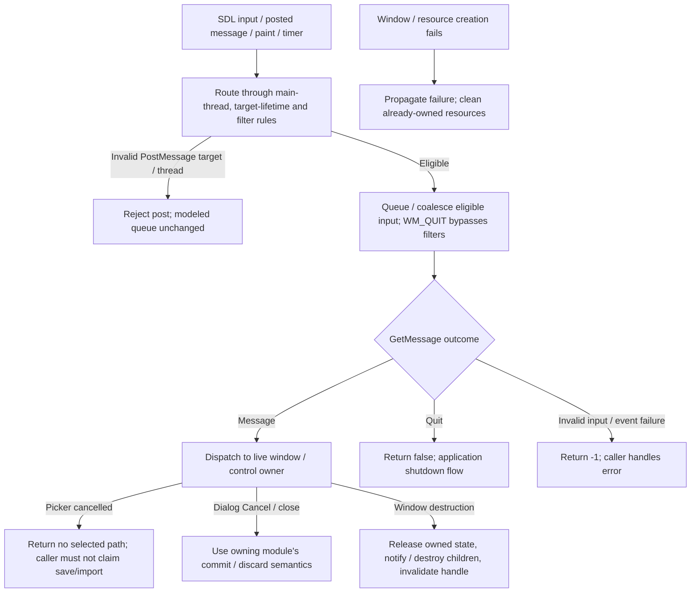
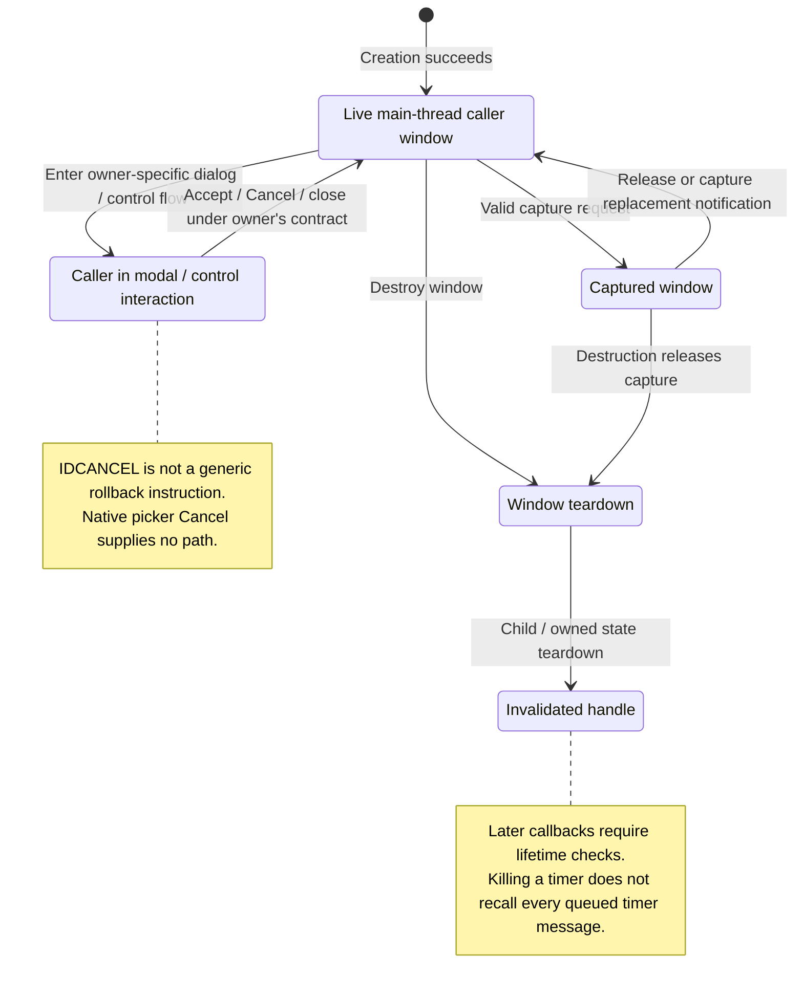

# S05: SDL Desktop Implementation

Status: source-derived detailed specification; logical ownership is proposed.
Inspected: `e2eae18cff0f990db20415c1c2262aed2022f95b`, 2026-10-24.

Canonical entry: [S05-desktop-specification.dfy](S05-desktop-specification.dfy);
[rules and proofs](dafny/S05-desktop.dfy). Behavior statuses and evidence follow
[the collection conventions](README.md#requirement-ids-and-status).

[Workflow and state diagrams](#workflow-and-state-diagrams) provide a visual reading path.

## 1. Purpose, actors and scope

Implement the desktop facilities actually consumed by SDL-Stars on supported
platforms: windows, controls, events, drawing, text, dialogs and desktop services.
This is the SDL-backed interface on every platform, not a maintained separate
native Win32 client and not a promise of full Win32 compatibility. Core logic
uses ui.h; the command-line host is independent of SDL. M01–M16 own user workflows,
S02 preferences, S04 native text/files and S03 resources/text. See the
[SDL development guide](../docs/SDL3-DEVELOPMENT.md) for implementation context.

Primary actors: A desktop player and UI developers using the SDL-backed Win32 compatibility interface.

### User stories

These source-derived stories describe intent, not evidence of user research.
The prerequisites and triggers are the corresponding workflows below. All
stories describe Observed capabilities with the stated limitations.

**S05-US01 — Interact with desktop windows.** As a player, I want mouse and keyboard actions delivered to the intended control so that dialogs and map actions work consistently.

**S05-US02 — Receive responsive updates.** As a player, I want input, paint and timer activity handled without losing meaningful actions so that the desktop stays usable.

**S05-US03 — Use desktop facilities.** As a player, I want text, images, menus and native dialogs rendered and operated correctly so that the game is readable and controllable.

**S05-US04 — Release desktop resources.** As a developer, I want window/timer/resource lifetimes enforced so that closing or failing a workflow does not leave stale callbacks or handles.

### Story entry and completion conditions

| Story | Trigger and prerequisites | Completion / alternate outcome |
| --- | --- | --- |
| [S05-US01](#s05-us01) | Deliver/post input with a valid desktop thread, hierarchy and target. | Route to the eligible control or reject; preserve meaningful event ordering. |
| [S05-US02](#s05-us02) | Pump messages/paint/timers with eligible queue/filter state. | Coalesce only allowed motion, deliver paint/timers in source priority and avoid duplicate pending ticks. |
| [S05-US03](#s05-us03) | Open/render/use a control or platform facility on a supported backend. | Return the real result or cancellation/error; visual/accessibility qualification remains separate. |
| [S05-US04](#s05-us04) | Destroy a window/timer/resource or unwind creation failure. | Enforce source lifetime checks and cleanup; already queued callbacks require care. |

## 2. Inputs, outputs and state

| Area | Contract |
| --- | --- |
| Window state | Live/destroying handles, parent/child hierarchy, focus, capture, visibility, invalid regions and control-specific storage. |
| Messages | Queued target/code/parameters, input provenance, filtering, quit and synchronous callback state. |
| Timers | Window/thread identity, interval, next due time and whether a timer message is already queued. |
| Resources | GDI-like DC/bitmap/font/palette ownership, SDL renderer/window, menus/dialogs, native picker/help/printing adapters. |

Persistent records remain [S01](S01-game-file-formats.md); logical state and
identity remain [S06](S06-shared-game-state.md). A derived/working value must not
be treated as a separately committed record or as information known to every player.

## 3. Workflows, rules and handoffs

### Message delivery and filtering

[message.c](../compat/win32/src/message.c) accepts `PostMessageA` only from the
main thread and for a live window or a thread message (`CanPost`). Worker work
uses the SDL event bridge; it must not bypass lifetime validation. `Motion`
coalesces consecutive input mouse-move messages only when target, message code
and key/button state match. An intervening key/button/posted message or changed
modifier prevents this coalescing. The model consumes the already classified
input provenance and requires an input message; a non-main-thread attempt leaves
the projected queue unchanged. Live-target validation/routing from native events
remain E05-1.

`Matches` preserves WM_QUIT bypassing filters; other messages require a matching
window/hierarchy and requested range (0,0 means all). Actual hierarchy and
thread-only `hwnd=-1` classification are adapter inputs. `PeekMessageA` first
routes available SDL events, checks queued non-timers, then paint, flushes present,
generates timers and checks the timer-inclusive queue. `GetMessageA` returns false
for quit, -1 for invalid input/event failure, otherwise waits for an eligible
message. Do not treat every false/negative result as an ordinary empty queue.

### Timers, capture, focus and destruction

[timer.c](../compat/win32/src/timer.c) clamps intervals to 10–2147483647 ms
(`TimerPeriod`), gives thread timers their own IDs and keeps at most one pending
message per timer. `Due` requires the timer to be due, eligible for the filter
and not already queued. The next due time advances from dispatch/generation time,
not by replaying every missed tick. Killing a timer removes its registration;
it does not imply an already queued message has been recalled. Window teardown
and handler checks must account for that lifetime distinction (E05-2).

Capture is restricted to valid live main-thread windows; replacement notifies
the old capture target with WM_CAPTURECHANGED. Logical capture routing persists
in a dummy backend even when SDL native capture is unavailable. Destruction
releases capture, sends destruction notifications, destroys children and purges
window-owned state according to the implementation. Focus, modal loops, tab/default
button navigation, IME and native window events remain E05-1/E05-2 rather than a
claim of identical behavior across all backends.

### Desktop facility ownership inventory

| Facility | Implementation surface | Boundary / consumer |
| --- | --- | --- |
| Window hierarchy, dispatch, invalidation and focus | compatibility window/message/event code | E05-1/E05-2; every desktop module |
| Dialogs and controls | dialog, edit, list/combo, buttons, scrolling and message-box code | E05-1/E05-3; M01–M16 |
| GDI-like drawing, DCs, bitmap/palette/font and text | compatibility rendering/resource code | E05-3; M07/M11/M14/M15 |
| Menus, accelerators, keyboard and clipboard | compatibility input/menu/clipboard code | E05-1/E05-3; desktop command routing |
| File pickers and platform dialogs | native backends and compatibility fallback | E05-3; S04 paths/M01/M02/M06 |
| Browser help and tutorial assets | help adapter | M16 owns content/open outcome; E05-3 render |
| Printing and other desktop services | compatibility platform-specific adapters | E05-3; caller reports/feedback |
| Profile settings | compatibility profile implementation | S02 owns policy; S04 paths/text |
| Application startup/shutdown and headless separation | compatibility startup, ui.h, hostui.c | E05-2; host must remain SDL-independent |

These are bounded compatibility implementations. Unsupported APIs/flags require
an explicit call-site decision; successfully linking a stub is not evidence of
full Windows behavior. Native file-picker cancellation produces no selected
path and must not become a save/import success. Text uses S04 UTF-8 byte limits;
editing, selection, glyph rendering and clipboard conversion must be tested at
the actual control boundary.

### Failure, cancellation and qualification

A module's Cancel action belongs to that module: some game dialogs commit on
close, so S05 must not invent rollback from IDCANCEL. Failed window/resource
creation must be propagated to the caller with cleanup of resources already
owned. Closing a window invalidates its handle and queued/later callbacks need
the implementation's lifetime checks; `CanPost` alone does not prove all callback
paths safe. Dummy-SDL tests exercise logic but do not qualify native font metrics,
IME, accessibility, display scaling, native dialogs, printing or compositor
behavior. Those remain explicit E05-3 tasks, not implicit passes.

## 4. Acceptance and traceability

All criteria below have **Observed** behavior status except where a rule is
explicitly a caller convention or repository maintenance constraint. A named
model/lemma supplies mathematical evidence within its preconditions. An E-boundary
supplies source evidence and an explicit implementation-test/refinement gap,
not a proved runtime outcome. The dated collection run records actual checks.

| Criterion / story | Given / When / Then | Authoritative rule, source and evidence scope |
| --- | --- | --- |
| **S05-AC01** / [S05-US01](#s05-us01) | Given a worker thread or destroyed target, when posting through PostMessageA, then reject the request. | `CanPost`; E05-1 actual handle/thread classification |
| **S05-AC02** / [S05-US01](#s05-us01) | Given WM_QUIT outside the requested window/message range, when filtering, then still return it. | `Matches`, vectors |
| **S05-AC03** / [S05-US02](#s05-us02) | Given two consecutive mouse moves with the same target and keys, when coalescing input, then keep the latest position. | `Motion`, `MotionSize`, vectors |
| **S05-AC04** / [S05-US02](#s05-us02) | Given changed mouse keys or an intervening non-input event, when queuing motion, then retain both actions. | `Motion`, vectors; E05-1 routing |
| **S05-AC05** / [S05-US02](#s05-us02) | Given a zero interval, when creating a timer, then use 10 ms; an already queued timer must not queue another due message. | `TimerPeriod`, `Due`, vectors |
| **S05-AC06** / [S05-US03](#s05-us03) | Given a cancelled native picker, when returning to the owning workflow, then return no selected file rather than success with an empty filename. | E05-3; native picker and S04 caller contracts |
| **S05-AC07** / [S05-US04](#s05-us04) | Given a killed timer, when handling a previously queued timer message, then do not assume KillTimer removed that queued message. | E05-2; timer/message implementation |
| **S05-AC08** / [S05-US04](#s05-us04) | Given a failed allocation during desktop creation, when unwinding, then treat cleanup/lifetime behavior as a required adapter check rather than model-proved success. | E05-2; native compatibility tests |

## 5. Interaction and quality requirements

**S05-IR01 — Caller and interaction requirement (Proposed).** Input delivery, focus, selection, modal feedback, keyboard navigation, Unicode text and readable rendering are this module’s core concerns. Current queue/timer contracts are Observed; screen-reader exposure, complete keyboard-only workflows, IME and supported-display targets remain Open pending platform qualification.

**S05-IR02 — Feedback and recovery (Proposed).**
Use the success, no-change, cancellation and failure distinctions in §3. The
owning caller must not imply that a forecast, accepted request or attempted write
is a confirmed final result. Section 3 records current outcomes and their limitations; this requirement does
not establish implementation. Complete keyboard/focus/error-announcement acceptance remains Open with the
caller and S05. No accessibility conformance level is asserted.

**S05-QR01 — Integrity and compatibility (Observed constraints).**
Preserve main-thread/lifetime constraints and event ordering; coalesce only eligible motion and avoid timer backlog duplication. Measure event latency, rendering cost and resource use on named backends before assigning budgets. Dummy-backend correctness is not visual, accessibility or full Win32 conformance.

Scenario/check: source/model boundary review and the native regression/build
checks below. Target: preserve the specified existing results and file/catalog
contracts; any intentional runtime change is separate work. Evidence: named
definitions, source pointers and dated checks; uncovered adapters are in §6.

**S05-QR02 — Performance and resource budgets (Open).**
Scenario: the largest supported workload for these workflows on each supported
backend. Method: measure wall time, peak allocation and caller-visible response
time with controlled inputs. Target: no agreed numeric budget or new measurement
in this specification batch. Owner: S05 and the consuming module/platform owner;
absence of a budget does not establish responsiveness.

**S05-QR03 — Text and presentation (Observed boundary / Open qualification).**
Use UTF-8 byte capacities and complete-code-point truncation from
[S04](S04-platform-services.md) and [Unicode boundaries](../docs/UNICODE-BOUNDARIES.md).
Native controls and rendering use [S05](S05-sdl-desktop-implementation.md);
headless/internal APIs have no independent viewport. Check non-ASCII boundary
inputs and the actual caller on supported displays. Target: valid text and the
stated capacities; complete font, large-text, IME and assistive-technology coverage
remains Open with S05 and the caller.

## 6. Coverage inventory and open decisions

The definitions named in §§3–4 are canonical for their stated projections.
The following inventory accounts for rules requiring native inputs/effects or
further decomposition; it is not a claim that their algorithms are proved.

| Boundary | Scope and limitation | Owner / next evidence or decision |
| --- | --- | --- |
| E05-1 | Native SDL-to-message routing, focus/modal/keyboard/IME/control semantics and real hierarchy/thread/handle checks are desktop adapters. Queue predicates do not verify event delivery. | S05/UI owners; compatibility tests plus real keyboard/mouse/IME workflow qualification. |
| E05-2 | Window/resource destruction, reentrant callbacks, stale handles, timer registration/removal, paint/dispatch scheduling and shutdown are mutable native lifetimes. | S05; teardown, capture, timer, handle and failure-injection suites. |
| E05-3 | Rendering/fonts/high-DPI/multiple monitors, assistive technology, native pickers/clipboard/printing/help and unsupported API behavior require actual backend qualification. | S05/M01–M16; supported-platform/display matrix and accessibility/visual acceptance. |

## 7. Evidence and verification

[compatibility source](../compat/win32/src), [message queue](../compat/win32/src/message.c), [timer tests](../tests/compat/win32_timers.c), [capture tests](../tests/compat/win32_capture.c), [help tests](../tests/compat/win32_help.c), and [SDL development guide](../docs/SDL3-DEVELOPMENT.md). Passing dummy tests must be reported separately from visible/native acceptance.

[Collection verification](README.md#remaining-specifications-verification)
records exact commands and outcomes for this batch. Proofs establish only the
named model properties and witnesses, with their preconditions; they do not prove
that C refines the models or that every UI/platform workflow has been tested.
The boundary inventory and Open interaction/quality requirements remain visible
after a successful formal/build/regression run.

## Workflow and state diagrams

These reading projections summarize [Message dispatch](#message-delivery-and-filtering), [Lifetime and timers](#timers-capture-focus-and-destruction), [Failure and cancellation](#failure-cancellation-and-qualification) and the
[canonical contracts](S05-desktop-specification.dfy) at the inspection revision recorded above.
States are explanatory milestones, not new persisted fields or a claim of
complete C/model refinement. Terminal nodes end the illustrated operation.

### Workflow

### State and recovery

These are bounded dispatch/lifetime projections, not qualification of every backend, control, focus or reentrancy path. Creation failure is propagated to its caller. Headless logic tests do not establish native rendering, IME, accessibility, printing or compositor behavior.
