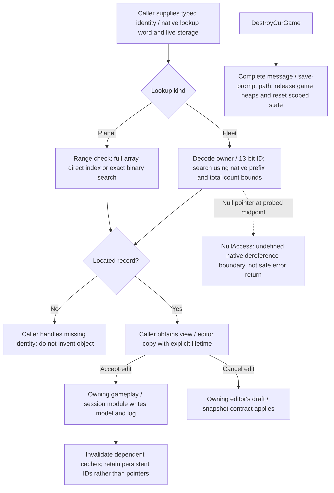
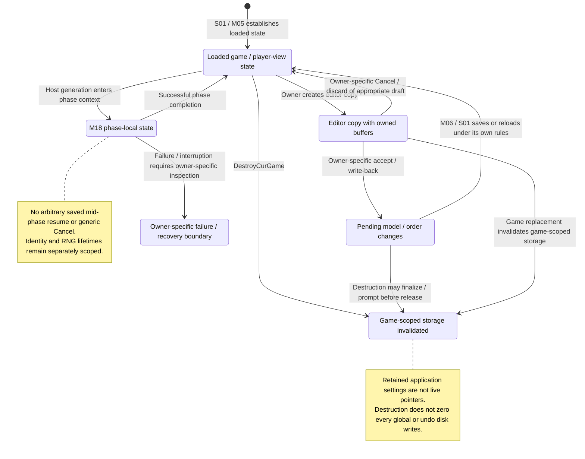
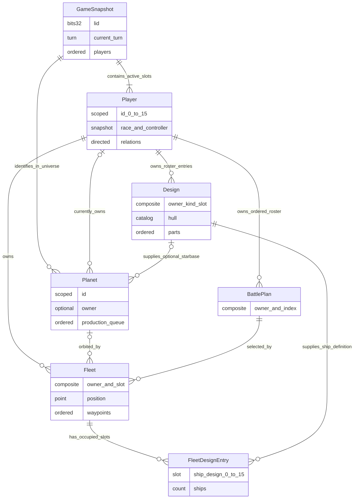
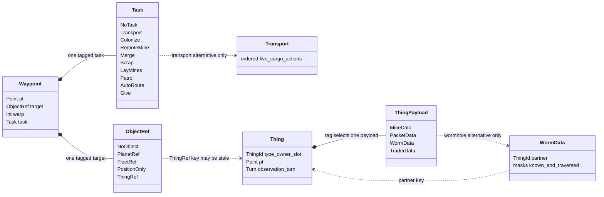
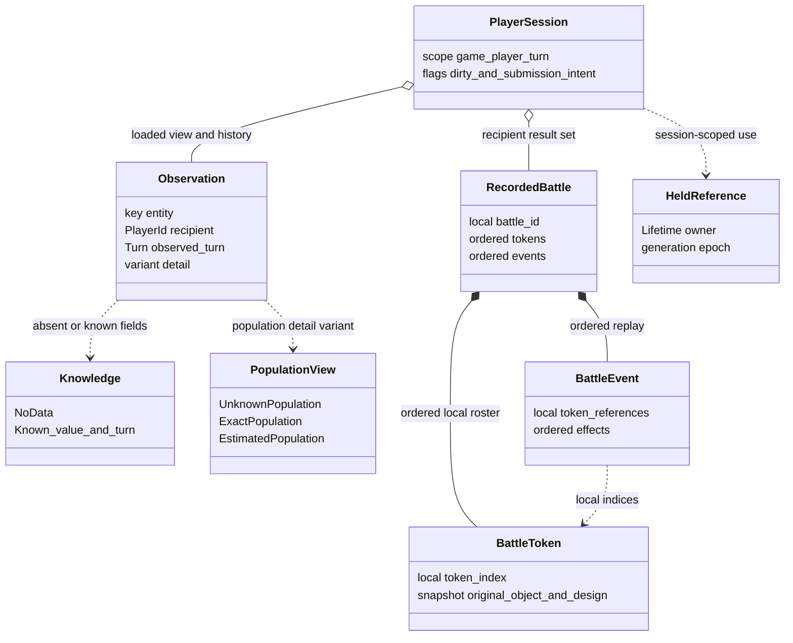

# S06 — Shared Game State and In-memory Data Model

Status: source-derived shared-state specification with proposed logical types
and machine-checkable contracts. Reviewed: 2026-10-24.
Source revision: `e2eae18cff0f990db20415c1c2262aed2022f95b`; accompanying M03,
M04 and S01 documents are local specification work at that revision.

The canonical formal definitions for shared entities, additional player/view/result groups and lifetime contracts are in
[S06-state-specification.dfy](S06-state-specification.dfy). The prose and worked examples below
explain those definitions and retain their source evidence. See the
[coverage inventory](README.md#dafny-coverage-and-verification) for exact scope,
proof strength, dependency boundaries and verification commands.

[Workflow and state diagrams](#workflow-and-state-diagrams) provide a visual reading path.
[Data-model and relationship diagrams](#data-model-and-relationship-diagrams) map the shared values and references.

## User stories and requirements

S06 is a support module. Its direct actors are developers implementing core/UI/
host consumers; the beneficiaries are players and hosts whose state must retain
identity, meaning and provenance. Its typed interfaces are proposals over observed
C values, as distinguished in §1 and the [collection conventions](README.md#requirement-ids-and-status).

### Stories and workflows

<a id="s06-us01"></a>
**S06-US01 — Resolve the intended entity (Proposed typed boundary).** As a
consumer developer, I want scoped identities, units and absence represented
explicitly so that an action reaches the correct game/player/entity. Receive
provenance with a typed key, decode its field-specific sentinel/packing, validate
references, then hand it to the owning rule. Invalid references and slot reuse
must not be silently interpreted as another live object.

<a id="s06-us02"></a>
**S06-US02 — Preserve what a player actually knows (Proposed typed boundary).**
As a UI/report developer, I want unknown, unowned, estimated and stale knowledge
kept distinct so that the display does not invent certainty. Decode the player's
observation with recipient/turn context, retain its detail variant, and present
only supplied data. Historical merge rules remain S01; a partial player view
must not be validated as a complete host graph.

<a id="s06-us03"></a>
**S06-US03 — Exchange coherent game values (Proposed validated boundary).** As a
core developer, I want explicit variants and cross-reference conditions so that
creation, editing and resolution agree on the meaning of their shared values.
Construct/decode a candidate, validate the conditions appropriate to that phase,
then call the gameplay owner. Storage fit alone is insufficient; transitional
state need not satisfy a final publication invariant.

<a id="s06-us04"></a>
**S06-US04 — Respect execution and session lifetime (Proposed logical boundary).**
As a session/host developer, I want RNG context and cached references tied to
their lifetime so that switching sessions or nested random work does not use
stale state. Push/pop random context as required and invalidate session-scoped
references on destruction. Library metadata may survive; C allocation/callback
behavior is separately sourced and not certified by the logical model.

### Acceptance and traceability

| ID / story / status | Observable criterion | Canonical rules and implementation evidence | Verification or gap |
| --- | --- | --- | --- |
| <a id="s06-ac01"></a>S06-AC01 / US01 / Proposed representation | Given owner and fleet slot, when encoding/decoding the canonical key, then preserve both; a library copy's storage identity must not be inferred solely from its internal game ID. | [Identity](#21-identity-domains-and-adapters); `FleetWord`, `DecodeFleet`, `FleetRoundTrip`, `FleetIdentityUnique` in [shared model](dafny/S06-shared-state.dfy); glossary. | General formal properties; no replacement of C lookup APIs or global uniqueness promise. |
| <a id="s06-ac02"></a>S06-AC02 / US01 / Proposed validation | Given wrong-turn orders, when matching a typed envelope to a session, then reject the match. | `Matches`, `WrongTurnCannotMatch`; [session scope](#8-execution-session-and-lifetimes). | Formal predicate; S01 documents which actual readers enforce which fields. |
| <a id="s06-ac03"></a>S06-AC03 / US02 / Proposed representation | Given unknown ownership and known-unowned ownership at a turn, when represented, then retain distinct values; a population estimate must not become exact population. | [Knowledge](#61-authoritative-state-versus-observations); `Knowledge`, `PopulationView`, `UnknownIsNotUnowned`. | Datatype/property checks; UI adapters and field-level historical merge remain separate obligations. |
| <a id="s06-ac04"></a>S06-AC04 / US03 / Proposed validation | Given a tagged task/thing or fleet referencing a design, when checking a published candidate, then validate the variant payload, domains and references appropriate to that state. | [Variants](#5-space-objects-and-other-variants); `TaskFits`, `ThingFits`, `FleetFits`, `HostTopology`, `CreationHomes`. | Predicates/selected witnesses; not proof that every C intermediate is valid or every mutation legal. |
| <a id="s06-ac05"></a>S06-AC05 / US03 / Proposed validation | Given a partial player view missing a wormhole partner, then do not apply the full-host reciprocal-pair invariant to infer corruption. | [Things](#5-space-objects-and-other-variants); `WormholePairs` is a full-state condition, not a partial-view requirement. | Scoped contract/source; separate player-projection validator remains an integration obligation. |
| <a id="s06-ac06"></a>S06-AC06 / US04 / Observed arithmetic, proposed representation | Given a valid RNG context and nested seed, when push is followed by pop, then restore the prior stream/context. | [RNG](#81-rng-and-determinism); `Push`, `Pop`, `PushPopRestores`. | General model property; complete draw-order equivalence belongs to the calling algorithm. |
| <a id="s06-ac07"></a>S06-AC07 / US04 / Proposed lifecycle | Given session-held references/caches, when the logical session is destroyed, then invalidate session lifetime as modeled while preserving longer-lived state. | [Lifetimes](#82-lifetime-inventory); `Lifetime`, `Held`, `DestroySession` in [extensions](dafny/S06-state-extensions.dfy). | Logical contracts only; native pointers, windows and callback order require C/UI validation. |
| <a id="s06-ac08"></a>S06-AC08 / US01 / Observed adapter | Given full planet storage, lookup indexes directly; sparse storage uses binary search. Fleet lookup masks to 13 bits and starts after preceding players' counts, without an ownership check or owner-slice upper bound. | [Native lookup adapters](#native-lookup-adapters); `Planet`, `Fleet`, `Binary`, `BinaryWithoutHoles`. | Checked bodies/witnesses and extracted native cases; null probes and invalid native count/storage domains remain explicit. |

### Interaction and quality requirements

| ID / status | Requirement, check and target | Owner / evidence / remaining decision |
| --- | --- | --- |
| <a id="s06-ir01"></a>S06-IR01 / Proposed | Consumer interfaces carry typed identity, provenance, units and detail variants explicitly. Validation feedback distinguishes malformed representation from gameplay illegality. | S06/S01/gameplay owners; no direct UI controls, keyboard/focus or viewport. Those requirements belong to M06/M07/M15/S05. |
| <a id="s06-ir02"></a>S06-IR02 / Proposed | Displays derived from knowledge values explain unknown/estimated/stale state with readable cues rather than only color or fabricated zero values. | M07/M08/M15/S05; S06 supplies the distinction, not accessible rendering or a tested wording scheme. |
| <a id="s06-qr01"></a>S06-QR01 / Observed constraints | Preserve storage widths, unit adapters and ordered collections; logical datatypes never become native disk layouts. Check adapters against S01 records and round-trip lemmas where available. | S06/S01/S04; root file contract unchanged. |
| <a id="s06-qr02"></a>S06-QR02 / Proposed | Apply full-host, player-observation, creation and phase-local validation at their specified boundaries. Test missing references, unknown values and destroyed-session access separately. | Existing predicates and lifetime contracts; broad C refinement/mutation preservation proofs missing. |
| <a id="s06-qr03"></a>S06-QR03 / Open | Measure validation/projection time and allocation growth across legal entity limits and partial views on a defined implementation/platform. Decide budgets and incremental-validation policy before promising bounded interactive cost. | S06/core/UI owners; mathematical validity does not establish runtime performance. |

§§1–2 define scope and shared meanings; gameplay legality, serialization and
catalogs remain their named neighbors. §10 owns unresolved history, validation
and lifecycle decisions. These stories describe the intended use of the model,
not a claim that the proposed typed interfaces are already implemented.

Checks for this story expansion are recorded in the
[collection verification](README.md#story-expansion-verification).

## 1. Purpose, scope and contract levels

S06 describes the state shared by creation, player sessions, hosting and game
rules. It separates identities, values, observations and execution lifetimes
from C allocation and serialized representation. It does not replace the C
structs, change game rules, or authorize a new file format.

The [Dafny model](dafny/S06-shared-state.dfy) is the executable notation for selected
contracts below. Its datatypes are projections of the logical model: omitted
fields remain specified in the tables, rather than being implicitly zero.
No Dafny ordinal, pointer, sequence header or language struct layout goes to disk.

Three levels must remain distinguishable:

- **Observed:** current C representation and behavior, traced to named sources.
- **Representable:** a field fits its storage; this does not establish legality.
- **Proposed validated boundary:** a caller contract for a coherent, normalized
  snapshot or accepted edit. Dafny predicates describe this level unless stated
  otherwise. They are not assertions that every C loader enforces it or every
  intermediate C state satisfies it.

[S01](S01-game-file-formats.md) owns bytes, codecs, file-family matching, replay and
recovery. [S03](S03-static-game-data-and-text.md) owns catalogs and their
stable keys. [M08](M08-planet-and-colony-management.md),
[M09](M09-production-management.md), [M10](M10-fleet-operations.md),
[M11](M11-ship-and-starbase-design.md) and M12–M20 own mutations, rule legality, visibility, scoring and phase
order. [M03](M03-new-game-wizard.md) remains the canonical setup/roster/victory
contract; [M04](M04-race-data-model.md) remains the canonical reusable race schema.
This document adds running-player state without copying either schema.

### 1.1 Inputs, outputs and interface

Conceptual interfaces, proposed rather than existing C functions:

| Boundary | Input | Output and obligations |
| --- | --- | --- |
| Create | Accepted M03 settings and ordered roster, M04 race snapshots, S03 catalog revision, execution context | Complete initial host state and player projections; initial-state conditions in §7. |
| Decode | S01 decoded records plus game/player/turn provenance | Host snapshot, player knowledge or explicit decode failure; never promote a partial record to full truth by zero filling. |
| Edit | Player session, typed target, operation and draft | Validated pending command or error; dirty/log effects belong to M06/S01. A well-shaped command can still be illegal. |
| Resolve | Complete authoritative state, ordered commands and execution context | Next authoritative state plus events and player-visible results. M18 defines sequence; S06 is not a second simulation. |
| Project | Authoritative state, recipient, detail/visibility decisions | Recipient-specific observations and results, not a promise of a complete object graph. |
| Close | Active session and save decision | Released game allocations and invalidated caches/selection; library metadata can outlive this state. |

A snapshot is scoped to an internal game identity and turn. A library copy is a
separate storage identity even when its internal game ID is equal. An ID match
alone is not globally unique provenance. This follows the [library glossary](../GLOSSARY.md)
and [ADR 0001](../docs/adr/0001-desktop-managed-libraries.md).

## 2. Identity, time, quantities and text

Unless explicitly optional, a validated field is present. No scalar has a
universal default: zero is often a valid ID or amount. Defaults below describe
constructors or creation, not how missing observations should be interpreted.
All arrays in these schemas are ordered.

### 2.1 Identity domains and adapters

| Logical type | Current symbols and domain | Scope, absence and invariants |
| --- | --- | --- |
| Game identity | `GAME.lid`, signed i32 storage interpreted as a 32-bit identity bit pattern | Equality within a file family; normal creation uses `DwTickCount`, tutorial sets its own ID. Not a UUID or unique library key. Zero also denotes cleared session state; do not infer a file is invalid solely from zero. |
| Player ID | `PLAYER.iPlayer`, `idPlayer`, 0..15; active IDs `< game.cPlayer`, count 1..16 | Game-scoped, zero-based; `.mN/.xN/.hN` suffix uses ID+1. `iplrNone=-1` is absent selection/ownership in the appropriate field. |
| Planet ID | `PLANET.id`, 0..`game.cPlanMax-1`; count at most 999 | Stable universe position, not the planet-name catalog key. Full `lpPlanets` has `id==index`; partial arrays are sorted by ID and can omit planets. |
| Planet location/name | `rgptPlan[id]`, `rgidPlan[id]` | Coordinates and name keys live outside PLANET. A name catalog index or display name is not a planet ID. |
| Fleet ID | `FLEET.id`, `FLEETID`: `512*iplr + ifl`, owner 0..15, slot 0..511 | Game-scoped composite key, canonical 0..8191. `FLEET.iPlayer` must agree with embedded owner. `LpflFromId` masks high three bits; those bits are not additional identity. Freed slots can be reused. |
| Fleet array index | `rglpfl[index]`, `sel.scan.ifl` | Transient position in the sorted fleet pointer array; never persist it as a fleet ID. Insertion/deletion shifts indices. |
| Design ID | owner plus ship slot 0..15 or starbase slot 0..9 | Separate rosters `rglpshdef[owner]` / `rglpshdefSB[owner]`; stored `ishdef` uses ship 0..15, base 16..25. `fFree` means unused roster entry; count is not a bound for every occupied sparse slot. |
| Battle-plan ID | owner plus `iplan` 0..15 | Player-scoped, not global. `rgcbtlplan[owner]` supplies active count; fleet plan must resolve at a stable full-state boundary. |
| Thing ID | `THING.idFull = 8192*ith + 512*iplr + id` | Type 0..3 declared, owner bits 0..15, slot 0..511. All three components participate in identity. `LpthNew` also imposes global count `<4050` and can fail while searching slots. |
| Observation/result key | entity key plus recipient and observation turn; battle ID within its result set; message index within its stream | Not an enduring foreign key to a currently live entity. Results may reference destroyed fleets/designs. |

Sources: [structs.h](../src/core/structs.h), [globals.h](../src/core/globals.h),
[enums.h](../src/core/enums.h); `LpplFromId`, `LpflFromId`, `LpflNew`,
`FLookupPlanet`, `FLookupFleet` in [util.c](../src/core/util.c);
`LpthNew`, `FreeLpth` in [thing.c](../src/core/thing.c).

Proposed keys are distinct types even where Dafny subset types share integer
representation. `FleetId`, `DesignId` and `ThingId` use tagged constructors.
Keys are unique only among simultaneously active entries in their scope. Do not
add a permanent incarnation number to saved IDs; a port may retain one privately
for cache invalidation, but must still implement the original reuse behavior.

### Native lookup adapters

[S06Lookups](dafny/S06-lookups.dfy) specifies the observed `LpplFromId` and
`LpflFromId` algorithms separately from the proposed typed identities above.
`Entry` projects native `id` and `iPlayer`; `Slot.Hole` represents a null fleet
pointer. `Located(index)` is an array position, not a claim about uniqueness,
ownership or pointer lifetime.

`Planet` rejects an ID outside 0..game.cPlanMax-1. When cPlanet equals that
maximum, it returns array element ID directly, without checking the element's
stored `id`. Otherwise it uses the exact binary-search bounds (-1, cPlanet).
The full-array fast path can therefore return a record whose stored ID differs
on inconsistent input; it does not validate the S06 array invariant for callers.

`Fleet` derives owner from bits 9–12 of the input word and masks the lookup ID
to 13 bits. It sums preceding players' fleet counts, sets lower bound to that
sum minus one, and uses **total cFleet** as upper bound, not that owner's slice
end. `Binary` follows source midpoint/comparison order. It proves that a found
binary-search position contains the searched ID; sortedness/uniqueness is not
checked by the C function, and an unsorted array may miss an existing ID. A
null pointer at a probed midpoint is `NullAccess`, marking a native dereference
outside the defined domain, not an implemented error return. `BinaryWithoutHoles`
proves that case cannot arise when every slot is present.

Native inputs retain their declared widths. Counts and prefixes must fit signed
16-bit intermediates; `Fleet` requires sixteen nonnegative player counts whose
total is <=32767. Array lengths and midpoint bounds must fit the corresponding
native fields, with live readable storage. The source does not independently
establish these assumptions. S06 host/view construction still owns count/order,
full-array identity and lifetime invariants; these lookup contracts do not widen
disk fields or enforce proposed validation at runtime.

Consumers must distinguish a found pointer from a successful subsequent action.
For example, [M07 restoration](M07-galaxy-map-and-navigation.md#61-restoring-selection-after-opening-a-turn)
can look up word 8192 as fleet 0 but then pass original 8192 to `SelectAdjFleet`.
Its fallback fleet scan stops at the first null pointer, unlike binary lookup,
which may probe a later position. [Native source fixtures](../tests/spec/check_restoration_source.py)
cover sparse/full planet paths, fleet masking and prefix limits using projected
structs. Full native struct extraction, invalid storage and cross-callback
pointer lifetime remain adapter obligations.

### 2.2 Sentinel decoding is field-specific

| Source field | Logical interpretation |
| --- | --- |
| `PLANET.iPlayer=-1` | Known unowned only when owner information is available; otherwise unknown ownership. Use `Knowledge<Option<PlayerId>>`. |
| `FLEET.idPlanet=-1` | Deep space (`None`), with coordinates still present. Zero is planet 0. |
| `PLANET.idRoute`, `idFling` | Zero is no target; nonzero value N refers to planet N-1. Validated domain 0..planet count. |
| `THPACK.idPlanet` | Direct zero-based planet ID for a moving packet; do not apply the optional route adapter. Salvage has warp zero and does not require a destination. |
| `TASKSELL.iPlrX` | Index in the roster excluding the giving player: decode `r=index+(index>=owner)`. Encode recipient `r` as `r-(r>owner)`. A validated gift cannot target itself. |
| `ishdefNone`, `ishdefAll`, `idWriteBack` | All have -1 representation but mean absent design, all designs, or a lookup write-back request. They are operation modes, not entity IDs. |
| `PLANET.iScanner=31` | No planetary scanner; not scanner catalog item 31. |
| Race environment -1 | M04 immunity only for the complete immune triple; not a planetary environmental value. `envNone` is a context-specific unavailable value. |
| Battle `idPlanet=0xffff` | No planet; battle coordinates remain available. |
| `grTaskAny=0xffff`, `iWarpAny`, `iDistAny` | Query/tutorial wildcards, not saved task, warp or distance variants. |

Evidence: sentinel enums; `SatisfyOrders` in [turn3.c](../src/core/turn3.c)
(for gift and mine-laying task execution), production packet creation in
[turn2.c](../src/core/turn2.c), route/report handling in
[report.c](../src/core/report.c), and [S01 order schemas](S01-game-file-orders.md).
Dafny proves fleet-key uniqueness/round-trip, thing-key uniqueness, optional
planet-link round-trip and gift-recipient round-trip.

### 2.3 Units and arithmetic

| Value | Meaning/domain | Important boundary |
| --- | --- | --- |
| `GAME.turn` | u16 elapsed years; calendar year = 2400+turn | `PLANET.turn` is signed i16 observation storage; history/writers have their own narrowing. The formal `Turn` models semantic nonnegative time, not every signed history bit pattern. Do not silently reinterpret an unknown historical turn as year zero. |
| `POINT16.x/y` | Signed i16 coordinates in light-years | Generated universe positions are narrower, governed by M03/M05; movement/trader destinations need not stay inside the original rectangle. |
| Mineral stocks | Ironium, Boranium, Germanium in kT; planet/fleet i32 | Validated nonnegative quantities, bounded by signed storage. `THPACK` mineral slots are i16, a different capacity. |
| Population/cargo colonists | `rgwtMin[3]` counts hundreds of colonists; one unit occupies one kT cargo | 250 means 25,000 people. Never use an exact count reconstructed from an estimate as authoritative population. |
| Resources | Production/research resource units | Cost arrays' index 3 is `Resources`; cargo arrays' index 3 is `Colonists`. Equal enum values do not make them the same quantity. |
| Fuel | Fleet `rgwtMin[4]`, mg | Excluded from fleet cargo mass. Hull fuel capacity is u16; fleet aggregates and current fuel are wider. |
| Environment | Ordered gravity/temperature/radiation coordinates, 0..100 | Physical display conversion belongs to [M04](M04-race-data-model.md#identity-habitat-and-units). |
| Mineral concentration | `rgMinConc[3]`, u8, not a probability | Do not clamp to 100: ordinary creation can produce 119. Depletion accumulator `rgpctMinLevel[3]` is separate u8 state. |
| Ship count | Each `FLEET.rgcsh[16]` is i16, validated 0..32767 | `Merge2Fleets` leaves excess behind at the limit; widening a port's integer must not remove this rule. |
| Damage | `DV.pctSh` 7-bit fraction of ships damaged, `pctDp` 9-bit damage fraction | Ship damage uses a scale of 500; loader clamps pctDp >=500 to 499. Starbase `pctDp` uses the same 500 scale but has separate 12-bit storage. Do not collapse all `pct` fields into one generic percentage. |
| Production progress | `PROD.pct`, 7-bit storage; normal progress in whole percent | `CBuildProdItem` applies `cost*pct/100`; 0..100 is the proposed normalized boundary, not the whole 0..127 bit domain. |

Evidence: `LGetFleetStat`, `Merge2Fleets` in [ship.c](../src/core/ship.c),
`CBuildProdItem` in [turn2.c](../src/core/turn2.c), `FReadFleet` in
[file.c](../src/core/file.c), and creation loops in [create.c](../src/core/create.c).
Resource/cost derivations remain with gameplay modules. The Dafny transfer
lemma requires enough source quantity and no destination overflow; it does not
prove cargo capacity, ownership, fuel rules, or correctness of C transfers.

C arithmetic widths, truncation toward zero, unsigned wrap and binary64 operation
boundaries remain significant. Dafny integers are mathematical integers; only
explicit bounded contracts are claimed. See [DOUBLE-PRECISION.md](../docs/DOUBLE-PRECISION.md)
and [S01 records](S01-game-file-records.md) for the boundaries a port must retain.

Names/title/design/plan names use UTF-8 with 31-byte payload budgets in their
32-byte arrays; no embedded NUL and no partial code point. Optional fleet name
is allocated text; absence permits the generated default name. Use S01's text
contracts and [UNICODE-BOUNDARIES.md](../docs/UNICODE-BOUNDARIES.md), not a language
`string.length` in characters. Names are labels, not foreign keys.

## 3. Game, players and designs

### 3.1 Game and player field groups

All fields below are present in a full authoritative model. Observations wrap
unavailable groups in knowledge types (§6); they do not default them to zero.

| Logical group | C correspondence | Domain, defaults and lifetime |
| --- | --- | --- |
| Universe configuration | `GAME.mdSize/mdDensity/mdStartDist`, flags, `rgvc[12]`, title | Reuse [M03 settings](M03-new-game-wizard.md#21-universe-settings) and victory contract. These are game settings, not process preferences. `wGen` is 3-bit generation state; `fDirty` is session state. |
| Race snapshot | PLAYER names, portrait, environment triples, growth, attributes, trait mask, credential | Reuse M04 schema; taken into a player at creation, distinct from later library race versions. Credential changes are host-applied commands, not edits to the library race. |
| Controller | `fAi/lvlAi/idAi`, `mdPlayer` overlay | M03 defines roster selection and AI kinds. Running controller is distinct from M04's random-template trait bit. `fInclude/det` are serialization/knowledge metadata, not controller identity. |
| Progress | `rgTech[6]`, `rgResSpent[6]`, `pctResearch`, `iTechNow/iTechNext`, `lResLastYear` | Technology in six fixed fields, normal 0..26; spent resources u32 per field. Allocation 0..100; now 0..5; next 0..5 explicit, 6 same field, 7 lowest. iTechNext C overlay is signed; validated values remain 0..7. |
| Relations | `rgmdRelation[16]` | Directed: 0 neutral, 1 friend, 2 enemy. No symmetry invariant. Only active player entries have gameplay meaning. Generation initializes neutral, with single-player exceptions in M03. |
| Battle plans | `rglpbtlplan[16]`, `rgcbtlplan[16]`, `BTLPLAN` | Per-player ordered roster at most 16; creation installs five catalog defaults. Fleet references scoped by owner. |
| Production template | `PLAYER.zpq1`: `fNoResearch`, `cpq`, `rgpq[12]` | Ordered default template, at most 12 entries; each has 6-bit mode and 10-bit quantity. Not a live planet queue or the five application presets `vrgZipProd`. |
| Status | `fDead/fCrippled/fUnused/fLearned/fHacker`, `grbitTrader` | Preserve distinct meanings/bit domains; dead does not imply the PLAYER slot is removed. Trader rewards are mutable per-player acquired abilities. |
| Counts and home | `cPlanet/cFleet/cShDef/cshdefSB`, `idPlanetHome`, `wScore` | Counts summarize the loaded dataset/detail and can be temporarily stale during mutation. Home records the starting world; do not demand its continued ownership. `wScore` is not the full i32 SCORE result. |

Evidence: PLAYER/GAME in [structs.h](../src/core/structs.h), `GenerateWorld`,
`InitBattlePlan` in [create.c](../src/core/create.c), `FRunLogRecord` in
[log.c](../src/core/log.c), research in [research.c](../src/core/research.c)
and `UpdateResearchStatus` in [turn2.c](../src/core/turn2.c).

There is no general zero-PLAYER default: a setup slot copies an M04 preset and
M05 selectively initializes runtime fields. Creation explicitly clears six
tech/spent entries, then applies starting technology; clears dead/learned/trader
rewards; assigns homeworld and initial relations. Reuse M03's precise starting
research/AI branches rather than normalizing every controller identically.

Battle plans contain name, tactic (0..5), two target classes (0..7), dump-cargo
flag and attack selector. Selector 0 nobody, 1 enemies, 2 neutrals/enemies,
3 everyone, and 4+player ID for a named player. `fDelete` is a command marker,
not a normal live plan property. S01 records the current replay checks' wider
acceptance of tactic 6/target 8; a typed enum must distinguish these raw values
from declared variants. Plan legality is M14's responsibility.

### 3.2 Ship and starbase designs

Proposed `Design` consists of a scoped `DesignId`, knowledge/detail, lifecycle
metadata and a hull description; it is not a ship instance.

| Field group | Source and contract |
| --- | --- |
| Hull/catalog | `SHDEF.hul.ihuldef` references S03 hull catalog, not design slot. `ibmp` is its image variant. A design draft may temporarily have empty/incompatible slots; accepted design uses M11 validation. |
| Parts | `HUL.chs` 0..16, ordered `rghs[16]`; each HS contains category mask, u8 item index and u8 count. Count zero is empty; index must resolve in the category's catalog when occupied. Hull slot capacity/category and technology/gift checks remain M11/S03 contracts. |
| Label | `hul.szClass`, UTF-8 ≤31 bytes; unknown designs may expose hull class rather than private name. |
| Derived values | `hul.rgTech[6]`, mass, costs, ore costs[3], cargo/fuel capacities, armor; `dScanRange/2`, `pctDetect`, `iSteal`, `lPower/lVisible` |
| Lifecycle | `fFree`, `fGift`, design `turn`, u32 `cBuilt/cExist`, `grbitPlr` knowledge mask; `det/fInclude` describes representation/visibility. |

Derived fields can be recalculated but are not license to change rounding or
recompute at a different point in the turn. `lPower/lVisible` is a phase-dependent
union, not two simultaneous facts. Full and partial design observations need
different variants: the latter cannot supply part lists or exact capabilities.
Default design slots are free until installed; starting templates and replacements
belong to M05/M11. Existing ships refer to slots, so replacement/deletion must
honor in-use checks. Source: `FReadShDef` in [file.c](../src/core/file.c),
`WriteRtShDef` in [save.c](../src/core/save.c), [build.c](../src/core/build.c),
and [S01 design mapping](S01-game-file-records.md#7-ship-and-starbase-designs).

## 4. Planets, fleets, production and waypoints

### 4.1 Planets and colonies

A colony is owned planetary state, not a second globally identified object.
The proposed `Planet` combines the PLANET data with the universe's position/name
lookup and separates observations from authoritative values.

| Fields | Mapping, domain, optionality/default |
| --- | --- |
| Identity/location | ID, optional owner, coordinates and planet-name catalog key (§2). |
| Environment/mining | Current and original environment triples, mineral concentration/depletion triples (§2.3). Unowned initial planets get random environments/concentrations; originals equal current; depletion starts zero. |
| Stocks | Three mineral stocks and population in hundreds; i32 nonnegative at validated stable boundary. No planet fuel slot. Unowned initial stocks zero except the temporary planet-0 template described in M03. |
| Improvements | `cMines/cFactories/cDefenses`: unsigned 12-bit counts; `iScanner`: 5-bit, 31 none; `iDeltaPop`: 8-bit population-change metadata; `fArtifact`, `fNoResearch`. Storage maxima are not operable limits. |
| Starbase | `fStarbase` gates optional owner-scoped base slot `isb`; `pctDp`, `fNoHeal`, fling target and warp. Do not treat slot zero as no base. Damage/healing legality belongs to M08/M19. |
| Routing | Optional `idRoute` and fling target, explicit one-based adapters (§2.2); `iWarpFling` is 4-bit driver setting. Zero-initialized absence. |
| Production | Optional allocation `lpplprod`; logical ordered sequence, empty if no queue. PLPROD's used/allocated counts are distinct. |
| Knowledge/lifecycle | `det/fInclude`, `turn`, `uPopGuess/uDefGuess`; `fHomeworld/fFirstYear/fWasInhabited`. Homeworld flag is historical designation, not proof of current owner. |

`PlanetFits` checks structural bounds, environmental array dimensions, optional
reference ranges and base-needs-owner. It deliberately accepts concentration
119 and installation counts beyond currently operable limits. It does not prove
habitability, a legal colony, valid scanner catalog membership, or that all
unowned planets must have no surviving minerals/installations. Those would be
incorrect blanket assumptions.

### 4.2 Fleet state

| Fields | Mapping and contract |
| --- | --- |
| Key, owner and position | Composite fleet ID, agreeing `iPlayer`, point and optional orbit planet. At a stable full-state boundary an orbiting fleet's point matches the universe point. Deep space retains a point. |
| Composition | Exactly 16 design-slot counts, each 0..32767. Every nonzero slot needs that owner's ship design in a full snapshot. A live settled fleet has at least one ship; newly allocated, emptied or dead fleets are transitional exceptions. |
| Damage | Exactly 16 DV entries for a full fleet; meaningful only for occupied slots. `pctSh` and `pctDp` describe a damaged fraction, not separate damaged ship instances. Partial fleets instead use overlaid `wtFleet`. |
| Cargo | Three minerals, colonists and fuel (§2.3); capacity is derived from composition, not the i32 maximum. Explicit transfer/split rules can clamp/rebalance quantities. |
| Orders | `cord`, `lpplord->iordMac`, ordered waypoints; normalized full fleet has at least current waypoint 0 and at most 255 (storage envelope). `iordMax` is capacity; UI may impose stricter edit limits. `fRepOrders` requests repetition. |
| Battle plan/name | Owner-scoped `iplan`, optional `lpszName`; null name requests default naming. Newly allocated fleet starts at plan 0, no explicit name. |
| Phase state | `fDead/fDone/fBombed/fHereAllTurn/fNoHeal/fMark`; `dMoveLeft/dMoveUsed` overlaid with `lPower`, `lFuelUsed`; direction/warp/valid/composition-change/targeted/skipped fields. Keep active union meaning with execution phase. |
| Derived links/visibility | `lpflNext` linked lists and `gd.fFleetLinkValid`; detail/include. Rebuild links after allocation/deletion/transfer; pointers are not entity references. |

`LpflNew` initializes an empty full-detail fleet, one current waypoint, zero
warp, no task, nonrepeating orders and an optional planet position. It allocates
capacity for three waypoints but uses one. This temporary empty fleet is not
claimed to satisfy `FleetFits`; the creator adds ships before publishing it.
Gift transfer allocates in the recipient's namespace and can remap designs.
`HostTopology` checks full-state fleet ordering/uniqueness, design/plan closure
and orbit coordinates. It does not require a tracked target fleet to still
exist: targets can disappear, and M10 defines tracking/cancellation.

### 4.3 Production entries

Proposed variants map as follows; order and carried progress must survive edits
as specified by M09/S01. Queue allocation NULL means no entries, not unknown
production when the snapshot is authoritative.

| Variant | PROD mapping |
| --- | --- |
| `BuildShip(slot)` | `grobjFleet`, iItem 0..15 |
| `BuildBase(slot)` | `grobjFleet`, iItem 16..25 encodes slot+16 |
| `PlanetItem(kind)` | `grobjPlanet`, codes below |

Planet kinds: 0 mine, 1 factory, 2 defense, 3 alchemy, 4 minimum terraform,
5 maximum terraform, 6 packet; 7 auto factory, 8 auto mine, 9 auto defense;
10 undeclared; 11 auto alchemy, 12 auto terraform, 13 Genesis; 14 iron packet,
15 boranium packet, 16 germanium packet, 17 mixed packet; 18..26 individual
planetary scanners, 27 generic scanner, 31 unknown placeholder. 28..30 and
32..127 have no declared production kind. `iobjUnknown` is representable as a
placeholder, not approval to build an unknown object.

Every entry has `cItem` (10-bit, 0..1023; zero can represent partial/scratch
state) and `pct` progress (§2.3). `ProductionFits` is a structural contract;
technology, owner, base capacity, automatic-repeat semantics and refunds are
owned by M09. It does not promise that every declared code is offered by the UI.
Source: `InitProduction`, `GetProductionCosts` in [produce.c](../src/core/produce.c),
`CBuildProdItem` in [turn2.c](../src/core/turn2.c), `ProdItemType` enum.

### 4.4 Object references and waypoint variants

`ObjectRef` separates `NoObject` (grobj 0), `PlanetRef` (1), `FleetRef` (2),
`PositionOnly` (4) and `ThingRef` (8). A waypoint always retains its point even
with a target identity: moving targets and stale observations make this useful.
`GrobjClass` also contains lookup modifier bits 0x20/0x40/0x80; those are API
flags, not more waypoint object variants. `OBJ` by itself is an untagged pointer
union; use the caller's discriminator to interpret it.

Each waypoint has point, typed target, warp, task, `fValidTask` and
`fNoAutoTrack`. Proposed normal waypoint warp is 0 stationary, 1..10 travel,
11 stargate; storage allows 0..15, so higher raw values need diagnosis, not
silent conversion. `fValidTask` is cached/task validation state, not a proof
that execution will succeed. Task payloads are exhaustive for declared codes:

| Code | Variant | Payload, domain and mapping |
| --- | --- | --- |
| 0 | No task | No union payload. |
| 1 | Transport | Exactly five actions in mineral/colonist/fuel order, `txp.rgia[5]`. |
| 2 | Colonize | No additional saved task payload. |
| 3 | Remote mine | No additional saved task payload. |
| 4 | Merge | Target identity is in the waypoint. |
| 5 | Scrap | No additional saved task payload. |
| 6 | Lay mines | `tlm.cTime`, `cTimeOld`, u16. Execution treats 0 as finishing and 5 as indefinite; other counts decrement. Preserve raw bookkeeping separately from an eventual richer duration type. |
| 7 | Patrol | `tptl.iWarp/iDist` u16 settings; M10 owns allowed patrol-speed/distance choices. |
| 8 | Auto route | No additional saved task payload. |
| 9 | Give fleet | Logical recipient PlayerId; stored `tsell.iPlrX` uses sender-excluded roster (§2.2). |

Task 10..15 has no declared implementation; 0xffff is a query wildcard.
Inactive union bytes are not extra parameters. A faithful raw-file adapter may
retain them separately; S06 does not model them as semantic state.

Transport actions 0..9: none, load all, unload all, load exact, unload exact,
fill percent, wait percent, load dunnage, set amount, set waypoint amount.
Exact/set quantities are 12-bit 0..4095 in the selected cargo unit; percentage
settings have proposed valid range 0..100. “Set waypoint” sets the amount at
the endpoint, not a waypoint index or target ID. Fuel dunnage implements the
optimal-fuel path; it is not an eleventh action. Arguments for all/none/dunnage
have no independent logical meaning. See `SatisfyOrders` in
[turn3.c](../src/core/turn3.c), `DeleteWpFar` in
[ship.c](../src/core/ship.c), [shipui.c](../src/ui/shipui.c) controls, and
[S01 waypoints](S01-game-file-records.md#9-snapshot-waypoints).
The [M10 transport adapter](M10-fleet-operations.md#314-native-mapping-and-evidence)
now retains raw packed actions separately and maps supported codes into this
existing datatype. Preset application can retain unused quantities, raw codes
10–15 and percent amounts above 100; only the selected control may normalize
its quantity during refresh. `ActionFits` remains a proposed validated boundary,
not a claim about all current stored or intermediate UI state.


## 5. Space objects and other variants

`THING.ith` has exactly four declared cases. Salvage is a packet representation
with warp zero, not a fifth discriminator. Every object has typed ID, point and
observation turn. Owner bits for wormholes/traders are a namespace component
(creation uses 0), not evidence that player 0 owns a natural phenomenon.

| Variant | Fields, defaults and constraints |
| --- | --- |
| Minefield (0) | `THMINE`: i32 mine count, u16 known/current-visible player masks, u8 mine type (declared 0 standard, 1 heavy, 2 speed trap), detonate flag. New THING is zeroed; M19 supplies count/type. Logical count is nonnegative, type 0..2. Visibility masks are distinct, and detonation is a requested state. |
| Packet/salvage (1) | `THPACK`: direct 10-bit destination, 4-bit warp; moved/include flags; three i16 mineral weights, 14-bit max weight and 2-bit decay mode. Moving packet requires destination in universe. Warp-zero salvage does not. Preserve max-weight/decay metadata, not only current cargo. |
| Wormhole (2) | `THWORM`: 2-bit stability, 10-bit turns-since-move, destination-known/include flags, known/traversed masks and full partner ThingId. Full stable host pairs are distinct, reciprocal wormholes. Partial player view need not contain the partner. |
| Mystery Trader (3) | `THTRADER`: destination point, 4-bit warp, include flag, known mask and reward mask. Player snapshots hide reward. Catalog reward values belong to S03; execution/availability belongs to M19. |

No task/thing tag switch should reinterpret an unknown tag using a convenient
union member. S01 records actual permissive/raw handling separately. `ThingFits`
checks tag/payload correspondence and representable domains; `WormholePairs`
adds the proposed full-host pairing condition. `ThingSetFits` also checks map
key/entity agreement and the total allocation bound. Neither proves movement,
detonation, packet decay or trader reward algorithms. It is not valid to apply
full-host pairing to a filtered player file.

Sources: `LpthNew` in [thing.c](../src/core/thing.c), `MoveThings` and salvage
creation in [turn.c](../src/core/turn.c), `GenerateWorld` in
[create.c](../src/core/create.c), `FWriteDataFile` in [save.c](../src/core/save.c),
[THING record adapters](S01-game-file-records.md#13-scores-and-things).

## 6. Knowledge, messages, scores and battles

### 6.1 Authoritative state versus observations

Detail codes: none 0, minimal 1, obscure 2, some 3, more 4, all 7. Values 5/6
have no declared `DetType`. Detail is a representation discriminator, not a
universally monotone visibility policy. `detAll` in a historical object does
not mean “currently authoritative.” Keep source turn and recipient context.

Proposed logical notation, shared across observed fields:

```text
Knowledge<T> = NoData | Known { value: T, observed_turn: Turn }
Ownership = Knowledge<Option<PlayerId>>
PopulationView = UnknownPopulation
               | ExactPopulation { hundreds, observed_turn }
               | EstimatedPopulation { population_bucket, defense_bucket, observed_turn }
DesignView = PartialHullObservation | FullDesignObservation
FleetView = PartialFleetObservation | FullFleetState
```

Unknown ownership, known unowned, known player 0 and stale knowledge of player 0
are four distinct situations. Estimated zero is still an estimate. Do not
invent lower/upper population bounds from the 12-bit bucket without using the
M08 estimate algorithm. Planet `uPopGuess/uDefGuess` retains buckets 0..4095 and
0..15. Exact stock arrays, installations and production may be absent in a
player view; a fleet's cargo population/fuel, damage/orders/plan/name likewise
require full detail. Known coordinates can exist without a loaded PLANET.

`FReadPlanet` history overlay retains some prior fields and detail. It is not
necessarily “replace all fields with the newest object” or “max detail wins”
for every value. `FReadShDef` also preserves full detail against some partial
updates. A future field-level knowledge model must implement these adapters
rather than applying a generic merge that changes the observed game.
`NotFuture` expresses a proposed nonfuture timestamp check for normalized
observations; signed/wrapped history and future-import policy are S01 concerns.

Source: `FReadPlanet`, `FReadFleet`, `FReadShDef`, history handling in
[file.c](../src/core/file.c); `FWriteDataFile` and `FWriteDataFile` in
[save.c](../src/core/save.c); [S01 validation](S01-game-file-validation.md).

### 6.2 Results and communications

| Type | Logical fields and mapping | Validity/lifetime |
| --- | --- | --- |
| Catalog event | `MSGBIG/MSGHDR`: message catalog ID, `MsgGoto`, up to seven ordered parameters; `MSGTURN` adds recipient and byte count | Catalog determines parameter meanings and widths. Parameters are not all entity IDs. Goto can encode fleet/player/object navigation. Ordered per-turn stream; hidden/filter state is presentation. |
| Player message | `MSGPLR`: sender, recipient selector, reply index, byte length and UTF-8 text | Linked-list pointer is allocation only. Recipient/reply sentinels and packing are [S01 §11](S01-game-file-records.md#11-messages); don't turn every raw recipient value into a PlayerId. Incoming/outgoing and pending/saved are distinct collections. |
| Score | `SCORE`: i32 score/resources, planet/base counts, three u16 ship-category counts, total tech; `SCOREX`: player, valid/winner/victory bits, current rank OR historical turn | `fHistory` selects the union. An invalid score is not zero. Key historical results by player and turn; public visibility and score/victory formula belong to M03/M15/M18. |
| Recorded battle | `BTLDATA`: battle ID, players/mask, point/optional planet, ordered tokens and events | Scoped to result set. Tokens are battle-local indices, not fleet IDs. Player copies contain participating battles; host file omits these blobs. |
| Battle token | `TOK`: original object key, owner, design, board position, initiative, target, cloak/jam/computer/capacitor/defense, mass/shields/count/damage, tactic/targets and movement flags | Snapshot required for replay; object may no longer exist in live state. Board coordinate is not a light-year coordinate. Field bit domains are in S01 §12. |
| Battle event | `BTLREC`: token, destination, round/disengagement/attacker, ordered `KILL` list; each kill holds token, weapon flags, killed ships, shields and damage | Validate local token indices and event boundaries after S01 continuation assembly. Event order matters. M14 owns replay semantics; battle-time scratch TOK state is not a live fleet. |
| AI memory | `AIHIST/AISTARBASE` or per-planet `CYBERINFO`, selected by AI controller | Persistent decision memory in player history, not authoritative host ownership or full RNG state. Stale references are repaired by `ValidateStarbaseHistory`. Temporary `CYBERINFOTEMP` is discarded. |

Full result field widths and sentinel maps are already centralized in
[S01 messages/battles/scores/AI records](S01-game-file-records.md#11-messages).
Those field tables plus the logical grouping here specify the result payloads;
S06 does not create a competing record schema. The core projection checks knowledge distinction, order envelope matching
and battle-local token index bounds. The extension checks catalog-event arity
against a supplied catalog and adds score/view variants;
[M03 scoring](dafny/M03-scoring.dfy) defines score formulas. Event legality and
complete catalog correctness remain separate obligations.

## 7. Creation-facing state and defaults

The interface from M03/M04 into M05 is an accepted setup plus an ordered roster
of race snapshots/controllers. Draft slots, random templates and canceled
wizard edits do not constitute published game state. Reference the exact
[creation algorithm](M05-universe-creation.md#4-rules-calculations-and-validation).

At successful logical construction, before visibility projection:

1. `game.cPlayer` active participants have IDs 0..count-1; planet IDs cover
   0..`game.cPlanMax-1`, with position/name lookups indexed consistently.
2. Every player has an assigned starting homeworld; those initial homeworlds
   are distinct and owned by the assigned player. This is a **creation-only**
   condition, not a lifetime invariant after conquest or extinction.
3. Starting technology, resources, improvements and bonuses follow [M05 §4](M05-universe-creation.md#4-rules-calculations-and-validation),
   including trait, tutorial, BBS and second-world branches. Unowned planets
   are full-detail in host memory, scanner 31, zero installations/population,
   original environment equal to current. The temporary planet-0 resource
   template is resolved before publication.
4. Starting bases resolve to that owner's base designs; starting fleet counts
   resolve to ship designs and fleets begin with a current waypoint. Five
   initial battle plans resolve every initial default plan reference.
5. Initial wormholes occur in reciprocal pairs, with initially zero visibility
   bookkeeping and random stability/position. Event-disable settings can make
   the set empty. A zeroed `LpthNew` allocation is incomplete until initialized.
6. Fresh normal creation starts at turn zero; tutorial construction is a
   distinct entry path. `GenerateWorld` consumes caller state and is not itself
   a universal reset of all globals. Clock-derived game ID and initial RNG
   state are both required for deterministic byte outputs.

`HostTopology`, `CreationHomes` and `WormholePairs` express structural
conditions, including distinct assigned homeworlds owned at creation. They do
not prove that the generation algorithm establishes them. Exact starting
inventories, visibility projection and generation success are not proved. A concrete one-player planet/base/
fleet witness and missing-design/duplicate-fleet counterexamples are verified
in `AcceptanceVectors`. The witness is a coherent structural state, not a
claim that M05 produces that exact setup.

Creation's return and library success are separate: M01 verifies complete
initial files after generation. Partial writes are not rolled back by a logical
invariant. [M03 recovery](M03-new-game-wizard.md#5-cancellation-errors-and-recovery)
and [S01](S01-game-file-formats.md) retain those failure contracts.

## 8. Execution, session and lifetimes

### 8.1 RNG and determinism

Simulation state is `(lRandSeed1,lRandSeed2)`, plus `cRandStack` and
`rglRandStack[4][2]` for saved contexts. File XOR uses separate
`lFileSeed1/lFileSeed2`. Do not share the streams. A deterministic run records
initial simulation seeds/stack, entry path, clock input, catalog/text revision,
command sequence, player/collection traversal and `qsort16` tie order. A user
seed alone omits some of those inputs.

`Random(c)` advances both seeds even if c<=0, then returns zero in that case.
For positive c it takes a modulo, without a uniform-distribution guarantee.
The exact recurrence and C wrap boundaries are in
[M03 §4.1](M03-new-game-wizard.md#41-arithmetic-conventions-and-rng), traced to
[utilgen.c](../src/core/utilgen.c). Dafny `Draw` models normalized seeds
`0<s1<2147483563`, `0<s2<2147483399` and signed-i16 bounds. Under those
preconditions it proves next-state validity and the return range. It makes no
claim about arbitrary negative/corrupt seed states or C-level equivalence.

`Randomize` selects two entries in the first 64 elements of `rgPrimes` from
seed bits 0..5 and 6..11 (advance the second index on equality).
`Randomize2` uses seven-bit indices from bits 0..6 and 7..13, XORs indices with
0x35/0x5c, then resolves equality. Retain the literal table, including 279.
Host and desktop startup use `Randomize2`; tutorial creation/generation and
batch paths have their own seed behavior. `PushRandom` saves/restores a pair
without bounds checks in C; the proposed preconditions are depth<4 for push,
depth>0 for pop. `PushPopRestores` proves exact logical restoration.

Source: `Randomize/Randomize2/Random/PushRandom/PopRandom` in utilgen.c,
startup in [host.c](../src/host/host.c) / [stars.c](../src/ui/stars.c),
`CreateTutorWorld/GenNewGameFromFile` in create.c, `FGenerateTurn` in turn.c,
and isolated drawing context in [utilui.c](../src/ui/utilui.c).

### 8.2 Lifetime inventory

| Lifetime/owner | State | Save, reset and ordering contract |
| --- | --- | --- |
| Universe/game | GAME config, coordinate/name tables | Universe file and snapshot envelopes through S01. Library title/name/exchange basename remain distinct. |
| Authoritative turn/M18 | Players, planets, designs, fleets, things, plans | Host snapshot owns full truth. One generation mutates in place; publication is not an atomic in-memory transaction. |
| Player session/M06 | Current player ID, loaded projection/history, pending commands/messages, `game.fDirty`, submit/read-only/partial flags | Save/submit/export differ. `OrderEnvelope` matches game, player and turn; submission flag alone does not mean the host executed anything. |
| Pending command stream/S01 | `lpLog`, `imemLogCur/Prev`, prior header, transfer coalescing state `lx/lxf` | Ordered log; some adjacent edits coalesce. Replay can partially mutate before failure. No set/map sorting of commands. |
| Generation phase/M18 | `gd.fGeneratingTurn`, local pass/order, `fDone`, movement counters, colonist drops/transfers, resource extras/losses | Current phase is largely control flow, not a saved enum. A proposed phase tag must follow existing sequence; saves do not provide arbitrary mid-phase resume. |
| AI decision/M20 | Persistent AI history plus planning scratch (`vlpbAiData`, per-planet data, temporary arrays) | Retain only schema-defined history; recompute scratch. Stale references repaired against current observations. |
| Derived caches | Ship costs/mass/scans, fleet links, sorted report IDs, `RPT.fCached`, selection copies | Invalidate when source changes; maintain calculation timing/rounding. Neither a heap address nor cached array index is persistent identity. |
| Editor/UI | `sel`, `shdefBuild`, `vplr`, `lpplProdGlob`, wizard drafts, windows and tutor state | Accept explicitly into model/log; cancel discards appropriate draft. Selection copies may own copied order/queue buffers; not aliases that may outlive game destruction. |
| Application/S02 | INI, window arrangement, presets, remembered game/player | Outlives a game, can remember identity but not live pointers. |
| File operation/S01/S04 | `hf`, current header/buffer, XOR state, version and error flags | Scoped to I/O; not simulation state. Failure cleanup and retries are entry-point-specific. |

`DestroyCurGame` in [file.c](../src/core/file.c) calls message completion/save
prompt, resets game heaps and pointers, clears counts, logs, scores/battles,
AI pointer, game identity/settings selection and report/link validity. It may
retain selected identity in INI first. `InitGameStuff` in
[turn.c](../src/core/turn.c) creates application-held log/message/report buffers.
Neither routine is a blanket zeroing of every global or a promise to roll back
an interrupted generation. See [FGenerateTurn](../src/core/turn.c) for failure
cleanup and reload; [S01 recovery](S01-game-file-formats.md) for disk outcomes.

## 9. Formal verification and acceptance

Run with Dafny 4.11.0 (verification only; no generated C or game dependency):

```sh
dafny verify spec/dafny/S06-shared-state.dfy --verification-time-limit 30
```

Installation follows the [official Dafny instructions](https://dafny.org/dafny/Installation).
The original core model is independent of S01; the
[extension model](dafny/S06-state-extensions.dfy) now reuses its record predicates. S01
models raw widths/envelopes while S06 models resolved identities and normalized
state. For example, S01's raw give-recipient field must pass through `DecodeGive`
before becoming S06's `Give(PlayerId)`. Shared names do not establish a proof
between the two modules; an adapter/refinement proof would be separate work.

| Acceptance obligation | Formal evidence |
| --- | --- |
| Fleet owner 15/slot 511 packs to 8191; owner 1/slot 0 is 512; no two canonical composite IDs collide | `FleetRoundTrip`, `FleetIdentityUnique`, vectors |
| Thing identity includes kind, owner and local number | `ThingIdentityUnique` |
| No route is 0; planet 0 route is 1; both decode without losing absence | `PlanetLinkRoundTrip`, vectors |
| Gift recipient mapping skips sender and round-trips | `GiveRoundTrip` |
| Unknown owner differs from observed unowned; exact population differs from estimate | Knowledge/PopulationView datatypes, `UnknownIsNotUnowned`, bucket rejection vector |
| Accepted bounded transfer conserves quantity and cannot overflow destination | `TransferQuantity` pre/postconditions |
| Transport has exactly five actions; percentages and 12-bit quantities are bounded | `TaskFits`, `ActionFits`, positive/negative vectors |
| Six-field research progress, directed relation domains, hull-slot byte limits and declared battle-plan domains | `ResearchFits`, `RelationsFit`, `HullSlotsFit`, `BattlePlanFits`, positive/negative vectors |
| Battle events reference battle-local tokens within the token count | `BattleEventIndicesFit`, positive/negative vectors |
| Queue quantities fit 10 bits and undeclared kind 10 is rejected | `ProductionFits`, vectors |
| Full fleet references existing owner designs/plans and orbit position | `FleetFits`, `HostTopology`; coherent witness, missing-design and duplicate-fleet rejection |
| Initial homeworlds are in range, distinct and owned by their assigned player | `CreationHomes`, one-player witness; creation-only condition |
| Paired full-state wormholes point back; absent partner fails | `ThingFits`, `WormholePairs`, vectors |
| Wrong turn cannot match an order envelope | `WrongTurnCannotMatch` |
| RNG return range/next normalized seeds and context restoration | `Draw`, `PushPopRestores`, first-step vector |

Proofs establish the model's obligations, not that current C satisfies them.
Predicates alone are definitions; acceptance witnesses and lemmas exercise
selected consequences. Not proved: C memory safety, UTF-8 decoding (S01 owns
that), faithful field-by-field serialization, all arithmetic equivalence,
visibility/noninterference, gameplay transitions, battle results, generation
termination, or crash-safe publication. No `assume`, axiom, disabled-verification
attribute or unimplemented proof body is needed.

Existing C evidence to retain: [test_utilgen.c](../tests/unit/test_utilgen.c),
[test_util.c](../tests/unit/test_util.c), [test_ship.c](../tests/unit/test_ship.c),
[test_log.c](../tests/unit/test_log.c), [test_save.c](../tests/unit/test_save.c),
[test_native_files.c](../tests/unit/test_native_files.c), and the
[native regression suite](../tests/scaffold/REGRESSION.md). Their existence is
not a formal connection between C and Dafny. Neither native nor frozen original
baselines are modified by this specification.

### 9.1 Verification performed on 2026-10-24

| Check | Result |
| --- | --- |
| Dafny 4.11.0, command above | 38 verified, 0 errors. |
| macOS SDL Debug preset, fresh `dist/s06-macos-sdl-debug` build | Passed, no compiler warnings. |
| SDL unit suites and available dummy-driver tutorial checkpoint | 18/18 passed: 17 `sdl_test_*` suites and `win32_native_tutorial_smoke_dummy`. This is partial tutorial coverage. |
| Full native regression, seed 12345, all nine scenarios through turn 150 | 519 matches, including 21 unused-storage warning matches; 0 differences/errors; 0 reference inputs skipped. |
| Relative links in S06, module index and linked M03/M04 consumers | 305 checked, no missing paths or anchors. |
| Runtime source, record layouts and baselines | Unchanged; host-specific checks were not required because no game code changed. |

The default `make test-unit` first encountered a pre-existing CMake cache for
`/Users/jdrake/Projects/stars`. Verification therefore used the same
`macos-sdl-debug` preset with `-B dist/s06-macos-sdl-debug`, then built that
folder and ran CTest with the Makefile's dummy-driver environment and unit/
tutorial filters. No existing build cache was removed. Full `make regression`
used separate `REGRESSION_BUILD`, `REGRESSION_WORK`, `REGRESSION_REPORT` and
`SAVE_CLI` paths; scenario and checkpoint defaults were unchanged.


## 10. Remaining decisions and scope limits

S06's six requested model areas are covered above. The following remain explicit
limits for implementation/consumer specifications, rather than invented rules:

- Knowledge ownership may become a separate Intelligence module; meanwhile S06
  owns representation and consumers own visibility calculations. Field-level
  history merge must retain current behavior until intentionally changed.
- Full-host closure is a proposed validation boundary. Malformed-input rejection
  is uneven in C; S01 catalogs gaps. Do not install these predicates as new
  rejecting runtime behavior without a separate change and compatibility review.
- The game does not expose a durable phase/checkpoint schema. Arbitrary mid-turn
  restart would require a new contract, not merely storing an enum and RNG pair.
- M11/S03 must finish catalog/slot legality and derived-property schemas; M14
  owns battle-record semantic validation. Their algorithmic rules are outside
  this structural model, not missing additional THING/ORDER variants.
- Signed observation turns and end-of-u16-turn behavior need explicit policy
  before a port extends game duration. This spec preserves the storage limits
  and does not claim unbounded calendar time.
- Root legacy protected-race instructions conflict with accepted ADR 0002;
  M04/S01 already record that conflict. S06 does not resolve it or alter race
  admission policy.

## Workflow and state diagrams

These reading projections summarize [Native lookup adapters](#native-lookup-adapters), [Session and lifetime ownership](#82-lifetime-inventory) and the
[canonical contracts](dafny/S06-shared-state.dfy) at the inspection revision recorded above.
States are explanatory milestones, not new persisted fields or a claim of
complete C/model refinement. Terminal nodes end the illustrated operation.

### Workflow



### State and recovery



The lifecycle diagram is a logical ownership map, not a saved enum or a universal commit/rollback controller. A found lookup position does not establish array invariants or pointer lifetime. Draft cancellation and load/destruction failure use the named owner contracts; the diagrams do not enforce proposed validation in C.

## Data-model and relationship diagrams

These reading projections select existing logical field groups and relationships;
they are not new C classes, database tables or disk layouts. Rechecked at
`7abe8083788d2f991e54eb9fc108a5468f82d2a1` on 2026-10-25. Proposed typed and
validated boundaries remain Proposed; observed packing and lookup behavior keep
their existing evidence/status. Native adapters need the checks in §§2 and 10.

<a id="s06-data-entities"></a>
### Entities and owner-scoped references in a full host snapshot

Trace: [S06-US01/AC01](#s06-us01), [US03/AC04](#s06-us03),
[identity domains](#21-identity-domains-and-adapters), [players/designs](#3-game-players-and-designs),
[planets/fleets](#4-planets-fleets-production-and-waypoints),
[canonical contracts](S06-state-specification.dfy): `FleetId`, `DesignId`,
`PlanetFits`, `FleetFits`, `HostTopology`; extension `FPlayer`.
Evidence: [structs.h](../src/core/structs.h) `GAME`, `PLAYER`, `PLANET`, `FLEET`,
`SHDEF`, `BTLPLAN`; [util.c](../src/core/util.c) `LpflNew`, `LpplFromId`, `LpflFromId`;
[create.c](../src/core/create.c) `GenerateWorld`.



Cardinality describes selected stable **full-host** relationships, not all
validation: there are 1–16 active player slots, 16 ship and 10 base slots per
owner, and at most 16 battle plans. `FleetDesignEntry` is a reading of nonzero
entries in the fleet's fixed 16-count array, not another saved entity. Ship
composition references ship designs; planetary bases reference base designs of
the current owner. Dead players retain slots. A colony is owned planetary state.
Partial views, newly allocated empty fleets and mutation intermediates must not
be checked as this complete graph. Native fleet lookup masks/prefix behavior
does not itself enforce these typed relationships. IDs can be reused, and a
library copy is not uniquely identified by the internal game ID alone.

<a id="s06-data-variants"></a>
### Waypoint targets, tasks, and space-object variants

Trace: [S06-US03](#s06-us03), [waypoints](#44-object-references-and-waypoint-variants),
[things](#5-space-objects-and-other-variants), [sentinels](#22-sentinel-decoding-is-field-specific),
[canonical contracts](S06-state-specification.dfy): `ObjectRef`, `Task`,
`WaypointFits`, `ThingPayload`, `ThingFits`, `WormholePairs`.
Evidence: [structs.h](../src/core/structs.h) `ORDER`, `THING`, task/thing unions;
[ship.c](../src/core/ship.c) `DeleteWpFar`; [thing.c](../src/core/thing.c) `LpthNew`;
[turn3.c](../src/core/turn3.c) `SatisfyOrders`.



Members of `ObjectRef`, `Task` and `ThingPayload` are **alternatives**, not
simultaneously populated fields or class inheritance. Waypoints always retain
coordinates even when they hold a target key. Targets can disappear; a typed key
does not guarantee a live pointer. Task payloads retain their field-specific
domains, units and sentinels from §4.4. Salvage is warp-zero packet data, not a
fifth thing kind. Owner bits in a natural object's namespace do not imply player
ownership. Reciprocal wormhole closure applies to a full host graph, not a
filtered player view. Inactive union bytes add no semantic fields here.

<a id="s06-data-observations"></a>
### Player knowledge, recorded results, and session-held state

Trace: [S06-US02](#s06-us02), [US04](#s06-us04),
[knowledge/results](#6-knowledge-messages-scores-and-battles),
[lifetimes](#82-lifetime-inventory), [canonical contracts](S06-state-specification.dfy):
`Knowledge`, `PopulationView`, `BattleEventIndicesFit`; extensions `DesignView`,
`FleetView`, `Score`, `Held`, `FLiveReference`, `DestroySession`.
Evidence: [file.c](../src/core/file.c) `FReadPlanet`, `FReadFleet`, `FReadShDef`;
[save.c](../src/core/save.c) `SetVisiblePlanFleet`, `FWriteDataFile`;
[file.c](../src/core/file.c) `DestroyCurGame`.



The session/observation boxes group existing field-level contracts, not new
canonical datatypes. Unknown ownership differs from known-unowned; exact,
estimated and stale data stay distinct. Full-format records do not automatically
establish full knowledge. Battle tokens preserve snapshots even if the original
fleet/design no longer exists; their indices are local to that battle, not
fleet IDs. History merging is field-specific in S01. Destroying a session
invalidates its held references/caches; application metadata can outlive it.
Gameplay RNG, AI scratch, file XOR state and derived caches have their separate
lifetimes in §8; no arbitrary mid-generation resume is implied.
